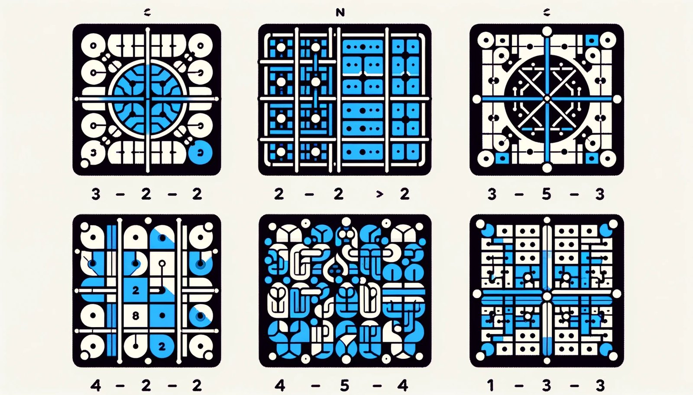
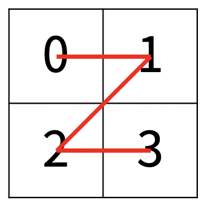
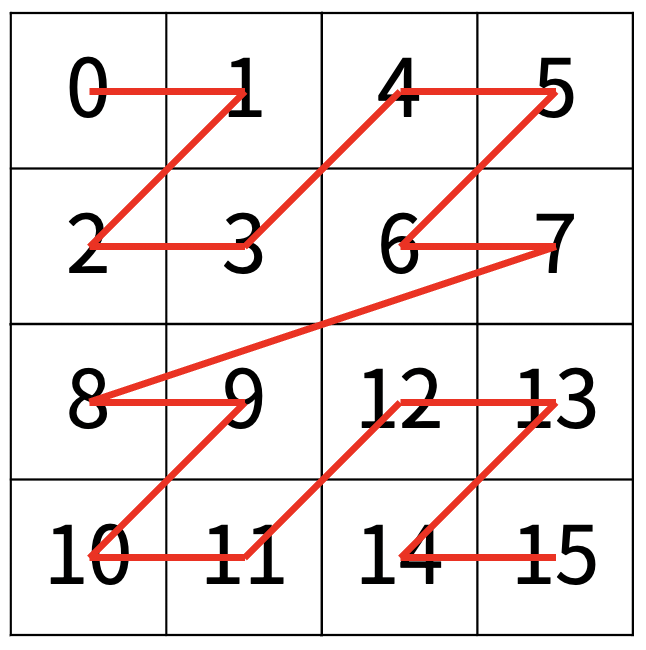
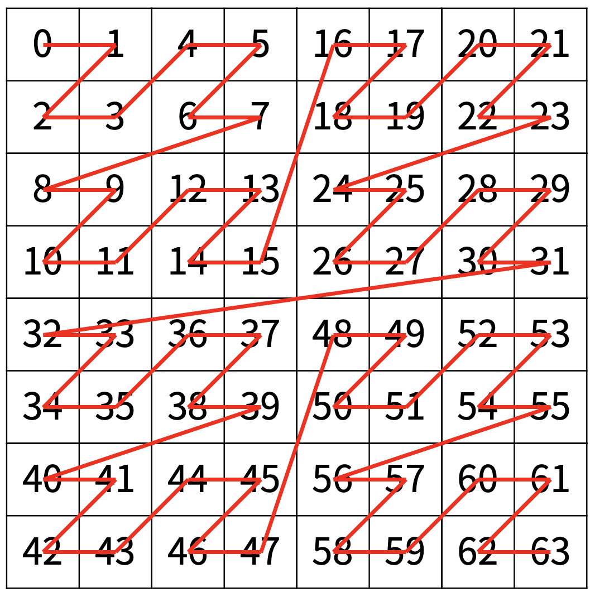
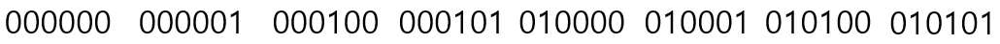
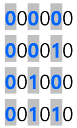
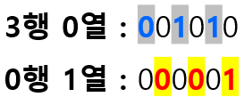

## Prob : [Z](https://www.acmicpc.net/problem/1074)
한수는 크기가 2N × 2N인 2차원 배열을 Z모양으로 탐색하려고 한다. 예를 들어, 2×2배열을 왼쪽 위칸, 오른쪽 위칸, 왼쪽 아래칸, 오른쪽 아래칸 순서대로 방문하면 Z모양이다.



N > 1인 경우, 배열을 크기가 2N-1 × 2N-1로 4등분 한 후에 재귀적으로 순서대로 방문한다.

다음 예는 22 × 22 크기의 배열을 방문한 순서이다.



N이 주어졌을 때, r행 c열을 몇 번째로 방문하는지 출력하는 프로그램을 작성하시오.

다음은 N=3일 때의 예이다.



## INPUT
첫째 줄에 정수 N, r, c가 주어진다.
* 1 ≤ N ≤ 15
* 0 ≤ r, c < 2N

## OUTPUT
r행 c열을 몇 번째로 방문했는지 출력한다.

## Sol
보통 이 문제는 분할정복으로 푸는 것이 일반적이지만 나는 숫자의 배열을 관찰했고, 맵이 $2^N$꼴의 형태이기에 2진법을 고안했다.
마지막 이미지 속 값들의 일부를 2진법으로 고치면 아래와 같다.

| ▼ r \ c ▶ | 0 = 000 | 1 = 001 | 2 = 010 | 3 = 011 | 4 = 100 | 5 = 101 | 6 = 110 | 7 = 111 |
| :-: | :-----------: | :-----------: | :-----------: | :-----------: | :-----------: | :-----------: | :-----------: | :-----------: |
| 0 = 000 | 0.0.0.0.0.0 | 0.0.0.0.0.1 | 0.0.0.1.0.0 | 0.0.0.1.0.1 | 0.1.0.0.0.0 | 0.1.0.0.0.1 | 0.1.0.1.0.0 | 0.1.0.1.0.1 |
| 1 = 001 | 0.0.0.0.1.0 | 0.0.0.0.1.1 | 0.0.0.1.1.0 | 0.0.0.1.1.1 | 0.1.0.0.1.0 | 0.1.0.0.1.1 | 0.1.0.1.1.0 | 0.1.0.1.1.1 |
| 2 = 010 | 0.0.1.0.0.0 | 0.0.1.0.0.1 | 0.0.1.1.0.0 | 0.0.1.1.0.1 | 0.1.1.0.0.0 | 0.1.1.0.0.1 | 0.1.1.1.0.0 | 0.1.1.1.0.1 |
| 3 = 011 | 0.0.1.0.1.0 | 0.0.1.0.1.1 | 0.0.1.1.1.0 | 0.0.1.1.1.1 | 0.1.1.0.1.0 | 0.1.1.0.1.1 | 0.1.1.1.1.0 | 0.1.1.1.1.1 |

음...생각보다 쉽지 않아서 0행의 값들과 0열의 값들을 관찰해봤다. 먼저 0행에 대해 살펴보겠다.



???

뭔가 점차적으로 숫자가 증가하는게 느껴진다. 어떻게 커지는지 다시 보자. 특히 홀수자리에 있는 수들을 집중해보자.


그렇다. 홀수자리를 관찰해보니 2진법으로 1씩 증가한다. 그렇다면 열도 비슷하지 않을까? 0열에 대해 살펴보자.



열에 대해서 짝수자리를 보니 2진법으로 1씩 증가한다는 사실을 알 수 있다. 그럼 예제1의 데이터인 3행 1열의 수는 어떻게 알 수 있을까? 그래서 3행 0열과 0행 1열의 수를 2진법 표현식을 봤다.



그렇다면, 이 두 수의 합은 아래와 같을 것이다.


놀랍게도 $001011_{(2)} = 11_{(10)}$이다. 이러한 방법을 이용하면 분할정복을 사용하지 않고, 단순한 비트연산자를 이용해 정답을 이끌어 낼 수 있다.

아래는 위 과정을 바탕으로 작성한 코드이다.

```c++
#include <iostream>
#include <stack>
using namespace std;
int main()
{
	ios_base::sync_with_stdio(false);
	cin.tie(NULL);
	int N, in, sum = 0;
	cin >> N;
	for (int i = 0; i < 2; i++)
	{
		int t = 0;
		stack<int> v;
		cin >> in;
		while(in>0)
		{
			v.push(in % 2);
			in /= 2;
		}
		while (!v.empty())
		{
			int tmp = v.top();
			t <<= 2;
			t += tmp;
			v.pop();
		}
		t <<= (1 - i);
		sum += t;
	}
	cout << sum;
	return 0;
}
```
