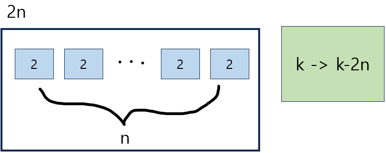

## Condition
time limit per test : 2 seconds  
memory limit per test : 256 megabytes  
input : standard input  
output : standard output  

## Prob : [A. Exam](https://codeforces.com/problemset/problem/194/A)
어느 날 Codeforces 라운드 작성자가 시험에 응시했습니다. 그는 n개의 시험이 있었고 각 시험마다 2에서 5 사이의 정수의 값을 점수로 얻어야 했습니다. 그는 실패한 각 시험, 즉 2점을 받은 시험에 다시 응시해야 합니다.

저자는 자신의 점수 합계가 k보다 확실하게 높아지도록 하기 위해 굉장히 많은 시간과 노력을 쏟아야 합니다. 그러다가 Codeforces 라운드를 망칠 수도 있었습니다. 반면에, 그의 점수의 합이 k보다 확실하게 작다면, 저자의 엄마는 전혀 기뻐하지 않을 것입니다.

Codeforces 작성자는 매우 똑똑하며 항상 자신이 선택한 등급을 받습니다. 또한 Codeforces 작성자는 재시험을 싫어합니다. 작성자를 도와서 모든 n개 시험의 점수 합이 정확히 k가 되는 방식으로 시험에 합격하기 위해 작성자가 재응시해야 하는 최소 시험 횟수를 알아보세요.

## INPUT
단일 입력 라인에는 공백으로 구분된 정수 $n$과 $k(1 ≤ n ≤ 50, 1 ≤ k ≤ 250)$가 포함됩니다. 이는 시험 횟수와 필요한 점수 합계입니다. 총점의 합이 정확히 $k$가 되는 방식으로 $n$번의 시험에 합격할 수 있는 방법이 존재한다는 것이 보장됩니다.

## OUTPUT
한 개의 정수를 출력하세요 — 모든 시험의 점수 합계가 k와 같아야 한다는 점을 고려하여 저자가 2점을 받을 최소 시험 수입니다.

## Sol
한 개의 시험은 최소점수 2점을 갖는다. 따라서 우리가 원하는 n개의 시험은 최소한 2n의 점수를 포함하게 된다.



이제 남은 것은 k-2n이 된다. k-2n을 p라 하고, 이것에 대해 생각해보자.
1. $p<0$  
   n개의 시험점수로 2점씩 주는게 부족하다는 뜻이다. 그런데 이 경우에 대해서는 입력 조건에서 이미 정답에 대한 존재성을 보장받았기 때문에 고려하지 않아도 되겠다.
2. $0 \leq p \leq n$  
   어느정도 남은 점수에서 메꿀만한 가능성이 있다는 뜻이다. 그런데 p가 n이하의 값이므로 2점을 받을 시험 수는 0 ~ n개일 것이다. 우리는 2점짜리 시험 수를 최소화시키고자 한다. 따라서 시험 하나씩 1점을 받는다고 생각하면 된다. 그러면 2점짜리 시험 수는 $n-k$개가 된다.
3. $n \leq p$  
   n개의 시험에 1점씩 더 넣어준다면 3점짜리가 n개로 받을 수 있다. 이때부터 2점짜리 시험수는 존재할 수 없으므로 0을 출력하면 된다.

아래는 위 설명을 구현한 코드이다.

## Code
```c
#define _CRT_SECURE_NO_WARNINGS
#include <stdio.h>
int main()
{
	int n, k;
	scanf("%d %d", &n, &k);
	k -= (n * 2);
	printf("%d", k >= n ? 0 : n - k);
	return 0;
}
```




## Condition {#en-condition}
time limit per test : 2 seconds  
memory limit per test : 256 megabytes  
input : standard input  
output : standard output  

## Prob : [A. Exams](https://codeforces.com/problemset/problem/194/A) {#en-prob-a-exams}
One day the Codeforces round author sat exams. He had n exams and he needed to get an integer from 2 to 5 for each exam. He will have to re-sit each failed exam, i.e. the exam that gets mark 2.

The author would need to spend too much time and effort to make the sum of his marks strictly more than k. That could have spoilt the Codeforces round. On the other hand, if the sum of his marks is strictly less than k, the author's mum won't be pleased at all.

The Codeforces authors are very smart and they always get the mark they choose themselves. Also, the Codeforces authors just hate re-sitting exams.

Help the author and find the minimum number of exams he will have to re-sit if he passes the exams in the way that makes the sum of marks for all n exams equal exactly k.

## INPUT {#en-input}
The single input line contains space-separated integers n and k (1 ≤ n ≤ 50, 1 ≤ k ≤ 250) — the number of exams and the required sum of marks.

It is guaranteed that there exists a way to pass n exams in the way that makes the sum of marks equal exactly k.

## OUTPUT {#en-output}
Print the single number — the minimum number of exams that the author will get a 2 for, considering that the sum of marks for all exams must equal k.

## Sol {#en-sol}
A exam has a minimum score of 2 points. Therefore, the n exams we want will contain at least 2n scores.


Now all that remains is k-2n. Let k-2n be p, and think about this.
1. $p<0$  
    This means that giving 2 points each for n exam scores is not enough. However, in this case, there is no need to consider it because the existence of the correct answer is already guaranteed in the input conditions.
2. $0 \leq p \leq n$  
    This means that there is a possibility to make up for some of the remaining points. However, since p is a value less than n, the number of exams that will receive a score of 2 will be 0 to n. We want to minimize the number of 2-point exams. Therefore, you can think of each exam as receiving 1 point. Then, the number of 2-point exams becomes $n-k$.
3. $n \leq p$  
    If you add 1 point to each of n exams, you can get n exams with a score of 3. From this point on, since there cannot be a exam number with 2 points, 0 can be output.

Below is the code that implements the above explanation.

## Code {#en-code}
```c
#define _CRT_SECURE_NO_WARNINGS
#include <stdio.h>
int main()
{
	int n, k;
	scanf("%d %d", &n, &k);
	k -= (n * 2);
	printf("%d", k >= n ? 0 : n - k);
	return 0;
}
```

