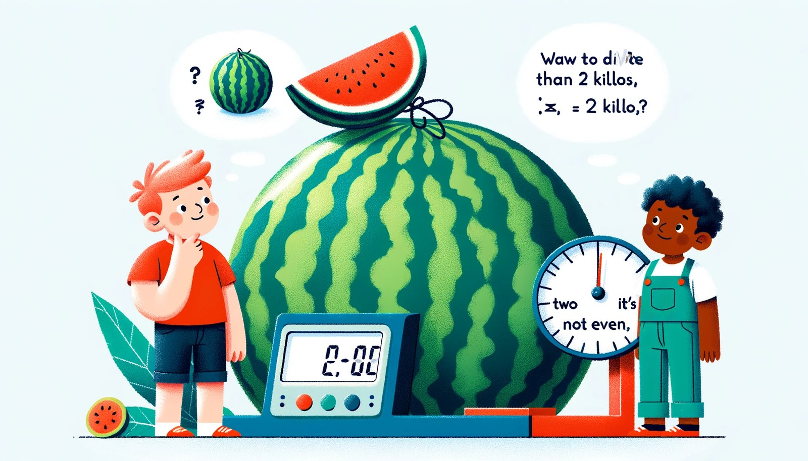

+++
title = "$1. [CODEFORCES] A. Watermelon"
date = "2024-01-04"
description = "수박 무게 w를 두 개의 양의 짝수 부분으로 나눌 수 있는지를 w가 2보다 큰 짝수인지로 판별하는 풀이"
tags = ["Codeforces", "브루트포스", "수학", "Rating800"]
thumbnail = "images/cover.jpg"
+++



## Condition
time limit per test : 1 second  
memory limit per test : 64 megabytes  
input : standard input  
output : standard output  

## Prob : [A. Watermelon](https://codeforces.com/contest/4/problem/A)
어느 더운 여름날, Pete와 그의 친구 Billy는 수박을 사기로 결정했습니다. 그들은 자신들의 의견으로 가장 크고 가장 잘 익은 것을 선택했습니다. 그 후 수박의 무게를 쟀더니 저울에 킬로그램이 표시되었습니다. 그들은 목이 말라 죽을듯해 집으로 달려가 열매를 나누기로 결정했지만 어려운 문제에 직면했습니다.

Pete와 Billy는 짝수를 좋아하는 팬입니다. 그래서 그들은 두 부분의 무게가 짝수 킬로가 되도록 수박을 나누는데, 그 두 덩이리의 무게가 동일할 필요는 없습니다. 남자아이들은 매우 피곤해서 가능한 한 빨리 식사를 시작하고 싶어합니다. 따라서 그들이 원하는 방식으로 수박을 나눌 수 있는지 알아보고 도와주어야 합니다. 확실히, 그들 각각은 양수 값을 받아야 합니다.

## INPUT
첫 번째(그리고 유일한) 입력 라인에는 정수 w(1 ≤ w ≤ 100)가 포함됩니다. 이는 소년들이 구입한 수박의 무게입니다.

## OUTPUT
만약 소년들이 두 개의 짝수 킬로그램을 가지는 부분으로 나눌 수 있다면 YES라고 출력하세요; 반대의 경우라면 NO입니다.

## Sol
이 문제는 어렵게 생각할 필요가 없다. 소년들은 반드시 짝수의 값을 가지는 무게를 가질 것이다. 그럼 짝수인 두 수의 합에 대해 생각해 보자. 짝수와 짝수의 합은 반드시 짝수일 수밖에 없다. 정말 그럴까?

$$Pete : P = 2x \quad x \in \mathbb{N}$$

$$Billy : B = 2y \quad y \in \mathbb{N}$$

그럼 P+B는 수박의 무게로 가능한 값이다.

$$P+B=2x+2y=2(x+y)=2k \quad k \in \mathbb{N}, \; 2k \geq 4$$

따라서 수박의 무게는 반드시 짝수이다. 단, 여기서 주의해야 할 점은 2k의 범위이다. 2k는 4이상의 값이므로 짝수인 2를 배제해야 한다. 이를 주의하며 작성한 코드는 아래와 같다.

## Code
```c
#define _CRT_SECURE_NO_WARNINGS
#include <stdio.h>
int main()
{
	int a;
	scanf("%d", &a);
	printf("%s", (a % 2 == 0 && a > 2) ? "YES" : "NO");
	return 0;
}
```




## Condition {#en-condition}
time limit per test : 1 second  
memory limit per test : 64 megabytes  
input : standard input  
output : standard output  

## Prob : [A. Watermelon](https://codeforces.com/contest/4/problem/A) {#en-prob-a-watermelon}
One hot summer day Pete and his friend Billy decided to buy a watermelon. They chose the biggest and the ripest one, in their opinion. After that the watermelon was weighed, and the scales showed w kilos. They rushed home, dying of thirst, and decided to divide the berry, however they faced a hard problem.

Pete and Billy are great fans of even numbers, that's why they want to divide the watermelon in such a way that each of the two parts weighs even number of kilos, at the same time it is not obligatory that the parts are equal. The boys are extremely tired and want to start their meal as soon as possible, that's why you should help them and find out, if they can divide the watermelon in the way they want. For sure, each of them should get a part of positive weight.

## INPUT {#en-input}
The first (and the only) input line contains integer number w (1 ≤ w ≤ 100) — the weight of the watermelon bought by the boys.

## OUTPUT {#en-output}
Print YES, if the boys can divide the watermelon into two parts, each of them weighing even number of kilos; and NO in the opposite case.

## Sol {#en-sol}
There is no need to think hard about this problem. Boys will always have weights with even values. Now, let’s think about the sum of two even numbers. The sum of two even numbers must be even. Is that really true?

$$Pete : P = 2x \quad x \in \mathbb{N}$$

$$Billy : B = 2y \quad y \in \mathbb{N}$$

Then P+B is a possible value for the weight of the watermelon.

$$P+B=2x+2y=2(x+y)=2k \quad k \in \mathbb{N}, \; 2k \geq 4$$

Therefore, the weight of the watermelon must be an even number. However, the point to note here is the 2k range. 2k is a value greater than 4, so the even number 2 must be excluded. The code written with this in mind is as follows.

## Code {#en-code}
```c
#define _CRT_SECURE_NO_WARNINGS
#include <stdio.h>
int main()
{
	int a;
	scanf("%d", &a);
	printf("%s", (a % 2 == 0 && a > 2) ? "YES" : "NO");
	return 0;
}
```

