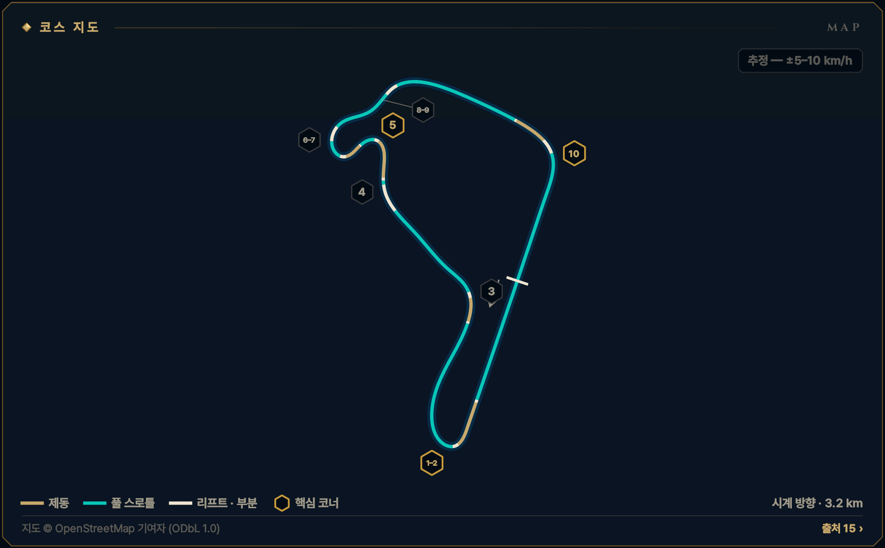
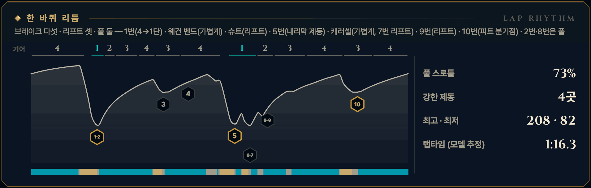

> **GRID서당 : iRacing**은 심레이싱이 처음인 동아리 신입을 위해 만든 드라이빙 아카데미 프로그램입니다. 이 글은 그 안의 **서킷 공략** 모드 — 이번 시즌 리그가 도는 서킷을 코스 개관과 코너별 애니메이션으로 미리 익히는 화면 — 를 블로그로 옮긴 것으로, 글과 애니메이션 모두 프로그램에서 그대로 가져왔습니다. 차는 iRacing의 Ray FF1600이고, 기준은 진도가 없는 루키(입문 렌즈)입니다. 강의는 [GRID서당 시리즈](/posts/untitled_life/motorsport/sim-racing/grid-seodang/)에, 낯선 말은 [용어 사전](/posts/untitled_life/motorsport/sim-racing/grid-seodang/glossary/)에 모아 두었습니다.

## 이번 시즌 일정

> **2026 시즌 4 · 포뮬러 1600 루키 시리즈 · 1주차** — 9.15(화)–9.21(월)
>
> - 루키 FF1600 · 기본 포함 · 12분 레이스 · 스탠딩 스타트 (차: Ray FF1600)
> - iRacing 트랙 이름: Summit Point Raceway - Summit Point Raceway
> - 주차는 매주 화요일 09:00(한국 시간)에 바뀝니다.
>
> iRacing 일정은 시즌마다 바뀝니다. 이 글의 주차는 2026 시즌 4 기준이고, 같은 서킷이 다른 시즌에 돌아오면 그 시즌 일정에서 주차와 레이아웃을 다시 확인하세요.

## 코스 개관

약 3.2 km, 시계 방향, 코너 열 개의 좁은 서킷입니다. 880 m 메인 직선 끝의 1번, 오르막 왼쪽 웨건 벤드(3번), 내리막의 가장 빠른 슈트(4번), 언덕 바닥의 5번, 거의 한 바퀴를 도는 캐러셀(6·7번), 에세스(8·9번), 메인 직선으로 나가는 10번이 한 바퀴입니다. 고저차는 약 11 m뿐이지만 하필 코너 위에 놓여 있고, 런오프는 대부분 잔디입니다.

- **시계 방향 · 메인 서킷 · 3.2 km · 10코너**
- **코너 번호** — 공식 10코너 번호를 씁니다 — 2번은 1번의 연속, 캐러셀은 6·7번입니다. 옛 SCCA 자료는 6a·6b처럼 다르게 셉니다.
- **루키 포인트** — 1번은 참고, 10번은 일찍, 9번은 깔끔하게 — 돈이 되는 출구는 1번·캐러셀·10번입니다
- **속도 표기: 추정 — ±5–10 km/h** — 이 서킷에는 기준이 되는 실주행 텔레메트리가 없습니다. 공개된 FF1600 트랙 가이드 등에서 맞춘 코너 최저 속도에 보정한 FF1600 물리 모델을 맞춰 계산했기 때문에, 글과 영상의 속도·페달·기어는 모두 **추정값**(±5–10 km/h)입니다. Test Drive에서 직접 확인하세요.

*지도 © OpenStreetMap 기여자 (ODbL 1.0) · 선 색: 골드 = 제동, 시안 = 풀 스로틀, 흰색 = 리프트 · 부분 · 금테 육각형 = 핵심 코너 · 번호 = 이 글의 코너 공략 단위*

## 한 바퀴 리듬

브레이크 다섯 · 리프트 셋 · 풀 둘 — 1번(4→1단) · 웨건 벤드(가볍게) · 슈트(리프트) · 5번(내리막 제동) · 캐러셀(가볍게, 7번 리프트) · 9번(리프트) · 10번(피트 분기점) · 2번·8번은 풀

*풀 스로틀 73% · 강한 제동 4곳 · 최고 · 최저 208 · 82 km/h · 랩타임 (모델 추정) 1:16.3 — 위 그림의 기어 줄·속도 곡선·입력 띠(골드 = 제동, 시안 = 풀 스로틀)와 코너 번호는 이 기준 랩입니다.*

## 먼저 볼 코너

1. **[T1–2 1번 코너](#w01-u1)** — 1랩 첫 제동 · 랩에서 가장 큰 제동 · 출구가 3번까지 460 m
2. **[T10 10번 코너](#w01-u7)** — 출구가 곧 메인 직선 — '일찍, 부드럽게'의 코너
3. **[T5 5번 헤어핀](#w01-u4)** — 내리막 큰 제동 · 깊은 트레일(5급) 연습 자리

> **루키 포인트** — 1번은 참고, 10번은 일찍, 9번은 깔끔하게 — 돈이 되는 출구는 1번·캐러셀·10번입니다

## 루키 안전 노트

- **스탠딩 스타트** — 1번은 출발 직후 랩에서 가장 붐비는 곳입니다. 평소보다 느리게 도착하니 평소 보드는 넉넉한 여유 — 늦추지 말고, 바깥 차선을 남깁니다.
- **3번 너머 꼭대기** — 3번 출구 언덕 너머는 보이지 않습니다. 1랩에 멈춘 차가 있을 수 있으니 노란 깃발을 먼저 찾습니다. 바깥은 자갈밭입니다.
- **4\~9번은 한 줄로** — 슈트부터 에세스까지는 좁고 빨라 사고가 비쌉니다. 5번 안쪽 찌르기, 6번 다이브는 하지 않습니다.
- **피트 합류·진입** — 피트 출구는 1번 제동 구간 오른쪽으로 합류하고, 피트 입구는 10번 제동점에서 오른쪽으로 갈라집니다. 오른쪽의 느린 차를 조심합니다.
- **스핀 대처** — 브레이크를 꽉 밟아 세우고(시동은 안티스톨이 지킵니다), 차들이 지나간 뒤 1단(왼쪽 패들)으로 트랙과 나란히 복귀합니다. 3번 출구(뒤쪽이 보이지 않는 언덕), 4·5번, 9번에서는 특히 Relative(F3)로 확인하고 나갑니다. 17x면 실격입니다. 사고 누적 드라이브스루는 없지만(출발 위반 등은 있음) 깨끗한 12분이 가장 빠른 길입니다.
- **트랙 리밋** — 차의 절반 이상이 노면 경계 밖이면 1x — 일부 트랙의 표시 구간만 네 바퀴 기준. 루키 규칙: 두 바퀴는 늘 선·연석 안쪽. 10번 출구의 여유 포장·에이프런이 트랙으로 인정되는지는 Test Drive에서 확인 전입니다.

**1랩 · 스탠딩 스타트** — 1랩: 평소 제동 지점보다 늦게 밟지 않습니다. 앞차에 맞춰 더 일찍, 부드럽게 밟고, 차 한 대 폭을 남깁니다. 바깥이나 가운데를 지키고 안쪽 다툼에 끼지 않습니다.

## 영상 보는 법

코너마다 앱의 코너 공략 화면을 그대로 녹화했습니다. ▶를 눌러 재생하세요 — 앱의 **가이드** 재생(실제 속도의 0.4배, 화면에서 차가 너무 빠른 코너는 0.25배)이라 단계(접근·제동·턴인·에이펙스·탈출)마다 잠깐 멈추고, 멈춤 링이 차면 다음 단계로 넘어갑니다. 블로그 영상은 단계 시작의 멈춤만 짧게 줄였고 (캡션을 읽을 시간은 그대로), 끝에 앱의 끝 카드가 나옵니다. **급수별 브레이크 시연**을 펼치면 같은 코너를 7급·6급·5급 렌즈로, **흔한 실수 고스트**를 펼치면 실수한 차(빨간 점선)와 나란히 달린 영상을 볼 수 있습니다.

- **제동** — 골드 — 두께·밝기 = 브레이크 압력
- **가속** — 시안 — 스로틀
- **관성** — 흰색 — 두 페달 모두 뗀 구간
- **흔한 실수** — 빨간 점선 고스트 — 한 번에 하나만
- **▼ 제동 시작** — 루키 기준선의 제동 시작점
- **◆ 턴인** — 핸들을 감기 시작하는 곳
- **○ 에이펙스** — 가장 안쪽·가장 느린 곳
- **◇ 트랙아웃** — 탈출에서 닿는 바깥 끝
- **보드 (?)** — 확인 전 참고값 — Test Drive에서 기준점을 정하세요
- **입력 지도** — 골드 띠 = 브레이크, 흰 리본(안쪽) = 핸들. 겹치면 트레일
- **손 칸 · 내림 ×N · 올림** — 왼쪽 패들 N번 내림(블립은 오토 블립이) · 오른쪽 패들 한 번 올림

화면과 글의 속도는 모두 **추정값**(±5–10 km/h)입니다 — 기준 텔레메트리가 없는 서킷이라 모델로 계산했습니다.

## 코너 공략

### T1–2 1번 코너

**우코너 · 1단 · 최저 약 78 km/h · 핵심 코너**  
1랩 첫 제동 · 랩에서 가장 큰 제동 · 4→3→2→1단

<figure>
  <video src="images/u1.mp4" poster="images/u1_poster.png" controls preload="none" playsinline style="width:100%;max-width:960px"></video>
  <figcaption>시범 — 루키 기준선 · 입문 렌즈(직선 제동) · 가이드 0.4× · 접근 → 제동 → 턴인 → 에이펙스 → 전환 → 에이펙스 ② → 탈출</figcaption>
</figure>

급수별 브레이크 시연 — 7급 · 6급 · 5급 렌즈 (영상 3)

라인과 기준점은 그대로, 페달 쓰는 법만 지금 급수에 맞춥니다. 위 영상은 **직선 제동 — 기초·심화·9·8급** 렌즈입니다 — 턴인 전에 브레이크를 다 뗍니다 (브레이크 끝 = 턴인).

**릴리스 — 7급** — 턴인을 향해 0.4초 넘게 흘려서 0으로 · 7급 기준: 릴리스 0.4초 이상

<figure>
  <video src="images/u1_release.mp4" poster="images/u1_release_poster.png" controls preload="none" playsinline style="width:100%;max-width:960px"></video>
  <figcaption>7급 렌즈(릴리스) · 가이드 0.4× · 접근 → 제동 → 턴인 → 에이펙스 → 전환 → 에이펙스 ② → 탈출</figcaption>
</figure>

- 제동 — **턴인을 향해 흘려 놓는다** · 피크 약 80% · 1.2초에 걸쳐 놓기 · 발 · 하나-둘-셋 놓기
- 턴인 — **샛길에서 0에 닿는다** · 턴인에서 약 0\~3% → 곧 0 · 발 · 3% → 0

**트레일 — 6급·4\~1급·졸업** — 턴인 때 15\~20%를 남기고, 감는 만큼 풉니다 · 6급 기준: 턴인 때 15% 이상 남기기

<figure>
  <video src="images/u1_trail.mp4" poster="images/u1_trail_poster.png" controls preload="none" playsinline style="width:100%;max-width:960px"></video>
  <figcaption>6급 렌즈(트레일) · 가이드 0.4× · 접근 → 제동 → 턴인 → 에이펙스 → 전환 → 에이펙스 ② → 탈출</figcaption>
</figure>

- 제동 — **턴인까지 끌고 간다** · 피크 약 76% · 턴인 때 약 18% · 발 · 놓으며 남기기
- 턴인 — **푸는 만큼 감는다** · 약 18% → 에이펙스 전 0 · 발 · 18% → 0 / 손 · 놓는 만큼 감기

**깊은 트레일 — 5급** — 턴인 때 30% 이상, 에이펙스 앞까지 끌고 갑니다 · 5급 기준: 턴인 때 30% 이상 남기기

<figure>
  <video src="images/u1_deep.mp4" poster="images/u1_deep_poster.png" controls preload="none" playsinline style="width:100%;max-width:960px"></video>
  <figcaption>5급 렌즈(깊은 트레일) · 가이드 0.4× · 접근 → 제동 → 턴인 → 에이펙스 → 전환 → 에이펙스 ② → 탈출</figcaption>
</figure>

- 제동 — **더 깊게, 턴인 32%** · 피크 약 70% · 턴인 때 약 32% · 발 · 천천히 남기기
- 턴인 — **앞을 누른 채 감는다** · 약 32% → 에이펙스 앞에서 0 · 발 · 32% → 0

4\~1급은 같은 영상의 캡션에 강조 한 줄(◆)이 더 붙습니다:

- ◆ 4급(턴인·에이펙스) — 브레이크 끝 = 스로틀 시작 — 에이펙스 전에 굴러가면 너무 줄인 것

흔한 실수 고스트 — 이른 턴인 → 출구에서 밀림

<figure>
  <video src="images/u1_ghost.mp4" poster="images/u1_ghost_poster.png" controls preload="none" playsinline style="width:100%;max-width:960px"></video>
  <figcaption>흔한 실수: 이른 턴인 → 출구에서 밀림 — 일찍 꺾으면 출구에서 바깥으로 밀린다 → 약 0.2초 늦음</figcaption>
</figure>

흔한 실수: **이른 턴인 → 출구에서 밀림** — 일찍 꺾으면 출구에서 바깥으로 밀린다 → 약 0.2초 늦음. 빨간 점선과 붉은 차가 실수 고스트, 흰 차가 루키 기준선입니다. 두 차는 같은 시계로 달리므로 늦어지거나 밀려나는 만큼이 그대로 보입니다. 영상은 앱에서 [흔한 실수]를 눌렀을 때처럼 그 실수가 시작되는 단계부터 재생합니다. 끝 카드의 '트레일 렌즈 기준'은 결과의 시간 차를 트레일(6급) 렌즈 주행과 비교한 값이라는 뜻입니다.

> **1랩 · 스탠딩 스타트** — 1랩: 평소 제동 지점보다 늦게 밟지 않습니다. 앞차에 맞춰 더 일찍, 부드럽게 밟고, 차 한 대 폭을 남깁니다. 바깥이나 가운데를 지키고 안쪽 다툼에 끼지 않습니다. 출발 직후라 평소보다 느리게 도착하므로 평소 보드는 넉넉한 여유가 됩니다.

#### 접근

880 m 메인 직선 끝, 4단 이 랩의 최고 속도에서 맞는 오른쪽입니다. 트랙 왼쪽 가장자리에서 한 뼘 안쪽을 달립니다 — 오른쪽은 피트 출구에서 합류하는 차의 자리입니다. 제동 보드는 왼쪽에 있고, 숫자는 Test Drive에서 확인합니다.

*지금 손과 발 — 발 · 풀스로틀 / 손 · 곧게 / 눈 · 왼쪽 보드*

**보드 · 기준점** — 모두 확인 전 참고값입니다. Test Drive에서 직접 보고 정하세요.

- **제동 · 기준점**? 왼쪽 제동 보드 — 숫자 미확인. 애니메이션은 턴인 약 135 m 전에서 밟음 *(확인 전 참고값)*
- **턴인**? 왼쪽 포장 샛길(진입로) 위 *(확인 전 참고값)*
- **에이펙스**? 안쪽 연석의 마지막 3분의 1(바퀴 반 개까지) *(확인 전 참고값)*

#### 제동

처음엔 빠른 랩보다 보드 하나(약 25\~30 m) 앞에서, 곧게 한 음절 '꾹' 약 80% — ABS가 없어 쿵 밟으면 잠기고 잔디로 갑니다. 가운데 토막에서 4→3→2단, 속도계가 100 km/h 아래로 내려온 뒤에야 1단입니다. 턴인 전에 1단이 안 끝나면 처음엔 2단으로 돌아도 됩니다.

*지금 손과 발 — 발 · 꾹 / 손 · 곧게 · 내림 ×3 / 눈 · 왼쪽 샛길*

#### 턴인

왼쪽의 포장된 샛길(진입로) 위에서, 생각보다 늦게 감기 시작합니다. 이 렌즈에서는 브레이크가 막 0입니다 — 한 번에 감고, 감은 뒤엔 더하지 않습니다.

*지금 손과 발 — 발 · 0 → 유지 스로틀 / 손 · 한 번 감기 / 눈 · 연석 뒤쪽*

#### 에이펙스

에이펙스는 안쪽 연석의 마지막 3분의 1입니다. 연석은 바퀴 반 개까지만 씁니다. 최저 약 78 km/h, 1단 — 빠른 랩은 약 83 km/h입니다.

*지금 손과 발 — 발 · 유지 → 열기 / 손 · 그대로 / 눈 · 2번 쪽*

#### 전환

에이펙스에서 스로틀을 열기 시작해, 핸들을 푸는 만큼 1.5\~2초에 걸쳐 100%로 갑니다. 1단에서 핸들을 많이 감은 채 깊게 밟으면 안쪽 바퀴가 헛돌고 앞이 밀립니다.

*지금 손과 발 — 발 · 앞으로만 / 손 · 풀기 / 눈 · 2번 바깥*

#### 에이펙스 ②

2번은 1번의 연속이고 풀스로틀입니다. 차가 왼쪽 샛길 쪽으로 흘러 나가게 둡니다 — 거기가 1번의 출구이자 2번의 시작입니다.

*지금 손과 발 — 발 · 풀스로틀 / 손 · 작게 유지 / 눈 · 왼쪽 샛길*

#### 탈출

2단, 3단으로 올리고, 3번을 위해 트랙 오른쪽으로 옮깁니다. 1번의 출구 속도는 3번 제동까지 약 460 m 동안 이자처럼 붙습니다 — 진입을 팔아 출구를 삽니다.

*지금 손과 발 — 발 · 풀스로틀 / 손 · 풀기 / 눈 · 3번 오른쪽*

#### 흔한 실수

- 일찍 꺾어 이른 에이펙스 — 출구에서 길이 모자라 발을 뗀다  
  → 늘 '더 늦게' — 왼쪽 샛길 위에서 감기
- 최고 속도에서 쿵 밟아 바퀴가 잠기고 직진  
  → 0.2초에 걸쳐 꾹, 85\~90%까지만
- 턴인에서 브레이크를 툭 놓아 앞이 가볍게 밀리기  
  → 놓는 속도는 밟는 속도의 절반 — 하나-둘-셋

#### 이 코너에서 확인할 것

- [ ] 1번 앞 왼쪽 보드의 숫자와 위치
- [ ] 턴인 기준인 왼쪽 샛길이 인게임에 있는지

#### 연결된 강의 · 드릴

- 강의: [기초 4강(레이싱 라인의 문법)](/posts/untitled_life/motorsport/sim-racing/grid-seodang/basics/f4-racing-line/) · [심화 1강(출발의 기술)](/posts/untitled_life/motorsport/sim-racing/grid-seodang/advanced/d1-the-start/) · [심화 2강(코너의 다섯 얼굴)](/posts/untitled_life/motorsport/sim-racing/grid-seodang/advanced/d2-five-corner-faces/) · [심화 3강(상황의 라인)](/posts/untitled_life/motorsport/sim-racing/grid-seodang/advanced/d3-situational-lines/) · [심화 6강(교본 차 해부)](/posts/untitled_life/motorsport/sim-racing/grid-seodang/advanced/d8-training-car-and-shifting/) · [8급(제동의 기본)](/posts/untitled_life/motorsport/sim-racing/grid-seodang/grades/g8-braking-basics/) · [7급(릴리스 수양)](/posts/untitled_life/motorsport/sim-racing/grid-seodang/grades/g7-release/) · [6급(트레일 입문)](/posts/untitled_life/motorsport/sim-racing/grid-seodang/grades/g6-trail-intro/) · [4급(전환 수련)](/posts/untitled_life/motorsport/sim-racing/grid-seodang/grades/g4-transition/) · [3급(스로틀 서예)](/posts/untitled_life/motorsport/sim-racing/grid-seodang/grades/g3-throttle-calligraphy/)
- 훈련장 드릴: 정밀 압력 · 제동 수양 · 트레일 브레이킹 · 전환

<small>근거: S1 · S4 · S8 · S10 · S12 · S17 · S21 · S23 · REC (아래 출처 목록) · 신뢰도 M</small>

### T3 웨건 벤드

**좌코너 · 3단 · 최저 약 144 km/h**  
오르막 왼쪽 · 짧고 가벼운 제동 · 보이지 않는 꼭대기

<figure>
  <video src="images/u2.mp4" poster="images/u2_poster.png" controls preload="none" playsinline style="width:100%;max-width:960px"></video>
  <figcaption>시범 — 루키 기준선 · 입문 렌즈(직선 제동) · 가이드 0.4× · 접근 → 제동 → 턴인 → 에이펙스 → 탈출</figcaption>
</figure>

급수별 브레이크 시연 — 모든 급수가 같은 그림

이 코너는 앱이 모든 급수에 **직선 제동 — 기초·심화·9·8급** 렌즈 하나만 보여 줍니다 — 턴인 전에 브레이크를 다 뗍니다 (브레이크 끝 = 턴인). 급수별 영상이 따로 없습니다.

흔한 실수 고스트 — 이른 턴인 → 출구에서 밀림

<figure>
  <video src="images/u2_ghost.mp4" poster="images/u2_ghost_poster.png" controls preload="none" playsinline style="width:100%;max-width:960px"></video>
  <figcaption>흔한 실수: 이른 턴인 → 출구에서 밀림 — 일찍 꺾으면 출구에서 바깥으로 밀린다 → 약 0.2초 늦음 · 트랙 밖</figcaption>
</figure>

흔한 실수: **이른 턴인 → 출구에서 밀림** — 일찍 꺾으면 출구에서 바깥으로 밀린다 → 약 0.2초 늦음 · 트랙 밖. 빨간 점선과 붉은 차가 실수 고스트, 흰 차가 루키 기준선입니다. 두 차는 같은 시계로 달리므로 늦어지거나 밀려나는 만큼이 그대로 보입니다. 영상은 앱에서 [흔한 실수]를 눌렀을 때처럼 그 실수가 시작되는 단계부터 재생합니다. 끝 카드의 '트레일 렌즈 기준'은 결과의 시간 차를 트레일(6급) 렌즈 주행과 비교한 값이라는 뜻입니다.

#### 접근

2번을 빠져나오면 트랙 오른쪽 절반에서 4단 약 177 km/h까지 올립니다. 오른쪽으로 갈라지는 샛길(진입로)들이 기준점이고, 두 번째 샛길이 턴인입니다.

*지금 손과 발 — 발 · 풀스로틀 / 손 · 곧게 / 눈 · 오른쪽 샛길*

**보드 · 기준점** — 모두 확인 전 참고값입니다. Test Drive에서 직접 보고 정하세요.

- **제동 · 기준점**? 오른쪽 샛길들 — 두 번째 샛길 약 85 m 앞(Test Drive에서 확인) *(확인 전 참고값)*
- **턴인**? 오른쪽 두 번째 샛길 *(확인 전 참고값)*
- **에이펙스**? 안쪽 연석의 끝부분(깊이 타지 않기) *(확인 전 참고값)*

#### 제동

길이 이미 왼쪽으로 휘기 시작한 곳이라, 핸들을 살짝 감은 채 짧고 가볍게(약 50%) 누르고 그동안 3단으로 내립니다. 오르막이라 차가 생각보다 잘 서니 흔한 실수는 너무 많이 밟는 것입니다. 이 코너는 급수와 관계없이 턴인 전에 브레이크를 다 뗍니다.

*지금 손과 발 — 발 · 짧게 누르기 / 손 · 살짝 감은 채 · 내림 ×1 / 눈 · 두 번째 샛길*

#### 턴인

밟는 동안 차는 휘는 길을 따라 안쪽으로 다가갑니다. 두 번째 샛길에서 브레이크가 다 떨어지면 핸들을 조금 더 감아 안쪽 연석 끝으로 붙습니다 — 코너가 일찍 꺾이는 것처럼 보여도 한꺼번에 크게 감지 않습니다. 브레이크 끝이 곧 스로틀 시작입니다.

*지금 손과 발 — 발 · 0 → 스로틀 / 손 · 조금 더 감기 / 눈 · 연석 끝*

#### 에이펙스

에이펙스는 안쪽 연석의 끝부분입니다. 꼭대기에 가까워 차가 가벼워지니 연석에 깊이 올라타지 않고, 밀리면 핸들 대신 스로틀을 10\~15% 덜어 줍니다. 최저 약 144 km/h, 빠른 랩은 약 151 km/h입니다.

*지금 손과 발 — 발 · 열기 / 손 · 그대로 / 눈 · 출구 연석*

#### 탈출

에이펙스를 지나면 풀스로틀입니다. 코너 후반에 노면이 평평해지며 바깥으로 기울고, 곧 꼭대기를 넘습니다 — 꼭대기에서는 절대 발을 떼지 않습니다. 출구 연석을 쓰고, 언덕을 넘으며 4번을 위해 왼쪽으로 건너갑니다.

*지금 손과 발 — 발 · 풀스로틀 / 손 · 풀기 / 눈 · 꼭대기 너머*

#### 흔한 실수

- 일찍 꺾어 이른 에이펙스 — 출구에서 바깥 자갈로  
  → 두 번째 샛길까지 기다리고 연석 끝을 에이펙스로
- 오르막에서 너무 세게 밟고 늦게 꺾기  
  → 더 짧게, 더 가볍게 — 오르막이 세워 준다
- 꼭대기에서 리프트해 뒤가 미끄러지기  
  → 꼭대기는 스로틀 유지, 핸들은 곧게

#### 이 코너에서 확인할 것

- [ ] 오른쪽 샛길(진입로)들이 2026 S4 그래픽에서도 보이는지

#### 연결된 강의 · 드릴

- 강의: [심화 9강(기울어진 트랙)](/posts/untitled_life/motorsport/sim-racing/grid-seodang/advanced/d7-banked-track/) · [심화 2강(코너의 다섯 얼굴)](/posts/untitled_life/motorsport/sim-racing/grid-seodang/advanced/d2-five-corner-faces/) · [심화 8강(페달의 문법)](/posts/untitled_life/motorsport/sim-racing/grid-seodang/advanced/d6-pedal-grammar/) · [4급(전환 수련)](/posts/untitled_life/motorsport/sim-racing/grid-seodang/grades/g4-transition/) · [2급(스티어링 일필휘지)](/posts/untitled_life/motorsport/sim-racing/grid-seodang/grades/g2-one-stroke-steering/) · [3급(스로틀 서예)](/posts/untitled_life/motorsport/sim-racing/grid-seodang/grades/g3-throttle-calligraphy/) · [기초 5강(서킷의 예절)](/posts/untitled_life/motorsport/sim-racing/grid-seodang/basics/f5-flags-etiquette/)
- 훈련장 드릴: 전환 · 정밀 압력 · 조향 일필

<small>근거: S4 · S5 · S8 · S10 · S12 · S17 · S22 · REC (아래 출처 목록) · 신뢰도 M</small>

### T4 슈트

**우코너 · 4단 · 최저 약 167 km/h**  
가장 빠른 코너 · 내리막 · 리프트만

<figure>
  <video src="images/u3.mp4" poster="images/u3_poster.png" controls preload="none" playsinline style="width:100%;max-width:960px"></video>
  <figcaption>시범 — 루키 기준선 · 렌즈 공통 · 가이드 0.4× · 접근 → 리프트 → 턴인 → 에이펙스 → 탈출</figcaption>
</figure>

급수별 브레이크 시연 — 모든 급수가 같은 그림

이 코너는 렌즈가 같습니다 — 리프트·풀스로틀 코너는 브레이크를 쓰지 않아 모든 급수가 같은 페달 그림을 봅니다.

#### 접근

3번 뒤 꼭대기를 넘으면 길이 크게 내려갑니다. 트랙 왼쪽에 서서 4단 약 184 km/h — 뚜렷한 표식이 없으니 바깥 가장자리가 오른쪽으로 휘기 시작하는 곳을 기준으로 삼습니다.

*지금 손과 발 — 발 · 풀스로틀 / 손 · 곧게 / 눈 · 바깥 가장자리*

**보드 · 기준점** — 모두 확인 전 참고값입니다. Test Drive에서 직접 보고 정하세요.

- **리프트 시작**? 바깥 가장자리가 오른쪽으로 휘기 시작하는 곳, 트랙 왼쪽 *(확인 전 참고값)*
- **에이펙스**? 연석 가운데\~3분의 2 지점, 높은 연석은 밟지 않기 *(확인 전 참고값)*

#### 리프트

턴인 전 직선에서 스로틀을 부드럽게 다 덜어냅니다 — 루키는 여기서 브레이크를 쓰지 않습니다. 리프트는 반드시 핸들을 꺾기 전에 끝내고, 감은 동안은 발을 그대로 둡니다.

*지금 손과 발 — 발 · 부드럽게 떼기 / 손 · 곧게 / 눈 · 에이펙스 쪽*

**급수 시험 주행에서는 리프트만 — 10%를 넘는 톡도 제동 코너로 채점됩니다.**

#### 턴인

왼쪽 끝에서, 늦은 에이펙스를 향해 매끄럽게 한 번에 감습니다. 이 속도에서는 손이 작게, 천천히 움직여야 합니다.

*지금 손과 발 — 발 · 그대로 / 손 · 한 번 감기 / 눈 · 연석 가운데*

#### 에이펙스

에이펙스는 연석의 가운데에서 3분의 2 지점입니다. 연석 자체는 높아서 밟으면 차가 튑니다 — 타이어 한 폭을 남기고 지나갑니다. 최저 약 166 km/h, 빠른 랩은 약 176 km/h입니다.

*지금 손과 발 — 발 · 그대로 / 손 · 유지 / 눈 · 왼쪽·가운데*

#### 탈출

라인은 4번 에이펙스의 오른쪽에 그대로 머물고, 차가 곧게 서면 곧바로 5번 제동입니다. 4번 출구에서 가운데로 밀렸다면 억지로 오른쪽으로 옮기지 않습니다 — 4번의 속도를 잃고 옆 차의 길을 가로지릅니다. 그 자리에서 곧게 제동합니다.

*지금 손과 발 — 발 · 곧 제동 / 손 · 풀기 / 눈 · 5번 제동점*

#### 흔한 실수

- 늦게 떼기 — 감은 채 코너 한가운데서 떼어 내리막 범프에서 뒤가 가벼워진다  
  → 리프트는 꺾기 전, 곧을 때 끝내기
- 리프트로 충분한 곳에서 브레이크로 15\~20 km/h 버리기  
  → 리프트만 — 랩마다 한 뼘씩 덜 떼어 보기
- 높은 에이펙스 연석 타기  
  → 타이어 한 폭을 남기기 — 이곳의 스핀은 차를 크게 부순다

#### 이 코너에서 확인할 것

- [ ] 리프트 기준이 될 고정물(표식 없음)
- [ ] 4번 에이펙스 연석 높이

#### 연결된 강의 · 드릴

- 강의: [심화 2강(코너의 다섯 얼굴)](/posts/untitled_life/motorsport/sim-racing/grid-seodang/advanced/d2-five-corner-faces/) · [심화 9강(기울어진 트랙)](/posts/untitled_life/motorsport/sim-racing/grid-seodang/advanced/d7-banked-track/) · [심화 7강(한계의 신호)](/posts/untitled_life/motorsport/sim-racing/grid-seodang/advanced/d9-signals-at-the-limit/) · [기초 4강(레이싱 라인의 문법)](/posts/untitled_life/motorsport/sim-racing/grid-seodang/basics/f4-racing-line/) · [심화 10강(라임락 교본)](/posts/untitled_life/motorsport/sim-racing/grid-seodang/advanced/d11-lime-rock-textbook/)
- 훈련장 드릴: 정밀 압력 · 스로틀 서예 · 트레일 브레이킹

<small>근거: S4 · S5 · S8 · S10 · S12 · S22 · REC (아래 출처 목록) · 신뢰도 M</small>

### T5 5번 헤어핀

**좌코너 · 1단 · 최저 약 80 km/h · 핵심 코너**  
언덕 바닥 · 내리막 큰 제동 · 버리는 코너

<figure>
  <video src="images/u4.mp4" poster="images/u4_poster.png" controls preload="none" playsinline style="width:100%;max-width:960px"></video>
  <figcaption>시범 — 루키 기준선 · 입문 렌즈(직선 제동) · 가이드 0.4× · 접근 → 제동 → 턴인 → 에이펙스 → 탈출</figcaption>
</figure>

급수별 브레이크 시연 — 7급 · 6급 · 5급 렌즈 (영상 3)

라인과 기준점은 그대로, 페달 쓰는 법만 지금 급수에 맞춥니다. 위 영상은 **직선 제동 — 기초·심화·9·8급** 렌즈입니다 — 턴인 전에 브레이크를 다 뗍니다 (브레이크 끝 = 턴인).

**릴리스 — 7급** — 턴인을 향해 0.4초 넘게 흘려서 0으로 · 7급 기준: 릴리스 0.4초 이상

<figure>
  <video src="images/u4_release.mp4" poster="images/u4_release_poster.png" controls preload="none" playsinline style="width:100%;max-width:960px"></video>
  <figcaption>7급 렌즈(릴리스) · 가이드 0.4× · 접근 → 제동 → 턴인 → 에이펙스 → 탈출</figcaption>
</figure>

- 제동 — **턴인을 향해 흘려 놓는다** · 피크 약 69% · 1.0초에 걸쳐 놓기 · 발 · 하나-둘-셋 놓기
- 턴인 — **턴인에서 0에 닿는다** · 턴인에서 약 0\~3% → 곧 0 · 발 · 3% → 0

**트레일 — 6급·4\~1급·졸업** — 턴인 때 15\~20%를 남기고, 감는 만큼 풉니다 · 6급 기준: 턴인 때 15% 이상 남기기

<figure>
  <video src="images/u4_trail.mp4" poster="images/u4_trail_poster.png" controls preload="none" playsinline style="width:100%;max-width:960px"></video>
  <figcaption>6급 렌즈(트레일) · 가이드 0.4× · 접근 → 제동 → 턴인 → 에이펙스 → 탈출</figcaption>
</figure>

- 제동 — **턴인까지 끌고 간다** · 피크 약 67% · 턴인 때 약 18% · 발 · 놓으며 남기기
- 턴인 — **푸는 만큼 감는다** · 약 18% → 에이펙스 전 0 · 발 · 18% → 0 / 손 · 놓는 만큼 감기

**깊은 트레일 — 5급** — 턴인 때 30% 이상, 에이펙스 앞까지 끌고 갑니다 · 5급 기준: 턴인 때 30% 이상 남기기

<figure>
  <video src="images/u4_deep.mp4" poster="images/u4_deep_poster.png" controls preload="none" playsinline style="width:100%;max-width:960px"></video>
  <figcaption>5급 렌즈(깊은 트레일) · 가이드 0.4× · 접근 → 제동 → 턴인 → 에이펙스 → 탈출</figcaption>
</figure>

- 제동 — **더 깊게, 턴인 32%** · 피크 약 64% · 턴인 때 약 32% · 발 · 천천히 남기기
- 턴인 — **앞을 누른 채 감는다** · 약 32% → 에이펙스 앞에서 0 (빠른 랩도 약 32%) · 발 · 32% → 0

4\~1급은 같은 영상의 캡션에 강조 한 줄(◆)이 더 붙습니다:

- ◆ 4급(턴인·에이펙스) — 브레이크 끝 = 스로틀 시작 — 1단 에이펙스에서 굴러가면 다시 붙이기 어렵다

흔한 실수 고스트 — 너무 세게, 너무 오래

<figure>
  <video src="images/u4_ghost.mp4" poster="images/u4_ghost_poster.png" controls preload="none" playsinline style="width:100%;max-width:960px"></video>
  <figcaption>흔한 실수: 너무 세게, 너무 오래 — 95%로 꾹, 굴러가며 최저 약 55 km/h → 약 2.5초 늦음</figcaption>
</figure>

흔한 실수: **너무 세게, 너무 오래** — 95%로 꾹, 굴러가며 최저 약 55 km/h → 약 2.5초 늦음. 빨간 점선과 붉은 차가 실수 고스트, 흰 차가 루키 기준선입니다. 두 차는 같은 시계로 달리므로 늦어지거나 밀려나는 만큼이 그대로 보입니다. 영상은 앱에서 [흔한 실수]를 눌렀을 때처럼 그 실수가 시작되는 단계부터 재생합니다. 끝 카드의 '트레일 렌즈 기준'은 결과의 시간 차를 트레일(6급) 렌즈 주행과 비교한 값이라는 뜻입니다.

#### 접근

4번을 나와 트랙 오른쪽에 머문 채, 차가 곧게 서는 순간이 제동 시점입니다. 이 제동 구간은 내리막이라 같은 힘으로 밟아도 덜 섭니다.

*지금 손과 발 — 발 · 곧게 → 꾹 / 손 · 곧게 / 눈 · 왼쪽 고정물*

**보드 · 기준점** — 모두 확인 전 참고값입니다. Test Drive에서 직접 보고 정하세요.

- **제동 · 기준점**? 4번 뒤 차가 곧게 서는 순간 — Test Drive에서 왼쪽 고정물을 정하세요 *(확인 전 참고값)*
- **턴인**? 오른쪽(바깥)에서 — 4번에서 밀렸다면 가운데에서 *(확인 전 참고값)*
- **에이펙스**? 코너 4분의 3 지점, 연석을 따라(올라타지 않음) *(확인 전 참고값)*

#### 제동

곧게, 강하게 — 그러나 약 69%까지만 밟습니다. 내리막에서 ABS 없는 바퀴는 금방 잠깁니다. 가운데 토막에서 4→3→2단, 속도계가 100 km/h 아래면 1단(처음엔 2단도 괜찮음)이고 턴인까지 약 125 m입니다.

*지금 손과 발 — 발 · 꾹 / 손 · 곧게 → 살짝 · 내림 ×3 / 눈 · 턴인 지점*

#### 턴인

애니메이션은 오른쪽(바깥)에서 감기 시작해 왼쪽 안쪽으로 들어갑니다. 4번에서 밀려 가운데에 있다면 거기서 들어가도 괜찮습니다 — 오른쪽 끝까지 억지로 가지 않는 것은 실수가 아니라 4번을 위해 치른 값입니다.

*지금 손과 발 — 발 · 0 → 유지 스로틀 / 손 · 한 번 감기 / 눈 · 늦은 에이펙스*

#### 에이펙스

에이펙스는 코너의 4분의 3 지점, 늦은 쪽입니다. 연석을 따라 돌되 올라탈 필요는 없습니다. 최저 약 80 km/h, 1단 — '너무 느린가?' 싶으면 대개 맞게 탄 것입니다.

*지금 손과 발 — 발 · 유지 → 열기 / 손 · 그대로 / 눈 · 출구 가운데*

#### 탈출

핸들이 풀리는 만큼 1.5\~2초에 걸쳐 100%로 갑니다 — 1단에서 많이 감은 채 깊게 밟으면 안쪽 바퀴가 헛돌고 코가 밀립니다. 출구는 트랙 가운데쯤에서 멈춥니다. 75 m 뒤 캐러셀 제동은 트랙 왼쪽에서 시작해야 합니다.

*지금 손과 발 — 발 · 앞으로만 / 손 · 풀기 / 눈 · 캐러셀 왼쪽*

#### 흔한 실수

- 너무 세게, 너무 오래 — 일찍 꾹 밟고 에이펙스까지 굴러가기  
  → 같은 자리에서 69%까지만, 천천히 놓고 놓는 끝에서 스로틀
- 늦고 세게 밟아 내리막에서 잠기고 지나치기  
  → 더 일찍, 무릎으로 '꾹' — 내리막은 덜 선다
- 일찍 에이펙스를 찍어 길이 모자라고 6번 진입까지 망치기  
  → 4분의 3 지점의 늦은 에이펙스

#### 이 코너에서 확인할 것

- [ ] 5번 제동 기준이 될 왼쪽 고정물(코너 포스트·연석 끝)

#### 연결된 강의 · 드릴

- 강의: [8급(제동의 기본)](/posts/untitled_life/motorsport/sim-racing/grid-seodang/grades/g8-braking-basics/) · [7급(릴리스 수양)](/posts/untitled_life/motorsport/sim-racing/grid-seodang/grades/g7-release/) · [6급(트레일 입문)](/posts/untitled_life/motorsport/sim-racing/grid-seodang/grades/g6-trail-intro/) · [5급(트레일 숙달)](/posts/untitled_life/motorsport/sim-racing/grid-seodang/grades/g5-trail-mastery/) · [4급(전환 수련)](/posts/untitled_life/motorsport/sim-racing/grid-seodang/grades/g4-transition/) · [심화 9강(기울어진 트랙)](/posts/untitled_life/motorsport/sim-racing/grid-seodang/advanced/d7-banked-track/) · [심화 2강(코너의 다섯 얼굴)](/posts/untitled_life/motorsport/sim-racing/grid-seodang/advanced/d2-five-corner-faces/) · [심화 6강(교본 차 해부)](/posts/untitled_life/motorsport/sim-racing/grid-seodang/advanced/d8-training-car-and-shifting/) · [심화 7강(한계의 신호)](/posts/untitled_life/motorsport/sim-racing/grid-seodang/advanced/d9-signals-at-the-limit/)
- 훈련장 드릴: 트레일 브레이킹 · 제동 수양 · 정밀 압력

<small>근거: S4 · S8 · S10 · S12 · S19 · S22 · REC (아래 출처 목록) · 신뢰도 L</small>

### T6–7 캐러셀

**우코너 · 1단 · 최저 약 78 km/h**  
하나의 원, 두 에이펙스 · 가벼운 트레일 연습 자리

<figure>
  <video src="images/u5.mp4" poster="images/u5_poster.png" controls preload="none" playsinline style="width:100%;max-width:960px"></video>
  <figcaption>시범 — 루키 기준선 · 입문 렌즈(직선 제동) · 가이드 0.4× · 접근 → 제동 → 턴인 → 에이펙스 → 리프트 ② → 에이펙스 ② → 탈출</figcaption>
</figure>

급수별 브레이크 시연 — 7급 · 6급 · 5급 렌즈 (영상 3)

라인과 기준점은 그대로, 페달 쓰는 법만 지금 급수에 맞춥니다. 위 영상은 **직선 제동 — 기초·심화·9·8급** 렌즈입니다 — 턴인 전에 브레이크를 다 뗍니다 (브레이크 끝 = 턴인).

**릴리스 — 7급** — 턴인을 향해 0.4초 넘게 흘려서 0으로 · 7급 기준: 릴리스 0.4초 이상

<figure>
  <video src="images/u5_release.mp4" poster="images/u5_release_poster.png" controls preload="none" playsinline style="width:100%;max-width:960px"></video>
  <figcaption>7급 렌즈(릴리스) · 가이드 0.4× · 접근 → 제동 → 턴인 → 에이펙스 → 리프트 ② → 에이펙스 ② → 탈출</figcaption>
</figure>

- 제동 — **턴인을 향해 흘려 놓는다** · 피크 약 40% · 0.8초에 걸쳐 놓기 · 발 · 하나-둘-셋 놓기
- 턴인 — **6번 턴인에서 0에 닿는다** · 턴인에서 약 0\~3% → 곧 0 · 발 · 3% → 0

**트레일 — 6급·4\~1급·졸업** — 턴인 때 15\~20%를 남기고, 감는 만큼 풉니다 · 6급 기준: 턴인 때 15% 이상 남기기

<figure>
  <video src="images/u5_trail.mp4" poster="images/u5_trail_poster.png" controls preload="none" playsinline style="width:100%;max-width:960px"></video>
  <figcaption>6급 렌즈(트레일) · 가이드 0.4× · 접근 → 제동 → 턴인 → 에이펙스 → 리프트 ② → 에이펙스 ② → 탈출</figcaption>
</figure>

- 제동 — **가볍게 눌러 남겨 둔다** · 피크 약 26% · 턴인 때 약 16% · 발 · 가볍게 남기기
- 턴인 — **푸는 만큼 감는다** · 약 16% → 에이펙스 전 0 · 발 · 16% → 0 / 손 · 놓는 만큼 감기

**깊은 트레일 — 5급** — 턴인 때 30% 이상, 에이펙스 앞까지 끌고 갑니다 · 가벼운 제동 코너 — 30% 기준보다 적게 남깁니다

<figure>
  <video src="images/u5_deep.mp4" poster="images/u5_deep_poster.png" controls preload="none" playsinline style="width:100%;max-width:960px"></video>
  <figcaption>5급 렌즈(깊은 트레일) · 가이드 0.4× · 접근 → 제동 → 턴인 → 에이펙스 → 리프트 ② → 에이펙스 ② → 탈출</figcaption>
</figure>

- 제동 — **가벼운 제동, 남길 만큼만** · 피크 약 22% · 턴인 때 약 15% · 발 · 가볍게 남기기
- 턴인 — **남은 만큼 앞을 누르며 감는다** · 약 15% → 6번 에이펙스 앞에서 0 · 발 · 15% → 0

4\~1급은 같은 영상의 캡션에 강조 한 줄(◆)이 더 붙습니다:

- ◆ 4급(턴인·에이펙스) — 브레이크 끝 = 스로틀 시작 — 6번은 가벼운 제동이라 굴러가는 틈이 생기기 쉽다

#### 접근

5번을 나와 1단으로 짧게 가속하며 트랙 왼쪽이나 가운데로 갑니다. 빠른 랩은 여기서 2단을 넣었다 다시 내리지만, 처음엔 1단을 유지해도 됩니다.

*지금 손과 발 — 발 · 풀스로틀 / 손 · 5번 풀기 / 눈 · 6번 연석*

**보드 · 기준점** — 모두 확인 전 참고값입니다. Test Drive에서 직접 보고 정하세요.

- **제동 · 기준점**? 5번에서 핸들이 풀려 곧아질 때, 트랙 왼쪽 *(확인 전 참고값)*
- **턴인**? 브레이크를 놓기 시작하는 순간 *(확인 전 참고값)*
- **에이펙스**? 6번 긴 안쪽 연석의 가운데(가장자리까지만) *(확인 전 참고값)*

#### 제동

5번에서 핸들이 아직 풀리는 중일 때 가볍고 짧게, 약 40%로 누릅니다 — 감는 일과 세게 밟는 일을 겹치지 않습니다. 브레이크를 놓기 시작하며 6번으로 감습니다.

*지금 손과 발 — 발 · 가볍게 짧게 / 손 · 풀면서 살짝 / 눈 · 6번 연석 가운데*

#### 턴인

6번은 느린 코너입니다 — 일부러 느리게 들어갑니다. 6번이 깔끔해야 7·8·9번이 모두 빨라집니다.

*지금 손과 발 — 발 · 0 → 유지 스로틀 / 손 · 한 번 감기 / 눈 · 연석 가운데*

#### 에이펙스

첫 에이펙스(6번)는 긴 안쪽 연석의 가운데쯤, 바퀴는 연석 가장자리까지만 둡니다. 최저 약 78 km/h, 빠른 랩은 약 82 km/h입니다.

*지금 손과 발 — 발 · 열기 시작 / 손 · 그대로 / 눈 · 7번 연석 끝*

#### 리프트 ②

스로틀을 열면 차가 바깥 연석 쪽으로 흘러갑니다 — 바깥 연석은 바깥으로 기울어 그립이 적으니 밟지 않습니다. 7번 입구에서 스로틀을 덜어 앞을 눌러 주면 차가 저절로 다시 안쪽으로 돕니다. 핸들은 그대로 — 더 감지 않습니다.

*지금 손과 발 — 발 · 덜기 / 손 · 그대로 / 눈 · 7번 연석 끝*

**급수 시험 주행에서는 리프트만 — 10%를 넘는 톡도 제동 코너로 채점됩니다.**

#### 에이펙스 ②

두 번째 에이펙스(7번)는 연석의 끝을 스치는 늦은 에이펙스입니다. 차가 돌아 들어오면 핸들을 푸는 만큼 다시 100% — 핸들을 풀기 전에 깊게 밟으면 1단에서 꽁무니나 앞이 밀립니다.

*지금 손과 발 — 발 · 푸는 만큼 / 손 · 풀기 시작 / 눈 · 오른쪽 출구*

#### 탈출

7번 에이펙스(오른쪽)에서 8번 에이펙스(왼쪽)로 비스듬히 곧게 건너가며 2단으로 올립니다 — 바깥으로 크게 흘러가지 않습니다. 핸들은 두 번 감고 두 번 풉니다. 톱질이 아니라 두 획입니다.

*지금 손과 발 — 발 · 풀스로틀 / 손 · 풀기 / 눈 · 8번*

#### 흔한 실수

- 최대 조향에서 일찍 풀스로틀 — 1단에서 앞이 밀려 바깥 연석으로  
  → 스로틀은 핸들이 풀리는 만큼만 — 앞으로만
- 6번에 너무 빨리 들어가 바깥 연석까지 밀리기  
  → 더 가볍게, 조금 일찍 — 6번은 원래 느린 코너
- 7번 출구에서 핸들을 풀기 전에 밟아 차가 돌기  
  → 풀고 나서 밟기 — 1단과 오픈 디퍼런셜은 인내

#### 이 코너에서 확인할 것

- [ ] 6번 연석과 바깥 연석의 기울기(인게임)

#### 연결된 강의 · 드릴

- 강의: [심화 2강(코너의 다섯 얼굴)](/posts/untitled_life/motorsport/sim-racing/grid-seodang/advanced/d2-five-corner-faces/) · [6급(트레일 입문)](/posts/untitled_life/motorsport/sim-racing/grid-seodang/grades/g6-trail-intro/) · [4급(전환 수련)](/posts/untitled_life/motorsport/sim-racing/grid-seodang/grades/g4-transition/) · [3급(스로틀 서예)](/posts/untitled_life/motorsport/sim-racing/grid-seodang/grades/g3-throttle-calligraphy/) · [2급(스티어링 일필휘지)](/posts/untitled_life/motorsport/sim-racing/grid-seodang/grades/g2-one-stroke-steering/) · [심화 6강(교본 차 해부)](/posts/untitled_life/motorsport/sim-racing/grid-seodang/advanced/d8-training-car-and-shifting/) · [심화 4강(차의 균형)](/posts/untitled_life/motorsport/sim-racing/grid-seodang/advanced/d4-car-balance/)
- 훈련장 드릴: 조향 일필 · 스로틀 서예 · 트레일 브레이킹 · 전환

<small>근거: S4 · S5 · S8 · S10 · S12 · S19 · REC (아래 출처 목록) · 신뢰도 M</small>

### T8–9 에세스

**좌·우 복합 · 2단 · 최저 약 138 km/h**  
8번 출구 = 9번 입구 · 곧을 때 리프트 한 번

<figure>
  <video src="images/u6.mp4" poster="images/u6_poster.png" controls preload="none" playsinline style="width:100%;max-width:960px"></video>
  <figcaption>시범 — 루키 기준선 · 렌즈 공통 · 가이드 0.4× · 접근 → 턴인 → 에이펙스 → 리프트 ② → 에이펙스 ② → 탈출</figcaption>
</figure>

급수별 브레이크 시연 — 모든 급수가 같은 그림

이 코너는 렌즈가 같습니다 — 리프트·풀스로틀 코너는 브레이크를 쓰지 않아 모든 급수가 같은 페달 그림을 봅니다.

#### 접근

7번 에이펙스의 오른쪽에서 비스듬히 건너와 풀스로틀로 8번에 들어가며 3단으로 올립니다. 8번의 출구가 곧 9번의 턴인입니다 — 둘을 한 문장으로 읽습니다.

*지금 손과 발 — 발 · 풀스로틀 / 손 · 곧게 / 눈 · 8번 연석 끝*

**보드 · 기준점** — 모두 확인 전 참고값입니다. Test Drive에서 직접 보고 정하세요.

- **리프트 시작**? 8·9번 사이 핸들이 곧아지는 순간, 트랙 왼쪽 절반 *(확인 전 참고값)*

#### 턴인

8번은 연석 끝을 스치는 늦은 에이펙스로 감습니다. 왼쪽으로 한 획, 핸들은 크지 않습니다.

*지금 손과 발 — 발 · 풀스로틀 / 손 · 왼쪽 한 획 / 눈 · 8번 연석 끝*

#### 에이펙스

8번 에이펙스를 지나도 오른쪽으로 크게 흘려 보내지 않고 왼쪽 절반에 머물러 9번을 준비합니다. 8번에서 폭을 다 쓰면 9번에 엉뚱한 쪽으로 도착합니다.

*지금 손과 발 — 발 · 풀스로틀 / 손 · 풀기 / 눈 · 9번 연석*

#### 리프트 ②

핸들이 왼쪽에서 오른쪽으로 넘어가며 곧아지는 그 짧은 순간에 스로틀을 다 뗍니다. 9번을 도는 동안은 발을 그대로 두고 에이펙스부터 다시 엽니다 — 루키는 브레이크를 쓰지 않습니다.

*지금 손과 발 — 발 · 다 떼기 / 손 · 곧게 → 오른쪽 / 눈 · 9번 연석 뒤쪽*

**급수 시험 주행에서는 리프트만 — 10%를 넘는 톡도 제동 코너로 채점됩니다.**

#### 에이펙스 ②

9번은 왼쪽 절반에서 이르게, 천천히, 부드럽게 감고, 에이펙스는 연석의 뒤쪽 절반입니다. 연석이 끝나는 자리에는 구멍이 있다고 생각하고 끝까지 따라가지 않습니다. 최저 약 137 km/h, 빠른 랩은 약 145 km/h입니다.

*지금 손과 발 — 발 · 에이펙스부터 열기 / 손 · 부드럽게 감기 / 눈 · 다리 가운데*

#### 탈출

에이펙스부터 앞으로만, 핸들은 천천히 풉니다. 오르막이고 에이펙스 뒤에 범프가 있으며, 출구 연석은 바깥으로 기울다가 갑자기 끝나니 연석에 기대지 않고 다리 한가운데를 보며 나갑니다. 오르막에서 4단으로 올리고, 다리를 지나 10번을 위해 왼쪽으로 옮깁니다.

*지금 손과 발 — 발 · 앞으로만 / 손 · 천천히 풀기 / 눈 · 다리 가운데*

#### 흔한 실수

- 늦게 떼기 — 9번 한가운데 최대 조향에서 떼어 오르막 범프에서 꽁무니가 나온다  
  → 리프트는 방향이 바뀌는 순간, 곧을 때 끝내기
- 일찍 에이펙스를 찍어 출구 연석의 끝을 밟기  
  → 연석의 뒤쪽 절반을 에이펙스로, 끝은 피하기
- 8번에서 폭을 다 써서 9번에 엉뚱한 쪽으로 도착하기  
  → S자를 펴서 — 8번 출구가 9번 턴인

#### 이 코너에서 확인할 것

- [ ] 9번 출구 연석의 끝 모양(2026 S4 갱신 뒤)

#### 연결된 강의 · 드릴

- 강의: [심화 2강(코너의 다섯 얼굴)](/posts/untitled_life/motorsport/sim-racing/grid-seodang/advanced/d2-five-corner-faces/) · [심화 9강(기울어진 트랙)](/posts/untitled_life/motorsport/sim-racing/grid-seodang/advanced/d7-banked-track/) · [심화 7강(한계의 신호)](/posts/untitled_life/motorsport/sim-racing/grid-seodang/advanced/d9-signals-at-the-limit/) · [심화 10강(라임락 교본)](/posts/untitled_life/motorsport/sim-racing/grid-seodang/advanced/d11-lime-rock-textbook/) · [2급(스티어링 일필휘지)](/posts/untitled_life/motorsport/sim-racing/grid-seodang/grades/g2-one-stroke-steering/) · [3급(스로틀 서예)](/posts/untitled_life/motorsport/sim-racing/grid-seodang/grades/g3-throttle-calligraphy/)
- 훈련장 드릴: 조향 일필 · 스로틀 서예 · 정밀 압력

<small>근거: S4 · S5 · S8 · S10 · S12 · S22 · REC (아래 출처 목록) · 신뢰도 M</small>

### T10 10번 코너

**우코너 · 3단 · 최저 약 142 km/h · 핵심 코너**  
일찍, 부드럽게 · 출구가 곧 메인 직선

<figure>
  <video src="images/u7.mp4" poster="images/u7_poster.png" controls preload="none" playsinline style="width:100%;max-width:960px"></video>
  <figcaption>시범 — 루키 기준선 · 입문 렌즈(직선 제동) · 가이드 0.4× · 접근 → 제동 → 턴인 → 에이펙스 → 탈출</figcaption>
</figure>

급수별 브레이크 시연 — 7급 · 6급 · 5급 렌즈 (영상 3)

라인과 기준점은 그대로, 페달 쓰는 법만 지금 급수에 맞춥니다. 위 영상은 **직선 제동 — 기초·심화·9·8급** 렌즈입니다 — 턴인 전에 브레이크를 다 뗍니다 (브레이크 끝 = 턴인).

**릴리스 — 7급** — 턴인을 향해 0.4초 넘게 흘려서 0으로 · 7급 기준: 릴리스 0.4초 이상

<figure>
  <video src="images/u7_release.mp4" poster="images/u7_release_poster.png" controls preload="none" playsinline style="width:100%;max-width:960px"></video>
  <figcaption>7급 렌즈(릴리스) · 가이드 0.4× · 접근 → 제동 → 턴인 → 에이펙스 → 탈출</figcaption>
</figure>

- 제동 — **턴인을 향해 흘려 놓는다** · 피크 약 65% · 0.8초에 걸쳐 놓기 · 발 · 하나-둘-셋 놓기
- 턴인 — **왼쪽 끝 턴인에서 0에 닿는다** · 턴인에서 약 0\~3% → 곧 0 · 발 · 3% → 0

**트레일 — 6급·4\~1급·졸업** — 턴인 때 15\~20%를 남기고, 감는 만큼 풉니다 · 6급 기준: 턴인 때 15% 이상 남기기

<figure>
  <video src="images/u7_trail.mp4" poster="images/u7_trail_poster.png" controls preload="none" playsinline style="width:100%;max-width:960px"></video>
  <figcaption>6급 렌즈(트레일) · 가이드 0.4× · 접근 → 제동 → 턴인 → 에이펙스 → 탈출</figcaption>
</figure>

- 제동 — **턴인까지 끌고 간다** · 피크 약 65% · 턴인 때 약 18% · 발 · 놓으며 남기기
- 턴인 — **푸는 만큼 감는다** · 약 18% → 에이펙스 전 0 · 발 · 18% → 0 / 손 · 놓는 만큼 감기

**깊은 트레일 — 5급** — 턴인 때 30% 이상, 에이펙스 앞까지 끌고 갑니다 · 가벼운 제동 코너 — 30% 기준보다 적게 남깁니다

<figure>
  <video src="images/u7_deep.mp4" poster="images/u7_deep_poster.png" controls preload="none" playsinline style="width:100%;max-width:960px"></video>
  <figcaption>5급 렌즈(깊은 트레일) · 가이드 0.4× · 접근 → 제동 → 턴인 → 에이펙스 → 탈출</figcaption>
</figure>

- 제동 — **더 깊게, 턴인 27%** · 피크 약 38% · 턴인 때 약 27% · 발 · 천천히 남기기
- 턴인 — **앞을 누른 채 감는다** · 약 27% → 에이펙스 앞에서 0 · 발 · 27% → 0

4\~1급은 같은 영상의 캡션에 강조 한 줄(◆)이 더 붙습니다:

- ◆ 4급(턴인·에이펙스) — 브레이크 끝 = 스로틀 시작 — 빠른 랩도 이 코너에서 0.37초 굴러간다, 그 아래로

흔한 실수 고스트 — 이른 턴인 → 출구에서 밀림

<figure>
  <video src="images/u7_ghost.mp4" poster="images/u7_ghost_poster.png" controls preload="none" playsinline style="width:100%;max-width:960px"></video>
  <figcaption>흔한 실수: 이른 턴인 → 출구에서 밀림 — 일찍 꺾으면 출구에서 바깥으로 밀린다 → 약 0.2초 늦음 · 트랙 밖</figcaption>
</figure>

흔한 실수: **이른 턴인 → 출구에서 밀림** — 일찍 꺾으면 출구에서 바깥으로 밀린다 → 약 0.2초 늦음 · 트랙 밖. 빨간 점선과 붉은 차가 실수 고스트, 흰 차가 루키 기준선입니다. 두 차는 같은 시계로 달리므로 늦어지거나 밀려나는 만큼이 그대로 보입니다. 영상은 앱에서 [흔한 실수]를 눌렀을 때처럼 그 실수가 시작되는 단계부터 재생합니다. 끝 카드의 '트레일 렌즈 기준'은 결과의 시간 차를 트레일(6급) 렌즈 주행과 비교한 값이라는 뜻입니다.

#### 접근

다리 밑을 지나면 트랙 왼쪽 끝으로 붙습니다 — 많은 사람이 폭을 다 쓰지 않습니다. 4단 약 186 km/h, 오른쪽으로 피트 레인이 갈라지는 곳(다리 약 70 m 뒤, 노면이 살짝 꺼진 곳)이 기준입니다.

*지금 손과 발 — 발 · 풀스로틀 / 손 · 곧게 / 눈 · 피트 분기점*

**보드 · 기준점** — 모두 확인 전 참고값입니다. Test Drive에서 직접 보고 정하세요.

- **제동 · 기준점**? 오른쪽 피트 레인 분기점 — 애니메이션은 그보다 조금 앞에서 밟음 *(확인 전 참고값)*
- **턴인**? 왼쪽 끝에서 늦게(실제 서킷의 전선 아래 — 인게임 확인 전) *(확인 전 참고값)*
- **에이펙스**? 안쪽 연석의 마지막 3분의 1(가장자리에 닿을 정도) *(확인 전 참고값)*

#### 제동

처음엔 피트 분기점보다 조금 앞에서 밟고, 그보다 늦게는 밟지 않습니다. 약 65%로 짧게 꾹 누른 뒤 길고 가볍게 흘리고, 4→3단은 턴인 전에 끝냅니다. 너무 늦게, 너무 세게 밟는 것이 가장 흔한 실수입니다.

*지금 손과 발 — 발 · 짧게 꾹, 길게 놓기 / 손 · 곧게 · 내림 ×1 / 눈 · 왼쪽 끝 턴인*

#### 턴인

왼쪽 끝에서 늦게 감기 시작해, 갈수록 조여지는 반경을 따라 조금씩 더 감습니다. 일찍 꺾으면 출구에서 길이 모자랍니다 — 이 렌즈에서는 브레이크가 막 0입니다.

*지금 손과 발 — 발 · 0 → 유지 스로틀 / 손 · 조금씩 더 감기 / 눈 · 연석 뒤쪽*

#### 에이펙스

에이펙스는 연석의 뒤쪽 절반, 마지막 3분의 1 근처의 늦은 에이펙스입니다. 안쪽 바퀴가 연석 가장자리에 닿는 정도면 충분합니다. 최저 약 142 km/h, 빠른 랩은 약 150 km/h입니다.

*지금 손과 발 — 발 · 유지 → 열기 / 손 · 그대로 / 눈 · 출구 바깥*

#### 탈출

핸들을 푸는 만큼 100%로 갑니다 — 발이 둘 다 쉬는 시간은 0.4초 아래로. 출구 바깥의 여유 포장은 보험이지만 iRacing에서 트랙으로 인정되는지는 Test Drive에서 확인합니다. 이 출구 속도가 메인 직선 내내, 다음 랩 1번의 추월 기회까지 이어집니다.

*지금 손과 발 — 발 · 앞으로만 / 손 · 풀기 / 눈 · 메인 직선*

#### 흔한 실수

- 일찍 꺾어 조여지는 출구에서 바깥으로 밀리기 — 발을 떼거나 잔디로  
  → 왼쪽 끝에서 늦게 턴인, 나갈 땐 바퀴를 곧게
- 늦고 세게 밟아 너무 느려진 뒤 에이펙스까지 기어가기  
  → 피트 분기점에서, 더 부드럽고 길게
- 브레이크를 일찍 놓고 에이펙스를 기다리며 굴러가기  
  → 발이 브레이크를 떠날 때 이미 스로틀 위에

#### 이 코너에서 확인할 것

- [ ] 피트 분기점과 다리가 인게임에서 보이는 위치
- [ ] 10번 출구 에이프런·여유 포장이 트랙으로 인정되는지

#### 연결된 강의 · 드릴

- 강의: [4급(전환 수련)](/posts/untitled_life/motorsport/sim-racing/grid-seodang/grades/g4-transition/) · [6급(트레일 입문)](/posts/untitled_life/motorsport/sim-racing/grid-seodang/grades/g6-trail-intro/) · [8급(제동의 기본)](/posts/untitled_life/motorsport/sim-racing/grid-seodang/grades/g8-braking-basics/) · [심화 2강(코너의 다섯 얼굴)](/posts/untitled_life/motorsport/sim-racing/grid-seodang/advanced/d2-five-corner-faces/) · [3급(스로틀 서예)](/posts/untitled_life/motorsport/sim-racing/grid-seodang/grades/g3-throttle-calligraphy/) · [심화 3강(상황의 라인)](/posts/untitled_life/motorsport/sim-racing/grid-seodang/advanced/d3-situational-lines/) · [기초 4강(레이싱 라인의 문법)](/posts/untitled_life/motorsport/sim-racing/grid-seodang/basics/f4-racing-line/)
- 훈련장 드릴: 전환 · 스로틀 서예 · 정밀 압력 · 트레일 브레이킹

<small>근거: S4 · S8 · S9 · S10 · S12 · S19 · S23 · REC (아래 출처 목록) · 신뢰도 M</small>

## Test Drive에서 확인할 것 6

보드·표지물·연석은 모두 확인 전 참고값입니다. Test Drive에서 직접 보고 기준점을 정하세요.

- [ ] 1번·5번·10번 앞 제동 보드의 숫자와 위치
- [ ] 1번 턴인의 왼쪽 샛길(진입로)과 3번의 오른쪽 샛길들이 보이는지
- [ ] 10번 제동 기준인 오른쪽 피트 레인 분기점과 그 앞 다리
- [ ] 4번 에이펙스 연석의 높이 — 밟지 않을 연석인지
- [ ] 10번 출구 에이프런이 트랙으로 인정되는지(인시던트 카운터로)
- [ ] 2026 S4 그래픽 갱신 뒤 연석 모양이 옛 영상과 같은지

## 출처

- **S1** [iRacing track page, Summit Point Raceway](https://www.iracing.com/tracks/summit-point-raceway/) — T1 grass runoff, layout (its '400-foot elevation' claim is wrong and not used)
- **S2** [iRacing 2026 Season 4 release notes](https://support.iracing.com/support/solutions/articles/31000179517-2026-season-4-initial-release-notes-2026-09-09-01-) — 2026 S4 art and surface update
- **S4** [Track Titan Summit Point guide, Ray FF1600 — reference lap telemetry (used as calibration targets only)](https://app.tracktitan.io/track-guides/en/ray_formula_1600-summit_summit_raceway-iRacing-Track-Guide/1) — minimum speeds, brake/lift pattern, brake points (aligned); no names or channels shipped
- **S5** [Track Titan Spec Racer Ford / Formula Vee Summit guides](https://app.tracktitan.io/track-guides/en/spec_racer_ford-summit_summit_raceway-iRacing-Track-Guide/1) — cross-check of the brake/lift pattern
- **S8** [Race & Track Driving, 'Summit Point Main' track guide (updated after the 2017 repave)](https://racetrackdriving.com/track-guide/summit-point-main/) — turn-by-turn intent, T10 brake at the pit split, curb use, T3 throttle over the crest
- **S9** [Paddock Pal, 'Summit Point – Turn by Turn'](https://www.paddock-pal.com/?page_id=1211) — mirror of S8
- **S10** [NNJR-PCA Trackside Classroom, Summit Point Turn by Turn (2022)](https://nnjr-pca.com/wp-content/uploads/2022/08/220723-Summit-Point-Turn-by-Turn.pdf) — apexes, access-road references, T4 high curb, T5 from the middle, no passing T4–T9, T10 early and light
- **S12** [Trackpedia, Summit Point turn-by-turn (2007, old numbering)](http://trackpedia.racetrackdriving.com/wiki/Turn_by_turn_guide_to_the_Summit_Point_Raceway_track) — T3 access roads, T10 'first dip', T5/T6 notes
- **S14** [Wikipedia, Summit Point Motorsports Park](https://en.wikipedia.org/wiki/Summit_Point_Motorsports_Park) — length, ten turns, Carousel history
- **S17** [iRacing official series recap (first-turn incidents, T3 sand trap)](https://www.iracing.com/?p=136319) — lap-1 T1, T3 gravel
- **S19** [iRacing pro race report, Summit Point](https://www.iracing.com/pro-road-racing-at-summit-point-a-short-track-long-on-great-corners/) — T5 rear-endings, T6 dives, T7 exit spins, T10 run-wide
- **S21** [iRacing 2026 S4 schedule (Formula 1600 Rookie Series)](https://radicalsimracing.com/wp-content/uploads/2026/09/iRacing-2026_S4.pdf) — standing start, 12-minute races, Week 1
- **S22** [USGS NED 10 m via OpenTopoData](https://api.opentopodata.org/v1/ned10m) — elevation (\~11 m range; T3 uphill, crest after T3, T4/T5 downhill)
- **S23** [OpenStreetMap way 572443699 (circuit), bridge 572443700, pit lane 572443703](https://www.openstreetmap.org/way/572443699) — geometry (ODbL), pit-lane split and access-road positions
- **REC** GRID서당 model ↔ guide reconciliation (pins and corrections) — speed pins, brake/lift kind, turn-in and apex positions

## 지도·데이터 출처와 라이선스

- **지도 © OpenStreetMap 기여자 (ODbL 1.0)** — 코스 지도와 코너 영상의 노면·라인은 OpenStreetMap 중심선(way 572443699)에서 만든 2차 데이터이며 [ODbL 1.0](https://opendatacommons.org/licenses/odbl/1-0/)을 따릅니다 ([OpenStreetMap 저작권 안내](https://www.openstreetmap.org/copyright)).
- 고도: OpenTopoData · USGS NED 10 m (퍼블릭 도메인)
- 코너 설명은 GRID서당이 위 출처를 바탕으로 정리한 자체 요약이고, 속도·페달·기어·조향은 보정한 Ray FF1600 질점 모델의 계산값입니다. 제3자 텔레메트리와 드라이버 이름은 싣지 않았습니다.
