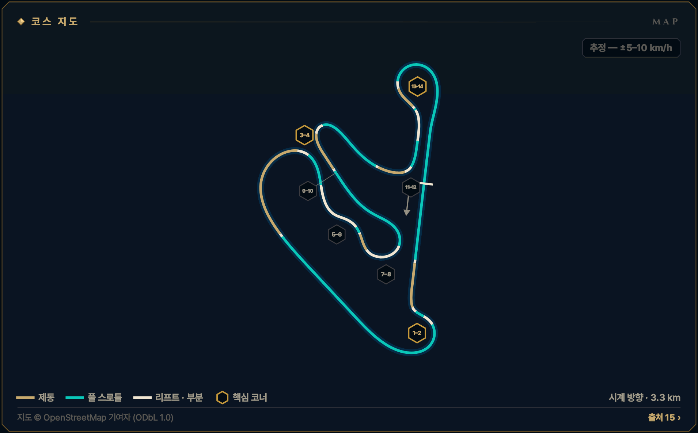
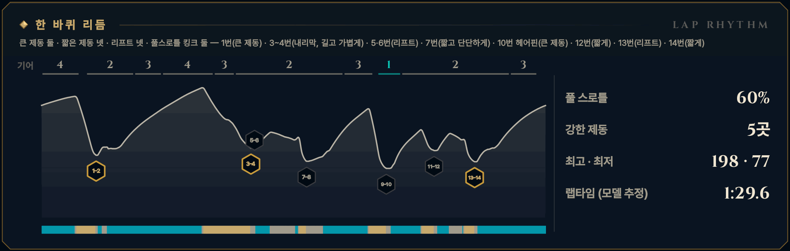

> **GRID서당 : iRacing**은 심레이싱이 처음인 동아리 신입을 위해 만든 드라이빙 아카데미 프로그램입니다. 이 글은 그 안의 **서킷 공략** 모드 — 이번 시즌 리그가 도는 서킷을 코스 개관과 코너별 애니메이션으로 미리 익히는 화면 — 를 블로그로 옮긴 것으로, 글과 애니메이션 모두 프로그램에서 그대로 가져왔습니다. 차는 iRacing의 Ray FF1600이고, 기준은 진도가 없는 루키(입문 렌즈)입니다. 강의는 [GRID서당 시리즈](/posts/untitled_life/motorsport/sim-racing/grid-seodang/)에, 낯선 말은 [용어 사전](/posts/untitled_life/motorsport/sim-racing/grid-seodang/glossary/)에 모아 두었습니다.

## 이번 시즌 일정

> **2026 시즌 4 · 포뮬러 1600 루키 시리즈 · 2주차** — 9.22(화)–9.28(월)
>
> - 루키 FF1600 · 기본 포함 · 12분 레이스 · 스탠딩 스타트 (차: Ray FF1600)
> - iRacing 트랙 이름: Rudskogen Motorsenter
> - 주차는 매주 화요일 09:00(한국 시간)에 바뀝니다.
>
> iRacing 일정은 시즌마다 바뀝니다. 이 글의 주차는 2026 시즌 4 기준이고, 같은 서킷이 다른 시즌에 돌아오면 그 시즌 일정에서 주차와 레이아웃을 다시 확인하세요.

## 코스 개관

약 3.25 km, 시계 방향, 14코너(왼쪽 7·오른쪽 7)의 숲속 롤러코스터입니다. 한 바퀴에 약 35\~40 m를 오르내리고, 언덕 너머가 보이지 않는 곳이 많습니다. 레이아웃은 하나뿐이고 코너 이름이 없어 번호로 부릅니다.

- **시계 방향 · 단일 코스 · 3.3 km · 14코너**
- **코너 번호** — 2012년 공식 지도 번호 T1\~T14를 씁니다. 코너 이름이 없어 번호로 부르고, 10번만 '헤어핀'입니다. iRacing 화면 번호와 같은지는 Test Drive에서 확인하세요.
- **루키 포인트** — 롤러코스터 트랙 — 3번 내리막은 '꾹'이 아니라 길고 가벼운 제동, 그리고 14번 탈출이 랩에서 가장 비쌉니다
- **속도 표기: 추정 — ±5–10 km/h** — 이 서킷에는 기준이 되는 실주행 텔레메트리가 없습니다. 공개된 FF1600 트랙 가이드 등에서 맞춘 코너 최저 속도에 보정한 FF1600 물리 모델을 맞춰 계산했기 때문에, 글과 영상의 속도·페달·기어는 모두 **추정값**(±5–10 km/h)입니다. Test Drive에서 직접 확인하세요.

*지도 © OpenStreetMap 기여자 (ODbL 1.0) · 선 색: 골드 = 제동, 시안 = 풀 스로틀, 흰색 = 리프트 · 부분 · 금테 육각형 = 핵심 코너 · 번호 = 이 글의 코너 공략 단위*

## 한 바퀴 리듬

큰 제동 둘 · 짧은 제동 넷 · 리프트 넷 · 풀스로틀 킹크 둘 — 1번(큰 제동) · 3\~4번(내리막, 길고 가볍게) · 5·6번(리프트) · 7번(짧고 단단하게) · 10번 헤어핀(큰 제동) · 12번(짧게) · 13번(리프트) · 14번(짧게)

*풀 스로틀 60% · 강한 제동 5곳 · 최고 · 최저 198 · 77 km/h · 랩타임 (모델 추정) 1:29.6 — 위 그림의 기어 줄·속도 곡선·입력 띠(골드 = 제동, 시안 = 풀 스로틀)와 코너 번호는 이 기준 랩입니다.*

## 먼저 볼 코너

1. **[T1–2 1–2번 코너](#w02-u1)** — 1랩 첫 제동 · 출발 직후 무리가 한꺼번에 몰리는 곳
2. **[T3–4 3–4번 내리막](#w02-u2)** — 랩 최고 속도에서 10% 내리막 제동 — 이 트랙의 시험대
3. **[T13–14 13–14번 코너](#w02-u7)** — 가장 비싼 탈출 — 약 600 m 메인 직선으로 이어진다

> **루키 포인트** — 롤러코스터 트랙 — 3번 내리막은 '꾹'이 아니라 길고 가벼운 제동, 그리고 14번 탈출이 랩에서 가장 비쌉니다

## 루키 안전 노트

- **스탠딩 스타트** — 출발 뒤 1번까지 짧고, 끝이 오르막인 제동 구간에 무리가 한꺼번에 몰립니다. 1번은 추월 시도가 가장 많은 곳 — 한 차선을 지키고 2번 루프를 나란히 돌지 않습니다.
- **3번 내리막** — 랩에서 가장 빠른 곳에서 약 10% 내리막을 내려가며 밟습니다. 세게 밟을수록 뒤가 가벼워집니다 — 곧은 차로, 가볍게, 조금 일찍.
- **보이지 않는 출구** — 7·8번 출구와 여러 언덕 너머는 보이지 않습니다. 거기서 돌았다면 그 자리에 멈추고, 릴레이티브로 뒤차를 확인한 뒤 복귀합니다.
- **연석 슬로다운** — 안쪽 연석을 너무 깊게 자르면 슬로다운이 유난히 혹독합니다(5·6번에서 약 1.7초 보고). 안쪽을 자를 때도 바퀴 하나는 늘 흰 선 위에 둡니다.
- **스핀 대처** — 브레이크를 꽉 밟아 세우고(시동은 안티스톨이 지킵니다), 차들이 지나간 뒤 1단(왼쪽 패들)으로 트랙과 나란히 복귀합니다. 언덕 너머에서 멈췄다면 뒤차가 늦게 봅니다 — 릴레이티브를 보고 기다리세요. 17x면 실격이고, 사고 누적 드라이브스루는 없지만(출발 위반 등은 있음) 깨끗한 12분이 가장 빠른 길입니다.
- **트랙 리밋** — 차의 절반 이상이 노면 경계 밖이면 1x — 일부 트랙의 표시 구간만 네 바퀴 기준. 루키 규칙: 두 바퀴는 늘 선·연석 안쪽. 이 트랙은 안쪽 연석을 깊게 자르면 주는 슬로다운이 유난히 혹독하다고 보고됩니다(1·4·5·6·12·13번 안쪽, 3번 출구). 일부 연석에는 솟은 턱(3D 연석)이 있습니다.

**1랩 · 스탠딩 스타트** — 1랩: 평소 제동 지점보다 늦게 밟지 않습니다. 앞차에 맞춰 더 일찍, 부드럽게 밟고, 차 한 대 폭을 남깁니다. 바깥이나 가운데를 지키고 안쪽 다툼에 끼지 않습니다.

## 영상 보는 법

코너마다 앱의 코너 공략 화면을 그대로 녹화했습니다. ▶를 눌러 재생하세요 — 앱의 **가이드** 재생(실제 속도의 0.4배, 화면에서 차가 너무 빠른 코너는 0.25배)이라 단계(접근·제동·턴인·에이펙스·탈출)마다 잠깐 멈추고, 멈춤 링이 차면 다음 단계로 넘어갑니다. 블로그 영상은 단계 시작의 멈춤만 짧게 줄였고 (캡션을 읽을 시간은 그대로), 끝에 앱의 끝 카드가 나옵니다. **급수별 브레이크 시연**을 펼치면 같은 코너를 7급·6급·5급 렌즈로, **흔한 실수 고스트**를 펼치면 실수한 차(빨간 점선)와 나란히 달린 영상을 볼 수 있습니다.

- **제동** — 골드 — 두께·밝기 = 브레이크 압력
- **가속** — 시안 — 스로틀
- **관성** — 흰색 — 두 페달 모두 뗀 구간
- **흔한 실수** — 빨간 점선 고스트 — 한 번에 하나만
- **▼ 제동 시작** — 루키 기준선의 제동 시작점
- **◆ 턴인** — 핸들을 감기 시작하는 곳
- **○ 에이펙스** — 가장 안쪽·가장 느린 곳
- **◇ 트랙아웃** — 탈출에서 닿는 바깥 끝
- **보드 (?)** — 확인 전 참고값 — Test Drive에서 기준점을 정하세요
- **입력 지도** — 골드 띠 = 브레이크, 흰 리본(안쪽) = 핸들. 겹치면 트레일
- **손 칸 · 내림 ×N · 올림** — 왼쪽 패들 N번 내림(블립은 오토 블립이) · 오른쪽 패들 한 번 올림

화면과 글의 속도는 모두 **추정값**(±5–10 km/h)입니다 — 기준 텔레메트리가 없는 서킷이라 모델로 계산했습니다.

## 코너 공략

### T1–2 1–2번 코너

**좌·우 복합 · 2단 · 최저 약 90 km/h · 핵심 코너 · 추정 — ±5–10 km/h**  
1랩 첫 제동 · 약 185→90 km/h · 왼쪽 꺾고 오르막 루프

<figure>
  <video src="images/u1.mp4" poster="images/u1_poster.png" controls preload="none" playsinline style="width:100%;max-width:960px"></video>
  <figcaption>시범 — 루키 기준선 · 입문 렌즈(직선 제동) · 가이드 0.4× · 접근 → 제동 → 턴인 → 에이펙스 → 리프트 ② → 에이펙스 ② → 탈출</figcaption>
</figure>

급수별 브레이크 시연 — 7급 · 6급 · 5급 렌즈 (영상 3)

라인과 기준점은 그대로, 페달 쓰는 법만 지금 급수에 맞춥니다. 위 영상은 **직선 제동 — 기초·심화·9·8급** 렌즈입니다 — 턴인 전에 브레이크를 다 뗍니다 (브레이크 끝 = 턴인).

**릴리스 — 7급** — 턴인을 향해 0.4초 넘게 흘려서 0으로 · 7급 기준: 릴리스 0.4초 이상

<figure>
  <video src="images/u1_release.mp4" poster="images/u1_release_poster.png" controls preload="none" playsinline style="width:100%;max-width:960px"></video>
  <figcaption>7급 렌즈(릴리스) · 가이드 0.4× · 접근 → 제동 → 턴인 → 에이펙스 → 리프트 ② → 에이펙스 ② → 탈출</figcaption>
</figure>

- 제동 — **턴인을 향해 흘려 놓는다** · 피크 약 46% · 릴리스 약 1.1초 · 발 · 하나-둘-셋 놓기
- 턴인 — **턴인에서 0에 닿는다** · 턴인에서 약 0\~3% · 발 · 3% → 0

**트레일 — 6급·4\~1급·졸업** — 턴인 때 15\~20%를 남기고, 감는 만큼 풉니다 · 6급 기준: 턴인 때 15% 이상 남기기

<figure>
  <video src="images/u1_trail.mp4" poster="images/u1_trail_poster.png" controls preload="none" playsinline style="width:100%;max-width:960px"></video>
  <figcaption>6급 렌즈(트레일) · 가이드 0.4× · 접근 → 제동 → 턴인 → 에이펙스 → 리프트 ② → 에이펙스 ② → 탈출</figcaption>
</figure>

- 제동 — **턴인까지 끌고 간다** · 피크 약 45% · 턴인에서 약 18% · 발 · 놓으며 남기기
- 턴인 — **에이펙스 전까지 흘린다** · 약 18% → 에이펙스 전 0 · 발 · 18% → 0 / 손 · 놓는 만큼 감기

**깊은 트레일 — 5급** — 턴인 때 30% 이상, 에이펙스 앞까지 끌고 갑니다 · 5급 기준: 턴인 때 30% 이상 남기기

<figure>
  <video src="images/u1_deep.mp4" poster="images/u1_deep_poster.png" controls preload="none" playsinline style="width:100%;max-width:960px"></video>
  <figcaption>5급 렌즈(깊은 트레일) · 가이드 0.4× · 접근 → 제동 → 턴인 → 에이펙스 → 리프트 ② → 에이펙스 ② → 탈출</figcaption>
</figure>

- 제동 — **더 깊게, 턴인 32%** · 피크 약 45% · 턴인에서 약 32% · 발 · 천천히 남기기
- 턴인 — **앞을 누른 채 감는다** · 약 32% → 에이펙스 직전 0 · 발 · 32% → 0

4\~1급은 같은 영상의 캡션에 강조 한 줄(◆)이 더 붙습니다:

- ◆ 4급(턴인·에이펙스) — 브레이크 끝 = 스로틀 시작 — 1번에서 두 발이 함께 쉬면 너무 줄인 것

흔한 실수 고스트 — 첫 코너 욕심 → 두 번째를 잃음

<figure>
  <video src="images/u1_ghost.mp4" poster="images/u1_ghost_poster.png" controls preload="none" playsinline style="width:100%;max-width:960px"></video>
  <figcaption>흔한 실수: 첫 코너 욕심 → 두 번째를 잃음 — 첫 코너에 욕심내면 두 번째를 잃는다 → 약 0.7초 늦음</figcaption>
</figure>

흔한 실수: **첫 코너 욕심 → 두 번째를 잃음** — 첫 코너에 욕심내면 두 번째를 잃는다 → 약 0.7초 늦음. 빨간 점선과 붉은 차가 실수 고스트, 흰 차가 루키 기준선입니다. 두 차는 같은 시계로 달리므로 늦어지거나 밀려나는 만큼이 그대로 보입니다. 영상은 앱에서 [흔한 실수]를 눌렀을 때처럼 그 실수가 시작되는 단계부터 재생합니다. 끝 카드의 '트레일 렌즈 기준'은 결과의 시간 차를 트레일(6급) 렌즈 주행과 비교한 값이라는 뜻입니다.

> **1랩 · 스탠딩 스타트** — 1랩: 평소 제동 지점보다 늦게 밟지 않습니다. 앞차에 맞춰 더 일찍, 부드럽게 밟고, 차 한 대 폭을 남깁니다. 바깥이나 가운데를 지키고 안쪽 다툼에 끼지 않습니다. 1번은 추월 시도가 가장 많은 곳입니다 — 한 차선을 정해 지키고, 2번 루프를 옆 차와 나란히 돌지 않습니다.

#### 접근

메인 직선 끝, 4단 약 185 km/h로 트랙 오른쪽에 곧게 붙습니다. 직선 끝이 약 5% 오르막이라 제동이 생각보다 잘 듣습니다. 가이드들은 100 m 보드를 쓰니, 처음엔 150 m 보드에서 시작해 반 보드씩 늦춥니다.

*지금 손과 발 — 발 · 풀스로틀 / 손 · 곧게 / 눈 · 150 보드*

**보드 · 기준점** — 모두 확인 전 참고값입니다. Test Drive에서 직접 보고 정하세요.

- **제동 · 기준점**? 100 m 보드(가이드 공통) — 애니메이션 루키는 그보다 앞, 턴인까지 약 135 m에서 밟습니다 *(확인 전 참고값)*
- **에이펙스**? 왼쪽 안쪽 연석 — 솟아 있어 안쪽 바퀴만 *(확인 전 참고값)*

#### 제동

곧은 차로 한 음절에 약 47%까지 '꾹', 제동 중에 왼쪽 패들로 4→3→2단까지 내립니다. 왼쪽으로 꺾기 전 약 135 m 동안 흘려서 풀어 턴인에서 0이 되게 합니다. 빠른 랩은 약 27 m 늦게, 80\~85%로 짧게 밟습니다.

*지금 손과 발 — 발 · 꾹 / 손 · 곧게 · 내림 ×2 / 눈 · 턴인 지점*

#### 턴인

브레이크가 0이 되는 순간 왼쪽으로 짧게 꺾습니다(브레이크 끝 = 턴인). 바깥 연석이 끝나 갈 즈음 안쪽 연석이 시작되는 곳을 겨눕니다. 1번은 짧은 왼쪽 꺾임이라 핸들을 크게, 그러나 한 번에 감습니다.

*지금 손과 발 — 발 · 0 → 유지 스로틀 / 손 · 한 번에 감기 / 눈 · 안쪽 연석*

#### 에이펙스

1번 에이펙스는 왼쪽 안쪽 연석, 최저 약 90 km/h(2단)입니다. 안쪽 바퀴만 연석에 올리세요 — 연석이 솟아 차가 튀고, 더 깊이 자르면 슬로다운입니다. 기준 랩은 약 95 km/h입니다.

*지금 손과 발 — 발 · 스로틀 서서히 / 손 · 잠깐 유지 / 눈 · 2번 안쪽 연석*

#### 리프트 ②

1번을 나오며 스로틀을 열고, 곧게 대각선으로 건너가 2번의 빨강·하양 안쪽 연석을 겨눕니다. 2번 루프에 들어가기 전, 차가 곧을 때 스로틀을 약 25%까지 덜어 앞을 눌러 줍니다. 1번에서 2번으로 너무 일찍 꺾으면 2번 출구에서 길이 모자랍니다.

*지금 손과 발 — 발 · 열고 → 덜기 / 손 · 곧게 건너기 / 눈 · 2번 연석*

**급수 시험 주행에서는 2번 루프를 스로틀만으로 — 10%를 넘는 톡은 따로 제동 코너로 채점됩니다.**

#### 에이펙스 ②

2번은 오르는 긴 오른쪽 루프입니다. 안쪽 연석을 따라 핸들 각도 하나로 버티고, 차가 출구를 향하면 스로틀을 끝까지 엽니다. 앞이 밀리면 스로틀을 10\~15%만 덜고, 크게 떼지 않습니다 — 크게 떼면 뒤가 돕니다.

*지금 손과 발 — 발 · 일정하게 → 100% / 손 · 각도 유지 / 눈 · 루프 출구*

#### 탈출

핸들을 풀며 트랙 왼쪽 흰 선까지 흘려보내되 넘지는 않습니다(2번 출구는 1x 구간으로 보고됨). 출구 바로 뒤가 랩에서 가장 높은 언덕이라 차가 가벼워지니, 꼭대기 전에 핸들을 다 풀어 둡니다. 그다음 내리막 백스트레이트에서 3번을 위해 왼쪽으로 옮깁니다.

*지금 손과 발 — 발 · 앞으로만 100% / 손 · 풀기 / 눈 · 언덕 꼭대기*

#### 흔한 실수

- 1번에 욕심내 빠르게 → 2번 루프 입구가 꼬이고 출구에서 길이 모자란다  
  → 1번은 내주고, 곧게 건너가 2번 연석에 붙는다
- 1랩 무리 속에서 평소처럼 늦게 밟기  
  → 평소보다 늦지 않게 — 앞차에 맞춰 더 일찍, 부드럽게
- 2번 한가운데서 발을 크게 떼어 뒤가 돈다  
  → 스로틀은 10\~15%만 덜고, 각도 하나로 버틴다

#### 이 코너에서 확인할 것

- [ ] 100·150 m 보드의 위치와 내 제동 시작 거리
- [ ] 1번 안쪽 연석의 높이와 슬로다운이 걸리는 깊이

#### 연결된 강의 · 드릴

- 강의: [심화 1강(출발의 기술)](/posts/untitled_life/motorsport/sim-racing/grid-seodang/advanced/d1-the-start/) · [기초 4강(레이싱 라인의 문법)](/posts/untitled_life/motorsport/sim-racing/grid-seodang/basics/f4-racing-line/) · [심화 2강(코너의 다섯 얼굴)](/posts/untitled_life/motorsport/sim-racing/grid-seodang/advanced/d2-five-corner-faces/) · [8급(제동의 기본)](/posts/untitled_life/motorsport/sim-racing/grid-seodang/grades/g8-braking-basics/) · [7급(릴리스 수양)](/posts/untitled_life/motorsport/sim-racing/grid-seodang/grades/g7-release/) · [6급(트레일 입문)](/posts/untitled_life/motorsport/sim-racing/grid-seodang/grades/g6-trail-intro/) · [심화 6강(교본 차 해부)](/posts/untitled_life/motorsport/sim-racing/grid-seodang/advanced/d8-training-car-and-shifting/) · [2급(스티어링 일필휘지)](/posts/untitled_life/motorsport/sim-racing/grid-seodang/grades/g2-one-stroke-steering/) · [심화 9강(기울어진 트랙)](/posts/untitled_life/motorsport/sim-racing/grid-seodang/advanced/d7-banked-track/)
- 훈련장 드릴: 제동 수양 · 정밀 압력 · 조향 일필

<small>근거: S4 · S6 · S8 · S9 · S10 · S11 · S12 · S13 · MODEL (아래 출처 목록) · 신뢰도 M</small>

### T3–4 3–4번 내리막

**우코너 · 2단 · 최저 약 105 km/h · 핵심 코너 · 추정 — ±5–10 km/h**  
이 트랙의 시험대 · 약 195→105 km/h · 10% 내리막 제동

<figure>
  <video src="images/u2.mp4" poster="images/u2_poster.png" controls preload="none" playsinline style="width:100%;max-width:960px"></video>
  <figcaption>시범 — 루키 기준선 · 입문 렌즈(직선 제동) · 가이드 0.4× · 접근 → 제동 → 턴인 → 에이펙스 → 탈출</figcaption>
</figure>

급수별 브레이크 시연 — 7급 · 6급 · 5급 렌즈 (영상 3)

라인과 기준점은 그대로, 페달 쓰는 법만 지금 급수에 맞춥니다. 위 영상은 **직선 제동 — 기초·심화·9·8급** 렌즈입니다 — 턴인 전에 브레이크를 다 뗍니다 (브레이크 끝 = 턴인).

**릴리스 — 7급** — 턴인을 향해 0.4초 넘게 흘려서 0으로 · 7급 기준: 릴리스 0.4초 이상

<figure>
  <video src="images/u2_release.mp4" poster="images/u2_release_poster.png" controls preload="none" playsinline style="width:100%;max-width:960px"></video>
  <figcaption>7급 렌즈(릴리스) · 가이드 0.4× · 접근 → 제동 → 턴인 → 에이펙스 → 탈출</figcaption>
</figure>

- 제동 — **4번 턴인을 향해 흘려 놓는다** · 피크 약 40% · 4번 턴인 앞에서 흘려 놓기 · 발 · 하나-둘-셋 놓기
- 턴인 — **4번 턴인에서 0에 닿는다** · 4번 턴인에서 약 0\~3% · 발 · 3% → 0

**트레일 — 6급·4\~1급·졸업** — 턴인 때 15\~20%를 남기고, 감는 만큼 풉니다 · 6급 기준: 턴인 때 15% 이상 남기기

<figure>
  <video src="images/u2_trail.mp4" poster="images/u2_trail_poster.png" controls preload="none" playsinline style="width:100%;max-width:960px"></video>
  <figcaption>6급 렌즈(트레일) · 가이드 0.4× · 접근 → 제동 → 턴인 → 에이펙스 → 탈출</figcaption>
</figure>

- 제동 — **4번 턴인까지 끌고 간다** · 피크 약 38% · 4번 턴인에서 약 18% · 발 · 놓으며 남기기
- 턴인 — **4번 에이펙스 전까지 흘린다** · 약 18% → 4번 에이펙스 전 0 · 발 · 18% → 0 / 손 · 놓는 만큼 감기

**깊은 트레일 — 5급** — 턴인 때 30% 이상, 에이펙스 앞까지 끌고 갑니다 · 가벼운 제동 코너 — 30% 기준보다 적게 남깁니다

<figure>
  <video src="images/u2_deep.mp4" poster="images/u2_deep_poster.png" controls preload="none" playsinline style="width:100%;max-width:960px"></video>
  <figcaption>5급 렌즈(깊은 트레일) · 가이드 0.4× · 접근 → 제동 → 턴인 → 에이펙스 → 탈출</figcaption>
</figure>

- 제동 — **더 깊게, 4번 턴인 26%** · 피크 약 37% · 4번 턴인에서 약 26% · 발 · 천천히 남기기
- 턴인 — **앞을 누른 채 감는다** · 약 26% → 4번 에이펙스 직전 0 · 발 · 26% → 0

4\~1급은 같은 영상의 캡션에 강조 한 줄(◆)이 더 붙습니다:

- ◆ 4급(턴인·에이펙스) — 골짜기에서 두 발이 쉬지 않게 — 브레이크 끝에서 바로 유지 스로틀

흔한 실수 고스트 — 너무 세게, 너무 오래

<figure>
  <video src="images/u2_ghost.mp4" poster="images/u2_ghost_poster.png" controls preload="none" playsinline style="width:100%;max-width:960px"></video>
  <figcaption>흔한 실수: 너무 세게, 너무 오래 — 95%로 꾹, 굴러가며 최저 약 85 km/h → 약 4.1초 늦음</figcaption>
</figure>

흔한 실수: **너무 세게, 너무 오래** — 95%로 꾹, 굴러가며 최저 약 85 km/h → 약 4.1초 늦음. 빨간 점선과 붉은 차가 실수 고스트, 흰 차가 루키 기준선입니다. 두 차는 같은 시계로 달리므로 늦어지거나 밀려나는 만큼이 그대로 보입니다. 영상은 앱에서 [흔한 실수]를 눌렀을 때처럼 그 실수가 시작되는 단계부터 재생합니다. 끝 카드의 '트레일 렌즈 기준'은 결과의 시간 차를 트레일(6급) 렌즈 주행과 비교한 값이라는 뜻입니다.

#### 접근

2번 꼭대기를 넘으면 백스트레이트가 곧장 내리꽂힙니다 — 랩에서 가장 빠른 곳, 4단 약 195 km/h. 트랙 왼쪽에 머물되 맨 끝까지 붙지는 않습니다(왼쪽 연석에 솟은 턱). 가이드 기준은 100 m 보드, 처음엔 150 m 보드에서 리프트한 뒤 가볍게 밟습니다.

*지금 손과 발 — 발 · 풀스로틀 / 손 · 곧게 / 눈 · 150 보드*

**보드 · 기준점** — 모두 확인 전 참고값입니다. Test Drive에서 직접 보고 정하세요.

- **제동 · 기준점**? 100 m 보드(가이드 공통) — 처음엔 150 보드에서 리프트 후 가볍게, 애니메이션은 4번 턴인까지 약 275 m *(확인 전 참고값)*
- **에이펙스**? 4번 안쪽 연석 — 너무 깊게 자르면 슬로다운 *(확인 전 참고값)*

#### 제동

여기는 '꾹'이 아니라 길고 가벼운 제동입니다 — 곧은 차로 약 40%, 그대로 3번 굽이를 따라 내려갑니다. 내리막에서는 세게 밟을수록 뒤가 가벼워지니, 핸들은 굽이만큼만 감고 발은 일정하게 지킵니다. 속도가 충분히 떨어지면 4→3→2단으로 하나씩, 골짜기 바닥에서 2단입니다.

*지금 손과 발 — 발 · 일정하게 톡 / 손 · 굽이만큼만 · 내림 ×2 / 눈 · 3번 안쪽 연석*

#### 턴인

3번 연석을 스친 뒤 골짜기(차가 눌리는 바닥)에서 트랙 가운데쯤으로 흘렸다가, 브레이크가 0이 되는 순간 4번으로 다시 감습니다(브레이크 끝 = 턴인). 핸들은 두 획 — 3번에 한 번, 골짜기에서 조금 풀고, 4번에 다시 감습니다.

*지금 손과 발 — 발 · 0 → 유지 스로틀 / 손 · 다시 감기 / 눈 · 4번 연석*

#### 에이펙스

4번 안쪽 연석에 올라타는 곳이 에이펙스, 최저 약 105 km/h(2단)입니다. 연석에 닿는 순간부터 스로틀을 열어 연석이 끝날 때 100% — 4번 연석을 너무 깊게 자르면 슬로다운입니다. 기준 랩은 약 110 km/h입니다.

*지금 손과 발 — 발 · 앞으로만 / 손 · 풀기 시작 / 눈 · 출구 절반*

#### 탈출

출구는 트랙의 절반까지만 씁니다 — 다음 5번이 왼쪽이라 오른쪽에 서 있어야 합니다. 여기서 출구를 조금 버리고 오르막 S자에서 법니다. 출구 약 115 km/h, 2단으로 오르막을 오릅니다.

*지금 손과 발 — 발 · 100% / 손 · 풀기 / 눈 · 5번 진입*

#### 흔한 실수

- 내리막에서 평지처럼 세게 '꾹' → 너무 줄여 굴러가거나 뒤가 가벼워 돈다  
  → 곧은 차로 가볍게, 길게 — 세기보다 시간
- 너무 빠른 속도에서 기어를 내려 엔진이 비명을 지르고 뒤가 흔들린다  
  → 속도가 충분히 떨어진 뒤 하나씩, 2단은 골짜기에서
- 4번 출구를 끝까지 써서 5번 진입을 놓친다  
  → 출구는 절반까지, 오른쪽에 남는다

#### 이 코너에서 확인할 것

- [ ] 100·150 m 보드 위치와 왼쪽 연석의 솟은 턱
- [ ] 3번에서 실제로 쓰는 제동 세기(가이드 25\~55%)

#### 연결된 강의 · 드릴

- 강의: [심화 9강(기울어진 트랙)](/posts/untitled_life/motorsport/sim-racing/grid-seodang/advanced/d7-banked-track/) · [심화 2강(코너의 다섯 얼굴)](/posts/untitled_life/motorsport/sim-racing/grid-seodang/advanced/d2-five-corner-faces/) · [6급(트레일 입문)](/posts/untitled_life/motorsport/sim-racing/grid-seodang/grades/g6-trail-intro/) · [5급(트레일 숙달)](/posts/untitled_life/motorsport/sim-racing/grid-seodang/grades/g5-trail-mastery/) · [심화 6강(교본 차 해부)](/posts/untitled_life/motorsport/sim-racing/grid-seodang/advanced/d8-training-car-and-shifting/) · [심화 4강(차의 균형)](/posts/untitled_life/motorsport/sim-racing/grid-seodang/advanced/d4-car-balance/) · [심화 7강(한계의 신호)](/posts/untitled_life/motorsport/sim-racing/grid-seodang/advanced/d9-signals-at-the-limit/) · [4급(전환 수련)](/posts/untitled_life/motorsport/sim-racing/grid-seodang/grades/g4-transition/)
- 훈련장 드릴: 정밀 압력 · 트레일 브레이킹 · 조향 일필

<small>근거: S6 · S8 · S9 · S10 · S11 · S12 · S13 · S17 · MODEL (아래 출처 목록) · 신뢰도 M</small>

### T5–6 5–6번 오르막 S

**좌·우 복합 · 2단 · 최저 약 115–125 km/h · 추정 — ±5–10 km/h**  
오르막 S자 · 브레이크 없이 리프트 · 약 120 km/h

<figure>
  <video src="images/u3.mp4" poster="images/u3_poster.png" controls preload="none" playsinline style="width:100%;max-width:960px"></video>
  <figcaption>시범 — 루키 기준선 · 렌즈 공통 · 가이드 0.4× · 접근 → 리프트 → 턴인 → 에이펙스 → 리프트 ② → 에이펙스 ② → 탈출</figcaption>
</figure>

급수별 브레이크 시연 — 모든 급수가 같은 그림

이 코너는 렌즈가 같습니다 — 리프트·풀스로틀 코너는 브레이크를 쓰지 않아 모든 급수가 같은 페달 그림을 봅니다.

흔한 실수 고스트 — 늦은 리프트 → 바깥으로

<figure>
  <video src="images/u3_ghost.mp4" poster="images/u3_ghost_poster.png" controls preload="none" playsinline style="width:100%;max-width:960px"></video>
  <figcaption>흔한 실수: 늦은 리프트 → 바깥으로 — 늦게 떼면 바깥으로 밀린다 · 트랙 밖</figcaption>
</figure>

흔한 실수: **늦은 리프트 → 바깥으로** — 늦게 떼면 바깥으로 밀린다 · 트랙 밖. 빨간 점선과 붉은 차가 실수 고스트, 흰 차가 루키 기준선입니다. 두 차는 같은 시계로 달리므로 늦어지거나 밀려나는 만큼이 그대로 보입니다. 영상은 앱에서 [흔한 실수]를 눌렀을 때처럼 그 실수가 시작되는 단계부터 재생합니다.

#### 접근

4번을 나와 오른쪽에 선 채 2단 풀스로틀로 오르막을 오릅니다. 5번은 왼쪽, 6번은 오른쪽 — 5번 출구가 곧 6번 입구인 S자입니다. 이 S자에는 브레이크가 없습니다.

*지금 손과 발 — 발 · 풀스로틀 / 손 · 곧게 / 눈 · 5번 연석*

**보드 · 기준점** — 모두 확인 전 참고값입니다. Test Drive에서 직접 보고 정하세요.

- **리프트 시작**? 5번 턴인 전 오른쪽, 차가 곧을 때 — Test Drive에서 이 근처 보드·표지물을 기준점으로 정하세요 *(확인 전 참고값)*
- **에이펙스**? 5번 안쪽 연석 — 바퀴 하나는 흰 선 위 *(확인 전 참고값)*

#### 리프트

5번 턴인 전, 차가 곧을 때 스로틀을 덜어 앞을 눌러 줍니다. 애니메이션은 약 25%까지 넉넉히 떼고, 빠른 랩은 10\~30%만 덜어 냅니다. 타이어가 식은 첫 랩에는 조금 더 덜어도 됩니다.

*지금 손과 발 — 발 · 리프트 / 손 · 곧게 / 눈 · 5번 안쪽*

**급수 시험 주행에서는 리프트만 — 10%를 넘는 톡도 제동 코너로 채점됩니다.**

#### 턴인

덜어 낸 상태로 왼쪽에 한 번에 부드럽게 감습니다. 연석 가장자리에서 조금 떨어져 시작하면 S자가 덜 꺾여 두 코너를 한 줄로 펼 수 있습니다. 감은 뒤에는 스로틀을 다시 '탁' 떼지 않습니다.

*지금 손과 발 — 발 · 부분 스로틀 / 손 · 한 번 감기 / 눈 · 5번 연석*

#### 에이펙스

5번 안쪽 연석을 자르되 바퀴 하나는 반드시 흰 선 위에 둡니다 — 이 S자의 슬로다운은 약 1.7초로 크게 보고됩니다. 최저 약 120 km/h(2단)입니다.

*지금 손과 발 — 발 · 부분 스로틀 / 손 · 풀며 오른쪽 / 눈 · 6번 연석*

#### 리프트 ②

5번 출구가 곧 6번 입구입니다. 핸들을 왼쪽에서 오른쪽으로 옮기는 사이 스로틀을 조금 더 덜어 6번을 준비합니다 — 6번 바로 뒤에 7번의 짧은 제동이 있습니다. 손은 조용히, 톱질하지 않습니다.

*지금 손과 발 — 발 · 조금 더 덜기 / 손 · 오른쪽으로 한 획 / 눈 · 6번 연석*

**급수 시험 주행에서는 리프트만 — 10%를 넘는 톡도 제동 코너로 채점됩니다.**

#### 에이펙스 ②

6번 안쪽 연석도 바퀴 하나는 흰 선 위에 둡니다. 에이펙스를 지나 핸들이 풀리기 시작하면 스로틀을 앞으로만 엽니다. 6번과 7번 사이에는 직선이 거의 없습니다.

*지금 손과 발 — 발 · 앞으로만 / 손 · 풀기 시작 / 눈 · 7번 안쪽 연석*

#### 탈출

6번 에이펙스에서 7번 안쪽 연석을 곧장 겨누고, 왼쪽 끝까지 흘려보내지 않습니다. 7번 제동은 그 대각선 위, 도로를 가로지른 흰 선 근처에서 시작합니다. 출구 약 115 km/h입니다.

*지금 손과 발 — 발 · 100% / 손 · 곧게 / 눈 · 7번 앞 흰 선*

#### 흔한 실수

- 늦게 떼기 — 꺾은 뒤에 떼면 차가 바깥으로 밀려 연석 밖으로  
  → 속도 조절은 모두 턴인 전, 곧을 때
- 욕심내서 연석을 깊게 잘라 슬로다운(약 1.7초)  
  → 바퀴 하나는 늘 흰 선 위
- 겁이 나서 브레이크를 밟아 오르막에서 속도를 잃는다  
  → 리프트만으로 충분 — 무서우면 조금 일찍, 조금 더 덜기

#### 이 코너에서 확인할 것

- [ ] 슬로다운이 걸리는 연석 깊이
- [ ] 실제 5·6번 속도(추정 약 115\~125 km/h)

#### 연결된 강의 · 드릴

- 강의: [심화 2강(코너의 다섯 얼굴)](/posts/untitled_life/motorsport/sim-racing/grid-seodang/advanced/d2-five-corner-faces/) · [기초 4강(레이싱 라인의 문법)](/posts/untitled_life/motorsport/sim-racing/grid-seodang/basics/f4-racing-line/) · [기초 5강(서킷의 예절)](/posts/untitled_life/motorsport/sim-racing/grid-seodang/basics/f5-flags-etiquette/) · [2급(스티어링 일필휘지)](/posts/untitled_life/motorsport/sim-racing/grid-seodang/grades/g2-one-stroke-steering/) · [3급(스로틀 서예)](/posts/untitled_life/motorsport/sim-racing/grid-seodang/grades/g3-throttle-calligraphy/) · [심화 8강(페달의 문법)](/posts/untitled_life/motorsport/sim-racing/grid-seodang/advanced/d6-pedal-grammar/)
- 훈련장 드릴: 조향 일필 · 정밀 압력

<small>근거: S8 · S9 · S10 · S11 · S12 · S13 · MODEL (아래 출처 목록) · 신뢰도 M</small>

### T7–8 7–8번 코너

**좌코너 · 2단 · 최저 약 85 km/h · 추정 — ±5–10 km/h**  
짧고 단단한 오르막 제동 · 약 120→85 km/h · 언덕 너머 루프

<figure>
  <video src="images/u4.mp4" poster="images/u4_poster.png" controls preload="none" playsinline style="width:100%;max-width:960px"></video>
  <figcaption>시범 — 루키 기준선 · 입문 렌즈(직선 제동) · 가이드 0.4× · 접근 → 제동 → 턴인 → 에이펙스 → 리프트 ② → 에이펙스 ② → 탈출</figcaption>
</figure>

급수별 브레이크 시연 — 7급 · 6급 · 5급 렌즈 (영상 3)

라인과 기준점은 그대로, 페달 쓰는 법만 지금 급수에 맞춥니다. 위 영상은 **직선 제동 — 기초·심화·9·8급** 렌즈입니다 — 턴인 전에 브레이크를 다 뗍니다 (브레이크 끝 = 턴인).

**릴리스 — 7급** — 턴인을 향해 0.4초 넘게 흘려서 0으로 · 7급 기준: 릴리스 0.4초 이상

<figure>
  <video src="images/u4_release.mp4" poster="images/u4_release_poster.png" controls preload="none" playsinline style="width:100%;max-width:960px"></video>
  <figcaption>7급 렌즈(릴리스) · 가이드 0.4× · 접근 → 제동 → 턴인 → 에이펙스 → 리프트 ② → 에이펙스 ② → 탈출</figcaption>
</figure>

- 제동 — **턴인을 향해 흘려 놓는다** · 피크 약 85% · 릴리스 약 0.8초 · 발 · 하나-둘-셋 놓기
- 턴인 — **턴인에서 0에 닿는다** · 턴인에서 약 0\~3% · 발 · 3% → 0

**트레일 — 6급·4\~1급·졸업** — 턴인 때 15\~20%를 남기고, 감는 만큼 풉니다 · 6급 기준: 턴인 때 15% 이상 남기기

<figure>
  <video src="images/u4_trail.mp4" poster="images/u4_trail_poster.png" controls preload="none" playsinline style="width:100%;max-width:960px"></video>
  <figcaption>6급 렌즈(트레일) · 가이드 0.4× · 접근 → 제동 → 턴인 → 에이펙스 → 리프트 ② → 에이펙스 ② → 탈출</figcaption>
</figure>

- 제동 — **턴인까지 끌고 간다** · 피크 약 73% · 턴인에서 약 18% · 발 · 놓으며 남기기
- 턴인 — **에이펙스 전까지 흘린다** · 약 18% → 에이펙스 전 0 · 발 · 18% → 0 / 손 · 놓는 만큼 감기

**깊은 트레일 — 5급** — 턴인 때 30% 이상, 에이펙스 앞까지 끌고 갑니다 · 5급 기준: 턴인 때 30% 이상 남기기

<figure>
  <video src="images/u4_deep.mp4" poster="images/u4_deep_poster.png" controls preload="none" playsinline style="width:100%;max-width:960px"></video>
  <figcaption>5급 렌즈(깊은 트레일) · 가이드 0.4× · 접근 → 제동 → 턴인 → 에이펙스 → 리프트 ② → 에이펙스 ② → 탈출</figcaption>
</figure>

- 제동 — **더 깊게, 턴인 32%** · 피크 약 46% · 턴인에서 약 32% · 발 · 천천히 남기기
- 턴인 — **앞을 누른 채 감는다** · 약 32% → 에이펙스 직전 0 · 발 · 32% → 0

흔한 실수 고스트 — 첫 코너 욕심 → 두 번째를 잃음

<figure>
  <video src="images/u4_ghost.mp4" poster="images/u4_ghost_poster.png" controls preload="none" playsinline style="width:100%;max-width:960px"></video>
  <figcaption>흔한 실수: 첫 코너 욕심 → 두 번째를 잃음 — 첫 코너에 욕심내면 두 번째를 잃는다 → 약 0.9초 늦음</figcaption>
</figure>

흔한 실수: **첫 코너 욕심 → 두 번째를 잃음** — 첫 코너에 욕심내면 두 번째를 잃는다 → 약 0.9초 늦음. 빨간 점선과 붉은 차가 실수 고스트, 흰 차가 루키 기준선입니다. 두 차는 같은 시계로 달리므로 늦어지거나 밀려나는 만큼이 그대로 보입니다. 영상은 앱에서 [흔한 실수]를 눌렀을 때처럼 그 실수가 시작되는 단계부터 재생합니다. 끝 카드의 '트레일 렌즈 기준'은 결과의 시간 차를 트레일(6급) 렌즈 주행과 비교한 값이라는 뜻입니다.

#### 접근

6번 에이펙스에서 7번 안쪽 연석을 겨눈 대각선 위입니다. 오르막 끝에 도로를 가로지르는 흰 선이 있고, 가이드들은 그 선을 지나자마자 밟습니다. 6번 직후라 준비 시간이 짧습니다.

*지금 손과 발 — 발 · 떼기 시작 / 손 · 곧게 / 눈 · 흰 선*

**보드 · 기준점** — 모두 확인 전 참고값입니다. Test Drive에서 직접 보고 정하세요.

- **제동 · 기준점**? 도로를 가로지른 흰 선 — 가이드들은 선 직후 밟음, Test Drive에서 위치 확인 *(확인 전 참고값)*
- **에이펙스**? 7번 안쪽 연석 — 대부분까지만 *(확인 전 참고값)*

#### 제동

짧고 단단하게, 약 85%까지 — 오르막이라 차가 잘 서서 세게 밟아도 괜찮은, 이 트랙에서 가장 친절한 제동입니다. 턴인까지 약 35 m뿐이니 곧게 밟고 빨리 흘려서 풉니다. 빠른 랩은 1단까지 내리지만 처음엔 2단 그대로 둡니다.

*지금 손과 발 — 발 · 꾹 → 빨리 놓기 / 손 · 조금 감긴 채 / 눈 · 7번 안쪽 연석*

#### 턴인

브레이크가 0이 되는 순간 왼쪽으로 감습니다(브레이크 끝 = 턴인). 7번 안쪽 연석의 대부분을 가로질러 자르되 그 이상은 넘지 않습니다 — 오른쪽 바퀴가 아스팔트 위에 있으면 괜찮습니다.

*지금 손과 발 — 발 · 0 → 유지 스로틀 / 손 · 한 번 감기 / 눈 · 7번 연석*

#### 에이펙스

7번 에이펙스, 최저 약 85 km/h(2단)입니다. 지나면 트랙 가운데쯤으로 흘려 8번을 엽니다 — 바깥 끝까지 밀리면 그립이 없습니다. 기준 랩은 약 90 km/h입니다.

*지금 손과 발 — 발 · 유지 스로틀 / 손 · 조금 풀기 / 눈 · 8번 언덕*

#### 리프트 ②

8번은 언덕을 넘어 내려가는 왼쪽 루프입니다. 꼭대기에서는 차가 가벼우니 스로틀을 약 25%로 조금만 두고 기다립니다 — 여기서 크게 열면 바퀴가 헛돌고 밀립니다. 브레이크는 쓰지 않습니다.

*지금 손과 발 — 발 · 조금만 / 손 · 다시 감기 / 눈 · 8번 바닥*

**급수 시험 주행에서는 8번을 스로틀만으로 — 언덕 위 10%를 넘는 톡도 제동 코너로 채점됩니다.**

#### 에이펙스 ②

에이펙스는 작은 언덕을 내려간 바닥 쪽 안쪽 연석입니다. 내리막이 시작되면 스로틀을 조금씩, 바닥의 딥에서 앞이 눌리면 한 번에 100%로 엽니다.

*지금 손과 발 — 발 · 한 번에 100% / 손 · 유지 / 눈 · 화살표 표지판*

#### 탈출

오른쪽 출구 연석까지 쓰되, 연석 바깥의 솟은 턱 너머로 오른쪽 바퀴를 내보내지 않습니다. 출구는 보이지 않는 블라인드 — 차가 정면의 화살표 표지판과 나란하면 맞게 나온 것입니다. 이 탈출 속도가 내리막을 따라 10번 제동까지 갑니다.

*지금 손과 발 — 발 · 100% 유지 / 손 · 풀기 / 눈 · 9번 킹크*

#### 흔한 실수

- 7번에 욕심내 빠르게 → 8번 입구에서 다시 줄여야 해 시간을 잃는다  
  → 7번은 짧게 끝내고 가운데로 흘려 8번을 연다
- 언덕 꼭대기에서 스로틀을 크게 열어 바퀴가 헛돈다  
  → 꼭대기엔 조금만, 바닥에서 100%
- 출구 연석의 솟은 턱에 걸려 돈다  
  → 오른쪽 바퀴는 턱 안쪽

#### 이 코너에서 확인할 것

- [ ] 7번 앞 흰 선의 위치
- [ ] 8번 출구 화살표 표지판이 지금도 있는지

#### 연결된 강의 · 드릴

- 강의: [심화 9강(기울어진 트랙)](/posts/untitled_life/motorsport/sim-racing/grid-seodang/advanced/d7-banked-track/) · [심화 2강(코너의 다섯 얼굴)](/posts/untitled_life/motorsport/sim-racing/grid-seodang/advanced/d2-five-corner-faces/) · [4급(전환 수련)](/posts/untitled_life/motorsport/sim-racing/grid-seodang/grades/g4-transition/) · [3급(스로틀 서예)](/posts/untitled_life/motorsport/sim-racing/grid-seodang/grades/g3-throttle-calligraphy/) · [심화 6강(교본 차 해부)](/posts/untitled_life/motorsport/sim-racing/grid-seodang/advanced/d8-training-car-and-shifting/) · [심화 7강(한계의 신호)](/posts/untitled_life/motorsport/sim-racing/grid-seodang/advanced/d9-signals-at-the-limit/)
- 훈련장 드릴: 전환 · 스로틀 서예 · 트레일 브레이킹

<small>근거: S6 · S8 · S9 · S10 · S12 · S13 · MODEL (아래 출처 목록) · 신뢰도 M</small>

### T9–10 9–10번 헤어핀

**우코너 · 1단 · 최저 약 70 km/h · 추정 — ±5–10 km/h**  
플랫 킹크 뒤 내리막 헤어핀 · 약 160→70 km/h

<figure>
  <video src="images/u5.mp4" poster="images/u5_poster.png" controls preload="none" playsinline style="width:100%;max-width:960px"></video>
  <figcaption>시범 — 루키 기준선 · 입문 렌즈(직선 제동) · 가이드 0.4× · 접근 → 턴인 → 에이펙스 → 제동 ② → 에이펙스 ② → 탈출</figcaption>
</figure>

급수별 브레이크 시연 — 7급 · 6급 · 5급 렌즈 (영상 3)

라인과 기준점은 그대로, 페달 쓰는 법만 지금 급수에 맞춥니다. 위 영상은 **직선 제동 — 기초·심화·9·8급** 렌즈입니다 — 턴인 전에 브레이크를 다 뗍니다 (브레이크 끝 = 턴인).

**릴리스 — 7급** — 턴인을 향해 0.4초 넘게 흘려서 0으로 · 7급 기준: 릴리스 0.4초 이상

<figure>
  <video src="images/u5_release.mp4" poster="images/u5_release_poster.png" controls preload="none" playsinline style="width:100%;max-width:960px"></video>
  <figcaption>7급 렌즈(릴리스) · 가이드 0.4× · 접근 → 턴인 → 에이펙스 → 제동 ② → 에이펙스 ② → 탈출</figcaption>
</figure>

- 제동 ② — **턴인을 향해 흘려 놓는다** · 피크 약 69% · 릴리스 약 1.0초 · 발 · 하나-둘-셋 놓기
- 에이펙스 ② — **턴인에서 0에 닿는다** · 턴인에서 약 0\~3% · 발 · 3% → 0

**트레일 — 6급·4\~1급·졸업** — 턴인 때 15\~20%를 남기고, 감는 만큼 풉니다 · 6급 기준: 턴인 때 15% 이상 남기기

<figure>
  <video src="images/u5_trail.mp4" poster="images/u5_trail_poster.png" controls preload="none" playsinline style="width:100%;max-width:960px"></video>
  <figcaption>6급 렌즈(트레일) · 가이드 0.4× · 접근 → 턴인 → 에이펙스 → 제동 ② → 에이펙스 ② → 탈출</figcaption>
</figure>

- 제동 ② — **턴인까지 끌고 간다** · 피크 약 64% · 턴인에서 약 18% · 발 · 놓으며 남기기
- 에이펙스 ② — **흘리며 절반 지나 접는다** · 약 18% → 에이펙스 전 0 · 발 · 18% → 0 / 손 · 놓는 만큼 감기

**깊은 트레일 — 5급** — 턴인 때 30% 이상, 에이펙스 앞까지 끌고 갑니다 · 5급 기준: 턴인 때 30% 이상 남기기

<figure>
  <video src="images/u5_deep.mp4" poster="images/u5_deep_poster.png" controls preload="none" playsinline style="width:100%;max-width:960px"></video>
  <figcaption>5급 렌즈(깊은 트레일) · 가이드 0.4× · 접근 → 턴인 → 에이펙스 → 제동 ② → 에이펙스 ② → 탈출</figcaption>
</figure>

- 제동 ② — **더 깊게, 턴인 32%** · 피크 약 56% · 턴인에서 약 32% · 발 · 천천히 남기기
- 에이펙스 ② — **앞을 누른 채 V로** · 약 32% → 에이펙스 직전 0 · 발 · 32% → 0

4\~1급은 같은 영상의 캡션에 강조 한 줄(◆)이 더 붙습니다:

- ◆ 3급(탈출) — 오르막 탈출은 한 번에, 끝까지 — 그러나 1.5\~2초에 걸쳐

흔한 실수 고스트 — 너무 세게, 너무 오래

<figure>
  <video src="images/u5_ghost.mp4" poster="images/u5_ghost_poster.png" controls preload="none" playsinline style="width:100%;max-width:960px"></video>
  <figcaption>흔한 실수: 너무 세게, 너무 오래 — 95%로 꾹, 굴러가며 최저 약 55 km/h → 약 2.6초 늦음</figcaption>
</figure>

흔한 실수: **너무 세게, 너무 오래** — 95%로 꾹, 굴러가며 최저 약 55 km/h → 약 2.6초 늦음. 빨간 점선과 붉은 차가 실수 고스트, 흰 차가 루키 기준선입니다. 두 차는 같은 시계로 달리므로 늦어지거나 밀려나는 만큼이 그대로 보입니다. 영상은 앱에서 [흔한 실수]를 눌렀을 때처럼 그 실수가 시작되는 단계부터 재생합니다. 끝 카드의 '트레일 렌즈 기준'은 결과의 시간 차를 트레일(6급) 렌즈 주행과 비교한 값이라는 뜻입니다.

#### 접근

8번 탈출에서 내리막을 따라 가속합니다. 9번은 연석을 살짝 자르며 풀스로틀로 지나는 킹크 — 거의 코너도 아닙니다. 그다음 10번을 위해 트랙 왼쪽 끝으로 옮깁니다.

*지금 손과 발 — 발 · 풀스로틀 / 손 · 살짝 기울이기 / 눈 · 9번 연석*

**보드 · 기준점** — 모두 확인 전 참고값입니다. Test Drive에서 직접 보고 정하세요.

- **제동 · 기준점**? 100 m 보드(가이드는 오른쪽 50 m 보드) — 애니메이션은 턴인 약 100 m 앞 *(확인 전 참고값)*
- **에이펙스**? 가운데를 조금 지난 안쪽 연석 *(확인 전 참고값)*

#### 턴인

9번은 핸들을 살짝 기울이기만 합니다 — 발은 그대로. 여기서 떼면 내리막 직선 전체의 속도를 잃습니다.

*지금 손과 발 — 발 · 풀스로틀 / 손 · 살짝 / 눈 · 왼쪽 끝*

#### 에이펙스

9번을 지나며 3단으로 올리고 트랙 왼쪽 끝으로 차를 옮깁니다. 10번 헤어핀은 내리막 끝에 있어, 평지보다 일찍 밟는 것이 맞습니다(심화 9강(기울어진 트랙)).

*지금 손과 발 — 발 · 풀스로틀 / 손 · 곧게 / 눈 · 10번 보드*

#### 제동 ②

내리막에서 곧은 차로 약 68%까지 '꾹', 왼쪽 패들로 3→2→1단까지 내립니다. 처음엔 100 m 보드에서 밟고(가이드 기준은 50 m 보드) 한 랩에 5 m씩만 늦춥니다. 왼쪽 연석의 솟은 턱 바로 안쪽에 왼쪽 타이어를 둡니다.

*지금 손과 발 — 발 · 꾹 / 손 · 곧게 · 내림 ×2 / 눈 · 왼쪽 연석 끝*

#### 에이펙스 ②

왼쪽 연석 끝에서 감기 시작하되, 코너의 절반쯤까지는 다 감지 않습니다 — 절반을 지나 차를 안쪽으로 접어 넣는 V자입니다. 에이펙스는 가운데를 조금 지난 안쪽 연석, 최저 약 70 km/h로 랩에서 가장 느린 곳입니다. 처음엔 2단에 머물러도 됩니다 — 조금 굼뜨지만 미끄러지지 않습니다.

*지금 손과 발 — 발 · 0 → 조금씩 / 손 · 절반 지나 접기 / 눈 · 출구 오르막*

#### 탈출

출구는 가파른 오르막(최대 약 9%)입니다. 스로틀은 일찍 열되 부드럽게, 핸들이 풀리는 만큼 1.5\~2초에 걸쳐 100% — 쿡 찍으면 뒷바퀴가 헛돌거나 차가 돕니다. 출구 흰 선 안쪽에서 트랙을 다 쓰고, 오른쪽으로 서둘러 돌아올 필요는 없습니다.

*지금 손과 발 — 발 · 1.5\~2초에 100% / 손 · 풀기 / 눈 · 11번 다리*

#### 흔한 실수

- 너무 세게, 너무 오래 — 일찍 꽉 밟고 에이펙스까지 굴러간다  
  → 같은 보드에서 한 음절로 꾹, 천천히 놓고 놓는 끝에서 스로틀
- 내리막인데 평지 기준점으로 늦게 밟아 바퀴가 잠긴다  
  → 내리막은 평지보다 일찍 — 100 보드에서 시작
- 핸들을 감은 채 오르막에서 스로틀을 쿡 → 헛돌거나 돈다  
  → 풀리는 만큼, 1.5\~2초에 걸쳐 100%

#### 이 코너에서 확인할 것

- [ ] 50·100 m 보드와 방호벽 끝의 위치
- [ ] 왼쪽 진입 연석의 솟은 턱

#### 연결된 강의 · 드릴

- 강의: [심화 2강(코너의 다섯 얼굴)](/posts/untitled_life/motorsport/sim-racing/grid-seodang/advanced/d2-five-corner-faces/) · [심화 9강(기울어진 트랙)](/posts/untitled_life/motorsport/sim-racing/grid-seodang/advanced/d7-banked-track/) · [8급(제동의 기본)](/posts/untitled_life/motorsport/sim-racing/grid-seodang/grades/g8-braking-basics/) · [7급(릴리스 수양)](/posts/untitled_life/motorsport/sim-racing/grid-seodang/grades/g7-release/) · [5급(트레일 숙달)](/posts/untitled_life/motorsport/sim-racing/grid-seodang/grades/g5-trail-mastery/) · [3급(스로틀 서예)](/posts/untitled_life/motorsport/sim-racing/grid-seodang/grades/g3-throttle-calligraphy/) · [심화 7강(한계의 신호)](/posts/untitled_life/motorsport/sim-racing/grid-seodang/advanced/d9-signals-at-the-limit/) · [심화 6강(교본 차 해부)](/posts/untitled_life/motorsport/sim-racing/grid-seodang/advanced/d8-training-car-and-shifting/) · [심화 3강(상황의 라인)](/posts/untitled_life/motorsport/sim-racing/grid-seodang/advanced/d3-situational-lines/)
- 훈련장 드릴: 정밀 압력 · 제동 수양 · 트레일 브레이킹 · 스로틀 서예

<small>근거: S6 · S8 · S9 · S10 · S11 · S12 · S13 · S17 · MODEL (아래 출처 목록) · 신뢰도 M</small>

### T11–12 11–12번 코너

**좌코너 · 2단 · 최저 약 100 km/h · 추정 — ±5–10 km/h**  
다리 밑 킹크 뒤 바위벽 앞 왼쪽 · 약 130→100 km/h

<figure>
  <video src="images/u6.mp4" poster="images/u6_poster.png" controls preload="none" playsinline style="width:100%;max-width:960px"></video>
  <figcaption>시범 — 루키 기준선 · 입문 렌즈(직선 제동) · 가이드 0.4× · 접근 → 제동 → 턴인 → 에이펙스 → 탈출</figcaption>
</figure>

급수별 브레이크 시연 — 7급 · 6급 · 5급 렌즈 (영상 3)

라인과 기준점은 그대로, 페달 쓰는 법만 지금 급수에 맞춥니다. 위 영상은 **직선 제동 — 기초·심화·9·8급** 렌즈입니다 — 턴인 전에 브레이크를 다 뗍니다 (브레이크 끝 = 턴인).

**릴리스 — 7급** — 턴인을 향해 0.4초 넘게 흘려서 0으로 · 7급 기준: 릴리스 0.4초 이상

<figure>
  <video src="images/u6_release.mp4" poster="images/u6_release_poster.png" controls preload="none" playsinline style="width:100%;max-width:960px"></video>
  <figcaption>7급 렌즈(릴리스) · 가이드 0.4× · 접근 → 제동 → 턴인 → 에이펙스 → 탈출</figcaption>
</figure>

- 제동 — **턴인을 향해 흘려 놓는다** · 피크 약 42% · 릴리스 약 0.8초 · 발 · 하나-둘-셋 놓기
- 턴인 — **턴인에서 0에 닿는다** · 턴인에서 약 0\~3% · 발 · 3% → 0

**트레일 — 6급·4\~1급·졸업** — 턴인 때 15\~20%를 남기고, 감는 만큼 풉니다 · 6급 기준: 턴인 때 15% 이상 남기기

<figure>
  <video src="images/u6_trail.mp4" poster="images/u6_trail_poster.png" controls preload="none" playsinline style="width:100%;max-width:960px"></video>
  <figcaption>6급 렌즈(트레일) · 가이드 0.4× · 접근 → 제동 → 턴인 → 에이펙스 → 탈출</figcaption>
</figure>

- 제동 — **턴인까지 끌고 간다** · 피크 약 36% · 턴인에서 약 18% · 발 · 놓으며 남기기
- 턴인 — **에이펙스 전까지 흘린다** · 약 18% → 에이펙스 전 0 · 발 · 18% → 0 / 손 · 놓는 만큼 감기

**깊은 트레일 — 5급** — 턴인 때 30% 이상, 에이펙스 앞까지 끌고 갑니다 · 가벼운 제동 코너 — 30% 기준보다 적게 남깁니다

<figure>
  <video src="images/u6_deep.mp4" poster="images/u6_deep_poster.png" controls preload="none" playsinline style="width:100%;max-width:960px"></video>
  <figcaption>5급 렌즈(깊은 트레일) · 가이드 0.4× · 접근 → 제동 → 턴인 → 에이펙스 → 탈출</figcaption>
</figure>

- 제동 — **더 깊게, 턴인 22%** · 피크 약 32% · 턴인에서 약 22% · 발 · 천천히 남기기
- 턴인 — **앞을 누른 채 감는다** · 약 22% → 에이펙스 직전 0 · 발 · 22% → 0

흔한 실수 고스트 — 이른 턴인 → 출구에서 밀림

<figure>
  <video src="images/u6_ghost.mp4" poster="images/u6_ghost_poster.png" controls preload="none" playsinline style="width:100%;max-width:960px"></video>
  <figcaption>흔한 실수: 이른 턴인 → 출구에서 밀림 — 일찍 꺾으면 출구에서 바깥으로 밀린다 → 약 0.4초 늦음 · 트랙 밖</figcaption>
</figure>

흔한 실수: **이른 턴인 → 출구에서 밀림** — 일찍 꺾으면 출구에서 바깥으로 밀린다 → 약 0.4초 늦음 · 트랙 밖. 빨간 점선과 붉은 차가 실수 고스트, 흰 차가 루키 기준선입니다. 두 차는 같은 시계로 달리므로 늦어지거나 밀려나는 만큼이 그대로 보입니다. 영상은 앱에서 [흔한 실수]를 눌렀을 때처럼 그 실수가 시작되는 단계부터 재생합니다. 끝 카드의 '트레일 렌즈 기준'은 결과의 시간 차를 트레일(6급) 렌즈 주행과 비교한 값이라는 뜻입니다.

#### 접근

10번을 나와 2단을 끝까지 돌리며 오르막을 오르고, 보행자 다리 밑의 11번 킹크를 풀스로틀로 지납니다. 다리를 지나면 차를 오른쪽으로 흘려 12번(왼쪽)을 준비합니다. 기준은 정면 바위벽의 광고판(지금은 뷔르트)이고, 광고는 바뀔 수 있으니 다리 같은 고정물도 함께 외웁니다.

*지금 손과 발 — 발 · 풀스로틀 / 손 · 곧게 / 눈 · 바위벽 광고판*

**보드 · 기준점** — 모두 확인 전 참고값입니다. Test Drive에서 직접 보고 정하세요.

- **제동 · 기준점**? 바위벽 광고판(지금은 뷔르트) — 바뀔 수 있으니 Test Drive에서 고정 기준물도 정하세요 *(확인 전 참고값)*
- **에이펙스**? 12번 안쪽 연석 — 바퀴 하나는 트랙 위 *(확인 전 참고값)*

#### 제동

짧게 약 42%, 2단 그대로입니다. 12번 바로 앞에 작은 꼭대기가 있고 코너는 살짝 내리막으로 떨어집니다 — 꼭대기를 지나 늦게 밟거나 늦게 꺾으면 뒤가 가벼워 빠져나갑니다. 내리막이 시작되기 전에 제동과 방향을 정리합니다.

*지금 손과 발 — 발 · 짧게 꾹 / 손 · 조금 감긴 채 / 눈 · 안쪽 연석*

#### 턴인

넓게 들어가도 되지만 오른쪽 연석의 솟은 턱에는 올라타지 않습니다. 브레이크가 0이 되는 순간 한 번에 감습니다(브레이크 끝 = 턴인).

*지금 손과 발 — 발 · 0 → 유지 스로틀 / 손 · 한 번 감기 / 눈 · 안쪽 연석*

#### 에이펙스

안쪽 연석을 쓰되 바퀴 하나는 트랙 위에 — 더 자르면 큰 슬로다운입니다. 최저 약 100 km/h(2단), 안쪽 연석에 닿으면 스로틀을 열기 시작합니다. 기준 랩은 약 105 km/h입니다.

*지금 손과 발 — 발 · 앞으로만 / 손 · 유지 / 눈 · 출구 연석*

#### 탈출

출구는 연석까지 넓게 쓰되, 그 바깥은 아스팔트 뒤 바로 잔디와 모래입니다 — 잔디 가장자리까지가 트랙입니다. 10번 탈출이 좋았다면 여기서 더 욕심낼 필요가 없습니다. 그리고 13번을 맞습니다.

*지금 손과 발 — 발 · 100% / 손 · 풀기 / 눈 · 13번*

#### 흔한 실수

- 일찍 꺾어 이른 에이펙스 → 출구에서 연석 밖 잔디·모래로  
  → 브레이크가 0이 될 때 꺾고, 안쪽 연석의 늦은 쪽을 노린다
- 꼭대기를 지나 늦게 밟아 뒤가 빠진다  
  → 제동은 꼭대기 전에, 내리막 전에 방향을 잡는다
- 안쪽을 깊게 잘라 슬로다운  
  → 바퀴 하나는 늘 트랙 위

#### 이 코너에서 확인할 것

- [ ] 바위벽 광고판이 지금도 같은 자리인지
- [ ] 11번 보행자 다리에서 제동점까지의 거리

#### 연결된 강의 · 드릴

- 강의: [심화 2강(코너의 다섯 얼굴)](/posts/untitled_life/motorsport/sim-racing/grid-seodang/advanced/d2-five-corner-faces/) · [심화 9강(기울어진 트랙)](/posts/untitled_life/motorsport/sim-racing/grid-seodang/advanced/d7-banked-track/) · [6급(트레일 입문)](/posts/untitled_life/motorsport/sim-racing/grid-seodang/grades/g6-trail-intro/) · [4급(전환 수련)](/posts/untitled_life/motorsport/sim-racing/grid-seodang/grades/g4-transition/) · [기초 5강(서킷의 예절)](/posts/untitled_life/motorsport/sim-racing/grid-seodang/basics/f5-flags-etiquette/)
- 훈련장 드릴: 트레일 브레이킹 · 전환

<small>근거: S6 · S8 · S9 · S10 · S11 · S12 · S13 · S16 · MODEL (아래 출처 목록) · 신뢰도 M</small>

### T13–14 13–14번 코너

**좌·우 복합 · 2단 · 최저 약 85 km/h · 핵심 코너 · 추정 — ±5–10 km/h**  
가장 비싼 탈출 · 리프트 뒤 짧은 제동 · 약 85 km/h

<figure>
  <video src="images/u7.mp4" poster="images/u7_poster.png" controls preload="none" playsinline style="width:100%;max-width:960px"></video>
  <figcaption>시범 — 루키 기준선 · 입문 렌즈(직선 제동) · 가이드 0.4× · 접근 → 리프트 → 턴인 → 에이펙스 → 제동 ② → 에이펙스 ② → 탈출</figcaption>
</figure>

급수별 브레이크 시연 — 7급 · 6급 · 5급 렌즈 (영상 3)

라인과 기준점은 그대로, 페달 쓰는 법만 지금 급수에 맞춥니다. 위 영상은 **직선 제동 — 기초·심화·9·8급** 렌즈입니다 — 턴인 전에 브레이크를 다 뗍니다 (브레이크 끝 = 턴인).

**릴리스 — 7급** — 턴인을 향해 0.4초 넘게 흘려서 0으로 · 7급 기준: 릴리스 0.4초 이상

<figure>
  <video src="images/u7_release.mp4" poster="images/u7_release_poster.png" controls preload="none" playsinline style="width:100%;max-width:960px"></video>
  <figcaption>7급 렌즈(릴리스) · 가이드 0.4× · 접근 → 리프트 → 턴인 → 에이펙스 → 제동 ② → 에이펙스 ② → 탈출</figcaption>
</figure>

- 제동 ② — **14번 턴인을 향해 흘려 놓는다** · 피크 약 66% · 릴리스 약 0.8초 · 발 · 하나-둘-셋 놓기
- 에이펙스 ② — **14번 턴인에서 0에 닿는다** · 14번 턴인에서 약 0\~3% · 발 · 3% → 0

**트레일 — 6급·4\~1급·졸업** — 턴인 때 15\~20%를 남기고, 감는 만큼 풉니다 · 6급 기준: 턴인 때 15% 이상 남기기

<figure>
  <video src="images/u7_trail.mp4" poster="images/u7_trail_poster.png" controls preload="none" playsinline style="width:100%;max-width:960px"></video>
  <figcaption>6급 렌즈(트레일) · 가이드 0.4× · 접근 → 리프트 → 턴인 → 에이펙스 → 제동 ② → 에이펙스 ② → 탈출</figcaption>
</figure>

- 제동 ② — **14번 턴인까지 끌고 간다** · 피크 약 46% · 14번 턴인에서 약 18% · 발 · 놓으며 남기기
- 에이펙스 ② — **첫 에이펙스 전까지 흘린다** · 약 18% → 첫 에이펙스 전 0 · 발 · 18% → 0 / 손 · 놓는 만큼 감기

**깊은 트레일 — 5급** — 턴인 때 30% 이상, 에이펙스 앞까지 끌고 갑니다 · 가벼운 제동 코너 — 30% 기준보다 적게 남깁니다

<figure>
  <video src="images/u7_deep.mp4" poster="images/u7_deep_poster.png" controls preload="none" playsinline style="width:100%;max-width:960px"></video>
  <figcaption>5급 렌즈(깊은 트레일) · 가이드 0.4× · 접근 → 리프트 → 턴인 → 에이펙스 → 제동 ② → 에이펙스 ② → 탈출</figcaption>
</figure>

- 제동 ② — **더 깊게, 14번 턴인 22%** · 피크 약 32% · 14번 턴인에서 약 22% · 발 · 천천히 남기기
- 에이펙스 ② — **앞을 누른 채 감는다** · 약 22% → 첫 에이펙스 직전 0 · 발 · 22% → 0

4\~1급은 같은 영상의 캡션에 강조 한 줄(◆)이 더 붙습니다:

- ◆ 3급(탈출) — 14번은 한 번에 끝까지 — 반쯤 열었다 떼면 직선 전체를 잃는다

흔한 실수 고스트 — 이른 턴인 → 출구에서 밀림

<figure>
  <video src="images/u7_ghost.mp4" poster="images/u7_ghost_poster.png" controls preload="none" playsinline style="width:100%;max-width:960px"></video>
  <figcaption>흔한 실수: 이른 턴인 → 출구에서 밀림 — 일찍 꺾으면 출구에서 바깥으로 밀린다 · 트랙 밖</figcaption>
</figure>

흔한 실수: **이른 턴인 → 출구에서 밀림** — 일찍 꺾으면 출구에서 바깥으로 밀린다 · 트랙 밖. 빨간 점선과 붉은 차가 실수 고스트, 흰 차가 루키 기준선입니다. 두 차는 같은 시계로 달리므로 늦어지거나 밀려나는 만큼이 그대로 보입니다. 영상은 앱에서 [흔한 실수]를 눌렀을 때처럼 그 실수가 시작되는 단계부터 재생합니다. 끝 카드의 '트레일 렌즈 기준'은 결과의 시간 차를 트레일(6급) 렌즈 주행과 비교한 값이라는 뜻입니다.

#### 접근

12번을 나와 짧게 가속합니다. 13번은 브레이크 없이 발만 떼는 왼쪽이고, 바로 뒤에 메인 직선으로 나가는 긴 14번이 있습니다. 이 두 코너가 다음 약 600 m 직선의 속도를 정합니다.

*지금 손과 발 — 발 · 풀스로틀 / 손 · 곧게 / 눈 · 13번 안쪽*

**보드 · 기준점** — 모두 확인 전 참고값입니다. Test Drive에서 직접 보고 정하세요.

- **제동 · 기준점**? 13번 출구 뒤 도로의 흰 선 — 애니메이션은 13번 에이펙스 직후 *(확인 전 참고값)*
- **리프트 시작**? 13번 턴인 전, 차가 곧을 때 — Test Drive에서 이 근처 표지물을 기준점으로 정하세요 *(확인 전 참고값)*
- **에이펙스**? 광고판이 끝나는 곳의 14번 안쪽 연석 *(확인 전 참고값)*

#### 리프트

13번 턴인 전, 차가 곧을 때 스로틀을 덜어 냅니다. 애니메이션은 루키답게 약 10%까지 길게 떼어 14번 제동을 짧게 만들고, 빠른 랩은 3단에서 살짝만 덜어 냅니다. 브레이크는 쓰지 않습니다.

*지금 손과 발 — 발 · 리프트 / 손 · 곧게 / 눈 · 13번 안쪽*

**급수 시험 주행에서는 13번을 리프트만 — 10%를 넘는 톡도 제동 코너로 채점됩니다.**

#### 턴인

13번은 노면이 바깥으로 기운 역캔트라, 생각보다 일찍 꺾어야 안쪽을 제대로 자를 수 있습니다. 한 번에 부드럽게 감고, 너무 깊게 자르면 큰 슬로다운입니다.

*지금 손과 발 — 발 · 덜어 낸 채 / 손 · 한 번 감기 / 눈 · 13번 연석*

#### 에이펙스

13번 에이펙스를 지나며 핸들을 풀자마자 14번 제동입니다 — 가이드 기준은 도로의 흰 선이고, 트랙 가운데쯤에서 밟습니다. 왼쪽 끝은 그립이 적습니다.

*지금 손과 발 — 발 · 떼고 → 꾹 / 손 · 풀기 / 눈 · 흰 선*

#### 제동 ②

짧게 약 63%, 2단입니다. 14번 턴인까지 약 40 m뿐이라 곧게 밟고 빨리 흘려서 풉니다. 광고판이 끝나는 곳에서 차가 이미 돌아 안쪽 연석에 있어야 합니다.

*지금 손과 발 — 발 · 꾹 → 놓기 / 손 · 조금 감긴 채 / 눈 · 14번 연석*

#### 에이펙스 ②

14번은 240도를 감는 긴 오른쪽입니다. 첫 에이펙스(최저 약 85 km/h)부터 안쪽 연석을 따라 핸들 각도 하나로 버티고, 스로틀은 유지했다가 차가 돌았다고 느껴질 때 한 번에 엽니다. 반쯤 열었다 다시 떼는 계단식 스로틀은 금물입니다.

*지금 손과 발 — 발 · 유지 → 100% / 손 · 각도 유지 / 눈 · 출구 연석*

#### 탈출

핸들을 풀며 출구 연석까지 트랙을 다 쓰되, 오른쪽 바퀴는 연석 위에 남깁니다 — 넘으면 1x, 때로는 슬로다운입니다. 관중석이 보일 때 100%면 맞습니다. 이 탈출 속도가 끝으로 갈수록 오르막인 약 600 m 직선의 끝까지 갑니다.

*지금 손과 발 — 발 · 100% 유지 / 손 · 풀기 / 눈 · 직선 끝*

#### 흔한 실수

- 14번에 일찍 꺾기 → 출구에서 흰 선 밖으로 밀린다  
  → 광고판 끝에서 안쪽 연석, 첫 에이펙스는 서두르지 않는다
- 13번에서 브레이크를 밟아 속도를 버린다  
  → 13번은 리프트만
- 14번 가운데서 스로틀을 일찍 크게 열었다 다시 떼기  
  → 차가 돌았다고 느낄 때 한 번에 100%

#### 이 코너에서 확인할 것

- [ ] 14번 앞 흰 선과 광고판 끝의 위치
- [ ] 13번 실제 속도(추정 약 125\~135 km/h, 3단)

#### 연결된 강의 · 드릴

- 강의: [심화 2강(코너의 다섯 얼굴)](/posts/untitled_life/motorsport/sim-racing/grid-seodang/advanced/d2-five-corner-faces/) · [3급(스로틀 서예)](/posts/untitled_life/motorsport/sim-racing/grid-seodang/grades/g3-throttle-calligraphy/) · [4급(전환 수련)](/posts/untitled_life/motorsport/sim-racing/grid-seodang/grades/g4-transition/) · [2급(스티어링 일필휘지)](/posts/untitled_life/motorsport/sim-racing/grid-seodang/grades/g2-one-stroke-steering/) · [1급(일관성 담금질)](/posts/untitled_life/motorsport/sim-racing/grid-seodang/grades/g1-consistency/)
- 훈련장 드릴: 스로틀 서예 · 전환 · 조향 일필

<small>근거: S6 · S8 · S9 · S10 · S11 · S12 · S13 · MODEL (아래 출처 목록) · 신뢰도 M</small>

## Test Drive에서 확인할 것 8

보드·표지물·연석은 모두 확인 전 참고값입니다. Test Drive에서 직접 보고 기준점을 정하세요.

- [ ] 1번 앞 100·150 m 보드 — 150 보드에서 세 랩 밟고 제동 거리를 확인
- [ ] 3번 앞 보드와 왼쪽 연석의 솟은 턱
- [ ] 7번 앞 도로를 가로지르는 흰 선
- [ ] 10번 앞 50·100 m 보드와 방호벽 끝
- [ ] 12번 앞 바위벽 광고판(지금은 뷔르트)과 11번 보행자 다리
- [ ] 14번 앞 흰 선과 관중석이 보이기 시작하는 지점
- [ ] 출발선 위치와 피트 출구 쪽(OSM 기준 메인 직선 왼쪽)
- [ ] iRacing 화면의 코너 번호가 T1\~T14와 같은지

## 출처

- **S1** [iRacing track page, Rudskogen Motorsenter](https://www.iracing.com/tracks/rudskogen-motorsenter/) — length, 14 turns, elevation, free base content
- **S3** [Wikipedia, Rudskogen Motorsenter](https://en.wikipedia.org/wiki/Rudskogen_Motorsenter) — history, 3.254 km layout, longest straight
- **S4** [Wikimedia Commons, Banetegning-rudskogen.jpg (official T1–T14 map, CC BY-SA 3.0)](https://commons.wikimedia.org/wiki/File:Banetegning-rudskogen.jpg) — turn numbering
- **S6** [Track Titan, Rudskogen Ray FF1600 guide (segment minimum speeds only)](https://app.tracktitan.io/track-guides/en/ray_formula_1600-rudskogen-iRacing-Track-Guide) — FF1600 minimum speeds per segment (speed pins); braking distances not used
- **S8** [YouTube FF1600 track guide (2025-09-21)](https://www.youtube.com/watch?v=oOFBW2rcdZw) — 3D curb lips, brake pressures, T12 sign
- **S9** [YouTube FF1600 track guide (2024-03-10)](https://www.youtube.com/watch?v=jDrq0a-yumY) — gears, T1/T3/T10 references
- **S10** [YouTube FF1600 fixed track guide (2023-05-03)](https://www.youtube.com/watch?v=v_6Gtai4tM0) — T7 curb, T10 braking, T14 double apex
- **S11** [YouTube FF1600 fixed track guide (2023-05-01)](https://www.youtube.com/watch?v=TgvuD2G9lIU) — T3 entry, T10 V-line, T12 entry
- **S12** [YouTube FF1600 fixed track guide (2023-05-01)](https://www.youtube.com/watch?v=dFu93afcWzY) — slowdown curbs, T8 throttle, T12 apex
- **S13** [YouTube FF1600 setup and track guide (2024-02-25)](https://www.youtube.com/watch?v=rR2wsYl7ReY) — slowdowns (\~1.7 s at T5–6), 1x zones, signs, T13 off-camber
- **S16** [OpenStreetMap raceway way 229179235 (© OpenStreetMap contributors, ODbL)](https://www.openstreetmap.org/way/229179235) — centerline, direction, footbridge, pit lane side
- **S17** [Kartverket height API (DTM1), sampled by the research stage](https://ws.geonorge.no/hoydedata/v1/punkt) — gradients quoted in the texts (T1 +5 %, T3 −10 %, T10 exit +9 %)
- **S18** [iRacing 2026 S4 schedule PDF (Formula 1600 Rookie Series)](https://radicalsimracing.com/wp-content/uploads/2026/09/iRacing-2026_S4.pdf) — series rules
- **S19** [iRacing 2021 Season 3 release notes (off-track detection)](https://support.iracing.com/support/solutions/articles/31000161130) — half-car off-track rule
- **MODEL** Calibrated Ray FF1600 model in this project (speeds pinned to S6 minima; estimate ±5–10 km/h) — racing line, speed, pedal and steering traces, brake points

## 지도·데이터 출처와 라이선스

- **지도 © OpenStreetMap 기여자 (ODbL 1.0)** — 코스 지도와 코너 영상의 노면·라인은 OpenStreetMap 중심선(way 229179235)에서 만든 2차 데이터이며 [ODbL 1.0](https://opendatacommons.org/licenses/odbl/1-0/)을 따릅니다 ([OpenStreetMap 저작권 안내](https://www.openstreetmap.org/copyright)).
- 고도: OpenTopoData · Copernicus EU-DEM 25 m — produced using Copernicus data and information funded by the European Union
- 코너 설명은 GRID서당이 위 출처를 바탕으로 정리한 자체 요약이고, 속도·페달·기어·조향은 보정한 Ray FF1600 질점 모델의 계산값입니다. 제3자 텔레메트리와 드라이버 이름은 싣지 않았습니다.
