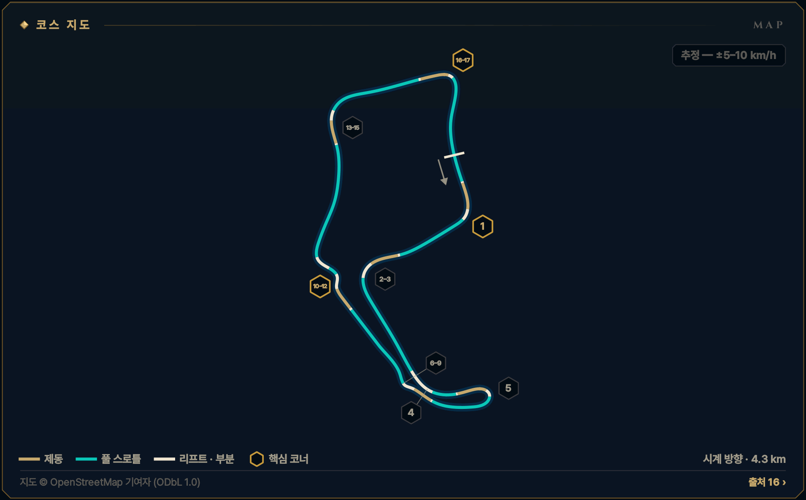
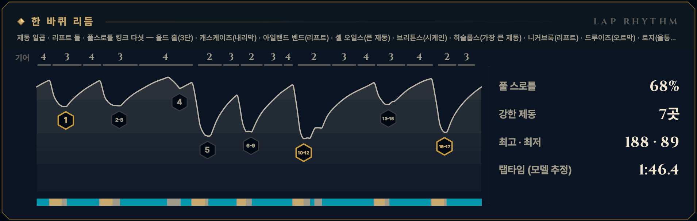

> **GRID서당 : iRacing**은 심레이싱이 처음인 동아리 신입을 위해 만든 드라이빙 아카데미 프로그램입니다. 이 글은 그 안의 **서킷 공략** 모드 — 이번 시즌 리그가 도는 서킷을 코스 개관과 코너별 애니메이션으로 미리 익히는 화면 — 를 블로그로 옮긴 것으로, 글과 애니메이션 모두 프로그램에서 그대로 가져왔습니다. 차는 iRacing의 Ray FF1600이고, 기준은 진도가 없는 루키(입문 렌즈)입니다. 강의는 [GRID서당 시리즈](/posts/untitled_life/motorsport/sim-racing/grid-seodang/)에, 낯선 말은 [용어 사전](/posts/untitled_life/motorsport/sim-racing/grid-seodang/glossary/)에 모아 두었습니다.

## 이번 시즌 일정

> **2026 시즌 4 · 포뮬러 1600 루키 시리즈 · 3주차** — 9.29(화)–10.05(월)
>
> - 루키 FF1600 · 기본 포함 · 12분 레이스 · 스탠딩 스타트 (차: Ray FF1600)
> - iRacing 트랙 이름: Oulton Park Circuit - International
> - 주차는 매주 화요일 09:00(한국 시간)에 바뀝니다.
>
> iRacing 일정은 시즌마다 바뀝니다. 이 글의 주차는 2026 시즌 4 기준이고, 같은 서킷이 다른 시즌에 돌아오면 그 시즌 일정에서 주차와 레이아웃을 다시 확인하세요.

## 코스 개관

약 4.3 km, 시계 방향, 17코너. 영국 시골 영지의 언덕을 따라 깔린 좁은 트랙으로, 보이지 않는 크레스트와 가까운 방호벽이 이어집니다. 이번 시즌 루키 시리즈에서 가장 긴 랩이라 12분 레이스는 6\~7랩뿐이고, 한 번의 이탈이 레이스 전체를 가져갑니다.

- **시계 방향 · 인터내셔널 · 4.3 km · 17코너**
- **코너 번호** — 서킷과 실제 경기 브리핑이 쓰는 1\~17번 번호와 코너 이름을 씁니다. iRacing 화면의 번호와 같은지는 Test Drive에서 확인하세요.
- **루키 포인트** — 언덕 너머가 보이지 않는 트랙 — 크레스트에서는 곧게, 고속 코너는 한 랩에 한 뼘씩, 랩타임은 로지·니커브룩 탈출에서 삽니다
- **속도 표기: 추정 — ±5–10 km/h** — 이 서킷에는 기준이 되는 실주행 텔레메트리가 없습니다. 공개된 FF1600 트랙 가이드 등에서 맞춘 코너 최저 속도에 보정한 FF1600 물리 모델을 맞춰 계산했기 때문에, 글과 영상의 속도·페달·기어는 모두 **추정값**(±5–10 km/h)입니다. Test Drive에서 직접 확인하세요.

*지도 © OpenStreetMap 기여자 (ODbL 1.0) · 선 색: 골드 = 제동, 시안 = 풀 스로틀, 흰색 = 리프트 · 부분 · 금테 육각형 = 핵심 코너 · 번호 = 이 글의 코너 공략 단위*

## 한 바퀴 리듬

제동 일곱 · 리프트 둘 · 풀스로틀 킹크 다섯 — 올드 홀(3단) · 캐스케이즈(내리막) · 아일랜드 벤드(리프트) · 셸 오일스(큰 제동) · 브리튼스(시케인) · 히슬롭스(가장 큰 제동) · 니커브룩(리프트) · 드루이즈(오르막) · 로지(울퉁불퉁 내리막)

*풀 스로틀 68% · 강한 제동 7곳 · 최고 · 최저 188 · 89 km/h · 랩타임 (모델 추정) 1:46.4 — 위 그림의 기어 줄·속도 곡선·입력 띠(골드 = 제동, 시안 = 풀 스로틀)와 코너 번호는 이 기준 랩입니다.*

## 먼저 볼 코너

1. **[T1 올드 홀](#w03-u1)** — 1랩 스탠딩 스타트가 몰리는 첫 코너 · 출구 리밋이 엄격
2. **[T10–12 히슬롭스–니커브룩](#w03-u6)** — 랩에서 가장 큰 제동 · 니커브룩 탈출이 오르막 약 560 m를 정한다
3. **[T16–17 로지–디어 리프](#w03-u8)** — 메인 직선과 올드 홀 추월 지점으로 이어지는 랩의 가장 중요한 탈출

> **루키 포인트** — 언덕 너머가 보이지 않는 트랙 — 크레스트에서는 곧게, 고속 코너는 한 랩에 한 뼘씩, 랩타임은 로지·니커브룩 탈출에서 삽니다

## 루키 안전 노트

- **스탠딩 스타트** — 그리드에서 올드 홀까지 짧아 모두가 한 덩어리로 도착합니다. 평소보다 일찍, 부드럽게 밟고 안쪽 범프 다툼에 끼지 않습니다.
- **블라인드 크레스트** — 힐톱·드루이즈 출구·로지 앞·디어 리프에서는 차가 가벼워집니다. 제동과 조향은 꼭대기 전에 끝내고 곧게 넘습니다.
- **가까운 방호벽** — 아일랜드 벤드와 드루이즈는 런오프가 좁아 이탈이 곧 벽입니다. 처음엔 기준보다 한참 느리게, 한 랩에 한 뼘씩 올립니다.
- **피트 출입** — 피트 출구는 올드 홀 뒤 오른쪽으로 합류하고, 피트 입구는 로지 뒤 오른쪽입니다. 그 근처에서는 속도가 다른 차를 조심합니다.
- **스핀 대처** — 브레이크를 꽉 밟아 세우고(시동은 안티스톨이 지킵니다), 차들이 지나간 뒤 1단(왼쪽 패들)으로 트랙과 나란히 복귀합니다. 크레스트 뒤에서 멈췄다면 다가오는 차가 늦게 봅니다 — 릴레이티브를 보고 기다리세요. 17x면 실격이고, 사고 누적 드라이브스루는 없지만(출발 위반 등은 있음) 깨끗한 12분이 가장 빠른 길입니다.
- **트랙 리밋** — 차의 절반 이상이 노면 경계 밖이면 1x — 일부 트랙의 표시 구간만 네 바퀴 기준. 루키 규칙: 두 바퀴는 늘 선·연석 안쪽. 올드 홀·캐스케이즈·로지 출구는 실제 경기에서도 엄격하게 보는 곳이고, 연석 밖 매트에는 기대지 않습니다.

**1랩 · 스탠딩 스타트** — 1랩: 평소 제동 지점보다 늦게 밟지 않습니다. 앞차에 맞춰 더 일찍, 부드럽게 밟고, 차 한 대 폭을 남깁니다. 바깥이나 가운데를 지키고 안쪽 다툼에 끼지 않습니다.

## 영상 보는 법

코너마다 앱의 코너 공략 화면을 그대로 녹화했습니다. ▶를 눌러 재생하세요 — 앱의 **가이드** 재생(실제 속도의 0.4배, 화면에서 차가 너무 빠른 코너는 0.25배)이라 단계(접근·제동·턴인·에이펙스·탈출)마다 잠깐 멈추고, 멈춤 링이 차면 다음 단계로 넘어갑니다. 블로그 영상은 단계 시작의 멈춤만 짧게 줄였고 (캡션을 읽을 시간은 그대로), 끝에 앱의 끝 카드가 나옵니다. **급수별 브레이크 시연**을 펼치면 같은 코너를 7급·6급·5급 렌즈로, **흔한 실수 고스트**를 펼치면 실수한 차(빨간 점선)와 나란히 달린 영상을 볼 수 있습니다.

- **제동** — 골드 — 두께·밝기 = 브레이크 압력
- **가속** — 시안 — 스로틀
- **관성** — 흰색 — 두 페달 모두 뗀 구간
- **흔한 실수** — 빨간 점선 고스트 — 한 번에 하나만
- **▼ 제동 시작** — 루키 기준선의 제동 시작점
- **◆ 턴인** — 핸들을 감기 시작하는 곳
- **○ 에이펙스** — 가장 안쪽·가장 느린 곳
- **◇ 트랙아웃** — 탈출에서 닿는 바깥 끝
- **보드 (?)** — 확인 전 참고값 — Test Drive에서 기준점을 정하세요
- **입력 지도** — 골드 띠 = 브레이크, 흰 리본(안쪽) = 핸들. 겹치면 트레일
- **손 칸 · 내림 ×N · 올림** — 왼쪽 패들 N번 내림(블립은 오토 블립이) · 오른쪽 패들 한 번 올림

화면과 글의 속도는 모두 **추정값**(±5–10 km/h)입니다 — 기준 텔레메트리가 없는 서킷이라 모델로 계산했습니다.

## 코너 공략

### T1 올드 홀

**우코너 · 3단 · 최저 약 135 km/h · 핵심 코너 · 추정 — ±5–10 km/h**  
1랩 첫 코너 · 약 180→135 km/h · 출구 리밋 엄격

<figure>
  <video src="images/u1.mp4" poster="images/u1_poster.png" controls preload="none" playsinline style="width:100%;max-width:960px"></video>
  <figcaption>시범 — 루키 기준선 · 입문 렌즈(직선 제동) · 가이드 0.4× · 접근 → 제동 → 턴인 → 에이펙스 → 탈출</figcaption>
</figure>

급수별 브레이크 시연 — 7급 · 6급 · 5급 렌즈 (영상 3)

라인과 기준점은 그대로, 페달 쓰는 법만 지금 급수에 맞춥니다. 위 영상은 **직선 제동 — 기초·심화·9·8급** 렌즈입니다 — 턴인 전에 브레이크를 다 뗍니다 (브레이크 끝 = 턴인).

**릴리스 — 7급** — 턴인을 향해 0.4초 넘게 흘려서 0으로 · 7급 기준: 릴리스 0.4초 이상

<figure>
  <video src="images/u1_release.mp4" poster="images/u1_release_poster.png" controls preload="none" playsinline style="width:100%;max-width:960px"></video>
  <figcaption>7급 렌즈(릴리스) · 가이드 0.4× · 접근 → 제동 → 턴인 → 에이펙스 → 탈출</figcaption>
</figure>

- 제동 — **턴인을 향해 흘려 놓는다** · 피크 약 60% · 릴리스 약 0.8초 · 발 · 하나-둘-셋 놓기
- 턴인 — **턴인에서 0에 닿는다** · 턴인에서 약 0\~3% · 발 · 3% → 0

**트레일 — 6급·4\~1급·졸업** — 턴인 때 15\~20%를 남기고, 감는 만큼 풉니다 · 6급 기준: 턴인 때 15% 이상 남기기

<figure>
  <video src="images/u1_trail.mp4" poster="images/u1_trail_poster.png" controls preload="none" playsinline style="width:100%;max-width:960px"></video>
  <figcaption>6급 렌즈(트레일) · 가이드 0.4× · 접근 → 제동 → 턴인 → 에이펙스 → 탈출</figcaption>
</figure>

- 제동 — **턴인까지 끌고 간다** · 피크 약 60% · 턴인에서 약 18% · 발 · 놓으며 남기기
- 턴인 — **에이펙스 전까지 흘린다** · 약 18% → 에이펙스 전 0 · 발 · 18% → 0 / 손 · 놓는 만큼 감기

**깊은 트레일 — 5급** — 턴인 때 30% 이상, 에이펙스 앞까지 끌고 갑니다 · 5급 기준: 턴인 때 30% 이상 남기기

<figure>
  <video src="images/u1_deep.mp4" poster="images/u1_deep_poster.png" controls preload="none" playsinline style="width:100%;max-width:960px"></video>
  <figcaption>5급 렌즈(깊은 트레일) · 가이드 0.4× · 접근 → 제동 → 턴인 → 에이펙스 → 탈출</figcaption>
</figure>

- 제동 — **더 깊게, 턴인 32%** · 피크 약 45% · 턴인에서 약 32% · 발 · 천천히 남기기
- 턴인 — **앞을 누른 채 감는다** · 약 32% → 에이펙스 직전 0 · 발 · 32% → 0

4\~1급은 같은 영상의 캡션에 강조 한 줄(◆)이 더 붙습니다:

- ◆ 4급(턴인·에이펙스) — 브레이크 끝 = 스로틀 시작 — 긴 턴인에서 두 발이 쉬지 않게

흔한 실수 고스트 — 이른 턴인 → 출구에서 밀림

<figure>
  <video src="images/u1_ghost.mp4" poster="images/u1_ghost_poster.png" controls preload="none" playsinline style="width:100%;max-width:960px"></video>
  <figcaption>흔한 실수: 이른 턴인 → 출구에서 밀림 — 일찍 꺾으면 출구에서 바깥으로 밀린다 → 약 0.2초 늦음 · 트랙 밖</figcaption>
</figure>

흔한 실수: **이른 턴인 → 출구에서 밀림** — 일찍 꺾으면 출구에서 바깥으로 밀린다 → 약 0.2초 늦음 · 트랙 밖. 빨간 점선과 붉은 차가 실수 고스트, 흰 차가 루키 기준선입니다. 두 차는 같은 시계로 달리므로 늦어지거나 밀려나는 만큼이 그대로 보입니다. 영상은 앱에서 [흔한 실수]를 눌렀을 때처럼 그 실수가 시작되는 단계부터 재생합니다. 끝 카드의 '트레일 렌즈 기준'은 결과의 시간 차를 트레일(6급) 렌즈 주행과 비교한 값이라는 뜻입니다.

> **1랩 · 스탠딩 스타트** — 1랩: 평소 제동 지점보다 늦게 밟지 않습니다. 앞차에 맞춰 더 일찍, 부드럽게 밟고, 차 한 대 폭을 남깁니다. 바깥이나 가운데를 지키고 안쪽 다툼에 끼지 않습니다. 올드 홀을 나가면 곧바로 내리막 캐스케이즈 제동입니다 — 나란히 달리는 차와 거리를 둡니다.

#### 접근

메인 직선 끝, 4단 약 180 km/h로 트랙 왼쪽에 붙습니다. 실제 서킷 가이드의 기준은 왼쪽 가장자리 — 실선 흰 선이 끝나는 곳이나 잔디 쪽 아스팔트 띠입니다(Test Drive에서 확인). 코너를 나가면 피트 출구 차가 오른쪽으로 합류합니다.

*지금 손과 발 — 발 · 풀스로틀 / 손 · 곧게 / 눈 · 왼쪽 흰 선 끝*

**보드 · 기준점** — 모두 확인 전 참고값입니다. Test Drive에서 직접 보고 정하세요.

- **제동 · 기준점**? 왼쪽 실선 흰 선이 끝나는 곳(실제 서킷 가이드) — Test Drive에서 이 근처 보드·표지물을 기준점으로 정하세요 *(확인 전 참고값)*
- **에이펙스**? 안쪽 연석 뒤쪽 절반 — 평평한 칠 부분에 바퀴 반만 *(확인 전 참고값)*

#### 제동

중간 세기의 제동입니다. 곧은 차로 한 음절에 약 60%까지 '꾹', 왼쪽 패들로 4→3단까지 내리고, 턴인까지 약 75 m 동안 흘려서 풉니다. 빠른 랩은 약 26 m 늦게 밟습니다.

*지금 손과 발 — 발 · 꾹 / 손 · 곧게 · 내림 ×1 / 눈 · 턴인 지점*

#### 턴인

브레이크가 0이 되는 순간 왼쪽 끝에서 감기 시작합니다(브레이크 끝 = 턴인). 서두르지 않고 천천히 감아 들어갑니다 — 일찍 꺾으면 안쪽이 빨라 보여도 출구에서 길이 모자랍니다. 에이펙스까지 길게 도는 코너입니다.

*지금 손과 발 — 발 · 0 → 유지 스로틀 / 손 · 천천히 감기 / 눈 · 연석 뒤쪽 절반*

#### 에이펙스

안쪽 연석의 뒤쪽 절반, 약간 늦은 에이펙스입니다. 연석은 평평한 칠 부분에 바퀴 반만 — 안쪽에 차를 튕기는 범프가 있습니다. 최저 약 135 km/h(3단), 기준 랩은 약 140 km/h입니다.

*지금 손과 발 — 발 · 속도 유지만큼 / 손 · 잠깐 유지 / 눈 · 출구 왼쪽 끝*

#### 탈출

핸들을 푸는 만큼 스로틀을 끝까지 엽니다(앞으로만). 왼쪽 끝까지 쓰되 두 바퀴는 흰 선 안에 — 이 출구는 실제 경기에서도 엄격하게 보는 곳입니다. 이어서 덴턴스를 지나며 오른쪽으로 옮겨 캐스케이즈를 준비합니다.

*지금 손과 발 — 발 · 앞으로만 100% / 손 · 풀기 / 눈 · 덴턴스 오른쪽*

#### 흔한 실수

- 이른 턴인 → 이른 에이펙스 → 출구에서 흰 선 밖으로  
  → 반 박자 늦게 꺾고, 연석 뒤쪽 절반을 노린다
- 1랩, 무리 속에서 평소보다 늦게 밟고 안쪽 범프로 파고들기  
  → 평소보다 일찍 부드럽게, 바깥이나 가운데를 지킨다
- 핸들을 꺾은 채 스로틀을 꾹 → 앞이 밀려 바깥으로(오픈 디퍼렌셜)  
  → 먼저 풀고, 푸는 만큼 연다

#### 이 코너에서 확인할 것

- [ ] 왼쪽 흰 선이 끝나는 지점과 아스팔트 띠가 iRacing에 있는지
- [ ] 안쪽 연석의 범프 위치

#### 연결된 강의 · 드릴

- 강의: [심화 1강(출발의 기술)](/posts/untitled_life/motorsport/sim-racing/grid-seodang/advanced/d1-the-start/) · [기초 4강(레이싱 라인의 문법)](/posts/untitled_life/motorsport/sim-racing/grid-seodang/basics/f4-racing-line/) · [심화 2강(코너의 다섯 얼굴)](/posts/untitled_life/motorsport/sim-racing/grid-seodang/advanced/d2-five-corner-faces/) · [8급(제동의 기본)](/posts/untitled_life/motorsport/sim-racing/grid-seodang/grades/g8-braking-basics/) · [7급(릴리스 수양)](/posts/untitled_life/motorsport/sim-racing/grid-seodang/grades/g7-release/) · [6급(트레일 입문)](/posts/untitled_life/motorsport/sim-racing/grid-seodang/grades/g6-trail-intro/) · [4급(전환 수련)](/posts/untitled_life/motorsport/sim-racing/grid-seodang/grades/g4-transition/) · [3급(스로틀 서예)](/posts/untitled_life/motorsport/sim-racing/grid-seodang/grades/g3-throttle-calligraphy/)
- 훈련장 드릴: 제동 수양 · 정밀 압력 · 트레일 브레이킹

<small>근거: O1 · O2 · O3 · O8 · O9 · O13 · MODEL (아래 출처 목록) · 신뢰도 L</small>

### T2–3 덴턴스–캐스케이즈

**우·좌 복합 · 3단 · 최저 약 135 km/h · 추정 — ±5–10 km/h**  
풀스로틀 킹크 뒤 내리막 왼쪽 · 약 180→135 km/h

<figure>
  <video src="images/u2.mp4" poster="images/u2_poster.png" controls preload="none" playsinline style="width:100%;max-width:960px"></video>
  <figcaption>시범 — 루키 기준선 · 입문 렌즈(직선 제동) · 가이드 0.4× · 접근 → 턴인 → 에이펙스 → 제동 ② → 에이펙스 ② → 탈출</figcaption>
</figure>

급수별 브레이크 시연 — 7급 · 6급 · 5급 렌즈 (영상 3)

라인과 기준점은 그대로, 페달 쓰는 법만 지금 급수에 맞춥니다. 위 영상은 **직선 제동 — 기초·심화·9·8급** 렌즈입니다 — 턴인 전에 브레이크를 다 뗍니다 (브레이크 끝 = 턴인).

**릴리스 — 7급** — 턴인을 향해 0.4초 넘게 흘려서 0으로 · 7급 기준: 릴리스 0.4초 이상

<figure>
  <video src="images/u2_release.mp4" poster="images/u2_release_poster.png" controls preload="none" playsinline style="width:100%;max-width:960px"></video>
  <figcaption>7급 렌즈(릴리스) · 가이드 0.4× · 접근 → 턴인 → 에이펙스 → 제동 ② → 에이펙스 ② → 탈출</figcaption>
</figure>

- 제동 ② — **턴인을 향해 흘려 놓는다** · 피크 약 60% · 릴리스 약 0.8초 · 발 · 하나-둘-셋 놓기
- 에이펙스 ② — **턴인에서 0에 닿는다** · 턴인에서 약 0\~3% · 발 · 3% → 0

**트레일 — 6급·4\~1급·졸업** — 턴인 때 15\~20%를 남기고, 감는 만큼 풉니다 · 6급 기준: 턴인 때 15% 이상 남기기

<figure>
  <video src="images/u2_trail.mp4" poster="images/u2_trail_poster.png" controls preload="none" playsinline style="width:100%;max-width:960px"></video>
  <figcaption>6급 렌즈(트레일) · 가이드 0.4× · 접근 → 턴인 → 에이펙스 → 제동 ② → 에이펙스 ② → 탈출</figcaption>
</figure>

- 제동 ② — **턴인까지 끌고 간다** · 피크 약 60% · 턴인에서 약 18% · 발 · 놓으며 남기기
- 에이펙스 ② — **에이펙스 전까지 흘린다** · 약 18% → 에이펙스 전 0 · 발 · 18% → 0 / 손 · 놓는 만큼 감기

**깊은 트레일 — 5급** — 턴인 때 30% 이상, 에이펙스 앞까지 끌고 갑니다 · 5급 기준: 턴인 때 30% 이상 남기기

<figure>
  <video src="images/u2_deep.mp4" poster="images/u2_deep_poster.png" controls preload="none" playsinline style="width:100%;max-width:960px"></video>
  <figcaption>5급 렌즈(깊은 트레일) · 가이드 0.4× · 접근 → 턴인 → 에이펙스 → 제동 ② → 에이펙스 ② → 탈출</figcaption>
</figure>

- 제동 ② — **더 깊게, 턴인 32%** · 피크 약 45% · 턴인에서 약 32% · 발 · 천천히 남기기
- 에이펙스 ② — **앞을 누른 채 감는다** · 약 32% → 에이펙스 직전 0 · 발 · 32% → 0

흔한 실수 고스트 — 이른 턴인 → 출구에서 밀림

<figure>
  <video src="images/u2_ghost.mp4" poster="images/u2_ghost_poster.png" controls preload="none" playsinline style="width:100%;max-width:960px"></video>
  <figcaption>흔한 실수: 이른 턴인 → 출구에서 밀림 — 일찍 꺾으면 출구에서 바깥으로 밀린다 → 약 0.1초 늦음</figcaption>
</figure>

흔한 실수: **이른 턴인 → 출구에서 밀림** — 일찍 꺾으면 출구에서 바깥으로 밀린다 → 약 0.1초 늦음. 빨간 점선과 붉은 차가 실수 고스트, 흰 차가 루키 기준선입니다. 두 차는 같은 시계로 달리므로 늦어지거나 밀려나는 만큼이 그대로 보입니다. 영상은 앱에서 [흔한 실수]를 눌렀을 때처럼 그 실수가 시작되는 단계부터 재생합니다. 끝 카드의 '트레일 렌즈 기준'은 결과의 시간 차를 트레일(6급) 렌즈 주행과 비교한 값이라는 뜻입니다.

#### 접근

올드 홀을 나와 4단으로 가속하며 덴턴스로 향합니다. 덴턴스는 길이 떨어지는 언덕 너머의 오른쪽 킹크로, 이 차는 풀스로틀입니다 — 핸들을 살짝 기울이기만 합니다.

*지금 손과 발 — 발 · 풀스로틀 / 손 · 곧게 / 눈 · 덴턴스*

**보드 · 기준점** — 모두 확인 전 참고값입니다. Test Drive에서 직접 보고 정하세요.

- **제동 · 기준점**? 제동 구간의 딥 — 그 전에 큰 압력을 끝냅니다. Test Drive에서 이 근처 보드·표지물을 기준점으로 정하세요 *(확인 전 참고값)*
- **턴인**? 바깥 탈출로가 시작되는 곳(실제 서킷 가이드) *(확인 전 참고값)*

#### 턴인

언덕 너머로 길이 떨어지기 직전, 핸들을 살짝 기울여 킹크를 지납니다. 발은 그대로입니다 — 여기서 떼면 아무것도 얻지 못하고 속도만 잃습니다.

*지금 손과 발 — 발 · 풀스로틀 / 손 · 살짝 기울이기 / 눈 · 오른쪽 끝*

#### 에이펙스

킹크를 지나며 트랙 오른쪽 끝에 붙고, 곧바로 캐스케이즈 제동을 시작합니다(덴턴스는 거의 곧은 길이라 핸들은 아주 조금만). 내리막(약 5%) 제동이라 평지보다 한 대 길이쯤 일찍 밟습니다(심화 9강(기울어진 트랙)).

*지금 손과 발 — 발 · 꾹 / 손 · 거의 곧게 / 눈 · 탈출로 입구*

#### 제동 ②

곧은 차로 약 60%, 왼쪽 패들로 4→3단까지 내립니다. 제동 구간의 딥(움푹 꺼진 곳) 위에서는 바퀴가 가벼워지니 압력을 더하지 말고 유지하거나 살짝 덜어 줍니다 — ABS가 없어 여기서 잠기면 그대로 직진합니다. 턴인까지 약 85 m입니다.

*지금 손과 발 — 발 · 꾹 → 유지 / 손 · 곧게 · 내림 ×1 / 눈 · 바깥 탈출로*

#### 에이펙스 ②

바깥 탈출로가 시작되는 부근에서 부드럽게 감습니다(브레이크 끝 = 턴인). 에이펙스는 늦게 — 안쪽 연석의 3분의 2 지점, 안쪽 가드레일이 끝나는 부근이고, 긴 가운데는 핸들을 조용히 붙든 채 스로틀로 속도계를 멈춰 둡니다. 최저 약 135 km/h(3단)입니다.

*지금 손과 발 — 발 · 유지 스로틀 / 손 · 조용히 유지 / 눈 · 연석 3분의 2*

#### 탈출

핸들을 푸는 만큼 100%로 엽니다. 레이크사이드 약 450 m 직선의 속도가 여기서 결정됩니다. 출구 연석 밖 매트에 기대지 말고 연석 안에서 마무리한 뒤, 아일랜드 벤드를 위해 다시 오른쪽으로 갑니다.

*지금 손과 발 — 발 · 앞으로만 100% / 손 · 풀기 / 눈 · 오른쪽 끝*

#### 흔한 실수

- 안쪽이 빨라 보여 일찍 꺾기 → 이른 에이펙스 → 출구에서 연석·잔디  
  → 탈출로가 보일 때까지 기다렸다 늦은 에이펙스로
- 딥 위에서 세게 밟아 앞바퀴 잠김 → 직진  
  → 큰 압력은 딥 전에 끝내고, 딥 위에선 유지
- 덴턴스에서 괜히 발 떼기  
  → 이 차에선 풀스로틀 — 기울이기만

#### 이 코너에서 확인할 것

- [ ] 캐스케이즈 제동 구간 딥의 위치
- [ ] 바깥 탈출로와 안쪽 가드레일 끝이 iRacing에 있는지

#### 연결된 강의 · 드릴

- 강의: [심화 2강(코너의 다섯 얼굴)](/posts/untitled_life/motorsport/sim-racing/grid-seodang/advanced/d2-five-corner-faces/) · [심화 9강(기울어진 트랙)](/posts/untitled_life/motorsport/sim-racing/grid-seodang/advanced/d7-banked-track/) · [심화 4강(차의 균형)](/posts/untitled_life/motorsport/sim-racing/grid-seodang/advanced/d4-car-balance/) · [8급(제동의 기본)](/posts/untitled_life/motorsport/sim-racing/grid-seodang/grades/g8-braking-basics/) · [7급(릴리스 수양)](/posts/untitled_life/motorsport/sim-racing/grid-seodang/grades/g7-release/) · [6급(트레일 입문)](/posts/untitled_life/motorsport/sim-racing/grid-seodang/grades/g6-trail-intro/) · [3급(스로틀 서예)](/posts/untitled_life/motorsport/sim-racing/grid-seodang/grades/g3-throttle-calligraphy/)
- 훈련장 드릴: 제동 수양 · 정밀 압력 · 스로틀 서예

<small>근거: O1 · O2 · O3 · O4 · O7 · O8 · O9 · MODEL (아래 출처 목록) · 신뢰도 L</small>

### T4 아일랜드 벤드

**좌코너 · 4단 · 최저 약 165 km/h · 추정 — ±5–10 km/h**  
가장 위험한 고속 코너 · 리프트 · 약 165 km/h

<figure>
  <video src="images/u3.mp4" poster="images/u3_poster.png" controls preload="none" playsinline style="width:100%;max-width:960px"></video>
  <figcaption>시범 — 루키 기준선 · 렌즈 공통 · 가이드 0.4× · 접근 → 리프트 → 턴인 → 에이펙스 → 탈출</figcaption>
</figure>

급수별 브레이크 시연 — 모든 급수가 같은 그림

이 코너는 렌즈가 같습니다 — 리프트·풀스로틀 코너는 브레이크를 쓰지 않아 모든 급수가 같은 페달 그림을 봅니다.

#### 접근

레이크사이드의 둔덕이 코너를 늦게까지 숨깁니다. 트랙 오른쪽 끝, 4단 약 185 km/h. 서킷에서 가장 위험한 코너로 꼽히니, 첫 세션은 기준보다 한참 느리게 시작해 한 랩에 한 뼘씩 올립니다.

*지금 손과 발 — 발 · 풀스로틀 / 손 · 곧게 / 눈 · 오른쪽 연결 도로*

**보드 · 기준점** — 모두 확인 전 참고값입니다. Test Drive에서 직접 보고 정하세요.

- **리프트 시작**? 트랙 오른쪽, 차가 곧을 때 — Test Drive에서 이 근처 보드·표지물을 기준점으로 정하세요 *(확인 전 참고값)*
- **턴인**? 오른쪽으로 갈라지는 연결 도로 입구 *(확인 전 참고값)*

#### 리프트

고속 코너의 속도 조절은 핸들을 꺾기 전에 끝냅니다. 차가 곧을 때 스로틀을 떼고(애니메이션은 완전히), 4단 그대로 둡니다. 가이드들은 필요하면 짧은 톡을 쓰지만, 루키는 리프트만으로 충분합니다.

*지금 손과 발 — 발 · 리프트 / 손 · 곧게 / 눈 · 연결 도로 입구*

**급수 시험 주행에서는 리프트만 — 10%를 넘는 톡도 제동 코너로 채점됩니다.**

#### 턴인

오른쪽으로 갈라지는 연결 도로(아일랜드 레이아웃의 지름길) 입구를 지나며 한 번에 부드럽게 감습니다. 감은 뒤에는 브레이크를 밟거나 스로틀을 '탁' 떼지 않습니다 — 뒤가 가벼워져 꽁무니가 돕니다(심화 4강(차의 균형)).

*지금 손과 발 — 발 · 뗀 채로 / 손 · 한 번 감기 / 눈 · 안쪽 연석 끝*

#### 에이펙스

안쪽 바퀴를 안쪽 연석에 올리고, 연석 끝을 에이펙스로 삼습니다. 에이펙스에서 스로틀을 다시 열어 앞으로만 100% — 최저 약 165 km/h(기준 랩 약 175). 처음엔 이보다 한참 느려도 괜찮습니다.

*지금 손과 발 — 발 · 앞으로만 100% / 손 · 유지 / 눈 · 출구*

#### 탈출

오른쪽으로 넓게 흘러 나가지 않습니다 — 오른쪽 잔디로 나가면 셸 안쪽 타이어 벽입니다. 길이 계속 완만하게 왼쪽으로 휘니, 오른쪽에서 왼쪽으로 비스듬히 곧은 선을 그어 그 위에서 셸 제동을 합니다.

*지금 손과 발 — 발 · 100% / 손 · 풀며 왼쪽으로 / 눈 · 셸 제동 지점*

#### 흔한 실수

- 턴인 뒤에 발 떼기·브레이크 → 약 170 km/h에서 뒤가 돈다  
  → 조정은 모두 꺾기 전에, 곧을 때
- 일찍 꺾기 → 출구 오른쪽 잔디 → 셸 안쪽 타이어 벽  
  → 연결 도로 입구까지 기다린다
- 첫 랩·차가운 타이어로 기준 속도 욕심  
  → 첫 세션은 한참 느리게, 한 랩에 한 뼘씩

#### 이 코너에서 확인할 것

- [ ] 연결 도로 입구가 iRacing에서 보이는지
- [ ] 실제로 필요한 리프트 깊이(가이드: 리프트, 필요하면 짧은 톡)

#### 연결된 강의 · 드릴

- 강의: [심화 2강(코너의 다섯 얼굴)](/posts/untitled_life/motorsport/sim-racing/grid-seodang/advanced/d2-five-corner-faces/) · [심화 4강(차의 균형)](/posts/untitled_life/motorsport/sim-racing/grid-seodang/advanced/d4-car-balance/) · [심화 9강(기울어진 트랙)](/posts/untitled_life/motorsport/sim-racing/grid-seodang/advanced/d7-banked-track/) · [2급(스티어링 일필휘지)](/posts/untitled_life/motorsport/sim-racing/grid-seodang/grades/g2-one-stroke-steering/) · [3급(스로틀 서예)](/posts/untitled_life/motorsport/sim-racing/grid-seodang/grades/g3-throttle-calligraphy/)
- 훈련장 드릴: 정밀 압력 · 트레일 브레이킹

<small>근거: O1 · O2 · O3 · O6 · O8 · O11 · MODEL (아래 출처 목록) · 신뢰도 M</small>

### T5 셸 오일스

**우코너 · 2단 · 최저 약 90 km/h · 추정 — ±5–10 km/h**  
뱅크 헤어핀 · 큰 제동 · 약 175→90 km/h

<figure>
  <video src="images/u4.mp4" poster="images/u4_poster.png" controls preload="none" playsinline style="width:100%;max-width:960px"></video>
  <figcaption>시범 — 루키 기준선 · 입문 렌즈(직선 제동) · 가이드 0.4× · 접근 → 제동 → 턴인 → 에이펙스 → 탈출</figcaption>
</figure>

급수별 브레이크 시연 — 7급 · 6급 · 5급 렌즈 (영상 3)

라인과 기준점은 그대로, 페달 쓰는 법만 지금 급수에 맞춥니다. 위 영상은 **직선 제동 — 기초·심화·9·8급** 렌즈입니다 — 턴인 전에 브레이크를 다 뗍니다 (브레이크 끝 = 턴인).

**릴리스 — 7급** — 턴인을 향해 0.4초 넘게 흘려서 0으로 · 7급 기준: 릴리스 0.4초 이상

<figure>
  <video src="images/u4_release.mp4" poster="images/u4_release_poster.png" controls preload="none" playsinline style="width:100%;max-width:960px"></video>
  <figcaption>7급 렌즈(릴리스) · 가이드 0.4× · 접근 → 제동 → 턴인 → 에이펙스 → 탈출</figcaption>
</figure>

- 제동 — **턴인을 향해 흘려 놓는다** · 피크 약 72% · 릴리스 약 1.0초 · 발 · 하나-둘-셋 놓기
- 턴인 — **턴인에서 0에 닿는다** · 턴인에서 약 0\~3% · 발 · 3% → 0

**트레일 — 6급·4\~1급·졸업** — 턴인 때 15\~20%를 남기고, 감는 만큼 풉니다 · 6급 기준: 턴인 때 15% 이상 남기기

<figure>
  <video src="images/u4_trail.mp4" poster="images/u4_trail_poster.png" controls preload="none" playsinline style="width:100%;max-width:960px"></video>
  <figcaption>6급 렌즈(트레일) · 가이드 0.4× · 접근 → 제동 → 턴인 → 에이펙스 → 탈출</figcaption>
</figure>

- 제동 — **턴인까지 끌고 간다** · 피크 약 65% · 턴인에서 약 18% · 발 · 놓으며 남기기
- 턴인 — **에이펙스 전까지 흘린다** · 약 18% → 에이펙스 전 0 · 발 · 18% → 0 / 손 · 놓는 만큼 감기

**깊은 트레일 — 5급** — 턴인 때 30% 이상, 에이펙스 앞까지 끌고 갑니다 · 5급 기준: 턴인 때 30% 이상 남기기

<figure>
  <video src="images/u4_deep.mp4" poster="images/u4_deep_poster.png" controls preload="none" playsinline style="width:100%;max-width:960px"></video>
  <figcaption>5급 렌즈(깊은 트레일) · 가이드 0.4× · 접근 → 제동 → 턴인 → 에이펙스 → 탈출</figcaption>
</figure>

- 제동 — **더 깊게, 턴인 32%** · 피크 약 56% · 턴인에서 약 32% · 발 · 천천히 남기기
- 턴인 — **앞을 누른 채 감는다** · 약 32% → 에이펙스 직전 0 · 발 · 32% → 0

흔한 실수 고스트 — 이른 턴인 → 출구에서 밀림

<figure>
  <video src="images/u4_ghost.mp4" poster="images/u4_ghost_poster.png" controls preload="none" playsinline style="width:100%;max-width:960px"></video>
  <figcaption>흔한 실수: 이른 턴인 → 출구에서 밀림 — 일찍 꺾으면 출구에서 바깥으로 밀린다 → 약 0.1초 늦음</figcaption>
</figure>

흔한 실수: **이른 턴인 → 출구에서 밀림** — 일찍 꺾으면 출구에서 바깥으로 밀린다 → 약 0.1초 늦음. 빨간 점선과 붉은 차가 실수 고스트, 흰 차가 루키 기준선입니다. 두 차는 같은 시계로 달리므로 늦어지거나 밀려나는 만큼이 그대로 보입니다. 영상은 앱에서 [흔한 실수]를 눌렀을 때처럼 그 실수가 시작되는 단계부터 재생합니다. 끝 카드의 '트레일 렌즈 기준'은 결과의 시간 차를 트레일(6급) 렌즈 주행과 비교한 값이라는 뜻입니다.

#### 접근

아일랜드 벤드 출구에서 오른쪽→왼쪽으로 비스듬히 곧게 달려 트랙 왼쪽에서 제동합니다. 길이 아직 휘어 있으니, 핸들이 꺾인 채 세게 밟지 않도록 먼저 차를 곧게 폅니다. 실제 서킷 가이드의 기준은 바깥 가드레일 쪽 마셜 포스트입니다(Test Drive에서 확인).

*지금 손과 발 — 발 · 풀스로틀 / 손 · 곧게 펴기 / 눈 · 마셜 포스트*

**보드 · 기준점** — 모두 확인 전 참고값입니다. Test Drive에서 직접 보고 정하세요.

- **제동 · 기준점**? 바깥 가드레일 쪽 마셜 포스트(실제 서킷 가이드) — Test Drive에서 이 근처 보드·표지물을 기준점으로 정하세요 *(확인 전 참고값)*
- **에이펙스**? 안쪽 연석 — 첫 연석부터 길게 *(확인 전 참고값)*

#### 제동

이 랩의 큰 제동 중 하나입니다. 곧은 차로 한 음절에 약 72%까지(ABS가 없어 100%는 잠김), 왼쪽 패들로 4→3→2단까지 내리고, 턴인까지 약 110 m 동안 흘려서 풉니다. 살짝 오르막이라 제동을 도와줍니다.

*지금 손과 발 — 발 · 꾹 / 손 · 곧게 · 내림 ×2 / 눈 · 첫 연석*

#### 턴인

브레이크가 0이 되는 순간 감아 첫 연석을 스치고, 기울어진 뱅크에 차를 맡깁니다. 뱅크가 차를 받쳐 주니 평지 헤어핀보다 속도를 더 들고 갈 수 있습니다(심화 9강(기울어진 트랙)).

*지금 손과 발 — 발 · 0 → 유지 스로틀 / 손 · 감기 / 눈 · 뱅크 위*

#### 에이펙스

안쪽 연석을 따라 길게 돌며, 최저 약 90 km/h(2단)입니다. 차가 도는 동안 유지 스로틀로 하중을 이어 주고(두 발이 쉬지 않게), 출구가 보이면 푸는 만큼 엽니다. 실제 가이드들은 두 번째 에이펙스를 늦게 잡으라고 강조합니다 — 서두르지 마세요.

*지금 손과 발 — 발 · 유지 → 열기 / 손 · 버티기 / 눈 · 출구 왼쪽 끝*

#### 탈출

핸들을 푸는 만큼 100%로. 출구에서 노면이 평평해지며 작은 언덕을 넘으니, 뱅크가 더는 받쳐 주지 않는다는 걸 기억하고 서두르지 않습니다. 왼쪽 끝까지 쓰고, 오른쪽 킹크를 풀스로틀로 지나 브리튼스로 갑니다.

*지금 손과 발 — 발 · 100% / 손 · 풀기 / 눈 · 오른쪽 킹크*

#### 흔한 실수

- 일찍 꺾어 안쪽에 붙는 한 획 → 출구에서 바깥으로 밀린다  
  → 브레이크가 0이 될 때 꺾고, 뱅크를 길게 쓴다
- 아일랜드에서 꺾인 채 늦게 꾹 → 앞바퀴 잠김  
  → 곧게 편 뒤 제동, 피크는 85% 이하
- 뱅크 안에서 일찍 풀스로틀 → 뱅크가 끝나는 곳에서 밀림  
  → 출구가 보이고 핸들이 풀릴 때 연다

#### 이 코너에서 확인할 것

- [ ] 마셜 포스트·주황색 블록이 iRacing에 있는지
- [ ] 두 번째 에이펙스의 위치(가이드: 첫 에이펙스 약 75 m 뒤, 늦게)

#### 연결된 강의 · 드릴

- 강의: [심화 2강(코너의 다섯 얼굴)](/posts/untitled_life/motorsport/sim-racing/grid-seodang/advanced/d2-five-corner-faces/) · [심화 9강(기울어진 트랙)](/posts/untitled_life/motorsport/sim-racing/grid-seodang/advanced/d7-banked-track/) · [심화 3강(상황의 라인)](/posts/untitled_life/motorsport/sim-racing/grid-seodang/advanced/d3-situational-lines/) · [8급(제동의 기본)](/posts/untitled_life/motorsport/sim-racing/grid-seodang/grades/g8-braking-basics/) · [5급(트레일 숙달)](/posts/untitled_life/motorsport/sim-racing/grid-seodang/grades/g5-trail-mastery/) · [4급(전환 수련)](/posts/untitled_life/motorsport/sim-racing/grid-seodang/grades/g4-transition/) · [3급(스로틀 서예)](/posts/untitled_life/motorsport/sim-racing/grid-seodang/grades/g3-throttle-calligraphy/)
- 훈련장 드릴: 제동 수양 · 트레일 브레이킹 · 정밀 압력

<small>근거: O1 · O3 · O4 · O5 · O8 · O13 · MODEL (아래 출처 목록) · 신뢰도 L</small>

### T6–9 브리튼스

**좌·우·좌 복합 · 2단 · 최저 약 95 km/h · 추정 — ±5–10 km/h**  
왼·오·왼 시케인 · 약 155→95 km/h · 오르막 탈출

<figure>
  <video src="images/u5.mp4" poster="images/u5_poster.png" controls preload="none" playsinline style="width:100%;max-width:960px"></video>
  <figcaption>시범 — 루키 기준선 · 입문 렌즈(직선 제동) · 가이드 0.4× · 접근 → 제동 → 턴인 → 리프트 ② → 에이펙스 ② → 전환 ③ → 에이펙스 ③ → 탈출</figcaption>
</figure>

급수별 브레이크 시연 — 7급 · 6급 · 5급 렌즈 (영상 3)

라인과 기준점은 그대로, 페달 쓰는 법만 지금 급수에 맞춥니다. 위 영상은 **직선 제동 — 기초·심화·9·8급** 렌즈입니다 — 턴인 전에 브레이크를 다 뗍니다 (브레이크 끝 = 턴인).

**릴리스 — 7급** — 턴인을 향해 0.4초 넘게 흘려서 0으로 · 7급 기준: 릴리스 0.4초 이상

<figure>
  <video src="images/u5_release.mp4" poster="images/u5_release_poster.png" controls preload="none" playsinline style="width:100%;max-width:960px"></video>
  <figcaption>7급 렌즈(릴리스) · 가이드 0.4× · 접근 → 제동 → 턴인 → 리프트 ② → 에이펙스 ② → 전환 ③ → 에이펙스 ③ → 탈출</figcaption>
</figure>

- 제동 — **첫 왼쪽 턴인을 향해 흘려 놓는다** · 피크 약 75% · 릴리스 약 0.9초 · 발 · 하나-둘-셋 놓기
- 턴인 — **첫 왼쪽 턴인에서 0에 닿는다** · 첫 왼쪽 턴인에서 약 0\~3% · 발 · 3% → 0

**트레일 — 6급·4\~1급·졸업** — 턴인 때 15\~20%를 남기고, 감는 만큼 풉니다 · 6급 기준: 턴인 때 15% 이상 남기기

<figure>
  <video src="images/u5_trail.mp4" poster="images/u5_trail_poster.png" controls preload="none" playsinline style="width:100%;max-width:960px"></video>
  <figcaption>6급 렌즈(트레일) · 가이드 0.4× · 접근 → 제동 → 턴인 → 리프트 ② → 에이펙스 ② → 전환 ③ → 에이펙스 ③ → 탈출</figcaption>
</figure>

- 제동 — **첫 왼쪽 턴인까지 끌고 간다** · 피크 약 75% · 첫 왼쪽 턴인에서 약 18% · 발 · 놓으며 남기기
- 턴인 — **오른쪽 전까지 흘린다** · 약 18% → 오른쪽 전 0 · 발 · 18% → 0 / 손 · 놓는 만큼 감기

**깊은 트레일 — 5급** — 턴인 때 30% 이상, 에이펙스 앞까지 끌고 갑니다 · 5급 기준: 턴인 때 30% 이상 남기기

<figure>
  <video src="images/u5_deep.mp4" poster="images/u5_deep_poster.png" controls preload="none" playsinline style="width:100%;max-width:960px"></video>
  <figcaption>5급 렌즈(깊은 트레일) · 가이드 0.4× · 접근 → 제동 → 턴인 → 리프트 ② → 에이펙스 ② → 전환 ③ → 에이펙스 ③ → 탈출</figcaption>
</figure>

- 제동 — **더 깊게, 첫 왼쪽 턴인 32%** · 피크 약 60% · 첫 왼쪽 턴인에서 약 32% · 발 · 천천히 남기기
- 턴인 — **앞을 누른 채 감는다** · 약 32% → 오른쪽 직전 0 · 발 · 32% → 0

흔한 실수 고스트 — 첫 코너 욕심 → 두 번째를 잃음

<figure>
  <video src="images/u5_ghost.mp4" poster="images/u5_ghost_poster.png" controls preload="none" playsinline style="width:100%;max-width:960px"></video>
  <figcaption>흔한 실수: 첫 코너 욕심 → 두 번째를 잃음 — 첫 코너에 욕심내면 두 번째를 잃는다 → 약 0.5초 늦음</figcaption>
</figure>

흔한 실수: **첫 코너 욕심 → 두 번째를 잃음** — 첫 코너에 욕심내면 두 번째를 잃는다 → 약 0.5초 늦음. 빨간 점선과 붉은 차가 실수 고스트, 흰 차가 루키 기준선입니다. 두 차는 같은 시계로 달리므로 늦어지거나 밀려나는 만큼이 그대로 보입니다. 영상은 앱에서 [흔한 실수]를 눌렀을 때처럼 그 실수가 시작되는 단계부터 재생합니다. 끝 카드의 '트레일 렌즈 기준'은 결과의 시간 차를 트레일(6급) 렌즈 주행과 비교한 값이라는 뜻입니다.

#### 접근

셸 뒤 오른쪽 킹크는 풀스로틀 — 왼쪽에서 들어가 킹크를 스치고 트랙 오른쪽에 머뭅니다. 3단 약 155 km/h. 실제 서킷 가이드의 제동 기준은 오른쪽 잔디의 작은 콘크리트 패치입니다(Test Drive에서 확인).

*지금 손과 발 — 발 · 풀스로틀 / 손 · 곧게 / 눈 · 콘크리트 패치*

**보드 · 기준점** — 모두 확인 전 참고값입니다. Test Drive에서 직접 보고 정하세요.

- **제동 · 기준점**? 오른쪽 잔디의 작은 콘크리트 패치(실제 서킷 가이드) — Test Drive에서 이 근처 보드·표지물을 기준점으로 정하세요 *(확인 전 참고값)*
- **에이펙스**? 첫 왼쪽 연석 — 평평한 부분에 바퀴 반만 *(확인 전 참고값)*

#### 제동

곧은 차로 약 75%까지 꾹, 3→2단으로 내립니다. 턴인까지 약 75 m 동안 흘려서 풀고, 첫 왼쪽 앞에서 브레이크를 끝냅니다. 시케인은 마지막 코너가 왕입니다(심화 2강(코너의 다섯 얼굴)).

*지금 손과 발 — 발 · 꾹 → 놓기 / 손 · 곧게 · 내림 ×1 / 눈 · 첫 왼쪽*

#### 턴인

첫 왼쪽은 '내주는' 코너입니다 — 늦은 에이펙스로 짧게 감아 오른쪽을 반듯하게 펴 줍니다. 첫 연석은 크고 높으니 평평한 부분에 바퀴 반만 올립니다. 브레이크 끝에서 바로 유지 스로틀로 이어 받습니다.

*지금 손과 발 — 발 · 유지 스로틀 / 손 · 짧게 감기 / 눈 · 오른쪽 연석*

#### 리프트 ②

왼쪽에서 오른쪽으로 핸들을 옮기는 사이 스로틀을 약 26%로 그대로 둡니다 — 오른쪽이 이 시케인에서 가장 좁고 가장 느린 곳입니다. 핸들은 미리 정한 '왼–오–왼' 세 획으로, 톱질하지 않습니다.

*지금 손과 발 — 발 · 약 26% 유지 / 손 · 오른쪽으로 한 획 / 눈 · 오른쪽 연석*

**급수 시험 주행에서는 오른쪽을 스로틀만으로 — 두 번째 톡(10% 넘게)은 따로 제동 코너로 채점됩니다.**

#### 에이펙스 ②

오른쪽 안쪽 바퀴를 빨강·하양 연석에 살짝 — 너무 안 쓰면 탈출이 느리고, 너무 쓰면 차가 튑니다. 최저 약 95 km/h(2단), 여기서부터 스로틀을 앞으로만 엽니다.

*지금 손과 발 — 발 · 앞으로만 / 손 · 풀며 왼쪽 / 눈 · 마지막 왼쪽*

#### 전환 ③

오른쪽을 나오며 풀스로틀로 올리고 마지막 왼쪽을 준비합니다. 출구가 가파른 오르막이라, 마지막 왼쪽에서 들고 나가는 속도가 힐톱까지 갑니다.

*지금 손과 발 — 발 · 100% / 손 · 왼쪽 한 획 / 눈 · 마지막 연석*

#### 에이펙스 ③

마지막 왼쪽 연석을 조금 자르고 오른쪽으로 흘려보냅니다. S자를 펴서 핸들을 덜 쓸수록 빠릅니다(심화 2강(코너의 다섯 얼굴)).

*지금 손과 발 — 발 · 100% 유지 / 손 · 풀기 / 눈 · 출구 오른쪽*

#### 탈출

오른쪽으로 흘려 나가 힐톱 약 420 m를 풀스로틀로 오릅니다. 힐톱 꼭대기를 넘으면 차가 가벼워지고, 곧 랩에서 가장 큰 히슬롭스 제동입니다.

*지금 손과 발 — 발 · 100% / 손 · 곧게 / 눈 · 힐톱 꼭대기*

#### 흔한 실수

- 첫 왼쪽에 빠르게 → 오른쪽에서 늦고 오르막 탈출이 느려진다  
  → 조금 일찍 제동, 첫 왼쪽은 늦은 에이펙스로 내준다
- 큰 첫 연석을 세게 밟아 차가 튄다  
  → 평평한 부분에 바퀴 반만
- 핸들 톱질  
  → '왼–오–왼' 세 획을 미리 정한다

#### 이 코너에서 확인할 것

- [ ] 콘크리트 패치가 iRacing에 있는지
- [ ] 첫 연석의 높이

#### 연결된 강의 · 드릴

- 강의: [심화 2강(코너의 다섯 얼굴)](/posts/untitled_life/motorsport/sim-racing/grid-seodang/advanced/d2-five-corner-faces/) · [심화 9강(기울어진 트랙)](/posts/untitled_life/motorsport/sim-racing/grid-seodang/advanced/d7-banked-track/) · [2급(스티어링 일필휘지)](/posts/untitled_life/motorsport/sim-racing/grid-seodang/grades/g2-one-stroke-steering/) · [4급(전환 수련)](/posts/untitled_life/motorsport/sim-racing/grid-seodang/grades/g4-transition/) · [기초 4강(레이싱 라인의 문법)](/posts/untitled_life/motorsport/sim-racing/grid-seodang/basics/f4-racing-line/)
- 훈련장 드릴: 조향 일필 · 전환

<small>근거: O1 · O2 · O3 · O5 · O8 · MODEL (아래 출처 목록) · 신뢰도 L</small>

### T10–12 히슬롭스–니커브룩

**우·좌·우 복합 · 2단 · 최저 약 85 km/h · 핵심 코너 · 추정 — ±5–10 km/h**  
랩에서 가장 큰 제동 · 약 175→85 km/h · 니커브룩 탈출이 핵심

<figure>
  <video src="images/u6.mp4" poster="images/u6_poster.png" controls preload="none" playsinline style="width:100%;max-width:960px"></video>
  <figcaption>시범 — 루키 기준선 · 입문 렌즈(직선 제동) · 가이드 0.4× · 접근 → 제동 → 턴인 → 리프트 ② → 에이펙스 ② → 리프트 ③ → 에이펙스 ③ → 탈출</figcaption>
</figure>

급수별 브레이크 시연 — 7급 · 6급 · 5급 렌즈 (영상 3)

라인과 기준점은 그대로, 페달 쓰는 법만 지금 급수에 맞춥니다. 위 영상은 **직선 제동 — 기초·심화·9·8급** 렌즈입니다 — 턴인 전에 브레이크를 다 뗍니다 (브레이크 끝 = 턴인).

**릴리스 — 7급** — 턴인을 향해 0.4초 넘게 흘려서 0으로 · 7급 기준: 릴리스 0.4초 이상

<figure>
  <video src="images/u6_release.mp4" poster="images/u6_release_poster.png" controls preload="none" playsinline style="width:100%;max-width:960px"></video>
  <figcaption>7급 렌즈(릴리스) · 가이드 0.4× · 접근 → 제동 → 턴인 → 리프트 ② → 에이펙스 ② → 리프트 ③ → 에이펙스 ③ → 탈출</figcaption>
</figure>

- 제동 — **턴인을 향해 흘려 놓는다** · 피크 약 70% · 릴리스 약 1.1초 · 발 · 하나-둘-셋 놓기
- 턴인 — **턴인에서 0에 닿는다** · 턴인에서 약 0\~3% · 발 · 3% → 0

**트레일 — 6급·4\~1급·졸업** — 턴인 때 15\~20%를 남기고, 감는 만큼 풉니다 · 6급 기준: 턴인 때 15% 이상 남기기

<figure>
  <video src="images/u6_trail.mp4" poster="images/u6_trail_poster.png" controls preload="none" playsinline style="width:100%;max-width:960px"></video>
  <figcaption>6급 렌즈(트레일) · 가이드 0.4× · 접근 → 제동 → 턴인 → 리프트 ② → 에이펙스 ② → 리프트 ③ → 에이펙스 ③ → 탈출</figcaption>
</figure>

- 제동 — **턴인까지 끌고 간다** · 피크 약 65% · 턴인에서 약 18% · 발 · 놓으며 남기기
- 턴인 — **에이펙스 전까지 흘린다** · 약 18% → 에이펙스 전 0 · 발 · 18% → 0 / 손 · 놓는 만큼 감기

**깊은 트레일 — 5급** — 턴인 때 30% 이상, 에이펙스 앞까지 끌고 갑니다 · 5급 기준: 턴인 때 30% 이상 남기기

<figure>
  <video src="images/u6_deep.mp4" poster="images/u6_deep_poster.png" controls preload="none" playsinline style="width:100%;max-width:960px"></video>
  <figcaption>5급 렌즈(깊은 트레일) · 가이드 0.4× · 접근 → 제동 → 턴인 → 리프트 ② → 에이펙스 ② → 리프트 ③ → 에이펙스 ③ → 탈출</figcaption>
</figure>

- 제동 — **더 깊게, 턴인 32%** · 피크 약 59% · 턴인에서 약 32% · 발 · 천천히 남기기
- 턴인 — **앞을 누른 채 감는다** · 약 32% → 에이펙스 직전 0 · 발 · 32% → 0

4\~1급은 같은 영상의 캡션에 강조 한 줄(◆)이 더 붙습니다:

- ◆ 3급(탈출) — 니커브룩은 한 번에 끝까지 — 앞의 두 코너는 이 탈출을 위한 준비

흔한 실수 고스트 — 첫 코너 욕심 → 두 번째를 잃음

<figure>
  <video src="images/u6_ghost.mp4" poster="images/u6_ghost_poster.png" controls preload="none" playsinline style="width:100%;max-width:960px"></video>
  <figcaption>흔한 실수: 첫 코너 욕심 → 두 번째를 잃음 — 첫 코너에 욕심내면 두 번째를 잃는다 → 약 1.2초 늦음</figcaption>
</figure>

흔한 실수: **첫 코너 욕심 → 두 번째를 잃음** — 첫 코너에 욕심내면 두 번째를 잃는다 → 약 1.2초 늦음. 빨간 점선과 붉은 차가 실수 고스트, 흰 차가 루키 기준선입니다. 두 차는 같은 시계로 달리므로 늦어지거나 밀려나는 만큼이 그대로 보입니다. 영상은 앱에서 [흔한 실수]를 눌렀을 때처럼 그 실수가 시작되는 단계부터 재생합니다. 끝 카드의 '트레일 렌즈 기준'은 결과의 시간 차를 트레일(6급) 렌즈 주행과 비교한 값이라는 뜻입니다.

#### 접근

힐톱 꼭대기를 넘으면 차가 가벼워지고, 길은 시케인까지 내리막입니다. 4단 약 175 km/h. 꼭대기 위에서는 밟지 않습니다 — 차가 내려앉은 뒤, 왼쪽의 100 m 보드(보인다면) 근처에서 시작합니다.

*지금 손과 발 — 발 · 풀스로틀 / 손 · 곧게 / 눈 · 100 보드*

**보드 · 기준점** — 모두 확인 전 참고값입니다. Test Drive에서 직접 보고 정하세요.

- **제동 · 기준점**? 왼쪽 100 m 보드(실제 서킷 가이드, 보인다면) — 꼭대기를 넘어 차가 내려앉은 뒤 *(확인 전 참고값)*
- **에이펙스**? 첫 오른쪽 연석 — 평평한 부분만 *(확인 전 참고값)*

#### 제동

이 랩에서 가장 큰 제동입니다. 곧은 차로 한 음절에 약 70%까지, 왼쪽 패들로 4→3→2단까지 내리고, 턴인까지 약 100 m 동안 흘려서 풉니다. 여기서 늦게 잠그면 탈출로로 직진합니다.

*지금 손과 발 — 발 · 꾹 / 손 · 곧게 · 내림 ×2 / 눈 · 첫 오른쪽*

#### 턴인

첫 오른쪽은 아주 늦게, 짧고 날카롭게 감습니다 — 그래야 다음 왼쪽이 열립니다. 첫 연석은 크니 평평한 부분만 씁니다. 최저 약 85 km/h(2단), 빠른 랩은 1단을 쓰지만 루키는 2단이 편합니다.

*지금 손과 발 — 발 · 0 → 유지 스로틀 / 손 · 짧게 감기 / 눈 · 왼쪽 연석*

#### 리프트 ②

오른쪽에서 왼쪽으로 넘어가는 사이 스로틀을 유지 수준에 둡니다 — 여기서 서두르면 니커브룩을 망칩니다. 참을성 있게.

*지금 손과 발 — 발 · 유지 / 손 · 왼쪽으로 한 획 / 눈 · 왼쪽 연석*

**급수 시험 주행에서는 니커브룩을 리프트만 — 10%를 넘는 톡도 제동 코너로 채점됩니다.**

#### 에이펙스 ②

왼쪽 안쪽 연석을 쓰되 바퀴가 연석 안으로 빠지지 않게 합니다. 에이펙스를 지나면 스로틀을 열고, 트랙 왼쪽으로 최대한 옮겨 니커브룩을 엽니다.

*지금 손과 발 — 발 · 열기 / 손 · 풀기 / 눈 · 니커브룩*

#### 리프트 ③

니커브룩 앞, 차가 곧을 때 스로틀을 덜어 앞을 눌러 줍니다(브레이크 없음, 애니메이션은 4분의 1쯤 남김). 왼쪽 잔디가 끝나기 직전에 꺾습니다. 가이드들은 가볍게 톡을 쓰기도 하지만, 급수 시험 주행에서는 리프트만 씁니다.

*지금 손과 발 — 발 · 리프트 / 손 · 곧게 / 눈 · 작은 언덕 뒤 연석*

**급수 시험 주행에서는 니커브룩을 리프트만 — 10%를 넘는 톡도 제동 코너로 채점됩니다.**

#### 에이펙스 ③

에이펙스는 작은 언덕 뒤 안쪽 연석, 오른쪽 앞바퀴를 연석 위로 올립니다. 에이펙스에서 핸들을 푸는 만큼 한 획에 100%로 엽니다(앞으로만).

*지금 손과 발 — 발 · 한 획 100% / 손 · 풀기 / 눈 · 클레이 힐*

#### 탈출

이 묶음의 진짜 목적은 니커브룩 탈출입니다 — 약 560 m 오르막에서 잃은 속도는 되찾기 어렵습니다. 출구 연석은 세게 쓰면 차를 뭅니다. 2→3→4단으로 올리며 클레이 힐을 오릅니다.

*지금 손과 발 — 발 · 100% / 손 · 풀기 / 눈 · 클레이 힐*

#### 흔한 실수

- 히슬롭스에 욕심내 빠르게 → 니커브룩을 망쳐 오르막에서 손해  
  → 앞의 두 코너는 내주고, 니커브룩 탈출에 맞춘다
- 꼭대기 위나 직후의 늦은 제동 → 잠김 → 탈출로  
  → 차가 내려앉은 뒤, 보드를 보고 밟는다
- 제동 중 바깥으로 추월 시도 → 접촉  
  → 상대 턴인 전에 안쪽을 확보하지 못했다면 기다린다

#### 이 코너에서 확인할 것

- [ ] 100·200 m 보드와 초록 마셜 초소가 iRacing에 있는지
- [ ] 힐톱 꼭대기의 정확한 위치(25 m 고도 자료로는 정밀하지 않음)
- [ ] 탈출로가 iRacing에 있는지

#### 연결된 강의 · 드릴

- 강의: [심화 2강(코너의 다섯 얼굴)](/posts/untitled_life/motorsport/sim-racing/grid-seodang/advanced/d2-five-corner-faces/) · [심화 9강(기울어진 트랙)](/posts/untitled_life/motorsport/sim-racing/grid-seodang/advanced/d7-banked-track/) · [심화 3강(상황의 라인)](/posts/untitled_life/motorsport/sim-racing/grid-seodang/advanced/d3-situational-lines/) · [8급(제동의 기본)](/posts/untitled_life/motorsport/sim-racing/grid-seodang/grades/g8-braking-basics/) · [7급(릴리스 수양)](/posts/untitled_life/motorsport/sim-racing/grid-seodang/grades/g7-release/) · [4급(전환 수련)](/posts/untitled_life/motorsport/sim-racing/grid-seodang/grades/g4-transition/) · [3급(스로틀 서예)](/posts/untitled_life/motorsport/sim-racing/grid-seodang/grades/g3-throttle-calligraphy/)
- 훈련장 드릴: 제동 수양 · 전환 · 스로틀 서예 · 정밀 압력

<small>근거: O1 · O2 · O3 · O5 · O6 · O8 · O11 · O13 · MODEL (아래 출처 목록) · 신뢰도 L</small>

### T13–15 클레이 힐–워터 타워–드루이즈

**좌·우 복합 · 3단 · 최저 약 135 km/h · 추정 — ±5–10 km/h**  
킹크 둘은 풀스로틀 · 드루이즈는 오르막 제동 · 약 135 km/h

<figure>
  <video src="images/u7.mp4" poster="images/u7_poster.png" controls preload="none" playsinline style="width:100%;max-width:960px"></video>
  <figcaption>시범 — 루키 기준선 · 입문 렌즈(직선 제동) · 가이드 0.4× · 접근 → 턴인 → 에이펙스 → 제동 ② → 에이펙스 ② → 탈출</figcaption>
</figure>

급수별 브레이크 시연 — 7급 · 6급 · 5급 렌즈 (영상 3)

라인과 기준점은 그대로, 페달 쓰는 법만 지금 급수에 맞춥니다. 위 영상은 **직선 제동 — 기초·심화·9·8급** 렌즈입니다 — 턴인 전에 브레이크를 다 뗍니다 (브레이크 끝 = 턴인).

**릴리스 — 7급** — 턴인을 향해 0.4초 넘게 흘려서 0으로 · 7급 기준: 릴리스 0.4초 이상

<figure>
  <video src="images/u7_release.mp4" poster="images/u7_release_poster.png" controls preload="none" playsinline style="width:100%;max-width:960px"></video>
  <figcaption>7급 렌즈(릴리스) · 가이드 0.4× · 접근 → 턴인 → 에이펙스 → 제동 ② → 에이펙스 ② → 탈출</figcaption>
</figure>

- 제동 ② — **턴인을 향해 흘려 놓는다** · 피크 약 50% · 릴리스 약 0.8초 · 발 · 하나-둘-셋 놓기
- 에이펙스 ② — **턴인에서 0에 닿는다** · 턴인에서 약 0\~3% · 발 · 3% → 0

**트레일 — 6급·4\~1급·졸업** — 턴인 때 15\~20%를 남기고, 감는 만큼 풉니다 · 6급 기준: 턴인 때 15% 이상 남기기

<figure>
  <video src="images/u7_trail.mp4" poster="images/u7_trail_poster.png" controls preload="none" playsinline style="width:100%;max-width:960px"></video>
  <figcaption>6급 렌즈(트레일) · 가이드 0.4× · 접근 → 턴인 → 에이펙스 → 제동 ② → 에이펙스 ② → 탈출</figcaption>
</figure>

- 제동 ② — **턴인까지 끌고 간다** · 피크 약 50% · 턴인에서 약 18% · 발 · 놓으며 남기기
- 에이펙스 ② — **첫 에이펙스 전까지 흘린다** · 약 18% → 첫 에이펙스 전 0 · 발 · 18% → 0 / 손 · 놓는 만큼 감기

**깊은 트레일 — 5급** — 턴인 때 30% 이상, 에이펙스 앞까지 끌고 갑니다 · 가벼운 제동 코너 — 30% 기준보다 적게 남깁니다

<figure>
  <video src="images/u7_deep.mp4" poster="images/u7_deep_poster.png" controls preload="none" playsinline style="width:100%;max-width:960px"></video>
  <figcaption>5급 렌즈(깊은 트레일) · 가이드 0.4× · 접근 → 턴인 → 에이펙스 → 제동 ② → 에이펙스 ② → 탈출</figcaption>
</figure>

- 제동 ② — **더 깊게, 턴인 26%** · 피크 약 37% · 턴인에서 약 26% · 발 · 천천히 남기기
- 에이펙스 ② — **앞을 누른 채 감는다** · 약 26% → 첫 에이펙스 직전 0 · 발 · 26% → 0

#### 접근

니커브룩을 나와 클레이 힐 오르막을 오릅니다. 클레이 힐과 워터 타워는 오르막의 왼쪽 킹크 둘로, 둘 다 풀스로틀입니다. 킹크 중에 발을 떼면 꽁무니가 흔들립니다.

*지금 손과 발 — 발 · 풀스로틀 / 손 · 기울이기만 / 눈 · 클레이 힐 연석*

**보드 · 기준점** — 모두 확인 전 참고값입니다. Test Drive에서 직접 보고 정하세요.

- **제동 · 기준점**? 워터 타워 뒤 차가 곧아지는 곳, 트랙 왼쪽 *(확인 전 참고값)*
- **턴인**? 노면을 가로지르는 이음매(Test Drive에서 확인) *(확인 전 참고값)*
- **에이펙스**? 드루이즈 첫 에이펙스 연석 — 둘째는 약 75 m 뒤 *(확인 전 참고값)*

#### 턴인

클레이 힐은 길이 계속 왼쪽으로 휘니 안쪽 연석 한가운데쯤의 늦은 에이펙스로 지나고, 3→4단으로 올립니다. 워터 타워는 안쪽 연석을 밟지 않습니다 — 연석이 차를 흐트러뜨리면 바로 뒤 드루이즈 제동이 불안해집니다.

*지금 손과 발 — 발 · 풀스로틀 / 손 · 기울이기만 / 눈 · 워터 타워*

#### 에이펙스

워터 타워를 지나 차가 곧아지는 순간, 트랙 왼쪽에서 드루이즈 제동을 시작합니다. 오르막이라 제동 거리가 짧습니다(심화 9강(기울어진 트랙)).

*지금 손과 발 — 발 · 꾹 / 손 · 곧게 / 눈 · 노면 이음매*

#### 제동 ②

곧은 차로 약 50%, 왼쪽 패들로 4→3단 하나만 내립니다. 턴인까지 약 80 m — 노면을 가로지르는 이음매가 턴인 기준입니다(Test Drive에서 확인).

*지금 손과 발 — 발 · 꾹 / 손 · 조금 감긴 채 · 내림 ×1 / 눈 · 이음매*

#### 에이펙스 ②

더블 에이펙스입니다. 첫 연석을 스친 뒤 유지 스로틀로 하중을 이어 주고(코스팅이 아니라 이어 주기), 차가 다시 물면 둘째 에이펙스를 향해 엽니다 — 둘째 에이펙스가 왕입니다. 첫 에이펙스 최저 약 135 km/h(3단)입니다.

*지금 손과 발 — 발 · 유지 → 열기 / 손 · 살짝 풀고 다시 / 눈 · 둘째 에이펙스*

#### 탈출

출구는 언덕 꼭대기이자 범프입니다. 핸들을 더 감는 일과 발을 떼는 일은 꼭대기 전에 끝내고, 곧게 넘으면서 스로틀을 앞으로만 엽니다. 출구 연석까지 써서 워릭 브리지 직선으로 — 다음 로지 제동은 추월 지점입니다.

*지금 손과 발 — 발 · 앞으로만 / 손 · 꼭대기 전 풀기 / 눈 · 워릭 브리지*

#### 흔한 실수

- 첫 오른쪽에 너무 빠르게 → 핸들 추가 → 꼭대기에서 떼서 스핀  
  → 진입을 조금 낮추고, 각도는 턴인 전에 정한다
- 킹크에서 발 떼기 → 속도 손실과 꽁무니 흔들림  
  → 킹크는 기울이기만
- 워터 타워 연석을 밟아 제동 전에 차가 흐트러진다  
  → 연석 바로 바깥을 지난다

#### 이 코너에서 확인할 것

- [ ] 노면 이음매가 iRacing에서 보이는지
- [ ] 출구 크레스트 위치

#### 연결된 강의 · 드릴

- 강의: [심화 2강(코너의 다섯 얼굴)](/posts/untitled_life/motorsport/sim-racing/grid-seodang/advanced/d2-five-corner-faces/) · [심화 9강(기울어진 트랙)](/posts/untitled_life/motorsport/sim-racing/grid-seodang/advanced/d7-banked-track/) · [심화 4강(차의 균형)](/posts/untitled_life/motorsport/sim-racing/grid-seodang/advanced/d4-car-balance/) · [2급(스티어링 일필휘지)](/posts/untitled_life/motorsport/sim-racing/grid-seodang/grades/g2-one-stroke-steering/) · [6급(트레일 입문)](/posts/untitled_life/motorsport/sim-racing/grid-seodang/grades/g6-trail-intro/) · [3급(스로틀 서예)](/posts/untitled_life/motorsport/sim-racing/grid-seodang/grades/g3-throttle-calligraphy/)
- 훈련장 드릴: 조향 일필 · 트레일 브레이킹 · 스로틀 서예

<small>근거: O1 · O2 · O3 · O6 · O8 · O11 · O16 · MODEL (아래 출처 목록) · 신뢰도 M</small>

### T16–17 로지–디어 리프

**우코너 · 2단 · 최저 약 95 km/h · 핵심 코너 · 추정 — ±5–10 km/h**  
랩의 가장 중요한 탈출 · 울퉁불퉁한 내리막 제동 · 약 95 km/h

<figure>
  <video src="images/u8.mp4" poster="images/u8_poster.png" controls preload="none" playsinline style="width:100%;max-width:960px"></video>
  <figcaption>시범 — 루키 기준선 · 입문 렌즈(직선 제동) · 가이드 0.4× · 접근 → 제동 → 턴인 → 에이펙스 → 탈출</figcaption>
</figure>

급수별 브레이크 시연 — 7급 · 6급 · 5급 렌즈 (영상 3)

라인과 기준점은 그대로, 페달 쓰는 법만 지금 급수에 맞춥니다. 위 영상은 **직선 제동 — 기초·심화·9·8급** 렌즈입니다 — 턴인 전에 브레이크를 다 뗍니다 (브레이크 끝 = 턴인).

**릴리스 — 7급** — 턴인을 향해 0.4초 넘게 흘려서 0으로 · 7급 기준: 릴리스 0.4초 이상

<figure>
  <video src="images/u8_release.mp4" poster="images/u8_release_poster.png" controls preload="none" playsinline style="width:100%;max-width:960px"></video>
  <figcaption>7급 렌즈(릴리스) · 가이드 0.4× · 접근 → 제동 → 턴인 → 에이펙스 → 탈출</figcaption>
</figure>

- 제동 — **꼭대기 위 가볍게 → 흘려 놓기** · 피크 약 80% · 릴리스 약 1.1초 · 발 · 하나-둘-셋 놓기
- 턴인 — **턴인에서 0에 닿는다** · 턴인에서 약 0\~3% · 발 · 3% → 0

**트레일 — 6급·4\~1급·졸업** — 턴인 때 15\~20%를 남기고, 감는 만큼 풉니다 · 6급 기준: 턴인 때 15% 이상 남기기

<figure>
  <video src="images/u8_trail.mp4" poster="images/u8_trail_poster.png" controls preload="none" playsinline style="width:100%;max-width:960px"></video>
  <figcaption>6급 렌즈(트레일) · 가이드 0.4× · 접근 → 제동 → 턴인 → 에이펙스 → 탈출</figcaption>
</figure>

- 제동 — **꼭대기 위 가볍게 → 턴인까지** · 피크 약 80% · 턴인에서 약 18% · 발 · 놓으며 남기기
- 턴인 — **에이펙스 전까지 흘린다** · 약 18% → 에이펙스 전 0 · 발 · 18% → 0 / 손 · 놓는 만큼 감기

**깊은 트레일 — 5급** — 턴인 때 30% 이상, 에이펙스 앞까지 끌고 갑니다 · 5급 기준: 턴인 때 30% 이상 남기기

<figure>
  <video src="images/u8_deep.mp4" poster="images/u8_deep_poster.png" controls preload="none" playsinline style="width:100%;max-width:960px"></video>
  <figcaption>5급 렌즈(깊은 트레일) · 가이드 0.4× · 접근 → 제동 → 턴인 → 에이펙스 → 탈출</figcaption>
</figure>

- 제동 — **꼭대기 위 가볍게 → 턴인 32%** · 피크 약 80% · 턴인에서 약 32% · 발 · 천천히 남기기
- 턴인 — **앞을 누른 채 감는다** · 약 32% → 에이펙스 직전 0 · 발 · 32% → 0

4\~1급은 같은 영상의 캡션에 강조 한 줄(◆)이 더 붙습니다:

- ◆ 3급(탈출) — 로지는 한 번에 끝까지 — 이 탈출이 메인 직선 전체에 실린다

흔한 실수 고스트 — 이른 턴인 → 출구에서 밀림

<figure>
  <video src="images/u8_ghost.mp4" poster="images/u8_ghost_poster.png" controls preload="none" playsinline style="width:100%;max-width:960px"></video>
  <figcaption>흔한 실수: 이른 턴인 → 출구에서 밀림 — 일찍 꺾으면 출구에서 바깥으로 밀린다 → 약 0.2초 늦음</figcaption>
</figure>

흔한 실수: **이른 턴인 → 출구에서 밀림** — 일찍 꺾으면 출구에서 바깥으로 밀린다 → 약 0.2초 늦음. 빨간 점선과 붉은 차가 실수 고스트, 흰 차가 루키 기준선입니다. 두 차는 같은 시계로 달리므로 늦어지거나 밀려나는 만큼이 그대로 보입니다. 영상은 앱에서 [흔한 실수]를 눌렀을 때처럼 그 실수가 시작되는 단계부터 재생합니다. 끝 카드의 '트레일 렌즈 기준'은 결과의 시간 차를 트레일(6급) 렌즈 주행과 비교한 값이라는 뜻입니다.

#### 접근

워릭 브리지 직선 끝, 4단 약 180 km/h로 트랙 왼쪽에 붙습니다. 직선 끝에 작은 꼭대기가 있고, 넘으면 울퉁불퉁한 내리막 제동 구간입니다. 실제 서킷 가이드의 기준은 왼쪽 코너 보드입니다(Test Drive에서 확인).

*지금 손과 발 — 발 · 풀스로틀 / 손 · 곧게 / 눈 · 코너 보드*

**보드 · 기준점** — 모두 확인 전 참고값입니다. Test Drive에서 직접 보고 정하세요.

- **제동 · 기준점**? 왼쪽 코너 보드(실제 서킷 가이드) — Test Drive에서 이 근처 보드·표지물을 기준점으로 정하세요 *(확인 전 참고값)*
- **에이펙스**? 안쪽 연석, 두 표식 사이의 한가운데 *(확인 전 참고값)*

#### 제동

꼭대기 앞에서 곧은 차로 가볍게(약 30%) 밟기 시작해 꼭대기와 범프 위에서는 그 가벼운 압력을 일정하게 지킵니다 — 바퀴가 가벼울 때 세게 밟으면 잠깁니다(심화 9강(기울어진 트랙)). 넘어서 바퀴가 다시 눌리면 약 80%까지 키우고, 왼쪽 패들로 4→3→2단까지 내리며 턴인까지 약 145 m 동안 흘려서 풉니다.

*지금 손과 발 — 발 · 쌓고 → 유지 / 손 · 곧게 · 내림 ×2 / 눈 · 턴인 지점*

#### 턴인

브레이크가 0이 되는 순간 감습니다(브레이크 끝 = 턴인). 에이펙스 쪽으로 길이 살짝 오르니, 보이는 것보다 조금 일찍, 그러나 부드럽게 한 획으로 감습니다.

*지금 손과 발 — 발 · 0 → 유지 스로틀 / 손 · 한 획 감기 / 눈 · 두 표식 사이*

#### 에이펙스

늦은 에이펙스 — 안쪽 연석, 두 표식 사이의 한가운데에 오른쪽 앞바퀴를 둡니다. 최저 약 95 km/h(2단)이고, 에이펙스 뒤 출구 쪽 언덕에서 차가 바깥으로 밀리려 합니다. 기준 랩은 약 100 km/h입니다.

*지금 손과 발 — 발 · 유지 → 열기 / 손 · 잠깐 유지 / 눈 · 출구 연석*

#### 탈출

브레이크 끝 = 스로틀 시작, 핸들을 푸는 만큼 한 획에 100%로 엽니다 — 출구 연석까지는 쓰되 그 밖 매트와 미끄러운 잔디는 피합니다. 이어지는 디어 리프는 오르막의 풀스로틀 왼쪽 킹크로, 언덕 위에서는 핸들을 곧게 폅니다. 이 탈출이 메인 직선 약 470 m와 올드 홀 추월 지점을 정하고, 피트 입구는 로지 뒤 오른쪽입니다.

*지금 손과 발 — 발 · 한 획 100% / 손 · 풀기 / 눈 · 디어 리프*

#### 흔한 실수

- 이른 에이펙스 → 출구 언덕에서 밀려 잔디 → 반대편으로 스핀  
  → 두 표식 사이의 늦은 에이펙스
- 범프 위에서 더 세게 밟아 바퀴가 잠긴다  
  → 꼭대기 위에선 가볍게 지키고, 넘어서 키운다
- 캠버 위에서 스로틀을 쿡 → 미끄러지거나 매트로  
  → 풀면서, 한 획으로 연다

#### 이 코너에서 확인할 것

- [ ] 왼쪽 코너 보드·화살표 보드가 iRacing에 있는지
- [ ] 로지 앞 꼭대기의 위치
- [ ] 출구 연석 바깥 매트가 트랙 밖으로 잡히는지

#### 연결된 강의 · 드릴

- 강의: [기초 4강(레이싱 라인의 문법)](/posts/untitled_life/motorsport/sim-racing/grid-seodang/basics/f4-racing-line/) · [심화 2강(코너의 다섯 얼굴)](/posts/untitled_life/motorsport/sim-racing/grid-seodang/advanced/d2-five-corner-faces/) · [심화 4강(차의 균형)](/posts/untitled_life/motorsport/sim-racing/grid-seodang/advanced/d4-car-balance/) · [심화 9강(기울어진 트랙)](/posts/untitled_life/motorsport/sim-racing/grid-seodang/advanced/d7-banked-track/) · [8급(제동의 기본)](/posts/untitled_life/motorsport/sim-racing/grid-seodang/grades/g8-braking-basics/) · [7급(릴리스 수양)](/posts/untitled_life/motorsport/sim-racing/grid-seodang/grades/g7-release/) · [6급(트레일 입문)](/posts/untitled_life/motorsport/sim-racing/grid-seodang/grades/g6-trail-intro/) · [5급(트레일 숙달)](/posts/untitled_life/motorsport/sim-racing/grid-seodang/grades/g5-trail-mastery/) · [4급(전환 수련)](/posts/untitled_life/motorsport/sim-racing/grid-seodang/grades/g4-transition/) · [3급(스로틀 서예)](/posts/untitled_life/motorsport/sim-racing/grid-seodang/grades/g3-throttle-calligraphy/)
- 훈련장 드릴: 제동 수양 · 전환 · 스로틀 서예 · 정밀 압력

<small>근거: O1 · O2 · O3 · O4 · O6 · O8 · O9 · O16 · MODEL (아래 출처 목록) · 신뢰도 L</small>

## Test Drive에서 확인할 것 7

보드·표지물·연석은 모두 확인 전 참고값입니다. Test Drive에서 직접 보고 기준점을 정하세요.

- [ ] 올드 홀 앞 왼쪽 가장자리의 기준(실선 흰 선이 끝나는 곳, 아스팔트 띠)
- [ ] 캐스케이즈 제동 구간의 딥과 바깥 탈출로
- [ ] 아일랜드 벤드 앞 오른쪽으로 갈라지는 연결 도로
- [ ] 셸·브리튼스·히슬롭스·로지의 제동 기준물(실제 서킷 가이드 기준) — iRacing에 있는지, 없다면 내 기준점
- [ ] 힐톱·로지 앞 크레스트의 위치
- [ ] 드루이즈 턴인의 노면 이음매
- [ ] iRacing 화면의 코너 번호가 1\~17과 같은지

## 출처

- **O1** [Coach Dave Academy, Oulton Park International track guide (sim-agnostic)](https://coachdaveacademy.com/tutorials/oulton-park-track-guide) — turn numbering, landmarks, curbs, track limits
- **O2** [Driver61, The Definitive Track Guide to Oulton Park](https://driver61.com/circuit-guide/oulton-park/) — Old Hall patience, Island Bend danger, Britten's/Hislop's curbs, Druids crest, Lodge bumps
- **O3** [Lotus on Track, Oulton Park circuit guide](https://www.lotus-on-track.com/circuit-guides/oulton-park/) — road features: seam, escape and access roads, grass end, Shell banking, Cascades bump
- **O4** [Devitt Insurance, Oulton Park circuit guide](https://www.devittinsurance.com/guides/circuits/oulton-park/) — Denton's line, Shell double apex, Lodge braking over undulations
- **O5** [Trackday Addicts, Oulton Park circuit guide](https://trackdayaddicts.com/track-day-circuits/oulton-park/) — Old Hall bump, Hilltop and Deer Leap crests, Shell double apex
- **O6** [Oversteer48, Oulton Park trackdays guide](https://oversteer48.com/oulton-park-trackdays/) — Island Bend, Hislop's heaviest braking, Druids crest, Lodge exit
- **O7** [Fast Car, Oulton Park track guide (search summaries)](https://www.fastcar.co.uk/tuning-tech-guides/oulton-park-track-guide/) — Cascades camber and bump
- **O8** [Track Titan, Oulton International Ray FF1600 guide (segment minimum speeds and gears only)](https://app.tracktitan.io/track-guides/en/ray_formula_1600-oulton_international-iRacing-Track-Guide/1) — FF1600 minimum speeds (speed pins); braking distances not used
- **O9** [Monoposto Racing Club, Oulton Park briefing notes (2024)](https://monoposto.co.uk/wp-content/uploads/2024/10/2024-op-mononotes.pdf) — track-limit monitoring at the Old Hall, Cascades and Lodge exits
- **O11** [Wikipedia, Oulton Park](https://en.wikipedia.org/wiki/Oulton_Park) — 4.307 km / 17 turns, Hislop's chicane history, Clay Hill gradient
- **O12** [iRacing track page, Oulton Park Circuit](https://www.iracing.com/tracks/oulton-park-circuit/) — official description, blind high-speed corners
- **O13** [BRSCC, Formula Ford race report at Oulton (2012)](https://brscc.co.uk/formula-ford-in-fine-health-at-oulton/) — real FF1600 incident spots: first corner, Shell, Druids, Hislop's
- **O16** [Pistonclick, Oulton Park photographic guide](https://www.pistonclick.com/oulton-park-photographic-guide) — bridges, armco at Druids and Lodge, dip before Deer Leap
- **R1** [iRacing 2021 Season 3 release notes (off-track detection)](https://support.iracing.com/support/solutions/articles/31000161130) — half-car off-track rule
- **R2** [iRacing 2026 S4 schedule PDF (Formula 1600 Rookie Series)](https://radicalsimracing.com/wp-content/uploads/2026/09/iRacing-2026_S4.pdf) — series rules
- **MODEL** Calibrated Ray FF1600 model in this project (speeds pinned to O8 minima; width assumed; estimate ±5–10 km/h) — racing line, speed, pedal and steering traces, brake points

## 지도·데이터 출처와 라이선스

- **지도 © OpenStreetMap 기여자 (ODbL 1.0)** — 코스 지도와 코너 영상의 노면·라인은 OpenStreetMap 중심선(way 820427227, 820427217, 820427218, 820427219, 820427212, 820427210, 21831735, 820427211, 820427206, 820427207, 820427208, 820427202, 820427209, 820427213, 820427214, 820427216, 820427215, 820427224, 820427225, 820427222, 820427223, 820427226, 820427220, 820427221)에서 만든 2차 데이터이며 [ODbL 1.0](https://opendatacommons.org/licenses/odbl/1-0/)을 따릅니다 ([OpenStreetMap 저작권 안내](https://www.openstreetmap.org/copyright)).
- 고도: OpenTopoData · Copernicus EU-DEM 25 m — produced using Copernicus data and information funded by the European Union
- 코너 설명은 GRID서당이 위 출처를 바탕으로 정리한 자체 요약이고, 속도·페달·기어·조향은 보정한 Ray FF1600 질점 모델의 계산값입니다. 제3자 텔레메트리와 드라이버 이름은 싣지 않았습니다.
