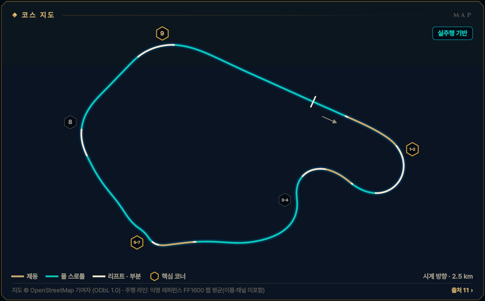
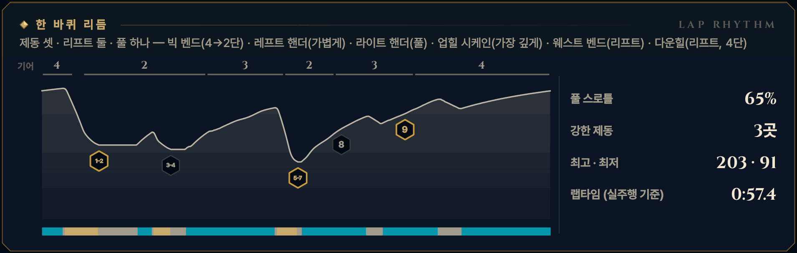

> **GRID서당 : iRacing**은 심레이싱이 처음인 동아리 신입을 위해 만든 드라이빙 아카데미 프로그램입니다. 이 글은 그 안의 **서킷 공략** 모드 — 이번 시즌 리그가 도는 서킷을 코스 개관과 코너별 애니메이션으로 미리 익히는 화면 — 를 블로그로 옮긴 것으로, 글과 애니메이션 모두 프로그램에서 그대로 가져왔습니다. 차는 iRacing의 Ray FF1600이고, 기준은 진도가 없는 루키(입문 렌즈)입니다. 강의는 [GRID서당 시리즈](/posts/untitled_life/motorsport/sim-racing/grid-seodang/)에, 낯선 말은 [용어 사전](/posts/untitled_life/motorsport/sim-racing/grid-seodang/glossary/)에 모아 두었습니다.

## 이번 시즌 일정

> **2026 시즌 4 · 포뮬러 1600 루키 시리즈 · 4주차** — 10.06(화)–10.12(월)
>
> - 루키 FF1600 · 기본 포함 · 12분 레이스 · 스탠딩 스타트 (차: Ray FF1600)
> - iRacing 트랙 이름: Lime Rock Park - Grand Prix
> - 주차는 매주 화요일 09:00(한국 시간)에 바뀝니다.
>
> iRacing 일정은 시즌마다 바뀝니다. 이 글의 주차는 2026 시즌 4 기준이고, 같은 서킷이 다른 시즌에 돌아오면 그 시즌 일정에서 주차와 레이아웃을 다시 확인하세요.

## 코스 개관

약 2.5 km, 시계 방향, 공식 9코너의 짧고 빠른 트랙입니다. 한 바퀴가 1분이 안 되어 쉴 틈이 없습니다. 브레이크 셋·리프트 둘·풀스로틀 하나, 기어는 2\~4단만 씁니다.

- **시계 방향 · 그랑프리 · 2.5 km · 9코너**
- **코너 번호** — iRacing GP 지도 번호 T1–T9를 씁니다. 심화 10강(라임락 교본)의 클래식 번호로는 웨스트 벤드가 6번, 다운힐이 7번입니다.
- **루키 포인트** — 탈출이 전부 — 빅 벤드를 너무 일찍, 세게 밟고 굴러가는 것이 가장 흔한 손실입니다
- **속도 표기: 실주행 기반** — 익명 레퍼런스 FF1600 랩으로 맞춘 속도입니다(이름·채널은 싣지 않았습니다). 그래도 내 차·내 페이스와는 다를 수 있으니 Test Drive에서 확인하세요.

*지도 © OpenStreetMap 기여자 (ODbL 1.0) · 선 색: 골드 = 제동, 시안 = 풀 스로틀, 흰색 = 리프트 · 부분 · 금테 육각형 = 핵심 코너 · 번호 = 이 글의 코너 공략 단위*

## 한 바퀴 리듬

제동 셋 · 리프트 둘 · 풀 하나 — 빅 벤드(4→2단) · 레프트 핸더(가볍게) · 라이트 핸더(풀) · 업힐 시케인(가장 깊게) · 웨스트 벤드(리프트) · 다운힐(리프트, 4단)

*풀 스로틀 65% · 강한 제동 3곳 · 최고 · 최저 203 · 91 km/h · 랩타임 (실주행 기준) 0:57.4 — 위 그림의 기어 줄·속도 곡선·입력 띠(골드 = 제동, 시안 = 풀 스로틀)와 코너 번호는 이 기준 랩입니다.*

## 먼저 볼 코너

1. **[T1–2 빅 벤드](#w04-u1)** — 1랩 첫 제동 · 랩에서 속도가 가장 크게 줄어드는 곳
2. **[T5–7 업힐 시케인](#w04-u3)** — 랩에서 페달이 가장 깊게 들어가는 제동
3. **[T9 다운힐](#w04-u5)** — 가장 빠른 코너 — 이 탈출이 메인 직선 전체에 실린다

> **루키 포인트** — 탈출이 전부 — 빅 벤드를 너무 일찍, 세게 밟고 굴러가는 것이 가장 흔한 손실입니다

## 루키 안전 노트

- **스탠딩 스타트** — 출발선에서 빅 벤드 제동 구간까지 약 150 m — 1랩에는 평소보다 훨씬 느리게 도착합니다. 앞차에 맞춰 밟습니다.
- **피트 출구** — 피트에서 나온 차가 빅 벤드 제동 구간 오른쪽으로 합류합니다. 턴인 전에 오른쪽 거울을 봅니다.
- **업힐 시케인 연석** — 빨간 혹(턱)을 밟으면 차가 튀어 벽으로 갑니다. 칠한 연석까지만, 1랩 다이브 금지.
- **스핀 대처** — 브레이크를 꽉 밟아 세우고, 시속 180 km로 오는 차들이 지나간 뒤 나란히 복귀합니다.
- **트랙 리밋** — 차의 절반 이상이 노면 경계 밖이면 1x — 일부 트랙의 표시 구간만 네 바퀴 기준. 루키 규칙: 두 바퀴는 늘 선·연석 안쪽. 콘으로 막힌 옛 도로는 쓰지 않습니다.

**1랩 · 스탠딩 스타트** — 1랩: 평소 제동 지점보다 늦게 밟지 않습니다. 앞차에 맞춰 더 일찍, 부드럽게 밟고, 차 한 대 폭을 남깁니다. 바깥이나 가운데를 지키고 안쪽 다툼에 끼지 않습니다.

## 영상 보는 법

코너마다 앱의 코너 공략 화면을 그대로 녹화했습니다. ▶를 눌러 재생하세요 — 앱의 **가이드** 재생(실제 속도의 0.4배, 화면에서 차가 너무 빠른 코너는 0.25배)이라 단계(접근·제동·턴인·에이펙스·탈출)마다 잠깐 멈추고, 멈춤 링이 차면 다음 단계로 넘어갑니다. 블로그 영상은 단계 시작의 멈춤만 짧게 줄였고 (캡션을 읽을 시간은 그대로), 끝에 앱의 끝 카드가 나옵니다. **급수별 브레이크 시연**을 펼치면 같은 코너를 7급·6급·5급 렌즈로, **흔한 실수 고스트**를 펼치면 실수한 차(빨간 점선)와 나란히 달린 영상을 볼 수 있습니다.

- **제동** — 골드 — 두께·밝기 = 브레이크 압력
- **가속** — 시안 — 스로틀
- **관성** — 흰색 — 두 페달 모두 뗀 구간
- **흔한 실수** — 빨간 점선 고스트 — 한 번에 하나만
- **▼ 제동 시작** — 루키 기준선의 제동 시작점
- **◆ 턴인** — 핸들을 감기 시작하는 곳
- **○ 에이펙스** — 가장 안쪽·가장 느린 곳
- **◇ 트랙아웃** — 탈출에서 닿는 바깥 끝
- **보드 (?)** — 확인 전 참고값 — Test Drive에서 기준점을 정하세요
- **입력 지도** — 골드 띠 = 브레이크, 흰 리본(안쪽) = 핸들. 겹치면 트레일
- **손 칸 · 내림 ×N · 올림** — 왼쪽 패들 N번 내림(블립은 오토 블립이) · 오른쪽 패들 한 번 올림

화면과 글의 속도는 실주행 기반 값입니다.

## 코너 공략

### T1–2 빅 벤드

**우코너 · 2단 · 최저 약 111 km/h · 핵심 코너**  
1랩 첫 제동 · 약 202→111 km/h · 진입 속도 코너

<figure>
  <video src="images/u1.mp4" poster="images/u1_poster.png" controls preload="none" playsinline style="width:100%;max-width:960px"></video>
  <figcaption>시범 — 루키 기준선 · 입문 렌즈(직선 제동) · 가이드 0.4× · 접근 → 제동 → 턴인 → 에이펙스 → 탈출</figcaption>
</figure>

급수별 브레이크 시연 — 7급 · 6급 · 5급 렌즈 (영상 3)

라인과 기준점은 그대로, 페달 쓰는 법만 지금 급수에 맞춥니다. 위 영상은 **직선 제동 — 기초·심화·9·8급** 렌즈입니다 — 턴인 전에 브레이크를 다 뗍니다 (브레이크 끝 = 턴인).

**릴리스 — 7급** — 턴인을 향해 0.4초 넘게 흘려서 0으로 · 7급 기준: 릴리스 0.4초 이상

<figure>
  <video src="images/u1_release.mp4" poster="images/u1_release_poster.png" controls preload="none" playsinline style="width:100%;max-width:960px"></video>
  <figcaption>7급 렌즈(릴리스) · 가이드 0.4× · 접근 → 제동 → 턴인 → 에이펙스 → 탈출</figcaption>
</figure>

- 제동 — **육교를 향해 흘려 놓는다** · 피크 약 65% · 1.0초에 걸쳐 놓기 · 발 · 하나-둘-셋 놓기
- 턴인 — **육교에서 0에 닿는다** · 턴인에서 약 0\~3% · 발 · 3% → 0

**트레일 — 6급·4\~1급·졸업** — 턴인 때 15\~20%를 남기고, 감는 만큼 풉니다 · 6급 기준: 턴인 때 15% 이상 남기기

<figure>
  <video src="images/u1_trail.mp4" poster="images/u1_trail_poster.png" controls preload="none" playsinline style="width:100%;max-width:960px"></video>
  <figcaption>6급 렌즈(트레일) · 가이드 0.4× · 접근 → 제동 → 턴인 → 에이펙스 → 탈출</figcaption>
</figure>

- 제동 — **육교까지 끌고 간다** · 피크 약 59% · 육교에서 약 18% · 발 · 놓으며 남기기
- 턴인 — **첫 에이펙스까지 흘린다** · 약 18% → 첫 에이펙스 전 0 · 발 · 18% → 0 / 손 · 놓는 만큼 감기

**깊은 트레일 — 5급** — 턴인 때 30% 이상, 에이펙스 앞까지 끌고 갑니다 · 5급 기준: 턴인 때 30% 이상 남기기

<figure>
  <video src="images/u1_deep.mp4" poster="images/u1_deep_poster.png" controls preload="none" playsinline style="width:100%;max-width:960px"></video>
  <figcaption>5급 렌즈(깊은 트레일) · 가이드 0.4× · 접근 → 제동 → 턴인 → 에이펙스 → 탈출</figcaption>
</figure>

- 제동 — **더 깊게, 육교 32%** · 피크 약 48% · 육교에서 약 32% · 발 · 천천히 남기기
- 턴인 — **앞을 누른 채 에이펙스로** · 약 32% → 첫 에이펙스에서 0 · 발 · 32% → 0

4\~1급은 같은 영상의 캡션에 강조 한 줄(◆)이 더 붙습니다:

- ◆ 4급(턴인·에이펙스) — 브레이크 끝 = 스로틀 시작 — 에이펙스 한참 전에 발이 떨어졌다면 너무 줄인 것

흔한 실수 고스트 — 너무 세게, 너무 오래

<figure>
  <video src="images/u1_ghost.mp4" poster="images/u1_ghost_poster.png" controls preload="none" playsinline style="width:100%;max-width:960px"></video>
  <figcaption>흔한 실수: 너무 세게, 너무 오래 — 95%로 꾹, 굴러가며 최저 약 90 km/h → 약 2.9초 늦음</figcaption>
</figure>

흔한 실수: **너무 세게, 너무 오래** — 95%로 꾹, 굴러가며 최저 약 90 km/h → 약 2.9초 늦음. 빨간 점선과 붉은 차가 실수 고스트, 흰 차가 루키 기준선입니다. 두 차는 같은 시계로 달리므로 늦어지거나 밀려나는 만큼이 그대로 보입니다. 영상은 앱에서 [흔한 실수]를 눌렀을 때처럼 그 실수가 시작되는 단계부터 재생합니다. 끝 카드의 '트레일 렌즈 기준'은 결과의 시간 차를 트레일(6급) 렌즈 주행과 비교한 값이라는 뜻입니다.

> **1랩 · 스탠딩 스타트** — 1랩: 평소 제동 지점보다 늦게 밟지 않습니다. 앞차에 맞춰 더 일찍, 부드럽게 밟고, 차 한 대 폭을 남깁니다. 바깥이나 가운데를 지키고 안쪽 다툼에 끼지 않습니다. 180도가 넘는 코너라 나란히 달리는 시간이 깁니다.

#### 접근

메인 직선 끝에서 4단 약 202 km/h, 차는 트랙 왼쪽입니다. 왼쪽 잔디 위로 숫자 보드 3·2·1이 지나가고, 그 너머 트랙을 가로지르는 육교가 턴인 지점입니다. 피트에서 나온 차가 오른쪽으로 합류할 수 있어 오른쪽 거울도 봅니다.

*지금 손과 발 — 발 · 풀스로틀 / 손 · 곧게 / 눈 · 3 보드*

**보드 · 기준점** — 모두 확인 전 참고값입니다. Test Drive에서 직접 보고 정하세요.

- **제동 · 기준점**? 왼쪽 숫자 보드 3 — 애니메이션은 그보다 조금 앞(육교까지 약 130 m) *(확인 전 참고값)*
- **턴인**? 트랙 위 육교 밑 *(확인 전 참고값)*
- **에이펙스**? 안쪽 평평한 콘크리트 연석 *(확인 전 참고값)*

#### 제동

처음엔 3 보드보다도 조금 앞에서 '꾹' 약 65%까지 — ABS가 없어 100%는 바퀴를 잠급니다. 왼쪽에서 안쪽 연석으로 완만한 대각선을 그리며 4→3→2단으로 하나씩 내립니다. 제동이 깔끔해지면 다음 세션에 보드 한 칸만 늦춥니다.

*지금 손과 발 — 발 · 꾹 / 손 · 거의 곧게 · 내림 ×2 / 눈 · 육교*

#### 턴인

육교 밑을 지나는 순간 핸들을 감기 시작합니다. 생각보다 이르게 느껴지지만 그게 맞습니다 — 180도가 넘는 긴 코너라 일찍 들어가 큰 호를 그립니다. 이 렌즈에서는 브레이크가 막 0입니다.

*지금 손과 발 — 발 · 0 → 유지 스로틀 / 손 · 한 번에 감기 / 눈 · 콘크리트 연석*

#### 에이펙스

첫 에이펙스는 안쪽의 평평한 콘크리트 연석입니다. 연석 가까이 붙인 뒤 트랙 가운데까지만 흘려보내고, 두 번째 에이펙스는 한참 돌아서 나오니 멀리 봅니다. 속도계가 멈출 만큼(약 20\~40%) 스로틀을 지키며 최저 약 111 km/h입니다.

*지금 손과 발 — 발 · 속도 유지만큼 / 손 · 거의 그대로 / 눈 · 두 번째 에이펙스*

#### 탈출

두 번째 에이펙스가 보이고 코가 출구를 향하면, 푸는 만큼 한 획으로 끝까지 밟습니다. 왼쪽 출구 연석은 끝까지 쓰되 두 바퀴는 안쪽에 둡니다. 오른쪽으로 서둘러 건너가지 말고, 레프트 핸더는 가운데에서 준비합니다.

*지금 손과 발 — 발 · 앞으로만 / 손 · 풀기 / 눈 · 트랙 가운데*

#### 흔한 실수

- 너무 세게, 너무 오래 — 일찍 100%로 밟고 에이펙스까지 굴러가기  
  → 같은 보드에서 한 음절로 꾹, 천천히 놓고 놓는 끝에서 스로틀
- 육교에서 브레이크를 '탁' 놓기 — 앞이 가벼워져 바깥으로 밀린다  
  → 0.4초 넘게 '하나-둘-셋'으로 놓는다
- 두 에이펙스 사이에서 가운데를 넘어 흘러나가기  
  → 가운데까지만, 핸들을 조금 더하고 눈은 두 번째 에이펙스

#### 이 코너에서 확인할 것

- [ ] 3·2·1 보드의 실제 거리(빠른 랩은 130\~160 m에서 밟음)
- [ ] 피트 출구 합류선이 어디서 끝나는지

#### 연결된 강의 · 드릴

- 강의: [기초 4강(레이싱 라인의 문법)](/posts/untitled_life/motorsport/sim-racing/grid-seodang/basics/f4-racing-line/) · [심화 1강(출발의 기술)](/posts/untitled_life/motorsport/sim-racing/grid-seodang/advanced/d1-the-start/) · [심화 2강(코너의 다섯 얼굴)](/posts/untitled_life/motorsport/sim-racing/grid-seodang/advanced/d2-five-corner-faces/) · [심화 8강(페달의 문법)](/posts/untitled_life/motorsport/sim-racing/grid-seodang/advanced/d6-pedal-grammar/) · [8급(제동의 기본)](/posts/untitled_life/motorsport/sim-racing/grid-seodang/grades/g8-braking-basics/) · [7급(릴리스 수양)](/posts/untitled_life/motorsport/sim-racing/grid-seodang/grades/g7-release/) · [6급(트레일 입문)](/posts/untitled_life/motorsport/sim-racing/grid-seodang/grades/g6-trail-intro/) · [4급(전환 수련)](/posts/untitled_life/motorsport/sim-racing/grid-seodang/grades/g4-transition/) · [3급(스로틀 서예)](/posts/untitled_life/motorsport/sim-racing/grid-seodang/grades/g3-throttle-calligraphy/) · [2급(스티어링 일필휘지)](/posts/untitled_life/motorsport/sim-racing/grid-seodang/grades/g2-one-stroke-steering/)
- 훈련장 드릴: 제동 수양 · 트레일 브레이킹 · 전환 · 정밀 압력 · 조향 일필

<small>근거: S1 · S2 · S3 · S5 · S16 · TEL (아래 출처 목록) · 신뢰도 M</small>

### T3–4 레프트 핸더 → 라이트 핸더

**좌·우 복합 · 2단 · 최저 약 105 km/h**  
희생하는 왼쪽 → 풀스로틀 오른쪽

<figure>
  <video src="images/u2.mp4" poster="images/u2_poster.png" controls preload="none" playsinline style="width:100%;max-width:960px"></video>
  <figcaption>시범 — 루키 기준선 · 입문 렌즈(직선 제동) · 가이드 0.4× · 접근 → 제동 → 턴인 → 에이펙스 → 전환 → 에이펙스 ② → 탈출</figcaption>
</figure>

급수별 브레이크 시연 — 7급 · 6급 · 5급 렌즈 (영상 3)

라인과 기준점은 그대로, 페달 쓰는 법만 지금 급수에 맞춥니다. 위 영상은 **직선 제동 — 기초·심화·9·8급** 렌즈입니다 — 턴인 전에 브레이크를 다 뗍니다 (브레이크 끝 = 턴인).

**릴리스 — 7급** — 턴인을 향해 0.4초 넘게 흘려서 0으로 · 7급 기준: 릴리스 0.4초 이상

<figure>
  <video src="images/u2_release.mp4" poster="images/u2_release_poster.png" controls preload="none" playsinline style="width:100%;max-width:960px"></video>
  <figcaption>7급 렌즈(릴리스) · 가이드 0.4× · 접근 → 제동 → 턴인 → 에이펙스 → 전환 → 에이펙스 ② → 탈출</figcaption>
</figure>

- 제동 — **턴인을 향해 부드럽게 놓기** · 피크 약 45% · 0.7초에 걸쳐 놓기 · 발 · 하나-둘-셋 놓기

**트레일 — 6급·4\~1급·졸업** — 턴인 때 15\~20%를 남기고, 감는 만큼 풉니다 · 6급 기준: 턴인 때 15% 이상 남기기

<figure>
  <video src="images/u2_trail.mp4" poster="images/u2_trail_poster.png" controls preload="none" playsinline style="width:100%;max-width:960px"></video>
  <figcaption>6급 렌즈(트레일) · 가이드 0.4× · 접근 → 제동 → 턴인 → 에이펙스 → 전환 → 에이펙스 ② → 탈출</figcaption>
</figure>

- 제동 — **놓는 속도로 차를 돌린다** · 피크 약 29% · 턴인 때 약 17% · 발 · 놓으며 남기기
- 턴인 — **릴리스는 핸들의 연장** · 약 17% → 에이펙스 전 0 · 가벼운 트레일 · 발 · 17% → 0

**깊은 트레일 — 5급** — 턴인 때 30% 이상, 에이펙스 앞까지 끌고 갑니다 · 가벼운 제동 코너 — 30% 기준보다 적게 남깁니다

<figure>
  <video src="images/u2_deep.mp4" poster="images/u2_deep_poster.png" controls preload="none" playsinline style="width:100%;max-width:960px"></video>
  <figcaption>5급 렌즈(깊은 트레일) · 가이드 0.4× · 접근 → 제동 → 턴인 → 에이펙스 → 전환 → 에이펙스 ② → 탈출</figcaption>
</figure>

- 제동 — **가볍게, 길게 남긴다** · 피크 약 20% · 턴인 때 약 14% · 발 · 천천히 남기기
- 턴인 — **가벼운 제동으로 회전** · 약 14% → 에이펙스에서 0 · 세게 시작하지 않기 · 발 · 14% → 0

흔한 실수 고스트 — 이른 턴인 → 출구에서 밀림

<figure>
  <video src="images/u2_ghost.mp4" poster="images/u2_ghost_poster.png" controls preload="none" playsinline style="width:100%;max-width:960px"></video>
  <figcaption>흔한 실수: 이른 턴인 → 출구에서 밀림 — 일찍 꺾으면 출구에서 바깥으로 밀린다 → 약 0.2초 늦음</figcaption>
</figure>

흔한 실수: **이른 턴인 → 출구에서 밀림** — 일찍 꺾으면 출구에서 바깥으로 밀린다 → 약 0.2초 늦음. 빨간 점선과 붉은 차가 실수 고스트, 흰 차가 루키 기준선입니다. 두 차는 같은 시계로 달리므로 늦어지거나 밀려나는 만큼이 그대로 보입니다. 영상은 앱에서 [흔한 실수]를 눌렀을 때처럼 그 실수가 시작되는 단계부터 재생합니다. 끝 카드의 '트레일 렌즈 기준'은 결과의 시간 차를 트레일(6급) 렌즈 주행과 비교한 값이라는 뜻입니다.

#### 접근

빅 벤드를 왼쪽으로 나오면 곧 이 트랙의 하나뿐인 진짜 왼쪽 코너입니다. 오른쪽 끝까지 벌리지 말고 가운데보다 조금 오른쪽에 차를 둡니다. 정면 패독의 화장실 건물을 겨냥해 곧게 세웁니다.

*지금 손과 발 — 발 · 풀스로틀 / 손 · 곧게 / 눈 · 패독 화장실 건물*

**보드 · 기준점** — 모두 확인 전 참고값입니다. Test Drive에서 직접 보고 정하세요.

- **제동 · 기준점**? 빅 벤드 출구 연석을 떠나 1초쯤(턴인까지 약 50 m) *(확인 전 참고값)*
- **에이펙스**? 가장 조이는 곳의 왼쪽 연석 *(확인 전 참고값)*

#### 제동

빅 벤드처럼 세게 세우는 곳이 아닙니다. 짧고 가볍게 약 45%까지만 밟습니다. 차가 거의 곧을 때 줄이고 턴인 전에 0으로 만듭니다.

*지금 손과 발 — 발 · 가볍게 짧게 / 손 · 살짝 감긴 채 / 눈 · 왼쪽 연석*

#### 턴인

핸들을 한 번에 확 꺾지 않고 조금씩 늘려 가는 '나선형' 진입입니다. 너무 일찍 크게 꺾으면 에이펙스도 일러져 출구에서 차가 오른쪽으로 밀립니다.

*지금 손과 발 — 발 · 0 → 스로틀 얹기 / 손 · 꾸준히 감기 / 눈 · 가장 조이는 곳*

#### 에이펙스

가장 조이는 곳의 왼쪽 연석, 늦은 편의 에이펙스입니다. 최저 약 105 km/h, 2단. 핵심은 에이펙스 뒤에도 차를 트랙 왼쪽 절반에 붙들어 두는 것입니다.

*지금 손과 발 — 발 · 한 획으로 100% / 손 · 풀되 왼쪽 유지 / 눈 · 라이트 핸더*

#### 전환

왼쪽에서 차를 곧게 세운 채 라이트 핸더를 맞습니다. 스로틀은 그대로입니다 — FF1600은 이 코너에서 뗄 필요가 없습니다.

*지금 손과 발 — 발 · 100% 유지 / 손 · 곧게 / 눈 · 오른쪽 연석*

#### 에이펙스 ②

오른쪽 에이펙스 연석에 가깝게 붙되 올라타서 '쾅' 치지 않습니다. 에이펙스 뒤로 길이 내리막으로 꺾여 방향을 바꾸기 어려워집니다.

*지금 손과 발 — 발 · 100% / 손 · 한 번 감고 풀기 / 눈 · 왼쪽 끝*

#### 탈출

왼쪽 끝까지 트랙아웃하고 핸들이 곧아지면 3단입니다. 노 네임 스트레이트는 곧지 않지만 스로틀은 떼지 않습니다 — 왼쪽, 가운데의 오른쪽, 다시 왼쪽으로 핸들을 거의 쓰지 않는 선을 긋습니다.

*지금 손과 발 — 발 · 100% 유지 / 손 · 곧게 / 눈 · 노 네임 끝*

#### 흔한 실수

- 이른 에이펙스 — 차가 오른쪽으로 밀려 라이트 핸더에서 떼게 된다  
  → 나선형으로 조금씩 감아 늦게, 에이펙스 뒤 왼쪽에 남는다
- 레프트 핸더 전에 오른쪽 끝까지 벌렸다가 긴 원을 그리기  
  → 가운데보다 조금 오른쪽에서 준비한다
- 레프트 핸더 한가운데서 스로틀을 '탁' 떼기 — 리어가 돈다  
  → 한 번 연 스로틀은 앞으로만, 너무 빠르면 10\~15%만 덜기

#### 이 코너에서 확인할 것

- [ ] 패독 화장실 건물이 정면에 보이는지

#### 연결된 강의 · 드릴

- 강의: [기초 4강(레이싱 라인의 문법)](/posts/untitled_life/motorsport/sim-racing/grid-seodang/basics/f4-racing-line/) · [심화 2강(코너의 다섯 얼굴)](/posts/untitled_life/motorsport/sim-racing/grid-seodang/advanced/d2-five-corner-faces/) · [심화 4강(차의 균형)](/posts/untitled_life/motorsport/sim-racing/grid-seodang/advanced/d4-car-balance/) · [5급(트레일 숙달)](/posts/untitled_life/motorsport/sim-racing/grid-seodang/grades/g5-trail-mastery/) · [3급(스로틀 서예)](/posts/untitled_life/motorsport/sim-racing/grid-seodang/grades/g3-throttle-calligraphy/) · [2급(스티어링 일필휘지)](/posts/untitled_life/motorsport/sim-racing/grid-seodang/grades/g2-one-stroke-steering/)
- 훈련장 드릴: 트레일 브레이킹 · 스로틀 서예 · 조향 일필

<small>근거: S1 · S5 · S8 · TEL (아래 출처 목록) · 신뢰도 M</small>

### T5–7 업힐 시케인

**우·좌·우 복합 · 2단 · 최저 약 86 km/h · 핵심 코너**  
랩에서 가장 깊은 제동 · 171→86 km/h

<figure>
  <video src="images/u3.mp4" poster="images/u3_poster.png" controls preload="none" playsinline style="width:100%;max-width:960px"></video>
  <figcaption>시범 — 루키 기준선 · 입문 렌즈(직선 제동) · 가이드 0.4× · 접근 → 제동 → 턴인 → 전환 → 에이펙스 ② → 전환 ③ → 에이펙스 ③ → 탈출</figcaption>
</figure>

급수별 브레이크 시연 — 7급 · 6급 · 5급 렌즈 (영상 3)

라인과 기준점은 그대로, 페달 쓰는 법만 지금 급수에 맞춥니다. 위 영상은 **직선 제동 — 기초·심화·9·8급** 렌즈입니다 — 턴인 전에 브레이크를 다 뗍니다 (브레이크 끝 = 턴인).

**릴리스 — 7급** — 턴인을 향해 0.4초 넘게 흘려서 0으로 · 7급 기준: 릴리스 0.4초 이상

<figure>
  <video src="images/u3_release.mp4" poster="images/u3_release_poster.png" controls preload="none" playsinline style="width:100%;max-width:960px"></video>
  <figcaption>7급 렌즈(릴리스) · 가이드 0.4× · 접근 → 제동 → 턴인 → 전환 → 에이펙스 ② → 전환 ③ → 에이펙스 ③ → 탈출</figcaption>
</figure>

- 제동 — **턴인을 향해 풀어 0** · 피크 약 72% · 1.0초에 걸쳐 놓기 · 발 · 하나-둘-셋 놓기
- 턴인 — **다 놓으며 크게 감기** · 턴인에서 약 3% → 곧 0 · 발 · 3% → 0

**트레일 — 6급·4\~1급·졸업** — 턴인 때 15\~20%를 남기고, 감는 만큼 풉니다 · 6급 기준: 턴인 때 15% 이상 남기기

<figure>
  <video src="images/u3_trail.mp4" poster="images/u3_trail_poster.png" controls preload="none" playsinline style="width:100%;max-width:960px"></video>
  <figcaption>6급 렌즈(트레일) · 가이드 0.4× · 접근 → 제동 → 턴인 → 전환 → 에이펙스 ② → 전환 ③ → 에이펙스 ③ → 탈출</figcaption>
</figure>

- 제동 — **트레일 교과서 — 남긴다** · 피크 약 67% · 턴인 때 약 18% · 발 · 놓으며 남기기
- 턴인 — **푸는 만큼 감는다** · 약 18% → 1초 남짓에 0 · 앞을 무겁게 · 발 · 18% → 0 / 손 · 놓는 만큼 감기

**깊은 트레일 — 5급** — 턴인 때 30% 이상, 에이펙스 앞까지 끌고 갑니다 · 5급 기준: 턴인 때 30% 이상 남기기

<figure>
  <video src="images/u3_deep.mp4" poster="images/u3_deep_poster.png" controls preload="none" playsinline style="width:100%;max-width:960px"></video>
  <figcaption>5급 렌즈(깊은 트레일) · 가이드 0.4× · 접근 → 제동 → 턴인 → 전환 → 에이펙스 ② → 전환 ③ → 에이펙스 ③ → 탈출</figcaption>
</figure>

- 제동 — **더 깊게, 턴인 32%** · 피크 약 61% · 턴인 때 약 32% · 발 · 천천히 남기기
- 턴인 — **앞을 누른 채 5번으로** · 약 32% → 에이펙스에서 0 · 발 · 32% → 0

4\~1급은 같은 영상의 캡션에 강조 한 줄(◆)이 더 붙습니다:

- ◆ 4급(턴인·에이펙스) — 브레이크와 스로틀 사이에 발이 쉬지 않는다 — 한 레퍼런스도 여기서 0.77초 굴러갔다

흔한 실수 고스트 — 늦은 제동 → 잠김 → 직진

<figure>
  <video src="images/u3_ghost.mp4" poster="images/u3_ghost_poster.png" controls preload="none" playsinline style="width:100%;max-width:960px"></video>
  <figcaption>흔한 실수: 늦은 제동 → 잠김 → 직진 — 33 m 늦게 100% → 바퀴가 잠겨 직진 · 트랙 밖</figcaption>
</figure>

흔한 실수: **늦은 제동 → 잠김 → 직진** — 33 m 늦게 100% → 바퀴가 잠겨 직진 · 트랙 밖. 빨간 점선과 붉은 차가 실수 고스트, 흰 차가 루키 기준선입니다. 두 차는 같은 시계로 달리므로 늦어지거나 밀려나는 만큼이 그대로 보입니다. 영상은 앱에서 [흔한 실수]를 눌렀을 때처럼 그 실수가 시작되는 단계부터 재생합니다. 끝 카드의 '트레일 렌즈 기준'은 결과의 시간 차를 트레일(6급) 렌즈 주행과 비교한 값이라는 뜻입니다.

#### 접근

노 네임 스트레이트 끝에서 3단 약 171 km/h, 마지막 완만한 왼쪽 굽이를 지나 트랙 왼쪽입니다. 정면 왼쪽에 콘으로 막힌 옛 업힐 도로가 있고, 시케인은 그 앞에서 오른쪽으로 꺾어 언덕을 오릅니다. 확인된 숫자 보드가 없어 고정 기준물을 씁니다.

*지금 손과 발 — 발 · 풀스로틀 / 손 · 곧게 / 눈 · 고정 기준물*

**보드 · 기준점** — 모두 확인 전 참고값입니다. Test Drive에서 직접 보고 정하세요.

- **제동 · 기준점**? Test Drive에서 5번 에이펙스 약 120 m 앞의 나무·가드레일 이음매를 기준점으로 정하세요(턴인까지 약 100 m) *(확인 전 참고값)*
- **턴인**? 콘으로 막힌 옛 도로 바로 앞 *(확인 전 참고값)*
- **에이펙스**? 칠한 연석까지, 빨간 혹 금지 *(확인 전 참고값)*

#### 제동

랩에서 페달이 가장 깊게 들어가는 제동입니다. 한 음절로 꾹 약 71%, 100%는 피합니다. 차가 곧을 때 대부분을 줄이고, 그사이 3→2단으로 내립니다.

*지금 손과 발 — 발 · 꾹 / 손 · 곧게 · 내림 ×1 / 눈 · 콘과 5번 연석*

#### 턴인

왼쪽 끝에서 오른쪽 5번으로 턴인합니다. 랩에서 핸들을 가장 많이 감는 순간입니다. 너무 빨리 들어가 연석의 빨간 혹을 밟으면 차가 튀어 벽으로 갑니다.

*지금 손과 발 — 발 · 0 → 스로틀 준비 / 손 · 크게 한 번 / 눈 · 5번 에이펙스*

#### 전환

5번 오른쪽 연석은 칠한 부분까지만, 빨간 혹은 절대 밟지 않습니다. 최저 약 86 km/h로 랩에서 가장 느린 곳입니다. 브레이크 끝이 곧 스로틀 시작 — 코가 6번을 향하면 한 획으로 100%까지 밟습니다.

*지금 손과 발 — 발 · 스로틀 → 100% / 손 · 풀며 왼쪽 / 눈 · 6번 연석*

#### 에이펙스 ②

6번(왼쪽)은 풀스로틀로, 왼쪽 연석을 살짝 스칩니다. S를 곧게 펼수록 핸들이 덜 움직이고 그만큼 빠릅니다.

*지금 손과 발 — 발 · 100% / 손 · 작게 왼쪽 / 눈 · 7번*

#### 전환 ③

6번에서 7번으로 넘어가며 핸들을 작게 바꿉니다. 오르막이라 차가 가벼워지기 시작합니다.

*지금 손과 발 — 발 · 100% / 손 · 작게 바꾸기 / 눈 · 7번 오른쪽*

#### 에이펙스 ③

7번에서는 오른쪽에 붙되 연석 위로 올라가지 않습니다. 꼭대기에 닿기 전에 왼쪽으로 나가 핸들을 곧게 둘 준비를 합니다.

*지금 손과 발 — 발 · 100% / 손 · 작게 오른쪽 / 눈 · 언덕 꼭대기*

#### 탈출

꼭대기에서는 차가 가벼워지므로 이미 트랙 왼쪽에 나가 있고 핸들이 곧아야 합니다. 꼭대기를 넘으면 3단, 웨스트 벤드까지 왼쪽을 지킵니다.

*지금 손과 발 — 발 · 100% / 손 · 곧게 / 눈 · 언덕 너머*

#### 흔한 실수

- 늦고 세게 밟기 — 앞바퀴가 잠겨 시케인을 똑바로 가로지른다  
  → 한 박자 일찍, 약 71%로, 어택은 0.15\~0.25초
- 빨간 혹을 밟아 차가 튀기  
  → 칠한 연석까지만
- 꼭대기에서도 핸들이 감겨 있기 — 가벼운 차가 털린다  
  → 꼭대기 전에 왼쪽으로 나가 곧게

#### 이 코너에서 확인할 것

- [ ] 빨간 혹이 어느 연석에 있는지
- [ ] 시케인을 가로지르면 몇 점(페널티)인지

#### 연결된 강의 · 드릴

- 강의: [심화 2강(코너의 다섯 얼굴)](/posts/untitled_life/motorsport/sim-racing/grid-seodang/advanced/d2-five-corner-faces/) · [심화 9강(기울어진 트랙)](/posts/untitled_life/motorsport/sim-racing/grid-seodang/advanced/d7-banked-track/) · [8급(제동의 기본)](/posts/untitled_life/motorsport/sim-racing/grid-seodang/grades/g8-braking-basics/) · [6급(트레일 입문)](/posts/untitled_life/motorsport/sim-racing/grid-seodang/grades/g6-trail-intro/) · [5급(트레일 숙달)](/posts/untitled_life/motorsport/sim-racing/grid-seodang/grades/g5-trail-mastery/) · [4급(전환 수련)](/posts/untitled_life/motorsport/sim-racing/grid-seodang/grades/g4-transition/) · [3급(스로틀 서예)](/posts/untitled_life/motorsport/sim-racing/grid-seodang/grades/g3-throttle-calligraphy/)
- 훈련장 드릴: 정밀 압력 · 트레일 브레이킹 · 전환 · 스로틀 서예

<small>근거: S1 · S2 · S3 · S11 · S14 · TEL (아래 출처 목록) · 신뢰도 L</small>

### T8 웨스트 벤드

**우코너 · 3단 · 최저 약 143 km/h**  
브레이크 아닌 리프트 · 약 142 km/h

<figure>
  <video src="images/u4.mp4" poster="images/u4_poster.png" controls preload="none" playsinline style="width:100%;max-width:960px"></video>
  <figcaption>시범 — 루키 기준선 · 렌즈 공통 · 가이드 0.4× · 접근 → 리프트 → 턴인 → 에이펙스 → 탈출</figcaption>
</figure>

급수별 브레이크 시연 — 모든 급수가 같은 그림

이 코너는 렌즈가 같습니다 — 리프트·풀스로틀 코너는 브레이크를 쓰지 않아 모든 급수가 같은 페달 그림을 봅니다.

#### 접근

언덕 꼭대기를 넘어 3단, 턴인할 때까지 트랙 왼쪽을 지킵니다. 속도는 약 157 km/h입니다. 이 코너는 브레이크가 아니라 스로틀을 떼는 코너입니다.

*지금 손과 발 — 발 · 풀스로틀 / 손 · 곧게 / 눈 · 안쪽 연석*

**보드 · 기준점** — 모두 확인 전 참고값입니다. Test Drive에서 직접 보고 정하세요.

- **리프트 시작**? 트랙 왼쪽, 차가 곧을 때 — 왼쪽 너머 표지판을 Test Drive에서 기준으로 *(확인 전 참고값)*
- **에이펙스**? 안쪽 연석 가까이, 높은 부분은 피하기 *(확인 전 참고값)*

#### 리프트

턴인 전, 차가 곧을 때 스로틀을 뗍니다. 처음엔 넉넉히(애니메이션은 1%까지) 떼고, 익숙해지면 빠른 랩처럼 15\~25%만 남깁니다. 급수와 관계없이 '리프트 → 턴인' 순서는 같습니다.

*지금 손과 발 — 발 · 리프트 / 손 · 곧게 / 눈 · 에이펙스 쪽*

**급수 시험 주행에서는 리프트만 — 10%를 넘는 톡도 제동 코너로 채점됩니다.**

#### 턴인

리프트로 앞에 하중이 실린 순간, 한 번에 부드럽게 감습니다. 바깥(왼쪽)으로 웨스트 벤드 시케인 입구를 막은 콘이 지나갑니다. 감은 뒤에는 스로틀을 다시 '탁' 떼지 않습니다.

*지금 손과 발 — 발 · 다시 열기 시작 / 손 · 한 번 감기 / 눈 · 연석 끝*

#### 에이펙스

안쪽 연석에 가깝게 붙되 높이 솟은 부분에는 올라타지 않습니다. 연석이 에이펙스 직전에 더 안쪽으로 꺾여 에이펙스가 멀게 느껴지니 서두르지 않습니다. 최저 약 142 km/h, 에이펙스 즈음 다시 100%입니다.

*지금 손과 발 — 발 · 100%로 / 손 · 유지 / 눈 · 출구*

#### 탈출

핸들을 푸는 만큼 스로틀을 그대로 두고, 필요하면 왼쪽 출구 연석까지 씁니다. 출구 노면이 바깥으로 살짝 기울어(역캔트) 출구를 과하게 욕심내지 않습니다. 이 탈출 속도가 다운힐까지 갑니다.

*지금 손과 발 — 발 · 100% 유지 / 손 · 풀기 / 눈 · 왼쪽 출구 연석*

#### 흔한 실수

- 늦게 떼기 — 빠른 채로 감아 출구에서 바깥으로 밀린다  
  → 속도 조절은 모두 턴인 전, 곧을 때 끝낸다
- 브레이크를 90% 넘게 밟아 10 km/h 넘게 버리기  
  → 리프트만, 무서우면 리프트를 조금 더 길게
- 코너 중간에 스로틀을 떼어 리어가 불안해지기, 안쪽 높은 연석 밟기  
  → 감은 뒤엔 앞으로만, 연석은 가깝게만

#### 이 코너에서 확인할 것

- [ ] 리프트 기준이 될 표지판·광고판 위치

#### 연결된 강의 · 드릴

- 강의: [심화 2강(코너의 다섯 얼굴)](/posts/untitled_life/motorsport/sim-racing/grid-seodang/advanced/d2-five-corner-faces/) · [심화 8강(페달의 문법)](/posts/untitled_life/motorsport/sim-racing/grid-seodang/advanced/d6-pedal-grammar/) · [심화 9강(기울어진 트랙)](/posts/untitled_life/motorsport/sim-racing/grid-seodang/advanced/d7-banked-track/) · [2급(스티어링 일필휘지)](/posts/untitled_life/motorsport/sim-racing/grid-seodang/grades/g2-one-stroke-steering/) · [심화 10강(라임락 교본)](/posts/untitled_life/motorsport/sim-racing/grid-seodang/advanced/d11-lime-rock-textbook/)
- 훈련장 드릴: 정밀 압력 · 트레일 브레이킹

<small>근거: S1 · S5 · S8 · TEL (아래 출처 목록) · 신뢰도 M</small>

### T9 다운힐

**우코너 · 4단 · 최저 약 164 km/h · 핵심 코너**  
가장 빠른 코너 · 약 163 km/h · 4단

<figure>
  <video src="images/u5.mp4" poster="images/u5_poster.png" controls preload="none" playsinline style="width:100%;max-width:960px"></video>
  <figcaption>시범 — 루키 기준선 · 렌즈 공통 · 가이드 0.4× · 접근 → 리프트 → 턴인 → 에이펙스 → 탈출</figcaption>
</figure>

급수별 브레이크 시연 — 모든 급수가 같은 그림

이 코너는 렌즈가 같습니다 — 리프트·풀스로틀 코너는 브레이크를 쓰지 않아 모든 급수가 같은 페달 그림을 봅니다.

흔한 실수 고스트 — 이른 턴인 → 출구에서 밀림

<figure>
  <video src="images/u5_ghost.mp4" poster="images/u5_ghost_poster.png" controls preload="none" playsinline style="width:100%;max-width:960px"></video>
  <figcaption>흔한 실수: 이른 턴인 → 출구에서 밀림 — 일찍 꺾으면 출구에서 바깥으로 밀린다 · 트랙 밖</figcaption>
</figure>

흔한 실수: **이른 턴인 → 출구에서 밀림** — 일찍 꺾으면 출구에서 바깥으로 밀린다 · 트랙 밖. 빨간 점선과 붉은 차가 실수 고스트, 흰 차가 루키 기준선입니다. 두 차는 같은 시계로 달리므로 늦어지거나 밀려나는 만큼이 그대로 보입니다. 영상은 앱에서 [흔한 실수]를 눌렀을 때처럼 그 실수가 시작되는 단계부터 재생합니다.

#### 접근

웨스트 벤드를 나와 내리막에 들어서기 전에 4단으로 올립니다 — 3단 그대로면 리미터에 걸립니다. 차량용 다리(베일리 브리지) 밑은 트랙 왼쪽으로 지나고, 언덕 바닥까지 왼쪽을 지킵니다.

*지금 손과 발 — 발 · 풀스로틀, 4단 / 손 · 곧게 / 눈 · 언덕 바닥*

**보드 · 기준점** — 모두 확인 전 참고값입니다. Test Drive에서 직접 보고 정하세요.

- **리프트 시작**? 베일리 브리지를 지나 약 1초(빠른 랩은 1.5초) *(확인 전 참고값)*
- **턴인**? 언덕이 평평해지는 바닥 *(확인 전 참고값)*
- **에이펙스**? 오른쪽 안쪽에 타이트하게 *(확인 전 참고값)*

#### 리프트

다리를 지나 1초쯤, 차가 아직 곧을 때 스로틀을 뗍니다(애니메이션 10%). 내리막이라 브레이크를 밟으면 앞으로 쏠리고 뒤가 가벼워집니다. 익숙해지면 빠른 랩처럼 다리 +1.5초, 20\~25%로 늦춥니다.

*지금 손과 발 — 발 · 리프트 / 손 · 곧게 / 눈 · 평평해지는 곳*

**급수 시험 주행에서는 리프트만 — 10%를 넘는 톡도 제동 코너로 채점됩니다.**

#### 턴인

언덕이 평평해지는 바닥, 차가 눌리는 곳에서 감습니다. 이 순간에는 그립이 잠깐 커져 손이 조금 빨라도 차가 받아 줍니다. 그 전부터 천천히 감기 시작하면 출구에서 길이 모자랍니다.

*지금 손과 발 — 발 · 스로틀 다시 얹기 / 손 · 또렷하게 감기 / 눈 · 오른쪽 에이펙스*

#### 에이펙스

오른쪽 안쪽에 타이트하게 붙고, 눈은 메인 스트레이트 저 멀리 둡니다. 스로틀은 앞으로만 밟아 에이펙스 즈음 100%가 됩니다. 최저 약 163 km/h, 랩에서 가장 빠른 코너입니다.

*지금 손과 발 — 발 · 100% / 손 · 유지 → 풀기 / 눈 · 직선 끝*

#### 탈출

차를 왼쪽 끝까지 흘려보내고 메인 스트레이트에서도 왼쪽을 유지합니다. 빅 벤드는 왼쪽에서 접근하고, 오른쪽은 피트 출구 차량의 자리입니다. 이 탈출 속도가 약 500 m 풀스로틀 구간 전체에 실립니다.

*지금 손과 발 — 발 · 100% 유지 / 손 · 곧게 / 눈 · 빅 벤드 보드*

#### 흔한 실수

- 일찍, 느린 손으로 턴인 — 출구에서 길이 모자라 스로틀을 뗀다  
  → 바닥(컴프레션)까지 기다렸다가 또렷하게 감는다
- 내리막에서 브레이크를 세게 — 뒤가 가벼워지고 너무 줄어든다  
  → 리프트만, 필요하면 곧을 때 아주 가볍게 스치기
- 코너 한가운데서 스로틀을 '탁' 떼기 — 안쪽으로 스핀  
  → 너무 빠르면 10\~15%만 덜고 절대 다 떼지 않는다

#### 이 코너에서 확인할 것

- [ ] 베일리 브리지에서 리프트까지의 시간

#### 연결된 강의 · 드릴

- 강의: [심화 9강(기울어진 트랙)](/posts/untitled_life/motorsport/sim-racing/grid-seodang/advanced/d7-banked-track/) · [심화 2강(코너의 다섯 얼굴)](/posts/untitled_life/motorsport/sim-racing/grid-seodang/advanced/d2-five-corner-faces/) · [심화 4강(차의 균형)](/posts/untitled_life/motorsport/sim-racing/grid-seodang/advanced/d4-car-balance/) · [3급(스로틀 서예)](/posts/untitled_life/motorsport/sim-racing/grid-seodang/grades/g3-throttle-calligraphy/) · [1급(일관성 담금질)](/posts/untitled_life/motorsport/sim-racing/grid-seodang/grades/g1-consistency/) · [심화 10강(라임락 교본)](/posts/untitled_life/motorsport/sim-racing/grid-seodang/advanced/d11-lime-rock-textbook/)
- 훈련장 드릴: 스로틀 서예 · 트레일 브레이킹

<small>근거: S1 · S5 · S8 · S24 · TEL (아래 출처 목록) · 신뢰도 M</small>

## Test Drive에서 확인할 것 5

보드·표지물·연석은 모두 확인 전 참고값입니다. Test Drive에서 직접 보고 기준점을 정하세요.

- [ ] 빅 벤드 앞 왼쪽 숫자 보드(3·2·1)의 위치 — 3 보드에서 세 랩 밟고 제동 시작 거리를 확인
- [ ] 업힐 시케인 5번 에이펙스 약 100 m 앞의 고정 기준물 하나(나무·가드레일 이음매)
- [ ] 웨스트 벤드와 다운힐의 리프트 기준물(표지판·베일리 브리지)
- [ ] 시케인 연석의 빨간 혹이 어느 연석에 있는지
- [ ] 콘으로 막힌 옛 도로가 트랙 밖으로 잡히는지

## 출처

- **S1** [Lime Rock Park official 'A Lap of Classic Lime Rock, Turn-by-Turn'](https://limerock.com/lapoflrp_turnbyturn-2/) — Big Bend entry, Lefthander, Uphill crest, West Bend, Downhill compression
- **S2** [iRacing track-map layers, Lime Rock Grand Prix (track 353)](https://members-assets.iracing.com/public/track-maps/tracks_limerock_2019/353-limerock-2019-gp/turns.svg) — official T1–T9 numbering, S/F, pit-exit blend line
- **S3** [iRacing Lime Rock track page and screenshots](https://www.iracing.com/tracks/lime-rock-park-2/) — footbridge, chicane curbs with red bumps, cones
- **S5** [NNJR-PCA 'Why Drive This Line + Lime Rock Turn by Turn' (2021)](https://nnjr-pca.com/wp-content/uploads/2021/06/210603-Why-Drive-This-Line-and-Lime-Rock-Turn-by-Turn.pdf) — diagonal braking, concrete-curb apex, T3 set-up, West Bend, bridge
- **S8** [Jalopnik 'How To Lap Lime Rock Park'](https://jalopnik.com/how-to-lap-lime-rock-park-5412014) — West Bend curbs, crest, Downhill turn-in
- **S11** [iRacing 'European MX-5 Cup drama at Lime Rock'](https://www.iracing.com/european-mx-5-cup-drama-at-lime-rock/) — chicane curb launch, inside-pass contact
- **S14** [GRIDLIFE Lime Rock driver resources](https://www.grid.life/lime-rock-park-driver-resources) — wheel straight at the crest, rejoining
- **S16** [Traxion FF1600 at Lime Rock](https://traxion.gg/?p=78976) — FF1600 lap-1 Big Bend funnel
- **S23** [iRacing 2026 S4 schedule PDF, p.139](https://radicalsimracing.com/wp-content/uploads/2026/09/iRacing-2026_S4.pdf) — series rules
- **S24** [USGS NED 10 m via OpenTopoData](https://api.opentopodata.org/v1/ned10m) — elevation
- **TEL** Anonymized reference Ray FF1600 laps in the project (2 laps, 55.99–56.06 s) — racing line, speeds, events (no names kept)

## 지도·데이터 출처와 라이선스

- **지도 © OpenStreetMap 기여자 (ODbL 1.0)** — 코스 지도와 코너 영상의 노면·라인은 OpenStreetMap 중심선(way 293189360, 293189359, 17179697, 293189371, 293189372, 293189368, 293189363, 432403007, 293189385, 293189374, 293189389, 293189364, 293189369)에서 만든 2차 데이터이며 [ODbL 1.0](https://opendatacommons.org/licenses/odbl/1-0/)을 따릅니다 ([OpenStreetMap 저작권 안내](https://www.openstreetmap.org/copyright)).
- 고도: OpenTopoData · USGS NED 10 m (퍼블릭 도메인)
- 주행 라인: 익명 레퍼런스 FF1600 랩 평균(이름·채널 미포함)
- 코너 설명은 GRID서당이 위 출처를 바탕으로 정리한 자체 요약이고, 속도·페달·기어·조향은 보정한 Ray FF1600 질점 모델의 계산값입니다. 제3자 텔레메트리와 드라이버 이름은 싣지 않았습니다.
