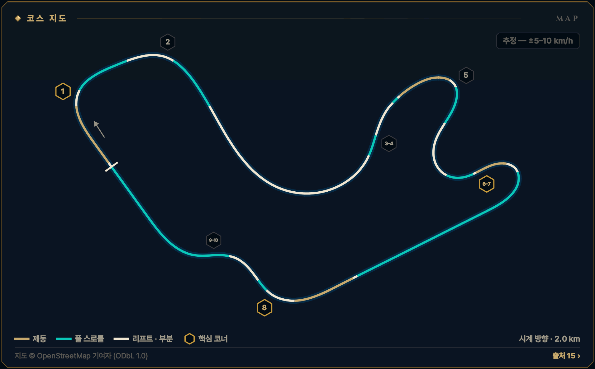
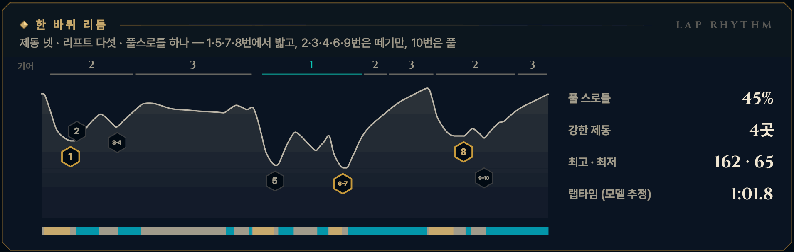

> **GRID서당 : iRacing**은 심레이싱이 처음인 동아리 신입을 위해 만든 드라이빙 아카데미 프로그램입니다. 이 글은 그 안의 **서킷 공략** 모드 — 이번 시즌 리그가 도는 서킷을 코스 개관과 코너별 애니메이션으로 미리 익히는 화면 — 를 블로그로 옮긴 것으로, 글과 애니메이션 모두 프로그램에서 그대로 가져왔습니다. 차는 iRacing의 Ray FF1600이고, 기준은 진도가 없는 루키(입문 렌즈)입니다. 강의는 [GRID서당 시리즈](/posts/untitled_life/motorsport/sim-racing/grid-seodang/)에, 낯선 말은 [용어 사전](/posts/untitled_life/motorsport/sim-racing/grid-seodang/glossary/)에 모아 두었습니다.

## 이번 시즌 일정

> **2026 시즌 4 · 포뮬러 1600 루키 시리즈 · 5주차** — 10.13(화)–10.19(월)
>
> - 루키 FF1600 · 기본 포함 · 12분 레이스 · 스탠딩 스타트 (차: Ray FF1600)
> - iRacing 트랙 이름: Winton Motor Raceway - Club Circuit
> - 이번 시즌 새 구성 — 지난 두 시즌은 내셔널 서킷
> - 주차는 매주 화요일 09:00(한국 시간)에 바뀝니다.
>
> iRacing 일정은 시즌마다 바뀝니다. 이 글의 주차는 2026 시즌 4 기준이고, 같은 서킷이 다른 시즌에 돌아오면 그 시즌 일정에서 주차와 레이아웃을 다시 확인하세요.

## 코스 개관

2.0 km, 시계 방향, 코너 10개. 1분 남짓한 한 바퀴에 큰 제동 넷(1·5·7·8번)과 리프트 코너가 촘촘히 붙은, 짧고 바쁜 클럽 서킷입니다. 기어는 1\~3단만 씁니다. 랩타임은 세 직선을 여는 7번·10번·2번 탈출에서 나옵니다.

- **시계 방향 · 클럽 서킷 · 2.0 km · 10코너**
- **코너 번호** — 클럽 서킷 번호 T1–T10을 씁니다(T1 = 출발선 뒤 내리막 우코너, T3 = 긴 왼쪽 스위퍼, T8 = 클럽 전용 연결 코너). 이 시리즈 S2·S3의 내셔널 번호와 다르니 iRacing 지도에서 한 번 확인하세요. 스폰서 이름(펜라이트·키토메)은 바뀔 수 있습니다.
- **루키 포인트** — 세 개의 큰 제동(1·5·8번)부터 — 6번을 버려 7번을, 9번을 버려 10번을 삽니다
- **속도 표기: 추정 — ±5–10 km/h** — 이 서킷에는 기준이 되는 실주행 텔레메트리가 없습니다. 공개된 FF1600 트랙 가이드 등에서 맞춘 코너 최저 속도에 보정한 FF1600 물리 모델을 맞춰 계산했기 때문에, 글과 영상의 속도·페달·기어는 모두 **추정값**(±5–10 km/h)입니다. Test Drive에서 직접 확인하세요.

*지도 © OpenStreetMap 기여자 (ODbL 1.0) · 선 색: 골드 = 제동, 시안 = 풀 스로틀, 흰색 = 리프트 · 부분 · 금테 육각형 = 핵심 코너 · 번호 = 이 글의 코너 공략 단위*

## 한 바퀴 리듬

제동 넷 · 리프트 다섯 · 풀스로틀 하나 — 1·5·7·8번에서 밟고, 2·3·4·6·9번은 떼기만, 10번은 풀

*풀 스로틀 45% · 강한 제동 4곳 · 최고 · 최저 162 · 65 km/h · 랩타임 (모델 추정) 1:01.8 — 위 그림의 기어 줄·속도 곡선·입력 띠(골드 = 제동, 시안 = 풀 스로틀)와 코너 번호는 이 기준 랩입니다.*

## 먼저 볼 코너

1. **[T1 내리막 우코너](#w05-u1)** — 출발선 바로 뒤 내리막 제동 — 1랩 사고 1순위
2. **[T6–7 버리는 6번, 사는 7번](#w05-u5)** — 랩에서 가장 값진 탈출 — 가장 긴 백스트레이트로
3. **[T8 백스트레이트 끝](#w05-u6)** — 랩에서 가장 빠른 직선 제동 · 약 160 km/h에서

> **루키 포인트** — 세 개의 큰 제동(1·5·8번)부터 — 6번을 버려 7번을, 9번을 버려 10번을 삽니다

## 루키 안전 노트

- **1랩 1번 코너** — 출발선에서 1번까지 아주 짧고 내리막입니다. 차들이 뭉친 채 도착하니 앞차에 맞춰 일찍, 부드럽게.
- **펜라이트 추월 지점** — 이 서킷의 대표 추월 지점입니다. 상대 턴인 전에 안쪽을 확보하지 못했으면 기다립니다.
- **5\~7번 연속 헤어핀** — 느린 헤어핀 셋이 이어집니다. 한 줄로, 차 한 대 길이 간격 — 멈춘 차는 잘 보이지 않습니다.
- **10번 출구 벽** — 이 랩에서 가장 가까운 벽입니다. 감은 채 풀스로틀이면 앞이 그쪽으로 밀립니다.
- **스핀 대처** — 브레이크를 꽉 밟아 세우고(시동은 안티스톨이 지킵니다), 상대 창으로 뒤차를 확인한 뒤 1단(왼쪽 패들)으로 트랙과 나란히 복귀합니다. 17x면 실격입니다.
- **트랙 리밋** — 차의 절반 이상이 노면 경계 밖이면 1x — 일부 트랙의 표시 구간만 네 바퀴 기준. 루키 규칙: 두 바퀴는 늘 선·연석 안쪽. 4번 양쪽의 큰 연석, 10번 출구의 큰 연석에는 올라타지 않습니다.

**1랩 · 스탠딩 스타트** — 1랩: 평소 제동 지점보다 늦게 밟지 않습니다. 앞차에 맞춰 더 일찍, 부드럽게 밟고, 차 한 대 폭을 남깁니다. 바깥이나 가운데를 지키고 안쪽 다툼에 끼지 않습니다.

## 영상 보는 법

코너마다 앱의 코너 공략 화면을 그대로 녹화했습니다. ▶를 눌러 재생하세요 — 앱의 **가이드** 재생(실제 속도의 0.4배, 화면에서 차가 너무 빠른 코너는 0.25배)이라 단계(접근·제동·턴인·에이펙스·탈출)마다 잠깐 멈추고, 멈춤 링이 차면 다음 단계로 넘어갑니다. 블로그 영상은 단계 시작의 멈춤만 짧게 줄였고 (캡션을 읽을 시간은 그대로), 끝에 앱의 끝 카드가 나옵니다. **급수별 브레이크 시연**을 펼치면 같은 코너를 7급·6급·5급 렌즈로, **흔한 실수 고스트**를 펼치면 실수한 차(빨간 점선)와 나란히 달린 영상을 볼 수 있습니다.

- **제동** — 골드 — 두께·밝기 = 브레이크 압력
- **가속** — 시안 — 스로틀
- **관성** — 흰색 — 두 페달 모두 뗀 구간
- **흔한 실수** — 빨간 점선 고스트 — 한 번에 하나만
- **▼ 제동 시작** — 루키 기준선의 제동 시작점
- **◆ 턴인** — 핸들을 감기 시작하는 곳
- **○ 에이펙스** — 가장 안쪽·가장 느린 곳
- **◇ 트랙아웃** — 탈출에서 닿는 바깥 끝
- **보드 (?)** — 확인 전 참고값 — Test Drive에서 기준점을 정하세요
- **입력 지도** — 골드 띠 = 브레이크, 흰 리본(안쪽) = 핸들. 겹치면 트레일
- **손 칸 · 내림 ×N · 올림** — 왼쪽 패들 N번 내림(블립은 오토 블립이) · 오른쪽 패들 한 번 올림

화면과 글의 속도는 모두 **추정값**(±5–10 km/h)입니다 — 기준 텔레메트리가 없는 서킷이라 모델로 계산했습니다.

## 코너 공략

### T1 내리막 우코너

**우코너 · 2단 · 최저 약 95 km/h · 핵심 코너 · 추정 — ±5–10 km/h**  
출발선 뒤 내리막 제동 · 145→95 km/h · 2단

<figure>
  <video src="images/u1.mp4" poster="images/u1_poster.png" controls preload="none" playsinline style="width:100%;max-width:960px"></video>
  <figcaption>시범 — 루키 기준선 · 입문 렌즈(직선 제동) · 가이드 0.4× · 접근 → 제동 → 턴인 → 에이펙스 → 탈출</figcaption>
</figure>

급수별 브레이크 시연 — 7급 · 6급 · 5급 렌즈 (영상 3)

라인과 기준점은 그대로, 페달 쓰는 법만 지금 급수에 맞춥니다. 위 영상은 **직선 제동 — 기초·심화·9·8급** 렌즈입니다 — 턴인 전에 브레이크를 다 뗍니다 (브레이크 끝 = 턴인).

**릴리스 — 7급** — 턴인을 향해 0.4초 넘게 흘려서 0으로 · 7급 기준: 릴리스 0.4초 이상

<figure>
  <video src="images/u1_release.mp4" poster="images/u1_release_poster.png" controls preload="none" playsinline style="width:100%;max-width:960px"></video>
  <figcaption>7급 렌즈(릴리스) · 가이드 0.4× · 접근 → 제동 → 턴인 → 에이펙스 → 탈출</figcaption>
</figure>

- 제동 — **턴인까지 흘려서 놓는다** · 피크 약 70% · 0.9초에 걸쳐 놓기 · 발 · 하나-둘-셋 놓기
- 턴인 — **다 놓으며 감기 시작** · 턴인 무렵 0 · 탁 놓지 않기 · 발 · 놓는 끝 → 0

**트레일 — 6급·4\~1급·졸업** — 턴인 때 15\~20%를 남기고, 감는 만큼 풉니다 · 6급 기준: 턴인 때 15% 이상 남기기

<figure>
  <video src="images/u1_trail.mp4" poster="images/u1_trail_poster.png" controls preload="none" playsinline style="width:100%;max-width:960px"></video>
  <figcaption>6급 렌즈(트레일) · 가이드 0.4× · 접근 → 제동 → 턴인 → 에이펙스 → 탈출</figcaption>
</figure>

- 제동 — **턴인까지 조금 남긴다** · 피크 약 70% · 턴인 때 약 18% · 발 · 놓으며 남기기
- 턴인 — **푸는 만큼 감는다** · 약 18% → 0 · 깊게 끌지 않기 · 발 · 18% → 0 / 손 · 놓는 만큼 감기

**깊은 트레일 — 5급** — 턴인 때 30% 이상, 에이펙스 앞까지 끌고 갑니다 · 5급 기준: 턴인 때 30% 이상 남기기

<figure>
  <video src="images/u1_deep.mp4" poster="images/u1_deep_poster.png" controls preload="none" playsinline style="width:100%;max-width:960px"></video>
  <figcaption>5급 렌즈(깊은 트레일) · 가이드 0.4× · 접근 → 제동 → 턴인 → 에이펙스 → 탈출</figcaption>
</figure>

- 제동 — **5급 렌즈: 턴인 32%** · 피크 약 57% · 이 코너는 6급 깊이면 충분 · 발 · 천천히 남기기
- 턴인 — **안쪽 앞바퀴를 느낀다** · 약 32% → 0 · 잠기면 바로 덜기 · 발 · 32% → 0

4\~1급은 같은 영상의 캡션에 강조 한 줄(◆)이 더 붙습니다:

- ◆ 4급(턴인·에이펙스) — 브레이크 끝 = 스로틀 시작 — 굴러가는 틈 0.4초 이하

흔한 실수 고스트 — 늦은 제동 → 잠김 → 직진

<figure>
  <video src="images/u1_ghost.mp4" poster="images/u1_ghost_poster.png" controls preload="none" playsinline style="width:100%;max-width:960px"></video>
  <figcaption>흔한 실수: 늦은 제동 → 잠김 → 직진 — 41 m 늦게 100% → 바퀴가 잠겨 직진 · 트랙 밖</figcaption>
</figure>

흔한 실수: **늦은 제동 → 잠김 → 직진** — 41 m 늦게 100% → 바퀴가 잠겨 직진 · 트랙 밖. 빨간 점선과 붉은 차가 실수 고스트, 흰 차가 루키 기준선입니다. 두 차는 같은 시계로 달리므로 늦어지거나 밀려나는 만큼이 그대로 보입니다. 영상은 앱에서 [흔한 실수]를 눌렀을 때처럼 그 실수가 시작되는 단계부터 재생합니다. 끝 카드의 '트레일 렌즈 기준'은 결과의 시간 차를 트레일(6급) 렌즈 주행과 비교한 값이라는 뜻입니다.

> **1랩 · 스탠딩 스타트** — 1랩: 출발선에서 1번까지 아주 짧아 차들이 뭉친 채 내리막으로 들어옵니다. 평소 제동 지점보다 늦게 밟지 않고, 앞차에 맞춰 더 일찍 부드럽게 밟아 차 한 대 폭을 남깁니다. 바깥이나 가운데를 지키고 안쪽 다툼에 끼지 않습니다.

#### 접근

메인 직선은 1번을 향해 오르막이고, 꼭대기를 넘으면 곧바로 내리막 제동입니다. 3단 약 145 km/h로 트랙 왼쪽에 붙습니다. 확인된 보드가 없으니 Test Drive에서 보이는 물체 하나를 제동 기준으로 정하세요.

*지금 손과 발 — 발 · 풀스로틀 / 손 · 곧게 / 눈 · 내 제동 기준점*

**보드 · 기준점** — 모두 확인 전 참고값입니다. Test Drive에서 직접 보고 정하세요.

- **제동 · 기준점**? Test Drive에서 보이는 물체 하나를 기준점으로 — 턴인까지 약 65 m *(확인 전 참고값)*
- **에이펙스**? 큰 안쪽 연석, 바퀴 가장자리만 *(확인 전 참고값)*

#### 제동

평지 감각보다 차 한 대 길이 일찍, 곧은 상태에서 '꾹' 한 음절로 약 70%까지 밟습니다. 내리막이라 제동 거리가 길고, ABS가 없어 100%면 앞바퀴가 잠깁니다. 속도가 내려가는 동안 3→2단을 한 번 내립니다.

*지금 손과 발 — 발 · 꾹 / 손 · 곧게 · 내림 ×1 / 눈 · 왼쪽 끝 턴인*

#### 턴인

왼쪽 끝에서, 브레이크가 다 빠지는 순간 핸들을 한 번에 감습니다. 이 코너는 안쪽이 아래로 기울어 나가 안쪽 앞바퀴가 쉽게 잠깁니다 — 브레이크를 깊이 끌고 들어가지 않습니다. 눈은 안쪽 연석의 뒷부분을 봅니다.

*지금 손과 발 — 발 · 0 → 살짝 스로틀 / 손 · 한 번에 감기 / 눈 · 연석 뒷부분*

#### 에이펙스

에이펙스는 코너 가운데보다 조금 뒤, 큰 안쪽 연석입니다. 바퀴 가장자리만 스칩니다. 최저 약 95 km/h, 2단 — 빠른 레퍼런스는 약 100 km/h입니다.

*지금 손과 발 — 발 · 조금씩 열기 / 손 · 유지 → 풀기 / 눈 · 왼쪽 출구*

#### 탈출

핸들을 푸는 만큼 1초 남짓 한 획으로 스로틀을 끝까지 엽니다. 길이 계속 내려가 차가 바깥으로 흐르니, 왼쪽 끝까지 쓰되 바퀴를 떨어뜨리지 않습니다. 2번이 약 130 m 뒤라 2단을 그대로 둡니다.

*지금 손과 발 — 발 · 푸는 만큼 / 손 · 풀기 / 눈 · 2번 코너*

#### 흔한 실수

- 평지처럼 늦게 100% — 내리막에서 바퀴가 잠겨 곧장 밖으로  
  → 한 대 길이 일찍, 약 70%로 점진적으로 꾹
- 에이펙스까지 깊게 끌다 안쪽 앞바퀴 잠김 → 직진  
  → 제동은 대부분 직선에서, 턴인 잔량은 15\~20%까지
- 1랩에 뭉친 채 안쪽으로 파고들기 — 접촉  
  → 앞차에 맞춰 더 일찍, 바깥이나 가운데 지키기

#### 이 코너에서 확인할 것

- [ ] 출발선에서 1번 턴인까지 거리(가이드 110\~130 m, 모델 약 60 m — 모델의 출발선은 ±30 m 넘게 다를 수 있음)
- [ ] 피트 출구가 1번 제동 구간 안쪽으로 합류하는지
- [ ] 제동 기준으로 쓸 보드·표지물

#### 연결된 강의 · 드릴

- 강의: [8급(제동의 기본)](/posts/untitled_life/motorsport/sim-racing/grid-seodang/grades/g8-braking-basics/) · [7급(릴리스 수양)](/posts/untitled_life/motorsport/sim-racing/grid-seodang/grades/g7-release/) · [6급(트레일 입문)](/posts/untitled_life/motorsport/sim-racing/grid-seodang/grades/g6-trail-intro/) · [4급(전환 수련)](/posts/untitled_life/motorsport/sim-racing/grid-seodang/grades/g4-transition/) · [심화 9강(기울어진 트랙)](/posts/untitled_life/motorsport/sim-racing/grid-seodang/advanced/d7-banked-track/) · [심화 1강(출발의 기술)](/posts/untitled_life/motorsport/sim-racing/grid-seodang/advanced/d1-the-start/) · [기초 4강(레이싱 라인의 문법)](/posts/untitled_life/motorsport/sim-racing/grid-seodang/basics/f4-racing-line/)
- 훈련장 드릴: 제동 수양 · 정밀 압력 · 전환

<small>근거: W3 · W4 · W7 · W10 · W12 · MODEL (아래 출처 목록) · 신뢰도 L</small>

### T2 한 줄 우코너

**우코너 · 2단 · 최저 약 110 km/h · 추정 — ±5–10 km/h**  
브레이크 없는 리프트 코너 · 약 110 km/h · 2단

<figure>
  <video src="images/u2.mp4" poster="images/u2_poster.png" controls preload="none" playsinline style="width:100%;max-width:960px"></video>
  <figcaption>시범 — 루키 기준선 · 렌즈 공통 · 가이드 0.4× · 접근 → 리프트 → 턴인 → 에이펙스 → 탈출</figcaption>
</figure>

급수별 브레이크 시연 — 모든 급수가 같은 그림

이 코너는 렌즈가 같습니다 — 리프트·풀스로틀 코너는 브레이크를 쓰지 않아 모든 급수가 같은 페달 그림을 봅니다.

흔한 실수 고스트 — 늦은 리프트 → 바깥으로

<figure>
  <video src="images/u2_ghost.mp4" poster="images/u2_ghost_poster.png" controls preload="none" playsinline style="width:100%;max-width:960px"></video>
  <figcaption>흔한 실수: 늦은 리프트 → 바깥으로 — 늦게 떼면 바깥으로 밀린다 · 트랙 밖</figcaption>
</figure>

흔한 실수: **늦은 리프트 → 바깥으로** — 늦게 떼면 바깥으로 밀린다 · 트랙 밖. 빨간 점선과 붉은 차가 실수 고스트, 흰 차가 루키 기준선입니다. 두 차는 같은 시계로 달리므로 늦어지거나 밀려나는 만큼이 그대로 보입니다. 영상은 앱에서 [흔한 실수]를 눌렀을 때처럼 그 실수가 시작되는 단계부터 재생합니다.

#### 접근

1번을 2단 그대로 나와 약 125 km/h까지 가속합니다. 2번은 '한 줄' 우코너입니다 — 진입이 안쪽으로 기울어 생각보다 잘 붙지만 길은 하나뿐입니다. 여기서 3단으로 올리지 않습니다.

*지금 손과 발 — 발 · 풀스로틀 / 손 · 곧게 / 눈 · 리프트 지점*

**보드 · 기준점** — 모두 확인 전 참고값입니다. Test Drive에서 직접 보고 정하세요.

- **리프트 시작**? 턴인 조금 전, 차가 곧을 때 *(확인 전 참고값)*
- **에이펙스**? 늦은 에이펙스 — 연석은 타지 않기 *(확인 전 참고값)*

#### 리프트

턴인 조금 전, 차가 곧을 때 오른발을 완전히 뗍니다. 이 리프트가 이 코너의 브레이크입니다. 레퍼런스도 브레이크 없이 약 1초 굴러가며 속도를 줄입니다.

*지금 손과 발 — 발 · 완전히 떼기 / 손 · 곧게 / 눈 · 안쪽 연석*

**급수 시험 주행에서는 리프트만 — 10%를 넘는 톡도 제동 코너로 채점됩니다.**

#### 턴인

왼쪽에서, 발을 뗀 채 한 번에 감습니다. 진입에서 안쪽 바퀴를 떨어뜨리지 마세요 — 연석이 차를 흔듭니다. 일찍 꺾으면 출구에서 길이 모자랍니다.

*지금 손과 발 — 발 · 떼고 기다리기 / 손 · 한 번에 감기 / 눈 · 늦은 에이펙스*

#### 에이펙스

늦은 에이펙스, 최저 약 110 km/h입니다. 레퍼런스는 약 115 km/h로 지나갑니다 — 진입 뱅크가 그만큼 도와줍니다. 에이펙스 무렵 스로틀을 다시 엽니다.

*지금 손과 발 — 발 · 한 획으로 열기 / 손 · 유지 / 눈 · 왼쪽 출구*

#### 탈출

핸들을 풀며 한 획으로 100%까지 엽니다. 왼쪽 끝까지 쓰고, 리미터 전에 3단으로 올린 뒤 직선 오른쪽으로 옮겨 스위퍼를 준비합니다. 이 탈출 속도가 다음 500 m를 정합니다.

*지금 손과 발 — 발 · 100% / 손 · 풀기 / 눈 · 직선 오른쪽*

#### 흔한 실수

- 늦게 떼기 — 빠른 채 들어가 출구에서 잔디로  
  → 곧을 때 일찍 완전히 떼고, 랩마다 조금씩 늦춘다
- 습관처럼 세게 밟기 — 속도를 버리고 1랩엔 뒤차가 놀란다  
  → 먼저 리프트만, 모자라면 직선에서 20\~30% 톡
- 코너 전에 3단 — 탈출에서 힘이 없다  
  → 2번까지 2단 유지, 출구에서 올린다

#### 이 코너에서 확인할 것

- [ ] 진입 뱅크가 느껴지는지(자료가 엇갈림)

#### 연결된 강의 · 드릴

- 강의: [심화 2강(코너의 다섯 얼굴)](/posts/untitled_life/motorsport/sim-racing/grid-seodang/advanced/d2-five-corner-faces/) · [3급(스로틀 서예)](/posts/untitled_life/motorsport/sim-racing/grid-seodang/grades/g3-throttle-calligraphy/) · [심화 9강(기울어진 트랙)](/posts/untitled_life/motorsport/sim-racing/grid-seodang/advanced/d7-banked-track/) · [심화 8강(페달의 문법)](/posts/untitled_life/motorsport/sim-racing/grid-seodang/advanced/d6-pedal-grammar/) · [심화 10강(라임락 교본)](/posts/untitled_life/motorsport/sim-racing/grid-seodang/advanced/d11-lime-rock-textbook/)
- 훈련장 드릴: 스로틀 서예 · 정밀 압력

<small>근거: W4 · W10 · W12 · MODEL (아래 출처 목록) · 신뢰도 M</small>

### T3–4 스위퍼와 킹크

**좌·우 복합 · 2단 · 최저 약 125 km/h · 추정 — ±5–10 km/h**  
브레이크 없는 긴 왼쪽 + 오른쪽 킹크 · 약 125 km/h

<figure>
  <video src="images/u3.mp4" poster="images/u3_poster.png" controls preload="none" playsinline style="width:100%;max-width:960px"></video>
  <figcaption>시범 — 루키 기준선 · 렌즈 공통 · 가이드 0.4× · 접근 → 리프트 → 턴인 → 에이펙스 → 리프트 ② → 에이펙스 ② → 탈출</figcaption>
</figure>

급수별 브레이크 시연 — 모든 급수가 같은 그림

이 코너는 렌즈가 같습니다 — 리프트·풀스로틀 코너는 브레이크를 쓰지 않아 모든 급수가 같은 페달 그림을 봅니다.

흔한 실수 고스트 — 이른 턴인 → 출구에서 밀림

<figure>
  <video src="images/u3_ghost.mp4" poster="images/u3_ghost_poster.png" controls preload="none" playsinline style="width:100%;max-width:960px"></video>
  <figcaption>흔한 실수: 이른 턴인 → 출구에서 밀림 — 일찍 꺾으면 출구에서 바깥으로 밀린다 → 약 0.1초 늦음 · 트랙 밖</figcaption>
</figure>

흔한 실수: **이른 턴인 → 출구에서 밀림** — 일찍 꺾으면 출구에서 바깥으로 밀린다 → 약 0.1초 늦음 · 트랙 밖. 빨간 점선과 붉은 차가 실수 고스트, 흰 차가 루키 기준선입니다. 두 차는 같은 시계로 달리므로 늦어지거나 밀려나는 만큼이 그대로 보입니다. 영상은 앱에서 [흔한 실수]를 눌렀을 때처럼 그 실수가 시작되는 단계부터 재생합니다.

#### 접근

2번을 나와 직선 오른쪽에 섭니다. 3번은 길게 조여 드는 왼쪽 스위퍼, 4번은 양쪽에 큰 연석이 있는 오른쪽 킹크입니다. 둘 다 브레이크를 쓰지 않습니다.

*지금 손과 발 — 발 · 가속 / 손 · 곧게 / 눈 · 스위퍼 입구*

**보드 · 기준점** — 모두 확인 전 참고값입니다. Test Drive에서 직접 보고 정하세요.

- **리프트 시작**? 턴인 전, 차가 곧을 때 — 빠른 랩은 코너 중간 *(확인 전 참고값)*
- **에이펙스**? 끝쪽(가장 조이는) 에이펙스 — 톱니 연석 주의 *(확인 전 참고값)*

#### 리프트

루키는 턴인 전, 차가 곧을 때 미리 발을 떼고 가벼운 스로틀(약 25%)로 바꿔 끝쪽 에이펙스까지 그대로 갑니다. 핸들을 많이 감은 채 갑자기 떼면 리어가 가벼워져 돕니다 — 이 차가 스핀하는 가장 흔한 이유입니다. 빠른 랩은 더 빠르게 들어가 코너 중간에서 뗍니다.

*지금 손과 발 — 발 · 떼고 약하게 유지 / 손 · 곧게 / 눈 · 스위퍼 안쪽*

**급수 시험 주행에서는 리프트만 — 10%를 넘는 톡도 제동 코너로 채점됩니다.**

#### 턴인

핸들은 조금씩 더 감기는 긴 한 획입니다. 처음엔 살짝 감아 원을 그리기 시작하고, 차가 트랙 가운데 쪽으로 흐르게 둡니다. 스로틀은 그대로, 발도 손도 조용히.

*지금 손과 발 — 발 · 일정하게 / 손 · 조금씩 감기 / 눈 · 끝쪽 에이펙스*

#### 에이펙스

코너가 가장 조이는 끝쪽에서 가장 많이 감고 늦은 에이펙스를 찍습니다. 최저 약 125 km/h(레퍼런스 약 130 km/h), 2단입니다. 톱니 모양 연석에는 세게 올라타지 않습니다.

*지금 손과 발 — 발 · 에이펙스부터 열기 / 손 · 가장 많이 감기 / 눈 · 4번 킹크*

#### 리프트 ②

곧바로 4번 오른쪽 킹크입니다. 들어가기 전 차가 곧을 때 스로틀을 잠깐 덜고, 양쪽의 큰 연석 사이 한 줄로 지납니다. 큰 연석을 밟으면 차가 튄 채로 펜라이트 제동에 들어갑니다.

*지금 손과 발 — 발 · 잠깐 덜기 / 손 · 곧게 → 오른쪽 / 눈 · 4번 안쪽*

**급수 시험 주행에서는 리프트만 — 10%를 넘는 톡도 제동 코너로 채점됩니다.**

#### 에이펙스 ②

4번은 핸들을 조금만 쓰는 킹크입니다. 출구에서 차를 트랙 왼쪽으로 흘려 보냅니다 — 곧바로 펜라이트 헤어핀 제동이 이어지고, 그 제동은 왼쪽에서 곧게 해야 합니다.

*지금 손과 발 — 발 · 다시 100% / 손 · 작게, 그리고 풀기 / 눈 · 펜라이트 입구*

#### 탈출

차가 완전히 곧아진 다음에 펜라이트 제동을 시작합니다. 킹크를 너무 빠르게 지나면 핸들이 감긴 채 밟게 되어 리어가 흔들립니다. 처음에는 킹크를 조금 천천히 지나세요.

*지금 손과 발 — 발 · 100% → 제동 준비 / 손 · 곧게 / 눈 · 펜라이트*

#### 흔한 실수

- 일찍 꺾어 안쪽만 껴안기 — 핸들이 너무 감겨 끝에서 밖으로 밀린다  
  → 늦게, 조금씩 감고 가운데로 흘렸다가 끝에서 에이펙스
- 코너 한가운데서 놀라 발을 확 뗌 → 리어가 돈다(1랩 차가운 타이어)  
  → 떼는 건 턴인 전, 안에서는 일정하게 유지
- 4번 큰 연석을 밟고 튄 채 펜라이트 제동  
  → 연석 사이 한 줄, 곧아진 뒤 제동

#### 이 코너에서 확인할 것

- [ ] 톱니 연석 높이 — 바퀴 폭만큼 써도 되는지
- [ ] 4번 양쪽 연석 높이

#### 연결된 강의 · 드릴

- 강의: [심화 2강(코너의 다섯 얼굴)](/posts/untitled_life/motorsport/sim-racing/grid-seodang/advanced/d2-five-corner-faces/) · [심화 4강(차의 균형)](/posts/untitled_life/motorsport/sim-racing/grid-seodang/advanced/d4-car-balance/) · [2급(스티어링 일필휘지)](/posts/untitled_life/motorsport/sim-racing/grid-seodang/grades/g2-one-stroke-steering/) · [3급(스로틀 서예)](/posts/untitled_life/motorsport/sim-racing/grid-seodang/grades/g3-throttle-calligraphy/) · [심화 8강(페달의 문법)](/posts/untitled_life/motorsport/sim-racing/grid-seodang/advanced/d6-pedal-grammar/) · [심화 10강(라임락 교본)](/posts/untitled_life/motorsport/sim-racing/grid-seodang/advanced/d11-lime-rock-textbook/)
- 훈련장 드릴: 조향 일필 · 정밀 압력

<small>근거: W3 · W6 · W7 · W10 · W12 · MODEL (아래 출처 목록) · 신뢰도 M</small>

### T5 펜라이트 헤어핀

**우코너 · 1단 · 최저 약 65 km/h · 추정 — ±5–10 km/h**  
첫 헤어핀, 트레일 교실 · 135→65 km/h · 1단

<figure>
  <video src="images/u4.mp4" poster="images/u4_poster.png" controls preload="none" playsinline style="width:100%;max-width:960px"></video>
  <figcaption>시범 — 루키 기준선 · 입문 렌즈(직선 제동) · 가이드 0.4× · 접근 → 제동 → 턴인 → 에이펙스 → 탈출</figcaption>
</figure>

급수별 브레이크 시연 — 7급 · 6급 · 5급 렌즈 (영상 3)

라인과 기준점은 그대로, 페달 쓰는 법만 지금 급수에 맞춥니다. 위 영상은 **직선 제동 — 기초·심화·9·8급** 렌즈입니다 — 턴인 전에 브레이크를 다 뗍니다 (브레이크 끝 = 턴인).

**릴리스 — 7급** — 턴인을 향해 0.4초 넘게 흘려서 0으로 · 7급 기준: 릴리스 0.4초 이상

<figure>
  <video src="images/u4_release.mp4" poster="images/u4_release_poster.png" controls preload="none" playsinline style="width:100%;max-width:960px"></video>
  <figcaption>7급 렌즈(릴리스) · 가이드 0.4× · 접근 → 제동 → 턴인 → 에이펙스 → 탈출</figcaption>
</figure>

- 제동 — **길게 흘려서 놓는다** · 피크 약 81% · 1.0초에 걸쳐 놓기 · 발 · 하나-둘-셋 놓기
- 턴인 — **다 놓으며 감기 시작** · 턴인에서 0 · 탁 놓지 않기 · 발 · 놓는 끝 → 0

**트레일 — 6급·4\~1급·졸업** — 턴인 때 15\~20%를 남기고, 감는 만큼 풉니다 · 6급 기준: 턴인 때 15% 이상 남기기

<figure>
  <video src="images/u4_trail.mp4" poster="images/u4_trail_poster.png" controls preload="none" playsinline style="width:100%;max-width:960px"></video>
  <figcaption>6급 렌즈(트레일) · 가이드 0.4× · 접근 → 제동 → 턴인 → 에이펙스 → 탈출</figcaption>
</figure>

- 제동 — **턴인까지 끌고 간다** · 피크 약 74% · 턴인 때 약 18% · 발 · 놓으며 남기기
- 턴인 — **푸는 만큼 감는다** · 약 18% → 에이펙스 전 0 · 뱅크가 받친다 · 발 · 18% → 0 / 손 · 놓는 만큼 감기

**깊은 트레일 — 5급** — 턴인 때 30% 이상, 에이펙스 앞까지 끌고 갑니다 · 5급 기준: 턴인 때 30% 이상 남기기

<figure>
  <video src="images/u4_deep.mp4" poster="images/u4_deep_poster.png" controls preload="none" playsinline style="width:100%;max-width:960px"></video>
  <figcaption>5급 렌즈(깊은 트레일) · 가이드 0.4× · 접근 → 제동 → 턴인 → 에이펙스 → 탈출</figcaption>
</figure>

- 제동 — **5급 교실: 턴인 32%** · 피크 약 66% · 뱅크 덕에 깊게 가능 · 발 · 천천히 남기기
- 턴인 — **앞을 누른 채 돌린다** · 약 32% → 0 · 놓는 속도 = 회전 다이얼 · 발 · 32% → 0

흔한 실수 고스트 — 너무 세게, 너무 오래

<figure>
  <video src="images/u4_ghost.mp4" poster="images/u4_ghost_poster.png" controls preload="none" playsinline style="width:100%;max-width:960px"></video>
  <figcaption>흔한 실수: 너무 세게, 너무 오래 — 95%로 꾹, 굴러가며 최저 약 40 km/h → 약 3.4초 늦음 · 트랙 밖</figcaption>
</figure>

흔한 실수: **너무 세게, 너무 오래** — 95%로 꾹, 굴러가며 최저 약 40 km/h → 약 3.4초 늦음 · 트랙 밖. 빨간 점선과 붉은 차가 실수 고스트, 흰 차가 루키 기준선입니다. 두 차는 같은 시계로 달리므로 늦어지거나 밀려나는 만큼이 그대로 보입니다. 영상은 앱에서 [흔한 실수]를 눌렀을 때처럼 그 실수가 시작되는 단계부터 재생합니다. 끝 카드의 '트레일 렌즈 기준'은 결과의 시간 차를 트레일(6급) 렌즈 주행과 비교한 값이라는 뜻입니다.

#### 접근

4번 킹크를 약 135 km/h로 빠져나오는 순간이 펜라이트 제동의 시작입니다. 핸들이 거의 곧게 돌아오면 밟습니다. 처음에는 킹크를 조금 천천히 지나 차가 완전히 곧을 때 밟으세요.

*지금 손과 발 — 발 · 100% → 떼기 / 손 · 곧게 펴기 / 눈 · 턴인 지점*

**보드 · 기준점** — 모두 확인 전 참고값입니다. Test Drive에서 직접 보고 정하세요.

- **제동 · 기준점**? 4번 킹크가 끝나 차가 곧아지는 순간(턴인까지 약 65 m) *(확인 전 참고값)*
- **에이펙스**? 늦은 에이펙스 — 코가 출구를 향할 때 *(확인 전 참고값)*

#### 제동

'꾹' 한 음절로 약 80%까지 밟고, 속도가 내려가는 대로 한 단씩 내립니다 — 2단은 130 km/h 아래, 1단은 100 km/h 아래. ABS가 없어 100%면 앞바퀴가 잠깁니다. 이 헤어핀은 안쪽으로 기울어(뱅크) 제동을 받아 줍니다.

*지금 손과 발 — 발 · 꾹 / 손 · 풀린 뒤 살짝 · 내림 ×2 / 눈 · 늦은 턴인*

#### 턴인

왼쪽에서 늦게, 브레이크가 다 빠지는 순간 핸들을 한 번에 크게 감습니다. 'U가 아니라 V' — 깊이 들어가 짧게 돌립니다.

*지금 손과 발 — 발 · 0 → 살짝 스로틀 / 손 · 크게 감기 / 눈 · 늦은 에이펙스*

#### 에이펙스

늦은 에이펙스, 안쪽 연석입니다. 최저 약 65 km/h(레퍼런스 약 70 km/h), 1단. 차의 코가 출구를 향하면 그곳이 에이펙스입니다.

*지금 손과 발 — 발 · 조금씩 열기 / 손 · 최대 조향 / 눈 · 출구 왼쪽*

#### 탈출

핸들이 풀리기 시작하면 한 획으로 끝까지 엽니다 — 디퍼렌셜이 열려 있어 다 감은 채 밟으면 앞이 밀립니다. 왼쪽으로 나가면 자연스럽게 6번의 안쪽에 섭니다. 1단 그대로입니다.

*지금 손과 발 — 발 · 푸는 만큼 / 손 · 풀기 / 눈 · 6번 입구*

#### 흔한 실수

- 너무 세게, 너무 오래 — 100%로 밟고 바닥에서 굴러간다  
  → 피크 85\~90% 이하, 턴인까지 놓고 놓는 끝에서 스로틀
- 킹크에서 아직 감긴 채 세게 밟기 — 리어가 흔들린다  
  → 킹크를 조금 천천히, 곧게 편 뒤 제동
- 너무 빠를 때 2→1 — 과회전, 뒷바퀴 잠김  
  → 1단은 100 km/h 아래, 턴인 전에

#### 이 코너에서 확인할 것

- [ ] 펜라이트 뱅크가 느껴지는지
- [ ] 제동 구간의 보드·표지물

#### 연결된 강의 · 드릴

- 강의: [8급(제동의 기본)](/posts/untitled_life/motorsport/sim-racing/grid-seodang/grades/g8-braking-basics/) · [7급(릴리스 수양)](/posts/untitled_life/motorsport/sim-racing/grid-seodang/grades/g7-release/) · [6급(트레일 입문)](/posts/untitled_life/motorsport/sim-racing/grid-seodang/grades/g6-trail-intro/) · [5급(트레일 숙달)](/posts/untitled_life/motorsport/sim-racing/grid-seodang/grades/g5-trail-mastery/) · [심화 2강(코너의 다섯 얼굴)](/posts/untitled_life/motorsport/sim-racing/grid-seodang/advanced/d2-five-corner-faces/) · [심화 9강(기울어진 트랙)](/posts/untitled_life/motorsport/sim-racing/grid-seodang/advanced/d7-banked-track/) · [심화 6강(교본 차 해부)](/posts/untitled_life/motorsport/sim-racing/grid-seodang/advanced/d8-training-car-and-shifting/) · [심화 3강(상황의 라인)](/posts/untitled_life/motorsport/sim-racing/grid-seodang/advanced/d3-situational-lines/)
- 훈련장 드릴: 트레일 브레이킹 · 제동 수양 · 정밀 압력

<small>근거: W3 · W4 · W7 · W9 · W12 · K1 · MODEL (아래 출처 목록) · 신뢰도 M</small>

### T6–7 버리는 6번, 사는 7번

**좌·우 복합 · 1단 · 최저 약 60 km/h · 핵심 코너 · 추정 — ±5–10 km/h**  
6번은 버리고 7번을 산다 · 7번 약 60 km/h

<figure>
  <video src="images/u5.mp4" poster="images/u5_poster.png" controls preload="none" playsinline style="width:100%;max-width:960px"></video>
  <figcaption>시범 — 루키 기준선 · 입문 렌즈(직선 제동) · 가이드 0.4× · 접근 → 리프트 → 턴인 → 에이펙스 → 제동 ② → 에이펙스 ② → 탈출</figcaption>
</figure>

급수별 브레이크 시연 — 7급 · 6급 · 5급 렌즈 (영상 3)

라인과 기준점은 그대로, 페달 쓰는 법만 지금 급수에 맞춥니다. 위 영상은 **직선 제동 — 기초·심화·9·8급** 렌즈입니다 — 턴인 전에 브레이크를 다 뗍니다 (브레이크 끝 = 턴인).

**릴리스 — 7급** — 턴인을 향해 0.4초 넘게 흘려서 0으로 · 7급 기준: 릴리스 0.4초 이상

<figure>
  <video src="images/u5_release.mp4" poster="images/u5_release_poster.png" controls preload="none" playsinline style="width:100%;max-width:960px"></video>
  <figcaption>7급 렌즈(릴리스) · 가이드 0.4× · 접근 → 리프트 → 턴인 → 에이펙스 → 제동 ② → 에이펙스 ② → 탈출</figcaption>
</figure>

- 제동 ② — **턴인까지 흘려서 놓는다** · 피크 약 46% · 0.8초에 걸쳐 놓기 · 발 · 하나-둘-셋 놓기
- 에이펙스 ② — **다 놓으며 감는다** · 턴인 무렵 0 · 최저 약 60 km/h · 발 · 놓는 끝 → 0

**트레일 — 6급·4\~1급·졸업** — 턴인 때 15\~20%를 남기고, 감는 만큼 풉니다 · 6급 기준: 턴인 때 15% 이상 남기기

<figure>
  <video src="images/u5_trail.mp4" poster="images/u5_trail_poster.png" controls preload="none" playsinline style="width:100%;max-width:960px"></video>
  <figcaption>6급 렌즈(트레일) · 가이드 0.4× · 접근 → 리프트 → 턴인 → 에이펙스 → 제동 ② → 에이펙스 ② → 탈출</figcaption>
</figure>

- 제동 ② — **턴인까지 남긴다** · 피크 약 26% · 턴인 때 약 15% · 발 · 놓으며 남기기
- 에이펙스 ② — **푸는 만큼 감는다** · 약 15% → 0 · 뱅크가 받친다 · 발 · 15% → 0

**깊은 트레일 — 5급** — 턴인 때 30% 이상, 에이펙스 앞까지 끌고 갑니다 · 가벼운 제동 코너 — 30% 기준보다 적게 남깁니다

<figure>
  <video src="images/u5_deep.mp4" poster="images/u5_deep_poster.png" controls preload="none" playsinline style="width:100%;max-width:960px"></video>
  <figcaption>5급 렌즈(깊은 트레일) · 가이드 0.4× · 접근 → 리프트 → 턴인 → 에이펙스 → 제동 ② → 에이펙스 ② → 탈출</figcaption>
</figure>

- 제동 ② — **가볍게, 턴인까지 길게** · 피크 약 20% · 턴인 때 약 14% · 발 · 가볍게 길게 남기기
- 에이펙스 ② — **앞을 누른 채 감는다** · 약 14% → 0 · 감고, 버티고, 푼다 · 발 · 14% → 0

흔한 실수 고스트 — 첫 코너 욕심 → 두 번째를 잃음

<figure>
  <video src="images/u5_ghost.mp4" poster="images/u5_ghost_poster.png" controls preload="none" playsinline style="width:100%;max-width:960px"></video>
  <figcaption>흔한 실수: 첫 코너 욕심 → 두 번째를 잃음 — 첫 코너에 욕심내면 두 번째를 잃는다 → 약 1.8초 늦음</figcaption>
</figure>

흔한 실수: **첫 코너 욕심 → 두 번째를 잃음** — 첫 코너에 욕심내면 두 번째를 잃는다 → 약 1.8초 늦음. 빨간 점선과 붉은 차가 실수 고스트, 흰 차가 루키 기준선입니다. 두 차는 같은 시계로 달리므로 늦어지거나 밀려나는 만큼이 그대로 보입니다. 영상은 앱에서 [흔한 실수]를 눌렀을 때처럼 그 실수가 시작되는 단계부터 재생합니다. 끝 카드의 '트레일 렌즈 기준'은 결과의 시간 차를 트레일(6급) 렌즈 주행과 비교한 값이라는 뜻입니다.

#### 접근

5번을 1단으로 나와 리미터 근처까지 가속합니다. 6번은 안쪽으로 기운 긴 왼쪽, 7번은 거의 한 바퀴를 도는 오른쪽 헤어핀입니다. 승부는 7번 탈출 — 가장 긴 백스트레이트로 이어집니다.

*지금 손과 발 — 발 · 1단 풀 / 손 · 곧게 / 눈 · 6번 안쪽*

**보드 · 기준점** — 모두 확인 전 참고값입니다. Test Drive에서 직접 보고 정하세요.

- **제동 · 기준점**? 핸들이 가운데를 지나는 순간(턴인까지 약 35 m) *(확인 전 참고값)*
- **리프트 시작**? 6번 턴인 전, 차가 곧을 때 *(확인 전 참고값)*

#### 리프트

6번은 리프트로 충분합니다. 차가 곧을 때 발을 떼고 굴러 들어갑니다. 레퍼런스는 아주 가볍게 톡 밟기도 하지만, 급수 시험 주행에서는 리프트만 하세요.

*지금 손과 발 — 발 · 떼기 / 손 · 곧게 / 눈 · 6번 안쪽*

**급수 시험 주행에서는 리프트만 — 10%를 넘는 톡도 제동 코너로 채점됩니다.**

#### 턴인

6번은 '안쪽을 끝까지 껴안고' 돕니다. 넓게 돌면 차가 오른쪽으로 빠져 7번을 잘못된 쪽에서 맞습니다. 6번에서 조금 잃는 것이 정답입니다.

*지금 손과 발 — 발 · 떼고 기다리기 / 손 · 왼쪽 감기 / 눈 · 6번 안쪽 연석*

#### 에이펙스

6번 에이펙스에서 스로틀을 다시 열되, 차는 트랙 왼쪽 절반에 남겨 둡니다. 그래야 7번에 바깥(왼쪽)에서 들어갈 수 있습니다.

*지금 손과 발 — 발 · 다시 열기 / 손 · 풀며 왼쪽 유지 / 눈 · 7번 제동점*

#### 제동 ②

핸들이 왼쪽에서 오른쪽으로 넘어가며 가운데를 지나는 순간 7번 제동을 시작합니다. 약 46%면 충분하고, 기어는 5번부터 7번까지 1단 그대로가 가장 단순합니다.

*지금 손과 발 — 발 · 가볍게 꾹 / 손 · 가운데 → 곧게 / 눈 · 7번 턴인*

#### 에이펙스 ②

7번은 왼쪽에서 늦게 들어가 감고, 버티고, 푸는 긴 한 획입니다. 에이펙스는 코너의 3분의 2쯤 안쪽 연석입니다. 최저 약 60 km/h(레퍼런스 약 65 km/h).

*지금 손과 발 — 발 · 0 → 살짝 / 손 · 크게 감고 버티기 / 눈 · 늦은 에이펙스*

#### 탈출

핸들이 풀리기 시작할 때까지 스로틀을 아낍니다 — 다 감은 채 밟으면 앞이 밀립니다. 푸는 만큼 한 획으로 100%, 왼쪽 끝까지 쓰고 백스트레이트로 나갑니다. 여기서 얻은 속도는 직선 끝까지 남습니다.

*지금 손과 발 — 발 · 푸는 만큼 100% / 손 · 풀기 / 눈 · 백스트레이트*

#### 흔한 실수

- 6번을 넓게 — 오른쪽으로 빠져 7번을 일찍 꺾고 탈출이 무너진다  
  → 6번은 희생 코너, 안쪽에 머문다
- 7번에서 다 감은 채 일찍 밟기 — 앞이 밀려 떼고 다시 밟는다  
  → 핸들이 풀리기 시작할 때 한 획으로
- 6번에서 아직 돌면서 7번 제동 — 차가 흔들린다  
  → 핸들이 가운데를 지날 때 밟기

#### 이 코너에서 확인할 것

- [ ] 6번·7번 뱅크 느낌
- [ ] 5\~7번을 1단으로 지날 때 리미터에 걸리는지

#### 연결된 강의 · 드릴

- 강의: [심화 2강(코너의 다섯 얼굴)](/posts/untitled_life/motorsport/sim-racing/grid-seodang/advanced/d2-five-corner-faces/) · [심화 3강(상황의 라인)](/posts/untitled_life/motorsport/sim-racing/grid-seodang/advanced/d3-situational-lines/) · [6급(트레일 입문)](/posts/untitled_life/motorsport/sim-racing/grid-seodang/grades/g6-trail-intro/) · [5급(트레일 숙달)](/posts/untitled_life/motorsport/sim-racing/grid-seodang/grades/g5-trail-mastery/) · [4급(전환 수련)](/posts/untitled_life/motorsport/sim-racing/grid-seodang/grades/g4-transition/) · [3급(스로틀 서예)](/posts/untitled_life/motorsport/sim-racing/grid-seodang/grades/g3-throttle-calligraphy/) · [2급(스티어링 일필휘지)](/posts/untitled_life/motorsport/sim-racing/grid-seodang/grades/g2-one-stroke-steering/) · [심화 10강(라임락 교본)](/posts/untitled_life/motorsport/sim-racing/grid-seodang/advanced/d11-lime-rock-textbook/)
- 훈련장 드릴: 스로틀 서예 · 트레일 브레이킹 · 전환 · 조향 일필

<small>근거: W3 · W4 · W7 · W9 · W12 · MODEL (아래 출처 목록) · 신뢰도 M</small>

### T8 백스트레이트 끝

**우코너 · 2단 · 최저 약 100 km/h · 핵심 코너 · 추정 — ±5–10 km/h**  
가장 빠른 직선 제동 · 160→100 km/h · 2단

<figure>
  <video src="images/u6.mp4" poster="images/u6_poster.png" controls preload="none" playsinline style="width:100%;max-width:960px"></video>
  <figcaption>시범 — 루키 기준선 · 입문 렌즈(직선 제동) · 가이드 0.4× · 접근 → 제동 → 턴인 → 에이펙스 → 탈출</figcaption>
</figure>

급수별 브레이크 시연 — 7급 · 6급 · 5급 렌즈 (영상 3)

라인과 기준점은 그대로, 페달 쓰는 법만 지금 급수에 맞춥니다. 위 영상은 **직선 제동 — 기초·심화·9·8급** 렌즈입니다 — 턴인 전에 브레이크를 다 뗍니다 (브레이크 끝 = 턴인).

**릴리스 — 7급** — 턴인을 향해 0.4초 넘게 흘려서 0으로 · 7급 기준: 릴리스 0.4초 이상

<figure>
  <video src="images/u6_release.mp4" poster="images/u6_release_poster.png" controls preload="none" playsinline style="width:100%;max-width:960px"></video>
  <figcaption>7급 렌즈(릴리스) · 가이드 0.4× · 접근 → 제동 → 턴인 → 에이펙스 → 탈출</figcaption>
</figure>

- 제동 — **턴인까지 흘려서 놓는다** · 피크 약 85% · 0.9초에 걸쳐 놓기 · 발 · 하나-둘-셋 놓기
- 턴인 — **다 놓으며 감기 시작** · 턴인 무렵 0 · 탁 놓지 않기 · 발 · 놓는 끝 → 0

**트레일 — 6급·4\~1급·졸업** — 턴인 때 15\~20%를 남기고, 감는 만큼 풉니다 · 6급 기준: 턴인 때 15% 이상 남기기

<figure>
  <video src="images/u6_trail.mp4" poster="images/u6_trail_poster.png" controls preload="none" playsinline style="width:100%;max-width:960px"></video>
  <figcaption>6급 렌즈(트레일) · 가이드 0.4× · 접근 → 제동 → 턴인 → 에이펙스 → 탈출</figcaption>
</figure>

- 제동 — **강하게, 그다음 가볍게 끈다** · 피크 약 85% · 턴인 때 약 18% · 발 · 두 단계로 놓기
- 턴인 — **푸는 만큼 감는다** · 약 18% → 에이펙스 전 0 · 발 · 18% → 0 / 손 · 놓는 만큼 감기

**깊은 트레일 — 5급** — 턴인 때 30% 이상, 에이펙스 앞까지 끌고 갑니다 · 5급 기준: 턴인 때 30% 이상 남기기

<figure>
  <video src="images/u6_deep.mp4" poster="images/u6_deep_poster.png" controls preload="none" playsinline style="width:100%;max-width:960px"></video>
  <figcaption>5급 렌즈(깊은 트레일) · 가이드 0.4× · 접근 → 제동 → 턴인 → 에이펙스 → 탈출</figcaption>
</figure>

- 제동 — **가벼운 꼬리를 길게** · 피크 약 62% · 턴인 때 약 32% · 발 · 천천히 남기기
- 턴인 — **앞을 누른 채 감는다** · 약 32% → 에이펙스 앞 0 · 발 · 32% → 0

4\~1급은 같은 영상의 캡션에 강조 한 줄(◆)이 더 붙습니다:

- ◆ 4급(턴인·에이펙스) — 브레이크 끝 = 스로틀 시작 — 굴러가는 틈 0.4초 이하

#### 접근

백스트레이트 끝에서 이 랩에서 가장 빠른 약 160 km/h가 나옵니다. 빠른 랩은 왼쪽으로 내셔널 서킷 길이 갈라지는 곳 근처에서 밟습니다 — iRacing에서 그 분기점이 보이는지 먼저 확인하세요. 루키는 그보다 앞에 기준을 두고, 슬립스트림을 탄 날에도 바꾸지 않습니다.

*지금 손과 발 — 발 · 풀스로틀 / 손 · 곧게, 왼쪽 / 눈 · 분기점·기준점*

**보드 · 기준점** — 모두 확인 전 참고값입니다. Test Drive에서 직접 보고 정하세요.

- **제동 · 기준점**? 왼쪽 내셔널 분기점보다 앞(턴인까지 약 65 m) — 보이는지 Test Drive에서 확인 *(확인 전 참고값)*
- **에이펙스**? 조금 늦은 에이펙스 *(확인 전 참고값)*

#### 제동

랩에서 가장 큰 직선 제동입니다. '꾹' 한 음절로 약 85%, 처음에는 강하게 버티다 턴인을 향해 천천히 풉니다. 130 km/h 아래에서 2단으로 내립니다.

*지금 손과 발 — 발 · 꾹 → 천천히 / 손 · 곧게 · 내림 ×1 / 눈 · 왼쪽 끝 턴인*

#### 턴인

왼쪽 끝에서 한 번에 감습니다. 출구 바로 뒤에 왼쪽 9번이 있으니, 너무 일찍 꺾어 출구에서 왼쪽 끝으로 밀려나지 않게 합니다.

*지금 손과 발 — 발 · 0 → 살짝 스로틀 / 손 · 한 번에 감기 / 눈 · 에이펙스*

#### 에이펙스

조금 늦은 에이펙스에서 가장 느려집니다 — 최저 약 100 km/h(레퍼런스 약 105 km/h), 2단.

*지금 손과 발 — 발 · 조금씩 열기 / 손 · 유지 / 눈 · 트랙 가운데*

#### 탈출

스로틀을 이어 열되, 출구를 왼쪽 끝까지 다 쓰지 말고 트랙 가운데에서 멈춥니다. 약 40 m 뒤에 왼쪽 9번이 오기 때문입니다.

*지금 손과 발 — 발 · 이어 열기 / 손 · 풀기 / 눈 · 9번 입구*

#### 흔한 실수

- 턴인에서 브레이크를 탁 놓기 — 앞이 가벼워져 밀린다  
  → 강하게 버티다 턴인까지 천천히 놓는다
- 슬립스트림에 욕심내 늦게 밟기 — 앞바퀴 잠김, 직진·추돌  
  → 기준점은 고정, 드래프트 날에도 같은 곳
- 일찍 꺾어 왼쪽 끝으로 — 9번을 잘못된 쪽에서 맞는다  
  → 늦게 꺾고 출구는 가운데까지

#### 이 코너에서 확인할 것

- [ ] 내셔널 서킷 분기점이 보이는지, 막혀 있는지
- [ ] 백스트레이트의 보드 유무
- [ ] 8\~10번 속도(추정)

#### 연결된 강의 · 드릴

- 강의: [8급(제동의 기본)](/posts/untitled_life/motorsport/sim-racing/grid-seodang/grades/g8-braking-basics/) · [7급(릴리스 수양)](/posts/untitled_life/motorsport/sim-racing/grid-seodang/grades/g7-release/) · [6급(트레일 입문)](/posts/untitled_life/motorsport/sim-racing/grid-seodang/grades/g6-trail-intro/) · [4급(전환 수련)](/posts/untitled_life/motorsport/sim-racing/grid-seodang/grades/g4-transition/) · [심화 3강(상황의 라인)](/posts/untitled_life/motorsport/sim-racing/grid-seodang/advanced/d3-situational-lines/) · [심화 1강(출발의 기술)](/posts/untitled_life/motorsport/sim-racing/grid-seodang/advanced/d1-the-start/)
- 훈련장 드릴: 제동 수양 · 정밀 압력 · 트레일 브레이킹

<small>근거: W2 · W11 · W12 · W20 · MODEL (아래 출처 목록) · 신뢰도 L</small>

### T9–10 에세스, 마지막이 왕

**좌·우 복합 · 2단 · 최저 약 95 km/h · 추정 — ±5–10 km/h**  
9번은 버리고 10번을 산다 · 약 95 km/h

<figure>
  <video src="images/u7.mp4" poster="images/u7_poster.png" controls preload="none" playsinline style="width:100%;max-width:960px"></video>
  <figcaption>시범 — 루키 기준선 · 렌즈 공통 · 가이드 0.4× · 접근 → 리프트 → 턴인 → 에이펙스 → 전환 → 에이펙스 ② → 탈출</figcaption>
</figure>

급수별 브레이크 시연 — 모든 급수가 같은 그림

이 코너는 렌즈가 같습니다 — 리프트·풀스로틀 코너는 브레이크를 쓰지 않아 모든 급수가 같은 페달 그림을 봅니다.

흔한 실수 고스트 — 이른 턴인 → 출구에서 밀림

<figure>
  <video src="images/u7_ghost.mp4" poster="images/u7_ghost_poster.png" controls preload="none" playsinline style="width:100%;max-width:960px"></video>
  <figcaption>흔한 실수: 이른 턴인 → 출구에서 밀림 — 일찍 꺾으면 출구에서 바깥으로 밀린다 → 약 0.3초 늦음</figcaption>
</figure>

흔한 실수: **이른 턴인 → 출구에서 밀림** — 일찍 꺾으면 출구에서 바깥으로 밀린다 → 약 0.3초 늦음. 빨간 점선과 붉은 차가 실수 고스트, 흰 차가 루키 기준선입니다. 두 차는 같은 시계로 달리므로 늦어지거나 밀려나는 만큼이 그대로 보입니다. 영상은 앱에서 [흔한 실수]를 눌렀을 때처럼 그 실수가 시작되는 단계부터 재생합니다.

#### 접근

8번을 나와 2단으로 약 110 km/h까지 가속합니다. 왼쪽 9번과 오른쪽 10번은 하나의 S자이고, 10번 탈출이 오르막 메인 직선과 1번까지 이어집니다.

*지금 손과 발 — 발 · 가속 / 손 · 곧게 / 눈 · 9번 왼쪽 연석*

**보드 · 기준점** — 모두 확인 전 참고값입니다. Test Drive에서 직접 보고 정하세요.

- **리프트 시작**? 9번 앞, 차가 곧을 때 *(확인 전 참고값)*
- **에이펙스**? 9번 왼쪽 연석 *(확인 전 참고값)*

#### 리프트

9번 앞에서 발을 떼는 것으로 충분합니다. 레퍼런스가 아주 가볍게 톡 밟기도 하지만, 급수 시험 주행에서는 리프트만 하세요.

*지금 손과 발 — 발 · 떼기 / 손 · 곧게 / 눈 · 9번 연석*

**급수 시험 주행에서는 리프트만 — 10%를 넘는 톡도 제동 코너로 채점됩니다.**

#### 턴인

트랙 가운데에서 왼쪽으로 한 번에 감습니다. 9번은 타이트하게 — 넓게 돌면 오른쪽으로 빠져 10번에 늦고 좁게 들어갑니다.

*지금 손과 발 — 발 · 떼고 기다리기 / 손 · 왼쪽 한 획 / 눈 · 9번 에이펙스*

#### 에이펙스

9번 왼쪽 연석을 스칩니다. 최저 약 95 km/h, 2단 — 여기서 스로틀을 다시 열기 시작합니다.

*지금 손과 발 — 발 · 다시 열기 / 손 · 풀기 시작 / 눈 · 10번 에이펙스*

#### 전환

S자를 곧게 폅니다. 9번 연석에서 10번의 오른쪽 에이펙스를 향해 대각선으로 곧장 갑니다 — 9번의 트랙아웃이 곧 10번의 턴인입니다. 핸들은 왼쪽 한 획, 오른쪽 한 획.

*지금 손과 발 — 발 · 열어 가기 / 손 · 오른쪽 한 획 / 눈 · 10번 연석*

#### 에이펙스 ②

10번 오른쪽 에이펙스를 지나며 핸들을 푸는 만큼 100%로 엽니다. 디퍼렌셜이 열려 있어 감은 채 밟으면 앞이 벽 쪽으로 밀립니다.

*지금 손과 발 — 발 · 한 획 100% / 손 · 풀기 / 눈 · 왼쪽 출구*

#### 탈출

출구 바깥에는 큰 연석과 이 랩에서 가장 가까운 벽이 있습니다. 앞이 밀리면 핸들을 더 감지 말고 스로틀을 10\~15%만 덜어 줍니다. 리미터 전에 3단으로 올립니다.

*지금 손과 발 — 발 · 100% / 손 · 곧게 / 눈 · 메인 직선*

#### 흔한 실수

- 9번을 일찍·넓게 — 10번에 늦고 좁게, 직선이 느리고 벽이 가깝다  
  → 9번은 타이트하게, 10번에 각을 맞춘다
- 10번에서 감은 채 일찍 풀스로틀 — 앞이 벽 쪽으로  
  → 푸는 만큼 밟기, 밀리면 10\~15%만 덜기
- 좌우로 핸들을 여러 번 고치기  
  → 9번 전에 두 각도를 정하고 한 획씩

#### 이 코너에서 확인할 것

- [ ] 10번 출구의 벽·연석 위치
- [ ] 9번에서 2단·3단 중 어느 쪽이 맞는지

#### 연결된 강의 · 드릴

- 강의: [심화 2강(코너의 다섯 얼굴)](/posts/untitled_life/motorsport/sim-racing/grid-seodang/advanced/d2-five-corner-faces/) · [2급(스티어링 일필휘지)](/posts/untitled_life/motorsport/sim-racing/grid-seodang/grades/g2-one-stroke-steering/) · [3급(스로틀 서예)](/posts/untitled_life/motorsport/sim-racing/grid-seodang/grades/g3-throttle-calligraphy/) · [4급(전환 수련)](/posts/untitled_life/motorsport/sim-racing/grid-seodang/grades/g4-transition/) · [심화 10강(라임락 교본)](/posts/untitled_life/motorsport/sim-racing/grid-seodang/advanced/d11-lime-rock-textbook/)
- 훈련장 드릴: 조향 일필 · 전환 · 스로틀 서예

<small>근거: W3 · W5 · W11 · W12 · MODEL (아래 출처 목록) · 신뢰도 M</small>

## Test Drive에서 확인할 것 6

보드·표지물·연석은 모두 확인 전 참고값입니다. Test Drive에서 직접 보고 기준점을 정하세요.

- [ ] 출발선 위치와 1번 턴인까지의 거리
- [ ] 1번·8번 제동 기준물 정하기 — 8번은 왼쪽 내셔널 분기점이 보이는지
- [ ] 피트 출구가 1번 앞 어디서 합류하는지
- [ ] iRacing 지도에서 턴 번호(T1–T10) 확인
- [ ] 2번 진입과 5\~7번 헤어핀의 뱅크 느낌
- [ ] 3번 톱니 연석과 4번 양쪽 연석의 높이

## 출처

- **W1** [iRacing track page: Winton Motor Raceway](https://www.iracing.com/tracks/winton-motor-raceway/) — Club layout = original circuit, 2.028 km, 10 turns
- **W2** [Wikipedia: Winton Motor Raceway](https://en.wikipedia.org/wiki/Winton_Motor_Raceway) — Club vs National layout, where the extension rejoins
- **W3** [Winton Motor Raceway: 'A Lap of the Nation's Action Track'](https://www.wintonraceway.com.au/news/motor-racing/a-lap-of-the-nations-action-track) — corner character: uphill straight, T1 curb, banked hairpins, passing spots
- **W4** Winton Motor Raceway: 'Hot Lap' feature with a Supercars driver (wintonraceway.com.au, News) — T1 inside falls away (inside-front lock), T2 one line, T7 braking into the apex
- **W5** [MOTOR (whichcar.com.au): MOTOR Track Guide — Winton Raceway](https://www.whichcar.com.au/features/winton-raceway-motor-track-guide) — the closest wall of the lap at the T10 exit
- **W6** MOTOR/whichcar: Winton Raceway tips from a Supercars driver — serrated curb in the sweeper
- **W7** [Bike Review: ASBK Winton corner by corner (2021)](https://bikereview.com.au/?p=74869) — corner character, off-camber T1 entry, passing spots
- **W9** [supercars.net: 'Penrite-to-Kitome, Winton Raceway'](https://www.supercars.net/blog/penrite-to-kitome-winton-raceway-aus) — three banked hairpins (Club T5–T7)
- **W10** [PerformanceForums: Winton track tips (2004, short-course numbering)](https://performanceforums.com/forums/forum/general/general-discussions/70909-winton-track-tips) — Club numbering, T1 drops away on exit, sweeper double apex
- **W11** [Track Titan: Winton Club, iRacing iR-04 track guide](https://app.tracktitan.io/track-guides/en/fia_f4-winton_club-iRacing-Track-Guide) — Club lap shape, T8 and esses (scaled to FF1600)
- **W12** [Track Titan: Winton National, Ray FF1600 track guide](https://app.tracktitan.io/track-guides/en/ray_formula_1600-winton_national-iRacing-Track-Guide) — FF1600 minimum speeds and gears on the tarmac shared with Club T1–T7
- **W13** [Track Titan (YouTube): Winton Club, Ray FF1600 track guide](https://www.youtube.com/watch?v=OltkbOCDIx8) — Club FF1600 pace (about 58–59 s)
- **W20** [OpenStreetMap raceway ways 60238255, 244816307 (ODbL)](https://www.openstreetmap.org/way/60238255) — geometry (Club loop 2,033 m)
- **K1** [Coach Dave Academy: iRacing Ray FF1600 guide](https://coachdaveacademy.com/tutorials/iracing-guide-ray-ff1600) — FF1600 traits: no ABS, open differential, blip on downshifts
- **MODEL** GRID서당 point-mass Ray FF1600 model (calibrated on anonymized Lime Rock and Okayama laps) — speeds, pedals, gears and steering in the animation (estimate ±5–10 km/h)

## 지도·데이터 출처와 라이선스

- **지도 © OpenStreetMap 기여자 (ODbL 1.0)** — 코스 지도와 코너 영상의 노면·라인은 OpenStreetMap 중심선(way 244816307, 60238255)에서 만든 2차 데이터이며 [ODbL 1.0](https://opendatacommons.org/licenses/odbl/1-0/)을 따릅니다 ([OpenStreetMap 저작권 안내](https://www.openstreetmap.org/copyright)).
- 고도: OpenTopoData · NASA SRTM 30 m (퍼블릭 도메인)
- 코너 설명은 GRID서당이 위 출처를 바탕으로 정리한 자체 요약이고, 속도·페달·기어·조향은 보정한 Ray FF1600 질점 모델의 계산값입니다. 제3자 텔레메트리와 드라이버 이름은 싣지 않았습니다.
