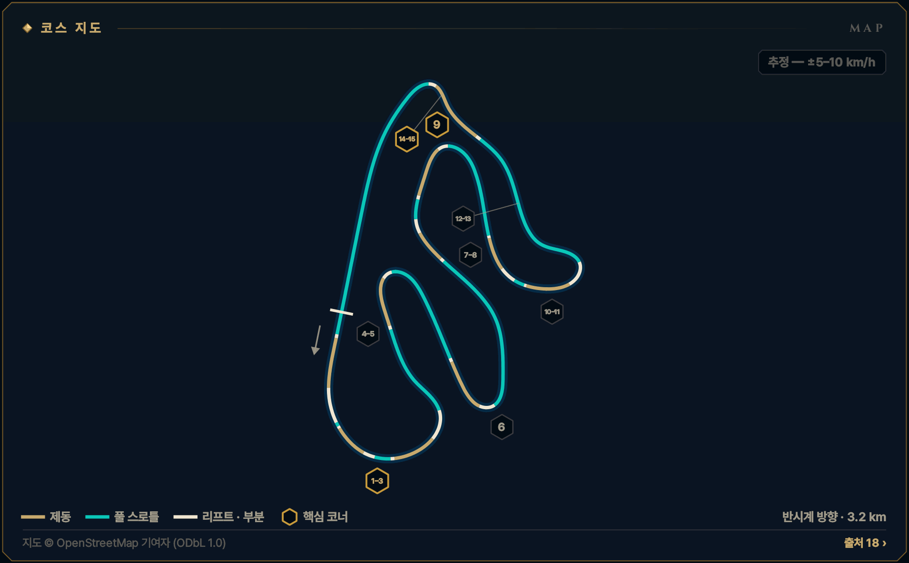
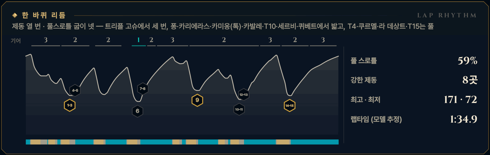

> **GRID서당 : iRacing**은 심레이싱이 처음인 동아리 신입을 위해 만든 드라이빙 아카데미 프로그램입니다. 이 글은 그 안의 **서킷 공략** 모드 — 이번 시즌 리그가 도는 서킷을 코스 개관과 코너별 애니메이션으로 미리 익히는 화면 — 를 블로그로 옮긴 것으로, 글과 애니메이션 모두 프로그램에서 그대로 가져왔습니다. 차는 iRacing의 Ray FF1600이고, 기준은 진도가 없는 루키(입문 렌즈)입니다. 강의는 [GRID서당 시리즈](/posts/untitled_life/motorsport/sim-racing/grid-seodang/)에, 낯선 말은 [용어 사전](/posts/untitled_life/motorsport/sim-racing/grid-seodang/glossary/)에 모아 두었습니다.

## 이번 시즌 일정

> **2026 시즌 4 · 포뮬러 1600 루키 시리즈 · 6주차** — 10.20(화)–10.26(월)
>
> - 루키 FF1600 · 기본 포함 · 12분 레이스 · 스탠딩 스타트 (차: Ray FF1600)
> - iRacing 트랙 이름: Circuit de Lédenon
> - 주차는 매주 화요일 09:00(한국 시간)에 바뀝니다.
>
> iRacing 일정은 시즌마다 바뀝니다. 이 글의 주차는 2026 시즌 4 기준이고, 같은 서킷이 다른 시즌에 돌아오면 그 시즌 일정에서 주차와 레이아웃을 다시 확인하세요.

## 코스 개관

3.15 km, 시계 반대 방향 — 프랑스의 주요 서킷 대부분과 반대로 돕니다. 높낮이 30 m 남짓에 공식 번호 15개의 코너가 촘촘한 '제동 학교'입니다. 레퍼런스는 한 바퀴에 브레이크를 열 번 밟고, 그중 다섯 번은 내리막에서 시작합니다. 힘이 약한 FF1600은 오르막에서 잃은 속도를 되찾지 못하니, 오르막 앞의 탈출이 랩타임입니다.

- **반시계 방향 · 단일 코스 · 3.2 km · 15코너**
- **코너 번호** — 서킷 공식 지도 번호 T1–T15를 씁니다. iRacing은 코너를 13개로 세고(평탄한 킹크 T4·T15를 빼는 것으로 보임) 지도에 번호를 싣지 않습니다. 번호보다 이름(트리플 고슈·퐁·카리에라스·카발레·세르비·퀴베트)으로 기억하세요.
- **루키 포인트** — 제동 학교 — 내리막에서 한 대 길이 일찍, 곧게 꾹, 길게 놓고, 오르막 탈출을 산다
- **속도 표기: 추정 — ±5–10 km/h** — 이 서킷에는 기준이 되는 실주행 텔레메트리가 없습니다. 공개된 FF1600 트랙 가이드 등에서 맞춘 코너 최저 속도에 보정한 FF1600 물리 모델을 맞춰 계산했기 때문에, 글과 영상의 속도·페달·기어는 모두 **추정값**(±5–10 km/h)입니다. Test Drive에서 직접 확인하세요.

*지도 © OpenStreetMap 기여자 (ODbL 1.0) · 선 색: 골드 = 제동, 시안 = 풀 스로틀, 흰색 = 리프트 · 부분 · 금테 육각형 = 핵심 코너 · 번호 = 이 글의 코너 공략 단위*

## 한 바퀴 리듬

제동 열 번 · 풀스로틀 굽이 넷 — 트리플 고슈에서 세 번, 퐁·카리에라스·카미옹(톡)·카발레·T10·세르비·퀴베트에서 밟고, T4·쿠르멜·라 데상트·T15는 풀

*풀 스로틀 59% · 강한 제동 8곳 · 최고 · 최저 171 · 72 km/h · 랩타임 (모델 추정) 1:34.9 — 위 그림의 기어 줄·속도 곡선·입력 띠(골드 = 제동, 시안 = 풀 스로틀)와 코너 번호는 이 기준 랩입니다.*

## 먼저 볼 코너

1. **[T14–15 퀴베트](#w06-u8)** — 가장 값진 탈출 — 가장 낮은 곳에서 벽 같은 오르막 직선으로
2. **[T1–3 트리플 고슈](#w06-u1)** — 1랩 스탠딩 스타트 뒤, 고개 너머 세 번 조여 오는 왼쪽
3. **[T9 카발레](#w06-u5)** — 가장 가파른 내리막 제동(약 −6%)

> **루키 포인트** — 제동 학교 — 내리막에서 한 대 길이 일찍, 곧게 꾹, 길게 놓고, 오르막 탈출을 산다

## 루키 안전 노트

- **1랩 트리플 고슈** — 오르막 위 그리드에서 출발해 고개를 넘자마자 T1, 이어서 두 번 더 조입니다. 콤플렉스 안에서는 차선을 바꾸지 않습니다.
- **오른쪽 피트 출구** — 피트 출구가 T1 앞 오른쪽, 레이싱 라인 위로 합류합니다(확인 필요). 연습·예선에서 오른쪽 거울을 봅니다.
- **내리막 제동 (퐁·카발레·퀴베트)** — 1랩에는 여기서 추월하지 않습니다. 한 박자 일찍, 차 한 대 폭.
- **보이지 않는 고개 (T10·카리에라스)** — 고개 너머 멈춘 차는 늦게 보입니다. 노란 깃발이면 고개 전에 줄입니다.
- **스핀 대처** — 브레이크를 꽉 밟아 세우고(시동은 안티스톨이 지킵니다), 상대 창으로 뒤차를 확인한 뒤 1단(왼쪽 패들)으로 트랙과 나란히 복귀합니다. 17x면 실격입니다.
- **트랙 리밋** — 차의 절반 이상이 노면 경계 밖이면 1x — 일부 트랙의 표시 구간만 네 바퀴 기준. 루키 규칙: 두 바퀴는 늘 선·연석 안쪽. 2024년에 트랙 리밋이 바뀌었다는 안내가 있으니 Test Drive에서 T3·카리에라스·카발레·퀴베트 출구의 1x를 확인하세요.

**1랩 · 스탠딩 스타트** — 1랩: 평소 제동 지점보다 늦게 밟지 않습니다. 앞차에 맞춰 더 일찍, 부드럽게 밟고, 차 한 대 폭을 남깁니다. 바깥이나 가운데를 지키고 안쪽 다툼에 끼지 않습니다.

## 영상 보는 법

코너마다 앱의 코너 공략 화면을 그대로 녹화했습니다. ▶를 눌러 재생하세요 — 앱의 **가이드** 재생(실제 속도의 0.4배, 화면에서 차가 너무 빠른 코너는 0.25배)이라 단계(접근·제동·턴인·에이펙스·탈출)마다 잠깐 멈추고, 멈춤 링이 차면 다음 단계로 넘어갑니다. 블로그 영상은 단계 시작의 멈춤만 짧게 줄였고 (캡션을 읽을 시간은 그대로), 끝에 앱의 끝 카드가 나옵니다. **급수별 브레이크 시연**을 펼치면 같은 코너를 7급·6급·5급 렌즈로, **흔한 실수 고스트**를 펼치면 실수한 차(빨간 점선)와 나란히 달린 영상을 볼 수 있습니다.

- **제동** — 골드 — 두께·밝기 = 브레이크 압력
- **가속** — 시안 — 스로틀
- **관성** — 흰색 — 두 페달 모두 뗀 구간
- **흔한 실수** — 빨간 점선 고스트 — 한 번에 하나만
- **▼ 제동 시작** — 루키 기준선의 제동 시작점
- **◆ 턴인** — 핸들을 감기 시작하는 곳
- **○ 에이펙스** — 가장 안쪽·가장 느린 곳
- **◇ 트랙아웃** — 탈출에서 닿는 바깥 끝
- **보드 (?)** — 확인 전 참고값 — Test Drive에서 기준점을 정하세요
- **입력 지도** — 골드 띠 = 브레이크, 흰 리본(안쪽) = 핸들. 겹치면 트레일
- **손 칸 · 내림 ×N · 올림** — 왼쪽 패들 N번 내림(블립은 오토 블립이) · 오른쪽 패들 한 번 올림

화면과 글의 속도는 모두 **추정값**(±5–10 km/h)입니다 — 기준 텔레메트리가 없는 서킷이라 모델로 계산했습니다.

## 코너 공략

### T1–3 트리플 고슈

**좌코너 · 2단 · 최저 약 120 km/h · 핵심 코너 · 추정 — ±5–10 km/h**  
고개 너머 왼쪽 셋 · T1 약 120 km/h · 주인공은 T3 (Triple Gauche)

<figure>
  <video src="images/u1.mp4" poster="images/u1_poster.png" controls preload="none" playsinline style="width:100%;max-width:960px"></video>
  <figcaption>시범 — 루키 기준선 · 입문 렌즈(직선 제동) · 가이드 0.4× · 접근 → 제동 → 턴인 → 에이펙스 → 에이펙스 ② → 제동 ③ → 에이펙스 ③ → 탈출</figcaption>
</figure>

급수별 브레이크 시연 — 7급 · 6급 · 5급 렌즈 (영상 3)

라인과 기준점은 그대로, 페달 쓰는 법만 지금 급수에 맞춥니다. 위 영상은 **직선 제동 — 기초·심화·9·8급** 렌즈입니다 — 턴인 전에 브레이크를 다 뗍니다 (브레이크 끝 = 턴인).

**릴리스 — 7급** — 턴인을 향해 0.4초 넘게 흘려서 0으로 · 7급 기준: 릴리스 0.4초 이상

<figure>
  <video src="images/u1_release.mp4" poster="images/u1_release_poster.png" controls preload="none" playsinline style="width:100%;max-width:960px"></video>
  <figcaption>7급 렌즈(릴리스) · 가이드 0.4× · 접근 → 제동 → 턴인 → 에이펙스 → 에이펙스 ② → 제동 ③ → 에이펙스 ③ → 탈출</figcaption>
</figure>

- 제동 — **고개 전 꾹 → 턴인까지 흘림** · 피크 약 72% · 1.3초에 걸쳐 놓기 · 발 · 하나-둘-셋 놓기
- 턴인 — **다 놓으며 감기 시작** · 턴인 무렵 0 · 탁 놓지 않기 · 발 · 놓는 끝 → 0

**트레일 — 6급·4\~1급·졸업** — 턴인 때 15\~20%를 남기고, 감는 만큼 풉니다 · 6급 기준: 턴인 때 15% 이상 남기기

<figure>
  <video src="images/u1_trail.mp4" poster="images/u1_trail_poster.png" controls preload="none" playsinline style="width:100%;max-width:960px"></video>
  <figcaption>6급 렌즈(트레일) · 가이드 0.4× · 접근 → 제동 → 턴인 → 에이펙스 → 에이펙스 ② → 제동 ③ → 에이펙스 ③ → 탈출</figcaption>
</figure>

- 제동 — **고개 전 꾹 → 조금 남기기** · 피크 약 72% · 턴인 때 약 18% · 발 · 놓으며 남기기
- 턴인 — **푸는 만큼 감는다** · 약 18% → 에이펙스 전 0 · 발 · 18% → 0 / 손 · 놓는 만큼 감기

**깊은 트레일 — 5급** — 턴인 때 30% 이상, 에이펙스 앞까지 끌고 갑니다 · 가벼운 제동 코너 — 30% 기준보다 적게 남깁니다

<figure>
  <video src="images/u1_deep.mp4" poster="images/u1_deep_poster.png" controls preload="none" playsinline style="width:100%;max-width:960px"></video>
  <figcaption>5급 렌즈(깊은 트레일) · 가이드 0.4× · 접근 → 제동 → 턴인 → 에이펙스 → 에이펙스 ② → 제동 ③ → 에이펙스 ③ → 탈출</figcaption>
</figure>

- 제동 — **5급도 여기선 곧게 놓기** · 피크 약 72% · 고개 바로 뒤라 턴인 전 0 · 발 · 꾹 → 가볍게 → 0
- 턴인 — **다 놓고 감는다** · 고개 바로 뒤 — 잔압은 남기지 않는다 · 발 · 0 → 스로틀

> **1랩 · 스탠딩 스타트** — 1랩: 오르막 위 그리드에서 출발해(초록불까지 브레이크를 밟고 있다가) 고개를 넘자마자 T1입니다. 평소 제동 지점보다 늦게 밟지 않고, 앞차에 맞춰 더 일찍 부드럽게 밟아 차 한 대 폭을 남깁니다. 콤플렉스 안에서는 들어간 줄 그대로 나오고, 바깥이나 가운데를 지킵니다.

#### 접근

메인 직선은 내내 오르막이고, 꼭대기 고개를 넘자마자 트리플 고슈가 시작됩니다. 트랙 오른쪽 끝에 붙고, 오른쪽에서 합류하는 피트 출구 차를 한 번 확인합니다. 루키 애니메이션은 약 165 km/h에서 밟습니다(레퍼런스는 4단 약 180 km/h).

*지금 손과 발 — 발 · 풀스로틀 / 손 · 곧게, 오른쪽 / 눈 · 오른쪽 거울·고개*

**보드 · 기준점** — 모두 확인 전 참고값입니다. Test Drive에서 직접 보고 정하세요.

- **제동 · 기준점**? 오른쪽 마셜 포스트·피트 출구 벽 끝 근처(실차 가이드, 미확인) — 턴인까지 약 75 m *(확인 전 참고값)*
- **에이펙스**? T1 안쪽 연석 — 높은 연석은 타지 않기 *(확인 전 참고값)*

#### 제동

T1은 곧은 동안 한 번에 줄입니다. 고개 전, 바퀴가 눌려 있을 때 점진적으로 약 72%까지 꾹 밟고, 고개 위에서는 약 30%로 가볍게 지키며 턴인까지 흘려 놓고 3단으로 맞춥니다. 실차 가이드의 기준물(오른쪽 마셜 포스트·피트 출구 벽 끝)은 Test Drive에서 확인하세요.

*지금 손과 발 — 발 · 꾹 → 고개 위 가볍게 / 손 · 곧게 / 눈 · T1 안쪽*

#### 턴인

T1은 오른쪽 끝에서 부드럽게 감습니다. 세 코너 모두 '조금 늦게'가 정답이고, 핸들은 코너마다 짧은 한 획씩입니다. T1에서 1\~2 km/h를 양보해도 괜찮습니다 — 주인공은 T3입니다.

*지금 손과 발 — 발 · 0 → 스로틀 / 손 · 작게 왼쪽 / 눈 · T1 에이펙스*

#### 에이펙스

T1 에이펙스(최저 약 120 km/h)를 지나 잠깐 가속하고, 차가 아직 왼쪽으로 기운 채 T2를 위해 짧고 가볍게 한 번 더 밟습니다. 코너 안에서 세게 밟으면 하중이 출렁여 뒤가 돌아 나옵니다.

*지금 손과 발 — 발 · 가볍게 → 놓기 / 손 · 유지 / 눈 · T2 에이펙스*

#### 에이펙스 ②

T2는 트랙 가운데쯤에서 T1보다 깊숙한 에이펙스를 봅니다. 빠져나오면서 일부러 오른쪽으로 흘러가 T3를 준비합니다.

*지금 손과 발 — 발 · 다시 열기 / 손 · 감고 유지 / 눈 · T3 바깥(오른쪽)*

#### 제동 ③

T2 바깥 연석이 끝날 즈음, 오른쪽에서 T3를 위해 한 번 더 밟습니다. T3는 가장 좁고 느린 코너라 조금 더 길게(약 33%), 핸들은 T2에서 감긴 만큼 둔 채 더 감지 않고 끝냅니다. 2단으로는 턴인 전에 내립니다.

*지금 손과 발 — 발 · 가볍게 길게 / 손 · T2 각도 그대로 · 내림 ×1 / 눈 · T3 늦은 에이펙스*

#### 에이펙스 ③

T3 에이펙스는 안쪽 연석의 마지막 3분의 1, 늦게 잡습니다. 높은 안쪽 연석에는 올라타지 않습니다. 이 콤플렉스의 최저 속도(약 80 km/h, 2단)가 여기입니다.

*지금 손과 발 — 발 · 에이펙스부터 열기 / 손 · 가장 많이 감기 / 눈 · 오른쪽 출구*

#### 탈출

T3 에이펙스부터 핸들을 푸는 만큼 스로틀을 끝까지 엽니다. 오르막 출구라 이 속도가 퐁 제동점까지 갑니다. 살짝 오른쪽으로 휘는 T4는 핸들을 거의 그대로 둔 채 풀스로틀입니다.

*지금 손과 발 — 발 · 푸는 만큼 / 손 · 풀기 / 눈 · T4 킹크*

#### 흔한 실수

- 고개 너머에서 늦게 100% — 차가 가벼워 바퀴가 잠기고 직진  
  → 한 대 길이 일찍, 곧게 점진적으로 꾹
- T2·T3에서 핸들을 감은 채 세게 밟기 — 뒤가 미끄러진다  
  → 짧고 가볍게, 곧은 구간에서 더 줄이기
- T3를 일찍 감기 — 출구 연석 밖, 트랙 리밋  
  → 늦게, 연석 마지막 3분의 1을 본다

#### 이 코너에서 확인할 것

- [ ] T1 제동 기준물(마셜 포스트·피트 출구 벽 끝)이 보이는지
- [ ] 피트 출구가 T1 앞 오른쪽으로 합류하는지
- [ ] 출발선 위치(모델은 ±수십 m)

#### 연결된 강의 · 드릴

- 강의: [심화 1강(출발의 기술)](/posts/untitled_life/motorsport/sim-racing/grid-seodang/advanced/d1-the-start/) · [심화 2강(코너의 다섯 얼굴)](/posts/untitled_life/motorsport/sim-racing/grid-seodang/advanced/d2-five-corner-faces/) · [심화 9강(기울어진 트랙)](/posts/untitled_life/motorsport/sim-racing/grid-seodang/advanced/d7-banked-track/) · [심화 6강(교본 차 해부)](/posts/untitled_life/motorsport/sim-racing/grid-seodang/advanced/d8-training-car-and-shifting/) · [8급(제동의 기본)](/posts/untitled_life/motorsport/sim-racing/grid-seodang/grades/g8-braking-basics/) · [6급(트레일 입문)](/posts/untitled_life/motorsport/sim-racing/grid-seodang/grades/g6-trail-intro/) · [기초 4강(레이싱 라인의 문법)](/posts/untitled_life/motorsport/sim-racing/grid-seodang/basics/f4-racing-line/) · [기초 6강(첫 공식전)](/posts/untitled_life/motorsport/sim-racing/grid-seodang/basics/f6-first-official-race/)
- 훈련장 드릴: 정밀 압력 · 트레일 브레이킹 · 조향 일필

<small>근거: L1 · L3 · L4 · L7 · L8 · L11 · L13 · MODEL (아래 출처 목록) · 신뢰도 L</small>

### T4–5 퐁

**우코너 · 2단 · 최저 약 85 km/h · 추정 — ±5–10 km/h**  
내리막 끝 긴 헤어핀 · 140→85 km/h · 2단 (Virage du Pont)

<figure>
  <video src="images/u2.mp4" poster="images/u2_poster.png" controls preload="none" playsinline style="width:100%;max-width:960px"></video>
  <figcaption>시범 — 루키 기준선 · 입문 렌즈(직선 제동) · 가이드 0.4× · 접근 → 턴인 → 에이펙스 → 제동 ② → 에이펙스 ② → 탈출</figcaption>
</figure>

급수별 브레이크 시연 — 7급 · 6급 · 5급 렌즈 (영상 3)

라인과 기준점은 그대로, 페달 쓰는 법만 지금 급수에 맞춥니다. 위 영상은 **직선 제동 — 기초·심화·9·8급** 렌즈입니다 — 턴인 전에 브레이크를 다 뗍니다 (브레이크 끝 = 턴인).

**릴리스 — 7급** — 턴인을 향해 0.4초 넘게 흘려서 0으로 · 7급 기준: 릴리스 0.4초 이상

<figure>
  <video src="images/u2_release.mp4" poster="images/u2_release_poster.png" controls preload="none" playsinline style="width:100%;max-width:960px"></video>
  <figcaption>7급 렌즈(릴리스) · 가이드 0.4× · 접근 → 턴인 → 에이펙스 → 제동 ② → 에이펙스 ② → 탈출</figcaption>
</figure>

- 제동 ② — **턴인까지 흘려서 놓는다** · 피크 약 61% · 0.8초에 걸쳐 놓기 · 발 · 하나-둘-셋 놓기
- 에이펙스 ② — **다 놓으며 감기 시작** · 턴인 무렵 0 · 탁 놓지 않기 · 발 · 놓는 끝 → 0

**트레일 — 6급·4\~1급·졸업** — 턴인 때 15\~20%를 남기고, 감는 만큼 풉니다 · 6급 기준: 턴인 때 15% 이상 남기기

<figure>
  <video src="images/u2_trail.mp4" poster="images/u2_trail_poster.png" controls preload="none" playsinline style="width:100%;max-width:960px"></video>
  <figcaption>6급 렌즈(트레일) · 가이드 0.4× · 접근 → 턴인 → 에이펙스 → 제동 ② → 에이펙스 ② → 탈출</figcaption>
</figure>

- 제동 ② — **턴인까지 조금 남긴다** · 피크 약 55% · 턴인 때 약 18% · 발 · 놓으며 남기기
- 에이펙스 ② — **푸는 만큼 감는다** · 약 18% → 조여 오기 전 0 · 발 · 18% → 0 / 손 · 놓는 만큼 감기

**깊은 트레일 — 5급** — 턴인 때 30% 이상, 에이펙스 앞까지 끌고 갑니다 · 5급 기준: 턴인 때 30% 이상 남기기

<figure>
  <video src="images/u2_deep.mp4" poster="images/u2_deep_poster.png" controls preload="none" playsinline style="width:100%;max-width:960px"></video>
  <figcaption>5급 렌즈(깊은 트레일) · 가이드 0.4× · 접근 → 턴인 → 에이펙스 → 제동 ② → 에이펙스 ② → 탈출</figcaption>
</figure>

- 제동 ② — **5급 렌즈: 턴인 32%** · 피크 약 47% · 천천히 길게 놓기 · 발 · 천천히 남기기
- 에이펙스 ② — **앞을 누른 채 감는다** · 약 32% → 에이펙스 앞 0 · 발 · 32% → 0

흔한 실수 고스트 — 너무 세게, 너무 오래

<figure>
  <video src="images/u2_ghost.mp4" poster="images/u2_ghost_poster.png" controls preload="none" playsinline style="width:100%;max-width:960px"></video>
  <figcaption>흔한 실수: 너무 세게, 너무 오래 — 95%로 꾹, 굴러가며 최저 약 65 km/h → 약 2.0초 늦음</figcaption>
</figure>

흔한 실수: **너무 세게, 너무 오래** — 95%로 꾹, 굴러가며 최저 약 65 km/h → 약 2.0초 늦음. 빨간 점선과 붉은 차가 실수 고스트, 흰 차가 루키 기준선입니다. 두 차는 같은 시계로 달리므로 늦어지거나 밀려나는 만큼이 그대로 보입니다. 영상은 앱에서 [흔한 실수]를 눌렀을 때처럼 그 실수가 시작되는 단계부터 재생합니다. 끝 카드의 '트레일 렌즈 기준'은 결과의 시간 차를 트레일(6급) 렌즈 주행과 비교한 값이라는 뜻입니다.

#### 접근

T3를 나와 짧게 오르면 살짝 오른쪽으로 휘는 T4 킹크입니다. 핸들을 거의 그대로 둔 채 풀스로틀로 지나며 트랙 왼쪽으로 옮겨 퐁을 준비합니다.

*지금 손과 발 — 발 · 풀스로틀 / 손 · 거의 곧게 / 눈 · T4 킹크*

**보드 · 기준점** — 모두 확인 전 참고값입니다. Test Drive에서 직접 보고 정하세요.

- **제동 · 기준점**? T4를 지나 보이는 물체 하나 정하기(턴인까지 약 70 m) *(확인 전 참고값)*

#### 턴인

T4는 손목만 쓰는 작은 오른쪽입니다. 차가 옆으로 실린 채 변속하지 않습니다.

*지금 손과 발 — 발 · 풀스로틀 / 손 · 작게 오른쪽 / 눈 · 왼쪽 끝*

#### 에이펙스

T4를 지나면 길이 내리막(약 −5%)으로 바뀌며 퐁으로 떨어집니다. 트랙 왼쪽 끝을 지킵니다.

*지금 손과 발 — 발 · 풀스로틀 / 손 · 곧게 / 눈 · 제동 기준점*

#### 제동 ②

이 랩에서 손꼽히게 강한 제동이고 내리막입니다. 평지 감각보다 한 대 길이 일찍, 곧게 '꾹' 약 61%까지 — ABS가 없어 내리막에서 100%면 앞바퀴가 잠깁니다. 확인된 보드가 없으니 T4를 지나 보이는 물체 하나를 기준으로 정하세요.

*지금 손과 발 — 발 · 꾹 / 손 · 곧게, 왼쪽 / 눈 · 늦은 턴인*

#### 에이펙스 ②

퐁은 길고 들어갈수록 조여 옵니다. 왼쪽 끝에서 오래 버틴 뒤 늦게 감고, 조여 오는 만큼 천천히 더 감습니다. 안쪽으로 기운 뱅크라 생각보다 잘 버팁니다 — 안쪽(오른쪽) 연석에는 올라타지 않습니다.

*지금 손과 발 — 발 · 0 → 살짝 스로틀 / 손 · 천천히 더 감기 / 눈 · 깊은 에이펙스*

#### 탈출

에이펙스에서 핸들을 풀며 스로틀을 끝까지 엽니다 — 감은 채 확 열면 앞이 밀립니다. 출구는 오르막이고 바깥 연석은 순한 편이라 넓게 나가도 괜찮습니다. 그다음 곧바로 트랙 오른쪽으로 건너가 카리에라스를 준비합니다.

*지금 손과 발 — 발 · 푸는 만큼 / 손 · 풀기 / 눈 · 트랙 오른쪽*

#### 흔한 실수

- 너무 세게, 너무 오래 — 100%로 밟고 내리막에서 굴러간다  
  → 피크 85\~90% 이하, 턴인까지 놓고 놓는 끝에서 스로틀
- 내리막을 잊고 늦게 — 앞바퀴 잠김, 바깥 벽 쪽으로  
  → 한 대 길이 일찍, 한 음절로 꾹
- 일찍 감기 — 이른 에이펙스, 출구에서 떼게 된다  
  → 왼쪽 끝에서 버티다 늦게, 에이펙스는 깊이

#### 이 코너에서 확인할 것

- [ ] 퐁 앞 제동 보드가 있는지
- [ ] 코너 중간 바깥(왼쪽) 벽의 위치

#### 연결된 강의 · 드릴

- 강의: [심화 2강(코너의 다섯 얼굴)](/posts/untitled_life/motorsport/sim-racing/grid-seodang/advanced/d2-five-corner-faces/) · [심화 9강(기울어진 트랙)](/posts/untitled_life/motorsport/sim-racing/grid-seodang/advanced/d7-banked-track/) · [심화 6강(교본 차 해부)](/posts/untitled_life/motorsport/sim-racing/grid-seodang/advanced/d8-training-car-and-shifting/) · [심화 7강(한계의 신호)](/posts/untitled_life/motorsport/sim-racing/grid-seodang/advanced/d9-signals-at-the-limit/) · [8급(제동의 기본)](/posts/untitled_life/motorsport/sim-racing/grid-seodang/grades/g8-braking-basics/) · [7급(릴리스 수양)](/posts/untitled_life/motorsport/sim-racing/grid-seodang/grades/g7-release/) · [6급(트레일 입문)](/posts/untitled_life/motorsport/sim-racing/grid-seodang/grades/g6-trail-intro/) · [3급(스로틀 서예)](/posts/untitled_life/motorsport/sim-racing/grid-seodang/grades/g3-throttle-calligraphy/)
- 훈련장 드릴: 제동 수양 · 정밀 압력 · 스로틀 서예

<small>근거: L1 · L4 · L7 · L8 · L9 · L13 · L18 · G2 · MODEL (아래 출처 목록) · 신뢰도 L</small>

### T6 카리에라스

**좌코너 · 1단 · 최저 약 70 km/h · 추정 — ±5–10 km/h**  
역뱅크 왼쪽 헤어핀 · 135→70 km/h · 1단 (La Carrierasse)

<figure>
  <video src="images/u3.mp4" poster="images/u3_poster.png" controls preload="none" playsinline style="width:100%;max-width:960px"></video>
  <figcaption>시범 — 루키 기준선 · 입문 렌즈(직선 제동) · 가이드 0.4× · 접근 → 제동 → 턴인 → 에이펙스 → 탈출</figcaption>
</figure>

급수별 브레이크 시연 — 7급 · 6급 · 5급 렌즈 (영상 3)

라인과 기준점은 그대로, 페달 쓰는 법만 지금 급수에 맞춥니다. 위 영상은 **직선 제동 — 기초·심화·9·8급** 렌즈입니다 — 턴인 전에 브레이크를 다 뗍니다 (브레이크 끝 = 턴인).

**릴리스 — 7급** — 턴인을 향해 0.4초 넘게 흘려서 0으로 · 7급 기준: 릴리스 0.4초 이상

<figure>
  <video src="images/u3_release.mp4" poster="images/u3_release_poster.png" controls preload="none" playsinline style="width:100%;max-width:960px"></video>
  <figcaption>7급 렌즈(릴리스) · 가이드 0.4× · 접근 → 제동 → 턴인 → 에이펙스 → 탈출</figcaption>
</figure>

- 제동 — **고개 위 가볍게 → 흘려 놓기** · 피크 약 50% · 1.0초에 걸쳐 놓기 · 발 · 하나-둘-셋 놓기
- 턴인 — **다 놓으며 감기 시작** · 턴인 무렵 0 · 탁 놓지 않기 · 발 · 놓는 끝 → 0

**트레일 — 6급·4\~1급·졸업** — 턴인 때 15\~20%를 남기고, 감는 만큼 풉니다 · 6급 기준: 턴인 때 15% 이상 남기기

<figure>
  <video src="images/u3_trail.mp4" poster="images/u3_trail_poster.png" controls preload="none" playsinline style="width:100%;max-width:960px"></video>
  <figcaption>6급 렌즈(트레일) · 가이드 0.4× · 접근 → 제동 → 턴인 → 에이펙스 → 탈출</figcaption>
</figure>

- 제동 — **고개 위 가볍게 → 조금 남기기** · 피크 약 45% · 턴인 때 약 18% · 발 · 놓으며 남기기
- 턴인 — **푸는 만큼 감는다** · 약 18% → 0 · 앞을 눌러 코를 넣는다 · 발 · 18% → 0 / 손 · 놓는 만큼 감기

**깊은 트레일 — 5급** — 턴인 때 30% 이상, 에이펙스 앞까지 끌고 갑니다 · 5급 기준: 턴인 때 30% 이상 남기기

<figure>
  <video src="images/u3_deep.mp4" poster="images/u3_deep_poster.png" controls preload="none" playsinline style="width:100%;max-width:960px"></video>
  <figcaption>5급 렌즈(깊은 트레일) · 가이드 0.4× · 접근 → 제동 → 턴인 → 에이펙스 → 탈출</figcaption>
</figure>

- 제동 — **고개 위 가볍게 → 턴인 32%** · 피크 약 45% · 역뱅크 내리막이라 고급 · 발 · 천천히 남기기
- 턴인 — **앞을 누른 채 감는다** · 약 32% → 에이펙스 앞 0 · 발 · 32% → 0

#### 접근

퐁을 빠져나와 짧게 오르면 고개를 넘어 다시 내려가며 카리에라스입니다. 고개에 닿기 전에 트랙 오른쪽 끝으로 건너가 둡니다 — 눈에 띄는 기준물이 없으니 Test Drive에서 하나 정하세요.

*지금 손과 발 — 발 · 풀스로틀 / 손 · 오른쪽으로 / 눈 · 고개*

**보드 · 기준점** — 모두 확인 전 참고값입니다. Test Drive에서 직접 보고 정하세요.

- **제동 · 기준점**? 퐁 뒤 오르막의 고개 — 오른쪽 끝에서(턴인까지 약 95 m) *(확인 전 참고값)*
- **에이펙스**? 안쪽 연석 끝 무렵, 거의 보이지 않음 *(확인 전 참고값)*

#### 제동

고개 위에서는 차가 가벼우니 부드럽게 걸기 시작하고, 넘어서 차가 가라앉으면 약 50%로 키웁니다. 길고 차분하게 줄이며 다운시프트는 곧은 동안 끝냅니다 — 2→1이 불안하면 처음엔 2단으로 돌아도 됩니다.

*지금 손과 발 — 발 · 부드럽게 → 키우기 / 손 · 곧게 · 내림 ×1 / 눈 · 늦은 턴인*

#### 턴인

노면이 바깥으로 기운 역뱅크라 그립이 평지보다 작습니다. 속도를 충분히 줄이고, 깊이 들어가 늦게 한 번에 감습니다.

*지금 손과 발 — 발 · 0 → 살짝 스로틀 / 손 · 크게 한 번에 / 눈 · 숨은 에이펙스*

#### 에이펙스

에이펙스는 안쪽 연석 끝 무렵, 거의 보이지 않는 곳입니다. 최저 약 70 km/h, 1단. 안쪽 연석은 살짝 밟아도 되지만 뒤의 콘크리트까지는 가지 않습니다.

*지금 손과 발 — 발 · 조금씩 열기 / 손 · 최대 조향 / 눈 · 오른쪽 바깥 연석*

#### 탈출

핸들을 푸는 만큼 한 획으로 엽니다. 차가 오른쪽 바깥 연석까지 흘러가도 되지만 그 연석이 한계선입니다. 이 탈출은 쿠르멜과 긴 내리막으로 이어지니 '느리게 들어가 빠르게 나오기'가 그대로 랩타임입니다.

*지금 손과 발 — 발 · 푸는 만큼 / 손 · 풀기 / 눈 · 쿠르멜*

#### 흔한 실수

- 일찍 감기 — 역뱅크에서 앞이 밀려 출구 연석 밖으로  
  → 더 깊이 들어가 늦게 — 진입에서 양보하고 출구를 산다
- 고개 위에서 세게 밟기 — 가벼운 차의 바퀴가 잠긴다  
  → 고개 위는 부드럽게, 넘어서 차가 가라앉으면 키운다
- 너무 빠를 때 1단 — 과회전, 뒷바퀴 잠김  
  → 1단은 100 km/h 아래, 아니면 2단으로

#### 이 코너에서 확인할 것

- [ ] 고개와 제동 시작 위치(알려진 기준물 없음)
- [ ] 1단과 2단 중 어느 쪽이 편한지

#### 연결된 강의 · 드릴

- 강의: [심화 2강(코너의 다섯 얼굴)](/posts/untitled_life/motorsport/sim-racing/grid-seodang/advanced/d2-five-corner-faces/) · [심화 9강(기울어진 트랙)](/posts/untitled_life/motorsport/sim-racing/grid-seodang/advanced/d7-banked-track/) · [심화 6강(교본 차 해부)](/posts/untitled_life/motorsport/sim-racing/grid-seodang/advanced/d8-training-car-and-shifting/) · [심화 7강(한계의 신호)](/posts/untitled_life/motorsport/sim-racing/grid-seodang/advanced/d9-signals-at-the-limit/) · [7급(릴리스 수양)](/posts/untitled_life/motorsport/sim-racing/grid-seodang/grades/g7-release/) · [5급(트레일 숙달)](/posts/untitled_life/motorsport/sim-racing/grid-seodang/grades/g5-trail-mastery/) · [4급(전환 수련)](/posts/untitled_life/motorsport/sim-racing/grid-seodang/grades/g4-transition/) · [3급(스로틀 서예)](/posts/untitled_life/motorsport/sim-racing/grid-seodang/grades/g3-throttle-calligraphy/)
- 훈련장 드릴: 제동 수양 · 트레일 브레이킹 · 전환 · 스로틀 서예

<small>근거: L1 · L4 · L7 · L8 · L13 · L17 · L18 · G2 · MODEL (아래 출처 목록) · 신뢰도 L</small>

### T7–8 쿠르멜 + 카미옹

**좌·우 복합 · 2단 · 최저 약 145 km/h · 추정 — ±5–10 km/h**  
쿠르멜은 풀, 카미옹은 짧게 톡 · 약 145 km/h (La Courmelle / Virage du Camion)

<figure>
  <video src="images/u4.mp4" poster="images/u4_poster.png" controls preload="none" playsinline style="width:100%;max-width:960px"></video>
  <figcaption>시범 — 루키 기준선 · 입문 렌즈(직선 제동) · 가이드 0.4× · 접근 → 턴인 → 에이펙스 → 제동 ② → 에이펙스 ② → 탈출</figcaption>
</figure>

급수별 브레이크 시연 — 7급 · 6급 · 5급 렌즈 (영상 3)

라인과 기준점은 그대로, 페달 쓰는 법만 지금 급수에 맞춥니다. 위 영상은 **직선 제동 — 기초·심화·9·8급** 렌즈입니다 — 턴인 전에 브레이크를 다 뗍니다 (브레이크 끝 = 턴인).

**릴리스 — 7급** — 턴인을 향해 0.4초 넘게 흘려서 0으로 · 7급 기준: 릴리스 0.4초 이상

<figure>
  <video src="images/u4_release.mp4" poster="images/u4_release_poster.png" controls preload="none" playsinline style="width:100%;max-width:960px"></video>
  <figcaption>7급 렌즈(릴리스) · 가이드 0.4× · 접근 → 턴인 → 에이펙스 → 제동 ② → 에이펙스 ② → 탈출</figcaption>
</figure>

- 제동 ② — **톡, 그리고 흘려서** · 피크 약 45% · 0.7초에 걸쳐 놓기 · 발 · 톡 → 흘려 놓기
- 에이펙스 ② — **다 놓으며 감는다** · 턴인 무렵 0 · 발 · 놓는 끝 → 0

**트레일 — 6급·4\~1급·졸업** — 턴인 때 15\~20%를 남기고, 감는 만큼 풉니다 · 6급 기준: 턴인 때 15% 이상 남기기

<figure>
  <video src="images/u4_trail.mp4" poster="images/u4_trail_poster.png" controls preload="none" playsinline style="width:100%;max-width:960px"></video>
  <figcaption>6급 렌즈(트레일) · 가이드 0.4× · 접근 → 턴인 → 에이펙스 → 제동 ② → 에이펙스 ② → 탈출</figcaption>
</figure>

- 제동 ② — **가볍게, 턴인까지 끈다** · 피크 약 45% · 턴인 때 약 18% · 발 · 가볍게 남기기
- 에이펙스 ② — **놓으며 감는다** · 약 18% → 0 · 일정한 원 · 발 · 18% → 0

**깊은 트레일 — 5급** — 턴인 때 30% 이상, 에이펙스 앞까지 끌고 갑니다 · 가벼운 제동 코너 — 30% 기준보다 적게 남깁니다

<figure>
  <video src="images/u4_deep.mp4" poster="images/u4_deep_poster.png" controls preload="none" playsinline style="width:100%;max-width:960px"></video>
  <figcaption>5급 렌즈(깊은 트레일) · 가이드 0.4× · 접근 → 턴인 → 에이펙스 → 제동 ② → 에이펙스 ② → 탈출</figcaption>
</figure>

- 제동 ② — **가벼운 톡, 턴인 전에 놓기** · 피크 약 45% · 빠른 오른쪽이라 잔압 없이 · 발 · 톡 → 0
- 에이펙스 ② — **다 놓고 감는다** · 깊은 트레일은 느린 코너에서 · 여기선 일정한 원 · 발 · 0 → 스로틀

#### 접근

카리에라스를 나와 올리면 왼쪽 쿠르멜(T7)이 고개 위에 있습니다. 쿠르멜 출구에서 길이 갑자기 떨어지므로, 그 너머가 보이지 않아도 미리 정해 둔 라인으로 들어갑니다.

*지금 손과 발 — 발 · 풀스로틀 / 손 · 곧게 / 눈 · 쿠르멜 안쪽*

**보드 · 기준점** — 모두 확인 전 참고값입니다. Test Drive에서 직접 보고 정하세요.

- **제동 · 기준점**? 내리막에서 보이는 물체 하나(턴인까지 약 45 m) — 공개된 기준물 없음 *(확인 전 참고값)*

#### 턴인

쿠르멜은 핸들을 적게, 한 번에 감습니다. 고개를 넘는 순간 차가 가벼워지니 그때는 조향을 더하지 않고 스로틀도 그대로 둡니다 — 여기서 떼면 뒤가 가벼워져 돕니다.

*지금 손과 발 — 발 · 풀스로틀 / 손 · 작게 왼쪽 / 눈 · 안쪽 연석*

#### 에이펙스

안쪽 연석을 스치고, 출구에서는 오른쪽 연석까지 흘러가지 않게 트랙 가운데에서 멈춥니다. 카미옹을 위해 다시 왼쪽으로 돌아와야 하기 때문입니다.

*지금 손과 발 — 발 · 풀스로틀 / 손 · 풀기 / 눈 · 내리막 왼쪽*

#### 제동 ②

약 400 m 내리막에서 이 구간 최고 속도(약 160 km/h)가 나옵니다. 카미옹은 '짧게 톡'입니다 — 레퍼런스는 1초도 안 되게 50% 안팎을 대고 4단을 유지합니다. 루키는 짧고 가벼운 제동으로 시작해, 매 랩 조금씩 덜 줄여 봅니다.

*지금 손과 발 — 발 · 짧게 톡 / 손 · 곧게, 왼쪽 / 눈 · 카미옹 턴인*

#### 에이펙스 ②

브레이크를 놓으며 감기 시작해 일정한 반지름으로 돕니다. 출구 바깥쪽이 솟아 있어(뱅크) 차를 붙잡아 줍니다. 최저 약 145 km/h(레퍼런스 약 150 km/h).

*지금 손과 발 — 발 · 놓고 → 스로틀 / 손 · 일정하게 / 눈 · 출구 왼쪽*

#### 탈출

트랙 왼쪽으로 나가고, 왼쪽 연석은 써도 됩니다. 곧바로 카발레 제동이 이어지니 차를 빨리 곧게 펴서 왼쪽에 세웁니다.

*지금 손과 발 — 발 · 100% / 손 · 빨리 풀기 / 눈 · 카발레 기준점*

#### 흔한 실수

- 쿠르멜 고개에서 떼거나 더 감기 — 뒤가 가벼워져 휙 돈다  
  → 고개 전에 각을 정하고 스로틀은 그대로
- 쿠르멜 출구에서 오른쪽으로 — 카미옹을 잘못된 쪽에서, 큰 제동  
  → 가운데에서 멈추고 왼쪽으로 돌아온다
- 카미옹에 늦고 세게 — 내리막 컴프레션에서 차가 흔들린다  
  → 일찍, 가볍게 톡, 놓으며 감기

#### 이 코너에서 확인할 것

- [ ] 쿠르멜 고개 너머가 보이는지, 출구 연석
- [ ] 카미옹 앞 기준물

#### 연결된 강의 · 드릴

- 강의: [심화 2강(코너의 다섯 얼굴)](/posts/untitled_life/motorsport/sim-racing/grid-seodang/advanced/d2-five-corner-faces/) · [심화 8강(페달의 문법)](/posts/untitled_life/motorsport/sim-racing/grid-seodang/advanced/d6-pedal-grammar/) · [심화 9강(기울어진 트랙)](/posts/untitled_life/motorsport/sim-racing/grid-seodang/advanced/d7-banked-track/) · [심화 4강(차의 균형)](/posts/untitled_life/motorsport/sim-racing/grid-seodang/advanced/d4-car-balance/) · [2급(스티어링 일필휘지)](/posts/untitled_life/motorsport/sim-racing/grid-seodang/grades/g2-one-stroke-steering/) · [6급(트레일 입문)](/posts/untitled_life/motorsport/sim-racing/grid-seodang/grades/g6-trail-intro/)
- 훈련장 드릴: 정밀 압력 · 트레일 브레이킹 · 조향 일필

<small>근거: L1 · L4 · L7 · L8 · L9 · L10 · MODEL (아래 출처 목록) · 신뢰도 L</small>

### T9 카발레

**우코너 · 2단 · 최저 약 90 km/h · 핵심 코너 · 추정 — ±5–10 km/h**  
가장 가파른 내리막 제동 · 150→90 km/h · 2단 (Le Cavalet)

<figure>
  <video src="images/u5.mp4" poster="images/u5_poster.png" controls preload="none" playsinline style="width:100%;max-width:960px"></video>
  <figcaption>시범 — 루키 기준선 · 입문 렌즈(직선 제동) · 가이드 0.4× · 접근 → 제동 → 턴인 → 에이펙스 → 탈출</figcaption>
</figure>

급수별 브레이크 시연 — 7급 · 6급 · 5급 렌즈 (영상 3)

라인과 기준점은 그대로, 페달 쓰는 법만 지금 급수에 맞춥니다. 위 영상은 **직선 제동 — 기초·심화·9·8급** 렌즈입니다 — 턴인 전에 브레이크를 다 뗍니다 (브레이크 끝 = 턴인).

**릴리스 — 7급** — 턴인을 향해 0.4초 넘게 흘려서 0으로 · 7급 기준: 릴리스 0.4초 이상

<figure>
  <video src="images/u5_release.mp4" poster="images/u5_release_poster.png" controls preload="none" playsinline style="width:100%;max-width:960px"></video>
  <figcaption>7급 렌즈(릴리스) · 가이드 0.4× · 접근 → 제동 → 턴인 → 에이펙스 → 탈출</figcaption>
</figure>

- 제동 — **턴인까지 흘려서 놓는다** · 피크 약 61% · 0.9초에 걸쳐 놓기 · 발 · 하나-둘-셋 놓기
- 턴인 — **다 놓으며 감기 시작** · 턴인 무렵 0 · 탁 놓지 않기 · 발 · 놓는 끝 → 0

**트레일 — 6급·4\~1급·졸업** — 턴인 때 15\~20%를 남기고, 감는 만큼 풉니다 · 6급 기준: 턴인 때 15% 이상 남기기

<figure>
  <video src="images/u5_trail.mp4" poster="images/u5_trail_poster.png" controls preload="none" playsinline style="width:100%;max-width:960px"></video>
  <figcaption>6급 렌즈(트레일) · 가이드 0.4× · 접근 → 제동 → 턴인 → 에이펙스 → 탈출</figcaption>
</figure>

- 제동 — **턴인까지 조금 남긴다** · 피크 약 56% · 턴인 때 약 18% · 발 · 놓으며 남기기
- 턴인 — **푸는 만큼 감는다** · 약 18% → 바닥 전에 0 · 발 · 18% → 0 / 손 · 놓는 만큼 감기

**깊은 트레일 — 5급** — 턴인 때 30% 이상, 에이펙스 앞까지 끌고 갑니다 · 5급 기준: 턴인 때 30% 이상 남기기

<figure>
  <video src="images/u5_deep.mp4" poster="images/u5_deep_poster.png" controls preload="none" playsinline style="width:100%;max-width:960px"></video>
  <figcaption>5급 렌즈(깊은 트레일) · 가이드 0.4× · 접근 → 제동 → 턴인 → 에이펙스 → 탈출</figcaption>
</figure>

- 제동 — **5급 렌즈: 턴인 32%** · 피크 약 50% · 천천히 길게 놓기 · 발 · 천천히 남기기
- 턴인 — **앞을 누른 채 감는다** · 약 32% → 에이펙스 앞 0 · 발 · 32% → 0

4\~1급은 같은 영상의 캡션에 강조 한 줄(◆)이 더 붙습니다:

- ◆ 4급(턴인·에이펙스) — 브레이크 끝 = 스로틀 시작 — 오르막 앞에서 굴러가지 않는다

흔한 실수 고스트 — 늦은 제동 → 잠김 → 직진

<figure>
  <video src="images/u5_ghost.mp4" poster="images/u5_ghost_poster.png" controls preload="none" playsinline style="width:100%;max-width:960px"></video>
  <figcaption>흔한 실수: 늦은 제동 → 잠김 → 직진 — 41 m 늦게 100% → 바퀴가 잠겨 직진 · 트랙 밖</figcaption>
</figure>

흔한 실수: **늦은 제동 → 잠김 → 직진** — 41 m 늦게 100% → 바퀴가 잠겨 직진 · 트랙 밖. 빨간 점선과 붉은 차가 실수 고스트, 흰 차가 루키 기준선입니다. 두 차는 같은 시계로 달리므로 늦어지거나 밀려나는 만큼이 그대로 보입니다. 영상은 앱에서 [흔한 실수]를 눌렀을 때처럼 그 실수가 시작되는 단계부터 재생합니다. 끝 카드의 '트레일 렌즈 기준'은 결과의 시간 차를 트레일(6급) 렌즈 주행과 비교한 값이라는 뜻입니다.

#### 접근

카미옹을 나와 트랙 왼쪽에 서면 곧바로 카발레 제동입니다. 이 랩에서 가장 가파른 내리막(약 −6%) 끝에 오른쪽 코너가 있고, 바닥의 컴프레션을 지나 오르막으로 나갑니다.

*지금 손과 발 — 발 · 풀스로틀 / 손 · 곧게 / 눈 · 제동 기준점*

**보드 · 기준점** — 모두 확인 전 참고값입니다. Test Drive에서 직접 보고 정하세요.

- **제동 · 기준점**? 진입 연석과 나란해질 때(심 가이드, 약한 근거) — 턴인까지 약 95 m *(확인 전 참고값)*
- **에이펙스**? 중간\~늦은 에이펙스 — 안쪽 연석 금지 *(확인 전 참고값)*

#### 제동

내리막이니 평지보다 한 대 길이 일찍, 곧게 '꾹' 한 음절로 약 60%까지 밟습니다. 속도가 내려가는 대로 한 단씩 — 2단은 130 km/h 아래에서. 브레이크는 바닥(컴프레션)에 닿기 전에 놓아 둡니다.

*지금 손과 발 — 발 · 꾹 / 손 · 곧게 · 내림 ×1 / 눈 · 턴인 지점*

#### 턴인

왼쪽 끝에서 중간\~늦은 턴인, 한 번에 감습니다. 바닥의 오르막이 앞을 눌러 주니 그 순간 그립이 잠깐 좋아집니다.

*지금 손과 발 — 발 · 0 → 살짝 스로틀 / 손 · 한 번에 감기 / 눈 · 에이펙스*

#### 에이펙스

에이펙스는 중간\~늦게, 최저 약 90 km/h(레퍼런스 약 95 km/h), 2단입니다. 안쪽 연석에는 올라타지 않습니다.

*지금 손과 발 — 발 · 조금씩 열기 / 손 · 최대 조향 / 눈 · 출구*

#### 탈출

코너가 열리며 약 10% 오르막으로 나갑니다. 핸들을 푸는 만큼 한 획으로 열고, 출구 바깥 연석은 피합니다 — 이 서킷에서 드물게 피해야 하는 연석입니다. 오르막에서 잃은 속도는 돌아오지 않습니다.

*지금 손과 발 — 발 · 푸는 만큼 / 손 · 풀기 / 눈 · 오르막 꼭대기*

#### 흔한 실수

- 내리막에서 늦게 100% — 앞바퀴가 잠겨 곧장 직진  
  → 한 대 길이 일찍, 피크 85\~90% 이하
- 바닥까지 세게 끌기 — 컴프레션에서 뒤가 돈다  
  → 바닥 전에 0, 하나-둘-셋으로 놓기
- 너무 빠를 때 2단 — 과회전, 뒷바퀴 잠김  
  → 2단은 130 km/h 아래에서

#### 이 코너에서 확인할 것

- [ ] 제동 보드·기준물
- [ ] 출구 바깥 연석이 1x인지

#### 연결된 강의 · 드릴

- 강의: [심화 9강(기울어진 트랙)](/posts/untitled_life/motorsport/sim-racing/grid-seodang/advanced/d7-banked-track/) · [심화 2강(코너의 다섯 얼굴)](/posts/untitled_life/motorsport/sim-racing/grid-seodang/advanced/d2-five-corner-faces/) · [심화 6강(교본 차 해부)](/posts/untitled_life/motorsport/sim-racing/grid-seodang/advanced/d8-training-car-and-shifting/) · [심화 7강(한계의 신호)](/posts/untitled_life/motorsport/sim-racing/grid-seodang/advanced/d9-signals-at-the-limit/) · [8급(제동의 기본)](/posts/untitled_life/motorsport/sim-racing/grid-seodang/grades/g8-braking-basics/) · [7급(릴리스 수양)](/posts/untitled_life/motorsport/sim-racing/grid-seodang/grades/g7-release/) · [6급(트레일 입문)](/posts/untitled_life/motorsport/sim-racing/grid-seodang/grades/g6-trail-intro/) · [3급(스로틀 서예)](/posts/untitled_life/motorsport/sim-racing/grid-seodang/grades/g3-throttle-calligraphy/)
- 훈련장 드릴: 제동 수양 · 정밀 압력 · 스로틀 서예

<small>근거: L1 · L4 · L7 · L8 · L9 · L13 · G2 · MODEL (아래 출처 목록) · 신뢰도 L</small>

### T10–11 10번 + 세르비

**좌코너 · 2단 · 최저 약 115 km/h · 추정 — ±5–10 km/h**  
보이지 않는 고개 + 조여 오는 말굽 · 세르비 약 70 km/h (La Servie)

<figure>
  <video src="images/u6.mp4" poster="images/u6_poster.png" controls preload="none" playsinline style="width:100%;max-width:960px"></video>
  <figcaption>시범 — 루키 기준선 · 입문 렌즈(직선 제동) · 가이드 0.4× · 접근 → 제동 → 턴인 → 에이펙스 → 제동 ② → 에이펙스 ② → 탈출</figcaption>
</figure>

급수별 브레이크 시연 — 7급 · 6급 · 5급 렌즈 (영상 3)

라인과 기준점은 그대로, 페달 쓰는 법만 지금 급수에 맞춥니다. 위 영상은 **직선 제동 — 기초·심화·9·8급** 렌즈입니다 — 턴인 전에 브레이크를 다 뗍니다 (브레이크 끝 = 턴인).

**릴리스 — 7급** — 턴인을 향해 0.4초 넘게 흘려서 0으로 · 7급 기준: 릴리스 0.4초 이상

<figure>
  <video src="images/u6_release.mp4" poster="images/u6_release_poster.png" controls preload="none" playsinline style="width:100%;max-width:960px"></video>
  <figcaption>7급 렌즈(릴리스) · 가이드 0.4× · 접근 → 제동 → 턴인 → 에이펙스 → 제동 ② → 에이펙스 ② → 탈출</figcaption>
</figure>

- 제동 — **턴인까지 흘려서 놓는다** · 피크 약 47% · 0.5초에 걸쳐 놓기 · 발 · 하나-둘-셋 놓기
- 턴인 — **다 놓으며 감기 시작** · 턴인 무렵 0 · 탁 놓지 않기 · 발 · 놓는 끝 → 0
- 제동 ② — **길게 흘려서 놓는다** · 턴인까지 하나-둘-셋 · 발 · 하나-둘-셋 놓기
- 에이펙스 ② — **다 놓으며 감는다** · 턴인 무렵 0 · 그다음 더 감기 · 발 · 놓는 끝 → 0

**트레일 — 6급·4\~1급·졸업** — 턴인 때 15\~20%를 남기고, 감는 만큼 풉니다 · 가벼운 제동 코너 — 15% 기준보다 적게 남깁니다

<figure>
  <video src="images/u6_trail.mp4" poster="images/u6_trail_poster.png" controls preload="none" playsinline style="width:100%;max-width:960px"></video>
  <figcaption>6급 렌즈(트레일) · 가이드 0.4× · 접근 → 제동 → 턴인 → 에이펙스 → 제동 ② → 에이펙스 ② → 탈출</figcaption>
</figure>

- 제동 — **10번은 가볍게, 턴인 전 0** · 피크 약 47% · 남기는 연습은 세르비에서 · 발 · 가볍게 → 0
- 턴인 — **다 놓고 감는다** · T10은 가볍게 · 세르비에서 약 15\~20% 남기기 · 발 · 0 → 유지 / 손 · 한 획으로 감기
- 제동 ② — **턴인까지 길게 남긴다** · 세르비 = 트레일 교실 · 약 15\~20% 남기기 · 발 · 놓으며 남기기
- 에이펙스 ② — **놓는 만큼 더 감는다** · 놓는 속도 = 회전 · 에이펙스 앞 0 · 발 · 천천히 → 0 / 손 · 놓는 만큼 감기

**깊은 트레일 — 5급** — 턴인 때 30% 이상, 에이펙스 앞까지 끌고 갑니다 · 가벼운 제동 코너 — 30% 기준보다 적게 남깁니다

<figure>
  <video src="images/u6_deep.mp4" poster="images/u6_deep_poster.png" controls preload="none" playsinline style="width:100%;max-width:960px"></video>
  <figcaption>5급 렌즈(깊은 트레일) · 가이드 0.4× · 접근 → 제동 → 턴인 → 에이펙스 → 제동 ② → 에이펙스 ② → 탈출</figcaption>
</figure>

- 제동 — **5급 렌즈: 턴인 22%** · 피크 약 24% · 천천히 길게 놓기 · 발 · 천천히 남기기
- 턴인 — **앞을 누른 채 감는다** · 약 22% → 에이펙스 앞 0 · 발 · 22% → 0
- 제동 ② — **가볍게, 말굽 안까지 길게** · 가볍게 길게 · 레퍼런스는 턴인 때 약 30% · 발 · 가볍게 길게
- 에이펙스 ② — **놓는 속도로 차를 돌린다** · 조여 오는 만큼 놓고 감기 · 발 · 천천히 → 0

#### 접근

카발레에서 약 250 m 오르막을 올라 꼭대기에서 왼쪽 T10입니다. 턴인과 에이펙스가 고개에 가려 보이지 않으니, 보이기 전에 하늘을 배경으로 한 연석 시작점이나 구조물로 기준을 정합니다.

*지금 손과 발 — 발 · 풀스로틀 / 손 · 곧게 / 눈 · 하늘 배경 기준물*

**보드 · 기준점** — 모두 확인 전 참고값입니다. Test Drive에서 직접 보고 정하세요.

- **제동 · 기준점**? T10 연석 시작점이나 하늘 배경 구조물(고개 전에 정하기) — 턴인까지 약 35 m *(확인 전 참고값)*

#### 제동

T10은 가볍게, 짧게 밟습니다(약 47%). 오르막이라 브레이크가 잘 듭니다. 고개를 넘기 전에 속도를 맞춰 둡니다.

*지금 손과 발 — 발 · 가볍게 톡 / 손 · 곧게 / 눈 · T10 턴인*

#### 턴인

놓으며 늦게 감고, 출구에서 오른쪽으로 흘러 오른쪽 연석에 닿게 둡니다. 그래야 세르비에 오른쪽 끝에서 들어갑니다.

*지금 손과 발 — 발 · 0 → 스로틀 / 손 · 작게 왼쪽 / 눈 · 오른쪽 연석*

#### 에이펙스

T10의 최저는 약 115 km/h입니다. 차가 안정되면 곧 세르비 제동이니, 오른쪽 끝에 붙은 채 곧게 세웁니다.

*지금 손과 발 — 발 · 스로틀 / 손 · 풀기 / 눈 · 세르비 제동점*

#### 제동 ②

T10에서 차가 안정되자마자 세르비 제동입니다. 루키는 곧은 동안 목표 속도까지 줄이고 턴인 전에 놓습니다. 세르비는 들어갈수록 조여 오는 말굽이라 레퍼런스는 브레이크를 오래 남긴 채 감습니다 — 트레일 교실입니다.

*지금 손과 발 — 발 · 꾹 → 놓기 / 손 · 곧게 / 눈 · 오른쪽 끝 턴인*

#### 에이펙스 ②

오른쪽 끝에서 천천히 감기 시작해, 조여 오는 만큼 더 감습니다. 에이펙스는 코너가 끝나는 곳 — 아주 늦게입니다. 세르비 최저는 약 70 km/h, 2단.

*지금 손과 발 — 발 · 가볍게 유지 / 손 · 천천히 더 감기 / 눈 · 코너 끝*

#### 탈출

에이펙스에서 바로 풀스로틀, 핸들은 빠르게 풉니다. 출구는 트랙 왼쪽에 남깁니다 — 곧바로 오른쪽 T12를 왼쪽에서 들어가야 합니다.

*지금 손과 발 — 발 · 한 획 100% / 손 · 빠르게 풀기 / 눈 · T12*

#### 흔한 실수

- 턴인에서 브레이크를 탁 놓기 — 조여 오는 곳에서 앞이 밀린다  
  → 놓는 건 거는 것보다 천천히, 하나-둘-셋
- 보이지 않는 T10에 빠르게 — 밀려서 세르비를 잘못된 쪽에서  
  → 고개 전에 가볍게 줄이고 하늘 기준물을 정한다
- 세르비를 일찍 — 오른쪽으로 밀려 T12를 잃는다  
  → 에이펙스는 코너가 끝나는 곳

#### 이 코너에서 확인할 것

- [ ] T10 고개 전 기준물
- [ ] 세르비 앞 마셜 포스트 위치

#### 연결된 강의 · 드릴

- 강의: [심화 9강(기울어진 트랙)](/posts/untitled_life/motorsport/sim-racing/grid-seodang/advanced/d7-banked-track/) · [심화 2강(코너의 다섯 얼굴)](/posts/untitled_life/motorsport/sim-racing/grid-seodang/advanced/d2-five-corner-faces/) · [심화 4강(차의 균형)](/posts/untitled_life/motorsport/sim-racing/grid-seodang/advanced/d4-car-balance/) · [6급(트레일 입문)](/posts/untitled_life/motorsport/sim-racing/grid-seodang/grades/g6-trail-intro/) · [5급(트레일 숙달)](/posts/untitled_life/motorsport/sim-racing/grid-seodang/grades/g5-trail-mastery/) · [2급(스티어링 일필휘지)](/posts/untitled_life/motorsport/sim-racing/grid-seodang/grades/g2-one-stroke-steering/)
- 훈련장 드릴: 트레일 브레이킹 · 제동 수양 · 조향 일필

<small>근거: L1 · L4 · L7 · L8 · L10 · L17 · MODEL (아래 출처 목록) · 신뢰도 L</small>

### T12–13 라 데상트

**우·좌 복합 · 2단 · 추정 — ±5–10 km/h**  
풀스로틀 내리막 S자 · 출구 약 170 km/h (La Descente)

<figure>
  <video src="images/u7.mp4" poster="images/u7_poster.png" controls preload="none" playsinline style="width:100%;max-width:960px"></video>
  <figcaption>시범 — 루키 기준선 · 렌즈 공통 · 가이드 0.4× · 접근 → 턴인 → 에이펙스 → 전환 → 에이펙스 ② → 탈출</figcaption>
</figure>

급수별 브레이크 시연 — 모든 급수가 같은 그림

이 코너는 렌즈가 같습니다 — 리프트·풀스로틀 코너는 브레이크를 쓰지 않아 모든 급수가 같은 페달 그림을 봅니다.

#### 접근

세르비를 트랙 왼쪽으로 나오면 내리막 S자 '라 데상트'입니다. 오른쪽 T12, 왼쪽 T13 — 레퍼런스는 모두 풀스로틀이고, 루키도 발은 그대로 둡니다.

*지금 손과 발 — 발 · 풀스로틀 / 손 · 곧게, 왼쪽 / 눈 · T12 안쪽*

**보드 · 기준점** — 모두 확인 전 참고값입니다. Test Drive에서 직접 보고 정하세요.

- **턴인**? T12 오른쪽 연석, 늦게 *(확인 전 참고값)*

#### 턴인

T12는 트랙 왼쪽에서 오른쪽 안쪽을 늦게 스칩니다. 한 획으로 감고, 이 굽이의 트랙아웃이 곧 T13의 턴인입니다.

*지금 손과 발 — 발 · 풀스로틀 / 손 · 오른쪽 한 획 / 눈 · T12 연석*

#### 에이펙스

T12 에이펙스를 지나 핸들을 풀고, 곧을 때 한 단 올립니다. 차가 옆으로 실린 채 변속하지 않습니다.

*지금 손과 발 — 발 · 풀스로틀 / 손 · 풀기 · 올림 / 눈 · T13*

#### 전환

내리막이 이어지며 속도가 빠르게 붙습니다. 발은 끝까지 그대로 — 차가 완전히 곧지 않아서, 떼었다 밟기를 반복하면 뒤가 가벼워져 흔들립니다.

*지금 손과 발 — 발 · 풀스로틀 / 손 · 작게 / 눈 · T13 안쪽*

#### 에이펙스 ②

T13은 작은 왼쪽입니다. 손목만으로 안쪽을 스치고, 다음 변속도 곧을 때 합니다.

*지금 손과 발 — 발 · 풀스로틀 / 손 · 작게 왼쪽 / 눈 · 바닥 오른쪽 연석*

#### 탈출

T13을 지나며 일찍 트랙 오른쪽으로 옮겨 바닥의 오른쪽 연석 시작점을 겨냥합니다. 그 앞이 퀴베트 제동이고, 퀴베트는 오른쪽에서 들어가야 합니다.

*지금 손과 발 — 발 · 풀스로틀 / 손 · 오른쪽으로 / 눈 · 오른쪽 연석 시작*

#### 흔한 실수

- 내리막에서 떼었다 밟기 반복 — 뒤가 가벼워 흔들린다  
  → 풀스로틀(또는 일정한 부분 스로틀)로 버티고 핸들은 작게
- 굽이마다 크게, 여러 번 꺾기  
  → 굽이마다 작은 한 획, 트랙아웃 = 다음 턴인
- T13 뒤 왼쪽에 남기 — 퀴베트를 잘못된 쪽에서  
  → 일찍 오른쪽으로, 바닥 오른쪽 연석을 본다

#### 이 코너에서 확인할 것

- [ ] T12·T13 연석 높이

#### 연결된 강의 · 드릴

- 강의: [심화 2강(코너의 다섯 얼굴)](/posts/untitled_life/motorsport/sim-racing/grid-seodang/advanced/d2-five-corner-faces/) · [심화 9강(기울어진 트랙)](/posts/untitled_life/motorsport/sim-racing/grid-seodang/advanced/d7-banked-track/) · [3급(스로틀 서예)](/posts/untitled_life/motorsport/sim-racing/grid-seodang/grades/g3-throttle-calligraphy/) · [2급(스티어링 일필휘지)](/posts/untitled_life/motorsport/sim-racing/grid-seodang/grades/g2-one-stroke-steering/)
- 훈련장 드릴: 조향 일필 · 스로틀 서예

<small>근거: L1 · L4 · L7 · L8 · L11 · MODEL (아래 출처 목록) · 신뢰도 M</small>

### T14–15 퀴베트

**우·좌 복합 · 2단 · 최저 약 80 km/h · 핵심 코너 · 추정 — ±5–10 km/h**  
가장 값진 코너 · 165→80 km/h · 2단 (La Cuvette)

<figure>
  <video src="images/u8.mp4" poster="images/u8_poster.png" controls preload="none" playsinline style="width:100%;max-width:960px"></video>
  <figcaption>시범 — 루키 기준선 · 입문 렌즈(직선 제동) · 가이드 0.4× · 접근 → 턴인 → 에이펙스 → 제동 ② → 에이펙스 ② → 탈출</figcaption>
</figure>

급수별 브레이크 시연 — 모든 급수가 같은 그림

이 코너는 앱이 모든 급수에 **직선 제동 — 기초·심화·9·8급** 렌즈 하나만 보여 줍니다 — 턴인 전에 브레이크를 다 뗍니다 (브레이크 끝 = 턴인). 급수별 영상이 따로 없습니다.

4\~1급은 같은 영상의 캡션에 강조 한 줄(◆)이 더 붙습니다:

- ◆ 4급(턴인·에이펙스) — 브레이크 끝 = 스로틀 시작 — 오르막 직선은 탈출이 전부

흔한 실수 고스트 — 이른 턴인 → 출구에서 밀림

<figure>
  <video src="images/u8_ghost.mp4" poster="images/u8_ghost_poster.png" controls preload="none" playsinline style="width:100%;max-width:960px"></video>
  <figcaption>흔한 실수: 이른 턴인 → 출구에서 밀림 — 일찍 꺾으면 출구에서 바깥으로 밀린다 → 약 0.4초 늦음</figcaption>
</figure>

흔한 실수: **이른 턴인 → 출구에서 밀림** — 일찍 꺾으면 출구에서 바깥으로 밀린다 → 약 0.4초 늦음. 빨간 점선과 붉은 차가 실수 고스트, 흰 차가 루키 기준선입니다. 두 차는 같은 시계로 달리므로 늦어지거나 밀려나는 만큼이 그대로 보입니다. 영상은 앱에서 [흔한 실수]를 눌렀을 때처럼 그 실수가 시작되는 단계부터 재생합니다. 끝 카드의 '트레일 렌즈 기준'은 결과의 시간 차를 트레일(6급) 렌즈 주행과 비교한 값이라는 뜻입니다.

#### 접근

약 300 m 내리막 끝, 이 서킷의 가장 낮은 곳에 퀴베트가 있습니다. 트랙 오른쪽 끝에 붙어 내려오다 바닥의 오른쪽 굽이 앞에서 곧게 제동을 시작합니다(내리막이니 한 대 길이 일찍). 노면이 울퉁불퉁해 브레이크를 한계까지 쓰지 않습니다.

*지금 손과 발 — 발 · 꾹, 한계 아래 / 손 · 곧게, 오른쪽 / 눈 · 오른쪽 연석*

**보드 · 기준점** — 모두 확인 전 참고값입니다. Test Drive에서 직접 보고 정하세요.

- **제동 · 기준점**? 바닥 오른쪽 연석 약 50 m 앞(실차 가이드, 미확인) — 턴인까지 약 135 m *(확인 전 참고값)*

#### 턴인

바닥의 오른쪽 굽이는 제동하는 동안 핸들만 살짝 씁니다. 범프 위에서 브레이크를 더 세게 하지 않고 일정하게 유지합니다. 다운시프트는 속도가 내려가는 대로 한 단씩.

*지금 손과 발 — 발 · 일정하게 / 손 · 작게 오른쪽 · 내림 ×1 / 눈 · 퀴베트 입구*

#### 에이펙스

굽이를 지나 차가 곧아지면 남은 제동을 마무리합니다. 핸들이 곧을 때 2단으로 내려 두면 오르막 탈출에서 힘이 남습니다.

*지금 손과 발 — 발 · 놓기 시작 / 손 · 곧게 / 눈 · 늦은 턴인*

#### 제동 ②

이 코너는 모든 급수에서 턴인 전에 브레이크를 다 놓습니다 — 범프 위에서 끌고 들어가면 바퀴가 잠깁니다. 레퍼런스도 거의 곧은 상태에서 제동을 끝냅니다.

*지금 손과 발 — 발 · 0까지 놓기 / 손 · 곧게 / 눈 · 숨은 에이펙스*

#### 에이펙스 ②

오른쪽 끝에서 늦게, 한 획으로 감습니다. 에이펙스는 입구에서 물러나 숨어 있습니다 — 일찍 꺾으면 스로틀을 열 수 없습니다. 최저 약 80 km/h(레퍼런스 약 85 km/h), 2단.

*지금 손과 발 — 발 · 0 → 스로틀 / 손 · 한 획으로 크게 / 눈 · 출구 오른쪽*

#### 탈출

벽처럼 보이는 메인 직선 오르막으로 나갑니다. 핸들을 푸는 만큼 한 획으로 열고 트랙 오른쪽 끝까지 씁니다 — 바깥 연석이 한계선이고 트랙 리밋이 잦은 곳입니다. 여기서 얻은 1 km/h는 T1 제동점까지 남습니다.

*지금 손과 발 — 발 · 푸는 만큼 100% / 손 · 풀기 / 눈 · 메인 직선*

#### 흔한 실수

- 일찍 꺾기 — 이른 에이펙스, 출구 연석 밖으로(트랙 리밋)  
  → 오른쪽에 더 오래, 에이펙스는 물러나 있다
- 울퉁불퉁한 내리막에서 늦게 — 바퀴가 잠겨 밖으로  
  → 제때, 곧게, 범프 위에서는 더 밟지 않기
- 감은 채 풀스로틀 — 앞이 밀린다  
  → 푸는 만큼, 코가 출구를 향하면 100%

#### 이 코너에서 확인할 것

- [ ] 바닥 오른쪽 연석과 제동 시작점
- [ ] 출구 바깥 연석이 1x인지
- [ ] 피트 입구 위치(T14/T15 뒤 오른쪽)

#### 연결된 강의 · 드릴

- 강의: [심화 2강(코너의 다섯 얼굴)](/posts/untitled_life/motorsport/sim-racing/grid-seodang/advanced/d2-five-corner-faces/) · [심화 9강(기울어진 트랙)](/posts/untitled_life/motorsport/sim-racing/grid-seodang/advanced/d7-banked-track/) · [심화 4강(차의 균형)](/posts/untitled_life/motorsport/sim-racing/grid-seodang/advanced/d4-car-balance/) · [심화 6강(교본 차 해부)](/posts/untitled_life/motorsport/sim-racing/grid-seodang/advanced/d8-training-car-and-shifting/) · [심화 7강(한계의 신호)](/posts/untitled_life/motorsport/sim-racing/grid-seodang/advanced/d9-signals-at-the-limit/) · [8급(제동의 기본)](/posts/untitled_life/motorsport/sim-racing/grid-seodang/grades/g8-braking-basics/) · [7급(릴리스 수양)](/posts/untitled_life/motorsport/sim-racing/grid-seodang/grades/g7-release/) · [4급(전환 수련)](/posts/untitled_life/motorsport/sim-racing/grid-seodang/grades/g4-transition/) · [3급(스로틀 서예)](/posts/untitled_life/motorsport/sim-racing/grid-seodang/grades/g3-throttle-calligraphy/) · [기초 5강(서킷의 예절)](/posts/untitled_life/motorsport/sim-racing/grid-seodang/basics/f5-flags-etiquette/) · [기초 6강(첫 공식전)](/posts/untitled_life/motorsport/sim-racing/grid-seodang/basics/f6-first-official-race/)
- 훈련장 드릴: 제동 수양 · 전환 · 스로틀 서예

<small>근거: L1 · L4 · L7 · L8 · L9 · L12 · L13 · G2 · MODEL (아래 출처 목록) · 신뢰도 L</small>

## Test Drive에서 확인할 것 6

보드·표지물·연석은 모두 확인 전 참고값입니다. Test Drive에서 직접 보고 기준점을 정하세요.

- [ ] T1·퐁·카리에라스·카발레·세르비·퀴베트의 제동 보드나 기준물
- [ ] iRacing 지도의 코너 번호(13개)와 공식 번호(15개) 비교
- [ ] 피트 출구가 T1 앞 어디서 합류하는지
- [ ] T3·카리에라스·카발레·퀴베트 출구에서 1x가 나는지
- [ ] 오르막 그리드에서 스탠딩 스타트 한 번(초록불까지 브레이크)
- [ ] 출발선 위치(모델은 수십 m 다를 수 있음)

## 출처

- **L1** [Circuit de Lédenon: official annotated track map (PDF)](https://www.ledenon.com/LEDENON_WEB/photos/ImgMenu/Download/trace_annote.pdf) — official T1–T15 numbers and names, pit lane layout
- **L2** [Circuit de Lédenon: Piste 1](https://www.ledenon.com/fr/informations/piste-1.awp) — length, counter-clockwise direction
- **L3** [iRacing track page: Circuit de Lédenon](https://www.iracing.com/tracks/circuit-de-ledenon/) — 3.151 km, 13 corners, direction (differs from most major French tracks)
- **L4** [Track Titan: Ray FF1600 at Lédenon (iRacing track guide, reference lap 1:30.15)](https://app.tracktitan.io/track-guides/en/ray_formula_1600-ledenon-iRacing-Track-Guide) — FF1600 minimum speeds, gears, braking shapes (used to pin the model; no telemetry shipped)
- **L7** [Porsche Club France: 'Le circuit de Lédenon' instructor lesson (PDF, 2001)](https://cms.porsche-clubs.com/PorscheClubs/pc_motorsport_france/files/Ledenon%20Cours%20de%20Pilotage.pdf) — lines, braking style, camber and curbs per corner
- **L8** [Super-trackday: Lédenon car guide](https://www.super-trackday.com/circuits-automobiles/ledenon.html) — brake references (T1 marshal post / pit wall, T3 curb end, T14 before the right curb), sides
- **L9** [Caradisiac: circuit info Lédenon (2008)](https://www.caradisiac.com/infos-circuit-ledenon-30-121936.htm) — corner list, gradients
- **L10** [Almacar Pilotage: Circuit de Lédenon](https://www.almacar-pilotage.fr/circuit-de-ledenon/) — elevation, main-straight gradient, corner descriptions
- **L11** [Lotus on Track: Lédenon circuit guide](https://www.lotus-on-track.com/circuit-guides/ledenon/) — T1–T3 placement, kinks, last-section positioning
- **L12** [111racers: first track day at Lédenon (2017)](https://www.111racers.com/2017/11/04/premier-roulage-a-ledenon/) — off-camber Triple Gauche, last corner = biggest gain
- **L13** [FUSION Racing: iRacing Lédenon guide](https://www.fusion-racing.org/iracing/track-guides/iracing-ledenon-guide.php) — curb warnings, exits where people run wide (used only where corroborated)
- **L15** [YouTube: iRacing Ray FF1600 Lédenon track guide (Nov 2024, description)](https://www.youtube.com/watch?v=wmd3Z53hL9E) — 'new track limits' warning
- **L17** [emoto.com forum: 'Le tour parfait à Lédenon' (motorcycle)](https://www.emoto.com/forums/piste.php?tid=970229) — camber changes at T6 and T11, crash spots
- **L18** [motopiste.net: Lédenon advice from experienced riders](https://www.motopiste.net/t78255-ledenon-quelques-conseils-par-des-pilotes-renommes) — T5 banking, T6 off-camber, T9 turn-in
- **L19** [Wikipedia: Circuit de Lédenon](https://en.wikipedia.org/wiki/Circuit_de_L%C3%A9denon) — length, 13 turns, counter-clockwise
- **G1** [OpenStreetMap way 43165485 (ODbL)](https://www.openstreetmap.org/way/43165485) — geometry
- **G2** [OpenTopoData EU-DEM 25 m](https://www.opentopodata.org/) — elevation and gradients
- **MODEL** GRID서당 point-mass Ray FF1600 model (calibrated on anonymized Lime Rock and Okayama laps) — speeds, pedals, gears and steering in the animation (estimate ±5–10 km/h)

## 지도·데이터 출처와 라이선스

- **지도 © OpenStreetMap 기여자 (ODbL 1.0)** — 코스 지도와 코너 영상의 노면·라인은 OpenStreetMap 중심선(way 43165485)에서 만든 2차 데이터이며 [ODbL 1.0](https://opendatacommons.org/licenses/odbl/1-0/)을 따릅니다 ([OpenStreetMap 저작권 안내](https://www.openstreetmap.org/copyright)).
- 고도: OpenTopoData · Copernicus EU-DEM 25 m — produced using Copernicus data and information funded by the European Union
- 코너 설명은 GRID서당이 위 출처를 바탕으로 정리한 자체 요약이고, 속도·페달·기어·조향은 보정한 Ray FF1600 질점 모델의 계산값입니다. 제3자 텔레메트리와 드라이버 이름은 싣지 않았습니다.
