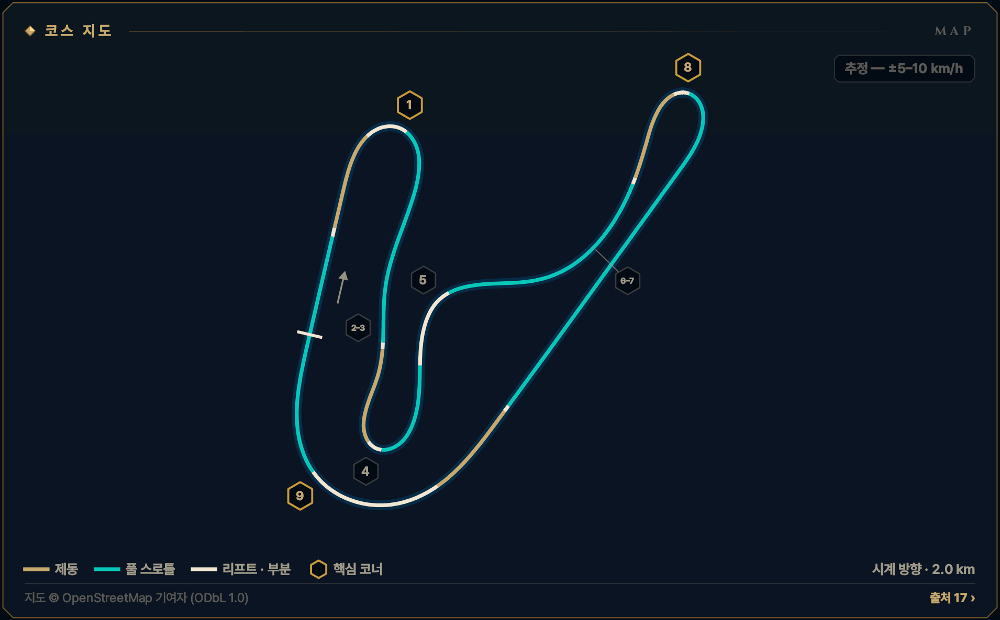
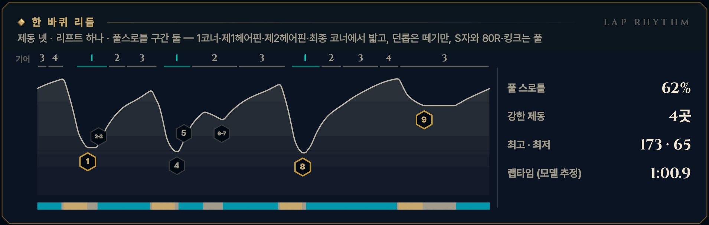

> **GRID서당 : iRacing**은 심레이싱이 처음인 동아리 신입을 위해 만든 드라이빙 아카데미 프로그램입니다. 이 글은 그 안의 **서킷 공략** 모드 — 이번 시즌 리그가 도는 서킷을 코스 개관과 코너별 애니메이션으로 미리 익히는 화면 — 를 블로그로 옮긴 것으로, 글과 애니메이션 모두 프로그램에서 그대로 가져왔습니다. 차는 iRacing의 Ray FF1600이고, 기준은 진도가 없는 루키(입문 렌즈)입니다. 강의는 [GRID서당 시리즈](/posts/untitled_life/motorsport/sim-racing/grid-seodang/)에, 낯선 말은 [용어 사전](/posts/untitled_life/motorsport/sim-racing/grid-seodang/glossary/)에 모아 두었습니다.

## 이번 시즌 일정

> **2026 시즌 4 · 포뮬러 1600 루키 시리즈 · 7주차** — 10.27(화)–11.02(월)
>
> - 루키 FF1600 · 기본 포함 · 12분 레이스 · 스탠딩 스타트 (차: Ray FF1600)
> - iRacing 트랙 이름: Tsukuba Circuit - 2000 Full
> - 주차는 매주 화요일 09:00(한국 시간)에 바뀝니다.
>
> iRacing 일정은 시즌마다 바뀝니다. 이 글의 주차는 2026 시즌 4 기준이고, 같은 서킷이 다른 시즌에 돌아오면 그 시즌 일정에서 주차와 레이아웃을 다시 확인하세요.

## 코스 개관

2.0 km, 시계 방향. 직선 둘을 크고 작은 코너가 촘촘히 잇는 짧은 서킷입니다. 고저차는 거의 없지만 모든 코너에 큰 캔트(기울기)가 있고 두 헤어핀은 그릇 모양입니다. 1단까지 내려가는 큰 제동 셋(1코너·제1·제2헤어핀) 뒤마다 긴 가속 구간이 이어지니, 탈출이 거의 전부입니다.

- **시계 방향 · 코스 2000 풀 · 2.0 km · 14코너**
- **코너 번호** — iRacing 2000 풀 지도의 번호 T1–T9를 전통 이름과 함께 씁니다. 일정표의 '14개 코너'는 바이크 시케인까지 넣은 코스 2000 전체 기준입니다. 커뮤니티 가이드마다 번호가 달라서 이름으로 맞추세요(제1헤어핀 = 왼쪽, 제2헤어핀 = 오른쪽).
- **루키 포인트** — 1단 헤어핀 셋 — 진입을 내주고 탈출을 산다. 던롭은 리프트, 80R은 풀
- **속도 표기: 추정 — ±5–10 km/h** — 이 서킷에는 기준이 되는 실주행 텔레메트리가 없습니다. 공개된 FF1600 트랙 가이드 등에서 맞춘 코너 최저 속도에 보정한 FF1600 물리 모델을 맞춰 계산했기 때문에, 글과 영상의 속도·페달·기어는 모두 **추정값**(±5–10 km/h)입니다. Test Drive에서 직접 확인하세요.

*지도 © OpenStreetMap 기여자 (ODbL 1.0) · 선 색: 골드 = 제동, 시안 = 풀 스로틀, 흰색 = 리프트 · 부분 · 금테 육각형 = 핵심 코너 · 번호 = 이 글의 코너 공략 단위*

## 한 바퀴 리듬

제동 넷 · 리프트 하나 · 풀스로틀 구간 둘 — 1코너·제1헤어핀·제2헤어핀·최종 코너에서 밟고, 던롭은 떼기만, S자와 80R·킹크는 풀

*풀 스로틀 62% · 강한 제동 4곳 · 최고 · 최저 173 · 65 km/h · 랩타임 (모델 추정) 1:00.9 — 위 그림의 기어 줄·속도 곡선·입력 띠(골드 = 제동, 시안 = 풀 스로틀)와 코너 번호는 이 기준 랩입니다.*

## 먼저 볼 코너

1. **[T8 제2헤어핀](#w07-u6)** — 가장 값진 탈출 — 가장 긴 백 스트레이트로
2. **[T9 최종 코너](#w07-u7)** — 가장 빠른 코너 · 홈 스트레이트와 1코너 추월로 이어짐
3. **[T1 1코너](#w07-u1)** — 스탠딩 스타트 뒤 첫 제동 · 반 바퀴 도는 긴 코너

> **루키 포인트** — 1단 헤어핀 셋 — 진입을 내주고 탈출을 산다. 던롭은 리프트, 80R은 풀

## 루키 안전 노트

- **1랩 1코너** — 반 바퀴를 도는 코너라 나란히 달리는 시간이 깁니다. 출구에서 바깥 차가 끼이기 쉬우니 차 한 대 폭을 남깁니다.
- **제1헤어핀 제동** — 울퉁불퉁한 제동 구간이라 뒤가 잠기기 쉽습니다. 제동 시작 전에 나란히 서지 못했으면 들어가지 않습니다.
- **던롭·80R** — 초보가 가장 많이 도는 곳(코너 안 리프트)입니다. 80R 바깥은 좁은 자갈 뒤 방호벽.
- **피트 출입** — 피트 입구는 최종 코너 제동 전 오른쪽, 출구는 1코너 제동 구간 오른쪽으로 합류합니다.
- **스핀 대처** — 브레이크를 꽉 밟아 세우고(시동은 안티스톨이 지킵니다), 상대 창으로 뒤차를 확인한 뒤 1단(왼쪽 패들)으로 트랙과 나란히 복귀합니다. 17x면 실격입니다.
- **트랙 리밋** — 차의 절반 이상이 노면 경계 밖이면 1x — 일부 트랙의 표시 구간만 네 바퀴 기준. 루키 규칙: 두 바퀴는 늘 선·연석 안쪽. 최종 코너 출구의 인조잔디가 1x인지 Test Drive에서 확인하세요.

**1랩 · 스탠딩 스타트** — 1랩: 평소 제동 지점보다 늦게 밟지 않습니다. 앞차에 맞춰 더 일찍, 부드럽게 밟고, 차 한 대 폭을 남깁니다. 바깥이나 가운데를 지키고 안쪽 다툼에 끼지 않습니다.

## 영상 보는 법

코너마다 앱의 코너 공략 화면을 그대로 녹화했습니다. ▶를 눌러 재생하세요 — 앱의 **가이드** 재생(실제 속도의 0.4배, 화면에서 차가 너무 빠른 코너는 0.25배)이라 단계(접근·제동·턴인·에이펙스·탈출)마다 잠깐 멈추고, 멈춤 링이 차면 다음 단계로 넘어갑니다. 블로그 영상은 단계 시작의 멈춤만 짧게 줄였고 (캡션을 읽을 시간은 그대로), 끝에 앱의 끝 카드가 나옵니다. **급수별 브레이크 시연**을 펼치면 같은 코너를 7급·6급·5급 렌즈로, **흔한 실수 고스트**를 펼치면 실수한 차(빨간 점선)와 나란히 달린 영상을 볼 수 있습니다.

- **제동** — 골드 — 두께·밝기 = 브레이크 압력
- **가속** — 시안 — 스로틀
- **관성** — 흰색 — 두 페달 모두 뗀 구간
- **흔한 실수** — 빨간 점선 고스트 — 한 번에 하나만
- **▼ 제동 시작** — 루키 기준선의 제동 시작점
- **◆ 턴인** — 핸들을 감기 시작하는 곳
- **○ 에이펙스** — 가장 안쪽·가장 느린 곳
- **◇ 트랙아웃** — 탈출에서 닿는 바깥 끝
- **보드 (?)** — 확인 전 참고값 — Test Drive에서 기준점을 정하세요
- **입력 지도** — 골드 띠 = 브레이크, 흰 리본(안쪽) = 핸들. 겹치면 트레일
- **손 칸 · 내림 ×N · 올림** — 왼쪽 패들 N번 내림(블립은 오토 블립이) · 오른쪽 패들 한 번 올림

화면과 글의 속도는 모두 **추정값**(±5–10 km/h)입니다 — 기준 텔레메트리가 없는 서킷이라 모델로 계산했습니다.

## 코너 공략

### T1 1코너

**우코너 · 1단 · 최저 약 70 km/h · 핵심 코너 · 추정 — ±5–10 km/h**  
스탠딩 스타트 뒤 첫 제동 · 170→70 km/h · 1단 (第1コーナー)

<figure>
  <video src="images/u1.mp4" poster="images/u1_poster.png" controls preload="none" playsinline style="width:100%;max-width:960px"></video>
  <figcaption>시범 — 루키 기준선 · 입문 렌즈(직선 제동) · 가이드 0.4× · 접근 → 제동 → 턴인 → 에이펙스 → 탈출</figcaption>
</figure>

급수별 브레이크 시연 — 7급 · 6급 · 5급 렌즈 (영상 3)

라인과 기준점은 그대로, 페달 쓰는 법만 지금 급수에 맞춥니다. 위 영상은 **직선 제동 — 기초·심화·9·8급** 렌즈입니다 — 턴인 전에 브레이크를 다 뗍니다 (브레이크 끝 = 턴인).

**릴리스 — 7급** — 턴인을 향해 0.4초 넘게 흘려서 0으로 · 7급 기준: 릴리스 0.4초 이상

<figure>
  <video src="images/u1_release.mp4" poster="images/u1_release_poster.png" controls preload="none" playsinline style="width:100%;max-width:960px"></video>
  <figcaption>7급 렌즈(릴리스) · 가이드 0.4× · 접근 → 제동 → 턴인 → 에이펙스 → 탈출</figcaption>
</figure>

- 제동 — **턴인까지 흘려서 놓는다** · 피크 약 72% · 1.0초에 걸쳐 놓기 · 발 · 하나-둘-셋 놓기
- 턴인 — **다 놓으며 감기 시작** · 턴인 무렵 0 · 탁 놓지 않기 · 발 · 놓는 끝 → 0

**트레일 — 6급·4\~1급·졸업** — 턴인 때 15\~20%를 남기고, 감는 만큼 풉니다 · 6급 기준: 턴인 때 15% 이상 남기기

<figure>
  <video src="images/u1_trail.mp4" poster="images/u1_trail_poster.png" controls preload="none" playsinline style="width:100%;max-width:960px"></video>
  <figcaption>6급 렌즈(트레일) · 가이드 0.4× · 접근 → 제동 → 턴인 → 에이펙스 → 탈출</figcaption>
</figure>

- 제동 — **턴인까지 조금 남긴다** · 피크 약 64% · 턴인 때 약 18% · 발 · 놓으며 남기기
- 턴인 — **푸는 만큼 감는다** · 약 18% → 코너 중반 0 · 발 · 18% → 0 / 손 · 놓는 만큼 감기

**깊은 트레일 — 5급** — 턴인 때 30% 이상, 에이펙스 앞까지 끌고 갑니다 · 5급 기준: 턴인 때 30% 이상 남기기

<figure>
  <video src="images/u1_deep.mp4" poster="images/u1_deep_poster.png" controls preload="none" playsinline style="width:100%;max-width:960px"></video>
  <figcaption>5급 렌즈(깊은 트레일) · 가이드 0.4× · 접근 → 제동 → 턴인 → 에이펙스 → 탈출</figcaption>
</figure>

- 제동 — **5급 렌즈: 턴인 32%** · 피크 약 54% · 평평해지는 곳에서 잠김 주의 · 발 · 천천히 남기기
- 턴인 — **앞을 누른 채 감는다** · 약 32% → 에이펙스 앞 0 · 발 · 32% → 0

4\~1급은 같은 영상의 캡션에 강조 한 줄(◆)이 더 붙습니다:

- ◆ 4급(턴인·에이펙스) — 브레이크 끝 = 스로틀 시작 — 긴 코너에서도 굴러가지 않는다

> **1랩 · 스탠딩 스타트** — 1랩: 출발선에서 1코너까지 아주 가깝습니다. 평소 제동 지점보다 늦게 밟지 않고, 앞차에 맞춰 더 일찍 부드럽게 밟아 차 한 대 폭을 남깁니다. 반 바퀴를 도는 긴 코너라 나란히 달리는 시간이 기니, 바깥이나 가운데를 지키고 안쪽 다툼에 끼지 않습니다.

#### 접근

최종 코너를 나와 홈 스트레이트 왼쪽 끝으로 붙습니다. 1코너는 오른쪽으로 거의 반 바퀴를 도는 긴 코너라, 바깥(왼쪽)에서 들어가야 반지름을 넓게 씁니다. 피트 출구 차가 오른쪽에서 합류할 수 있다는 것도 기억하세요.

*지금 손과 발 — 발 · 풀스로틀 / 손 · 왼쪽으로 / 눈 · 왼쪽 펜스*

**보드 · 기준점** — 모두 확인 전 참고값입니다. Test Drive에서 직접 보고 정하세요.

- **제동 · 기준점**? 왼쪽의 막힌 펜스(FF1600 가이드, 미확인) — 턴인까지 약 100 m *(확인 전 참고값)*
- **에이펙스**? 코너 마지막 3분의 1, 안쪽 연석 끝 무렵 *(확인 전 참고값)*

#### 제동

제동 기준은 왼쪽 펜스(FF1600 가이드, 미확인)입니다. 곧게 '꾹' 한 음절로 약 72%, 왼쪽 패들로 한 단씩 — 1단은 100 km/h 아래, 턴인 무렵입니다. 길이 평평해지는 곳에서는 차가 가벼워지니 압력을 조금 덜어 잠김을 막습니다.

*지금 손과 발 — 발 · 꾹 / 손 · 곧게 · 내림 ×2 / 눈 · 턴인 지점*

#### 턴인

출구가 살짝 조여 있어서, 일찍 꺾으면 출구에서 길이 모자랍니다. 왼쪽 끝에서 한 박자 늦게, 필요한 만큼 한 번에 감고 그대로 들고 있습니다.

*지금 손과 발 — 발 · 0 → 5\~10% / 손 · 한 번에 감고 고정 / 눈 · 늦은 에이펙스*

#### 에이펙스

에이펙스는 코너의 마지막 3분의 1, 안쪽 연석 끝 무렵입니다. 반지름이 거의 같은 중반에는 스로틀 10\~30%로 속도계를 멈춰 둡니다. 최저 약 70 km/h(레퍼런스 약 75 km/h), 1단.

*지금 손과 발 — 발 · 속도계가 멈추게 / 손 · 유지 / 눈 · 출구 연석*

#### 탈출

차 코가 S자를 향하고 핸들이 풀리기 시작하면 한 번에 100%로 밟습니다 — 감은 채 풀스로틀이면 디퍼렌셜이 열려 있어 앞이 밀립니다. 출구는 끝까지 다 쓰지 말고 가운데쯤으로, S자가 곧바로 이어집니다.

*지금 손과 발 — 발 · 한 번에 100% / 손 · 풀기 / 눈 · S자*

#### 흔한 실수

- 일찍 꺾기 — 조여 오는 출구에서 아직 감긴 채 길이 모자란다  
  → 한 박자 늦게, 바깥에서 시작
- 일찍·약하게 밟고 길게 굴러가기  
  → 브레이크 끝 = 스로틀 시작, 제동점은 한 대씩 늦추기
- 평평해지는 곳까지 같은 압력 — 앞바퀴 잠김  
  → 평평해지면 조금 덜기

#### 이 코너에서 확인할 것

- [ ] 왼쪽 펜스(또는 50 보드)가 제동 기준으로 쓸 만한지
- [ ] 1코너 제동 구간이 오르막인지
- [ ] 피트 출구가 합류하는 위치

#### 연결된 강의 · 드릴

- 강의: [8급(제동의 기본)](/posts/untitled_life/motorsport/sim-racing/grid-seodang/grades/g8-braking-basics/) · [7급(릴리스 수양)](/posts/untitled_life/motorsport/sim-racing/grid-seodang/grades/g7-release/) · [6급(트레일 입문)](/posts/untitled_life/motorsport/sim-racing/grid-seodang/grades/g6-trail-intro/) · [4급(전환 수련)](/posts/untitled_life/motorsport/sim-racing/grid-seodang/grades/g4-transition/) · [심화 9강(기울어진 트랙)](/posts/untitled_life/motorsport/sim-racing/grid-seodang/advanced/d7-banked-track/) · [심화 2강(코너의 다섯 얼굴)](/posts/untitled_life/motorsport/sim-racing/grid-seodang/advanced/d2-five-corner-faces/) · [심화 8강(페달의 문법)](/posts/untitled_life/motorsport/sim-racing/grid-seodang/advanced/d6-pedal-grammar/) · [기초 4강(레이싱 라인의 문법)](/posts/untitled_life/motorsport/sim-racing/grid-seodang/basics/f4-racing-line/) · [심화 1강(출발의 기술)](/posts/untitled_life/motorsport/sim-racing/grid-seodang/advanced/d1-the-start/) · [심화 3강(상황의 라인)](/posts/untitled_life/motorsport/sim-racing/grid-seodang/advanced/d3-situational-lines/)
- 훈련장 드릴: 제동 수양 · 트레일 브레이킹 · 정밀 압력

<small>근거: S1 · S7 · S9 · S14 · S15 · S16 · S18 · MODEL (아래 출처 목록) · 신뢰도 L</small>

### T2–3 S자

**좌·우 복합 · 2단 · 추정 — ±5–10 km/h**  
풀스로틀 S자 — 진짜 임무는 헤어핀 제동 준비 (S字コーナー)

<figure>
  <video src="images/u2.mp4" poster="images/u2_poster.png" controls preload="none" playsinline style="width:100%;max-width:960px"></video>
  <figcaption>시범 — 루키 기준선 · 렌즈 공통 · 가이드 0.4× · 접근 → 턴인 → 에이펙스 → 전환 → 에이펙스 ② → 탈출</figcaption>
</figure>

급수별 브레이크 시연 — 모든 급수가 같은 그림

이 코너는 렌즈가 같습니다 — 리프트·풀스로틀 코너는 브레이크를 쓰지 않아 모든 급수가 같은 페달 그림을 봅니다.

#### 접근

1코너를 나와 출구를 끝까지 다 쓰지 말고 가운데쯤으로 흘러나옵니다. S자는 왼쪽(T2), 오른쪽(T3) 두 번의 가벼운 꺾임이고 풀스로틀입니다. 시프트업은 핸들이 곧을 때 합니다.

*지금 손과 발 — 발 · 100% / 손 · 가운데로 / 눈 · T2 왼쪽 연석*

**보드 · 기준점** — 모두 확인 전 참고값입니다. Test Drive에서 직접 보고 정하세요.

- **턴인**? T2 왼쪽 연석 — 바퀴 반까지 *(확인 전 참고값)*

#### 턴인

T2는 왼쪽 연석을 향해 작게 한 획입니다. 조금씩 고쳐 잡지 않습니다.

*지금 손과 발 — 발 · 100% / 손 · 왼쪽 작게 / 눈 · T2 연석*

#### 에이펙스

평평한 연석이라 바퀴 반쯤은 올려도 됩니다(비 오는 날은 금지). 연석을 지나면 곧바로 T3를 향합니다.

*지금 손과 발 — 발 · 100% / 손 · 풀기 / 눈 · T3 연석*

#### 전환

왼쪽에서 오른쪽으로 핸들을 한 획으로 넘깁니다. 변속이 필요하면 이 곧은 순간에 합니다.

*지금 손과 발 — 발 · 100% / 손 · 오른쪽 한 획 / 눈 · T3 오른쪽 연석*

#### 에이펙스 ②

T3 오른쪽 연석을 스치면 차는 자연스럽게 코스 오른쪽 끝 — 제1헤어핀의 바깥 — 에 있습니다. 헤어핀 제동은 핸들이 곧을 때 해야 합니다.

*지금 손과 발 — 발 · 100% → 준비 / 손 · 작게, 곧게 / 눈 · 헤어핀 입구*

#### 탈출

T3 무렵부터는 이미 제1헤어핀 제동 구간입니다. 루키는 핸들이 곧은 순간 일찍, 부드럽게 밟기 시작합니다 — 다음 '제1헤어핀' 공략에서 이어집니다. 꺾은 채 세게 밟으면 울퉁불퉁한 노면에서 뒤가 잠길 수 있습니다.

*지금 손과 발 — 발 · 제동 준비 / 손 · 곧게 / 눈 · 헤어핀 입구*

#### 흔한 실수

- 1코너 출구에서 왼쪽 끝까지 — T2·T3 라인이 꼬인다  
  → 출구는 가운데, 꺾임마다 한 획
- T3에서 꺾은 채 세게 제동 — 뒤가 잠긴다  
  → 곧은 순간 일찍 부드럽게, 꺾임에서는 일정하게
- 핸들을 두세 번 고쳐 잡기  
  → 꺾임마다 작은 한 획

#### 이 코너에서 확인할 것

- [ ] S자 연석 높이

#### 연결된 강의 · 드릴

- 강의: [심화 2강(코너의 다섯 얼굴)](/posts/untitled_life/motorsport/sim-racing/grid-seodang/advanced/d2-five-corner-faces/) · [2급(스티어링 일필휘지)](/posts/untitled_life/motorsport/sim-racing/grid-seodang/grades/g2-one-stroke-steering/) · [기초 4강(레이싱 라인의 문법)](/posts/untitled_life/motorsport/sim-racing/grid-seodang/basics/f4-racing-line/) · [8급(제동의 기본)](/posts/untitled_life/motorsport/sim-racing/grid-seodang/grades/g8-braking-basics/)
- 훈련장 드릴: 조향 일필

<small>근거: S1 · S14 · S15 · S16 · S18 · MODEL (아래 출처 목록) · 신뢰도 M</small>

### T4 제1헤어핀

**좌코너 · 1단 · 최저 약 65 km/h · 추정 — ±5–10 km/h**  
왼쪽 그릇 헤어핀 · 150→65 km/h · 1단 (第1ヘアピン)

<figure>
  <video src="images/u3.mp4" poster="images/u3_poster.png" controls preload="none" playsinline style="width:100%;max-width:960px"></video>
  <figcaption>시범 — 루키 기준선 · 입문 렌즈(직선 제동) · 가이드 0.4× · 접근 → 제동 → 턴인 → 에이펙스 → 탈출</figcaption>
</figure>

급수별 브레이크 시연 — 모든 급수가 같은 그림

이 코너는 앱이 모든 급수에 **직선 제동 — 기초·심화·9·8급** 렌즈 하나만 보여 줍니다 — 턴인 전에 브레이크를 다 뗍니다 (브레이크 끝 = 턴인). 급수별 영상이 따로 없습니다.

흔한 실수 고스트 — 너무 세게, 너무 오래

<figure>
  <video src="images/u3_ghost.mp4" poster="images/u3_ghost_poster.png" controls preload="none" playsinline style="width:100%;max-width:960px"></video>
  <figcaption>흔한 실수: 너무 세게, 너무 오래 — 95%로 꾹, 굴러가며 최저 약 40 km/h → 약 4.5초 늦음</figcaption>
</figure>

흔한 실수: **너무 세게, 너무 오래** — 95%로 꾹, 굴러가며 최저 약 40 km/h → 약 4.5초 늦음. 빨간 점선과 붉은 차가 실수 고스트, 흰 차가 루키 기준선입니다. 두 차는 같은 시계로 달리므로 늦어지거나 밀려나는 만큼이 그대로 보입니다. 영상은 앱에서 [흔한 실수]를 눌렀을 때처럼 그 실수가 시작되는 단계부터 재생합니다. 끝 카드의 '트레일 렌즈 기준'은 결과의 시간 차를 트레일(6급) 렌즈 주행과 비교한 값이라는 뜻입니다.

#### 접근

이 헤어핀은 왼쪽으로 돕니다. S자의 두 꺾임 사이에서 핸들이 곧은 순간 일찍, 부드럽게 밟기 시작하고, 오른쪽 T3는 제동하는 동안 핸들만 살짝 써서 코스 오른쪽 끝(헤어핀의 바깥)으로 갑니다. 빠른 랩은 T3 연석 끝에서 밟습니다.

*지금 손과 발 — 발 · 100% → 떼기 / 손 · 곧게 / 눈 · 제동 기준*

**보드 · 기준점** — 모두 확인 전 참고값입니다. Test Drive에서 직접 보고 정하세요.

- **제동 · 기준점**? S자 두 꺾임 사이 핸들이 곧은 곳 — 가이드 기준물: 흙바닥 끝(미확인), 턴인까지 약 100 m *(확인 전 참고값)*
- **에이펙스**? 높은 안쪽 연석 바로 옆 — 올라타지 않기 *(확인 전 참고값)*

#### 제동

노면이 울퉁불퉁해 뒤가 잠기기 쉬우니 점진적으로 '꾹' 약 61%까지, 왼쪽 패들로 한 단씩 내립니다(1단은 100 km/h 아래). 이 코너는 범프 때문에 모든 급수가 턴인 전에 브레이크를 다 놓습니다.

*지금 손과 발 — 발 · 점진적 꾹 / 손 · 곧게, 오른쪽 · 내림 ×2 / 눈 · 헤어핀 안쪽 깊은 곳*

#### 턴인

오른쪽 끝에서 한 박자 늦게 꺾습니다. 라인은 U가 아니라 V — 가장 깊은 곳에서 차를 돌립니다. 일찍 안으로 들어가면 앞이 미끄러집니다.

*지금 손과 발 — 발 · 0 → 살짝 스로틀 / 손 · 늦게 한 획 / 눈 · 안쪽, 연석 옆*

#### 에이펙스

코너가 가장 조이는 곳에서 안쪽을 따라 돕니다. 그릇 모양 노면이 차를 받쳐 주니 그 기울기를 믿되, 높은 안쪽 연석에는 올라타지 않습니다 — 스핀이 나는 곳입니다. 최저 약 65 km/h, 1단.

*지금 손과 발 — 발 · 브레이크 끝 = 스로틀 / 손 · 고정 / 눈 · 출구 가운데*

#### 탈출

출구에서 그릇이 평평해지면 안쪽 뒷바퀴가 가벼워집니다. 핸들이 풀리기 전에 스로틀을 확 열면 디퍼렌셜이 열려 있어 그 바퀴가 헛돕니다 — 먼저 풀고, 한 번에 밟습니다. 바깥 연석까지 다 쓰지 말고 가운데쯤으로 나와 던롭을 준비합니다.

*지금 손과 발 — 발 · 풀리면 한 번에 / 손 · 일찍 풀기 / 눈 · 던롭 입구*

#### 흔한 실수

- 너무 세게, 너무 오래 — 범프에서 꽉 밟고 바닥에서 굴러간다  
  → 점진적으로 꾹, 턴인에서 0, 그 순간 스로틀
- 안쪽에서 일찍 들어가기 — 앞이 미끄러져 밀린다  
  → 오른쪽에 머물다 늦게, V자로
- 출구에서 스로틀을 서둘러 바깥 흙으로  
  → 먼저 풀고 한 번에, 출구는 가운데

#### 이 코너에서 확인할 것

- [ ] 제동 구간의 흙바닥·보드 위치
- [ ] 제동 구간 범프 느낌

#### 연결된 강의 · 드릴

- 강의: [심화 2강(코너의 다섯 얼굴)](/posts/untitled_life/motorsport/sim-racing/grid-seodang/advanced/d2-five-corner-faces/) · [심화 9강(기울어진 트랙)](/posts/untitled_life/motorsport/sim-racing/grid-seodang/advanced/d7-banked-track/) · [8급(제동의 기본)](/posts/untitled_life/motorsport/sim-racing/grid-seodang/grades/g8-braking-basics/) · [7급(릴리스 수양)](/posts/untitled_life/motorsport/sim-racing/grid-seodang/grades/g7-release/) · [4급(전환 수련)](/posts/untitled_life/motorsport/sim-racing/grid-seodang/grades/g4-transition/) · [3급(스로틀 서예)](/posts/untitled_life/motorsport/sim-racing/grid-seodang/grades/g3-throttle-calligraphy/) · [심화 4강(차의 균형)](/posts/untitled_life/motorsport/sim-racing/grid-seodang/advanced/d4-car-balance/)
- 훈련장 드릴: 제동 수양 · 전환 · 스로틀 서예

<small>근거: S1 · S5 · S7 · S9 · S14 · S15 · S16 · MODEL (아래 출처 목록) · 신뢰도 L</small>

### T5 던롭 코너

**우코너 · 2단 · 최저 약 110 km/h · 추정 — ±5–10 km/h**  
브레이크 없는 리프트 코너 · 약 110 km/h · 2단 (ダンロップコーナー)

<figure>
  <video src="images/u4.mp4" poster="images/u4_poster.png" controls preload="none" playsinline style="width:100%;max-width:960px"></video>
  <figcaption>시범 — 루키 기준선 · 렌즈 공통 · 가이드 0.4× · 접근 → 리프트 → 턴인 → 에이펙스 → 탈출</figcaption>
</figure>

급수별 브레이크 시연 — 모든 급수가 같은 그림

이 코너는 렌즈가 같습니다 — 리프트·풀스로틀 코너는 브레이크를 쓰지 않아 모든 급수가 같은 페달 그림을 봅니다.

흔한 실수 고스트 — 늦은 리프트 → 바깥으로

<figure>
  <video src="images/u4_ghost.mp4" poster="images/u4_ghost_poster.png" controls preload="none" playsinline style="width:100%;max-width:960px"></video>
  <figcaption>흔한 실수: 늦은 리프트 → 바깥으로 — 늦게 떼면 바깥으로 밀린다 · 트랙 밖</figcaption>
</figure>

흔한 실수: **늦은 리프트 → 바깥으로** — 늦게 떼면 바깥으로 밀린다 · 트랙 밖. 빨간 점선과 붉은 차가 실수 고스트, 흰 차가 루키 기준선입니다. 두 차는 같은 시계로 달리므로 늦어지거나 밀려나는 만큼이 그대로 보입니다. 영상은 앱에서 [흔한 실수]를 눌렀을 때처럼 그 실수가 시작되는 단계부터 재생합니다.

#### 접근

던롭 타이어 모양 다리 아래 짧은 직선을 2단으로 달리며 코스 왼쪽에 붙습니다. 오른쪽으로 꺾이는 빠른 코너이고, 3단으로 올리지 않습니다.

*지금 손과 발 — 발 · 100% (2단) / 손 · 왼쪽 / 눈 · 다리 너머 입구*

**보드 · 기준점** — 모두 확인 전 참고값입니다. Test Drive에서 직접 보고 정하세요.

- **리프트 시작**? 던롭 다리를 지나 턴인 전, 차가 곧을 때(다리 위치 미확인) *(확인 전 참고값)*
- **에이펙스**? 코너 중간의 안쪽 연석, 살짝 *(확인 전 참고값)*

#### 리프트

레퍼런스는 브레이크 없이 스로틀만 약 15\~20%로 덜어 냅니다. 꺾기 전에 떼서 무게를 앞으로 옮기는 것이 핵심입니다 — 코너 안에서는 절대 떼지 않습니다.

*지금 손과 발 — 발 · 약 15%로 / 손 · 아직 곧게 / 눈 · 안쪽 연석*

**급수 시험 주행에서는 리프트만 — 10%를 넘는 톡도 제동 코너로 채점됩니다.**

#### 턴인

앞이 눌린 그 순간 또렷하게 한 획으로 꺾습니다. 꺾는 양은 가능한 한 작게 — 많이 꺾을수록 느려집니다.

*지금 손과 발 — 발 · 그대로 / 손 · 작게 한 획 / 눈 · 에이펙스*

#### 에이펙스

코너 중간의 안쪽 연석을 살짝 스칩니다. 최저 약 110 km/h(레퍼런스 약 115 km/h). 차가 밀리면 핸들을 더 감지 말고 살짝 풀며 스로틀을 아주 조금만 줄입니다.

*지금 손과 발 — 발 · 다시 100%로 / 손 · 고정 / 눈 · 출구*

#### 탈출

에이펙스부터 다시 100%입니다. 출구는 필요한 만큼만 쓰고, 핸들이 곧아지면 3단으로 올린 뒤 오른쪽으로 차 한 대 폭만큼 옮겨 80R을 준비합니다.

*지금 손과 발 — 발 · 100% / 손 · 풀고 오른쪽 / 눈 · 80R 안쪽*

#### 흔한 실수

- 늦게 떼기 — 바깥으로 밀리다 코너 안에서 놀라 떼어 뒤가 돈다  
  → 한 박자 일찍, 꺾기 전에 작게 떼기
- 크게 떼거나 세게 밟기 — 80R까지 느려진다  
  → 15\~20%까지만, 브레이크 없이
- 출구에서 왼쪽 끝까지 — 80R을 안쪽에서 시작  
  → 출구는 필요한 만큼, 그다음 한 대 폭 오른쪽

#### 이 코너에서 확인할 것

- [ ] 던롭 다리와 리프트 지점의 위치 관계
- [ ] 출구를 얼마나 쓰는지(가이드끼리 엇갈림)

#### 연결된 강의 · 드릴

- 강의: [심화 2강(코너의 다섯 얼굴)](/posts/untitled_life/motorsport/sim-racing/grid-seodang/advanced/d2-five-corner-faces/) · [심화 4강(차의 균형)](/posts/untitled_life/motorsport/sim-racing/grid-seodang/advanced/d4-car-balance/) · [심화 8강(페달의 문법)](/posts/untitled_life/motorsport/sim-racing/grid-seodang/advanced/d6-pedal-grammar/) · [2급(스티어링 일필휘지)](/posts/untitled_life/motorsport/sim-racing/grid-seodang/grades/g2-one-stroke-steering/) · [심화 10강(라임락 교본)](/posts/untitled_life/motorsport/sim-racing/grid-seodang/advanced/d11-lime-rock-textbook/)
- 훈련장 드릴: 정밀 압력 · 트레일 브레이킹 · 조향 일필

<small>근거: S5 · S7 · S9 · S14 · S15 · S17 · S23 · MODEL (아래 출처 목록) · 신뢰도 L</small>

### T6–7 80R과 킹크

**좌코너 · 2단 · 추정 — ±5–10 km/h**  
풀스로틀 왼쪽 둘 · 약 155 km/h까지 (80Rコーナー)

<figure>
  <video src="images/u5.mp4" poster="images/u5_poster.png" controls preload="none" playsinline style="width:100%;max-width:960px"></video>
  <figcaption>시범 — 루키 기준선 · 렌즈 공통 · 가이드 0.4× · 접근 → 턴인 → 에이펙스 → 전환 → 에이펙스 ② → 탈출</figcaption>
</figure>

급수별 브레이크 시연 — 모든 급수가 같은 그림

이 코너는 렌즈가 같습니다 — 리프트·풀스로틀 코너는 브레이크를 쓰지 않아 모든 급수가 같은 페달 그림을 봅니다.

#### 접근

던롭을 나와 3단으로 올리고, 코스 끝까지가 아니라 오른쪽으로 차 한 대 폭만큼만 옮깁니다. 80R은 왼쪽으로 크게 도는 빠른 코너이고, 이어지는 T7은 같은 방향의 가벼운 꺾임입니다.

*지금 손과 발 — 발 · 100%, 3단 / 손 · 한 대 폭 오른쪽 / 눈 · 80R 안쪽*

**보드 · 기준점** — 모두 확인 전 참고값입니다. Test Drive에서 직접 보고 정하세요.

- **턴인**? 80R 안쪽 한 번 스치기 *(확인 전 참고값)*

#### 턴인

자연스러운 큰 원을 그리듯 한 번에 감습니다. 이 구간은 풀스로틀이고, 발이 할 일은 '가만히 있기'입니다.

*지금 손과 발 — 발 · 100% / 손 · 큰 원 한 획 / 눈 · 80R 출구*

#### 에이펙스

왼쪽 안쪽을 한 번 스치고, 바깥에는 차 한 대 폭의 여유를 남깁니다. 바깥 연석 너머 자갈은 좁고 그 뒤는 방호벽입니다.

*지금 손과 발 — 발 · 100% / 손 · 유지 / 눈 · T7 킹크*

#### 전환

80R을 나와 핸들을 풀며 속도가 계속 붙습니다. 불안해서 코너 안에서 살짝 떼면 차가 흔들립니다 — 발은 그대로.

*지금 손과 발 — 발 · 100% / 손 · 풀기 / 눈 · T7*

#### 에이펙스 ②

T7은 손목만 쓰는 가벼운 왼쪽입니다. 지나며 차를 코스 왼쪽\~가운데로 흘려 둡니다 — 다음 제2헤어핀(오른쪽)의 바깥입니다.

*지금 손과 발 — 발 · 100% / 손 · 살짝 왼쪽 / 눈 · 흰 선이 곧아지는 곳*

#### 탈출

왼쪽 흰 선이 다시 곧아지는 곳이 제2헤어핀의 제동 기준입니다(가이드, 미확인). 제동 전에 핸들을 곧게 펴 둡니다.

*지금 손과 발 — 발 · 100% → 준비 / 손 · 곧게 / 눈 · 제2헤어핀 입구*

#### 흔한 실수

- 불안해서 코너 안에서 살짝 떼기 — 차가 흔들린다  
  → 발은 가만히, 손은 한 획
- 던롭 출구에서 왼쪽 끝에 붙은 채 80R — 원이 너무 작아진다  
  → 오른쪽으로 한 대 폭 옮겨서 시작
- 나란히 달리며 바깥 차를 밀어내기  
  → 공간 남기기 — 결판은 제2헤어핀 제동에서

#### 이 코너에서 확인할 것

- [ ] 80R 반지름(우회로 재조립 뒤)과 바깥 자갈 폭

#### 연결된 강의 · 드릴

- 강의: [심화 2강(코너의 다섯 얼굴)](/posts/untitled_life/motorsport/sim-racing/grid-seodang/advanced/d2-five-corner-faces/) · [2급(스티어링 일필휘지)](/posts/untitled_life/motorsport/sim-racing/grid-seodang/grades/g2-one-stroke-steering/) · [심화 3강(상황의 라인)](/posts/untitled_life/motorsport/sim-racing/grid-seodang/advanced/d3-situational-lines/) · [기초 4강(레이싱 라인의 문법)](/posts/untitled_life/motorsport/sim-racing/grid-seodang/basics/f4-racing-line/)
- 훈련장 드릴: 조향 일필 · 스로틀 서예

<small>근거: S1 · S5 · S7 · S14 · S15 · S16 · S22 · MODEL (아래 출처 목록) · 신뢰도 M</small>

### T8 제2헤어핀

**우코너 · 1단 · 최저 약 65 km/h · 핵심 코너 · 추정 — ±5–10 km/h**  
백 스트레이트를 여는 헤어핀 · 160→65 km/h · 1단 (第2ヘアピン)

<figure>
  <video src="images/u6.mp4" poster="images/u6_poster.png" controls preload="none" playsinline style="width:100%;max-width:960px"></video>
  <figcaption>시범 — 루키 기준선 · 입문 렌즈(직선 제동) · 가이드 0.4× · 접근 → 제동 → 턴인 → 에이펙스 → 탈출</figcaption>
</figure>

급수별 브레이크 시연 — 7급 · 6급 · 5급 렌즈 (영상 3)

라인과 기준점은 그대로, 페달 쓰는 법만 지금 급수에 맞춥니다. 위 영상은 **직선 제동 — 기초·심화·9·8급** 렌즈입니다 — 턴인 전에 브레이크를 다 뗍니다 (브레이크 끝 = 턴인).

**릴리스 — 7급** — 턴인을 향해 0.4초 넘게 흘려서 0으로 · 7급 기준: 릴리스 0.4초 이상

<figure>
  <video src="images/u6_release.mp4" poster="images/u6_release_poster.png" controls preload="none" playsinline style="width:100%;max-width:960px"></video>
  <figcaption>7급 렌즈(릴리스) · 가이드 0.4× · 접근 → 제동 → 턴인 → 에이펙스 → 탈출</figcaption>
</figure>

- 제동 — **턴인까지 흘려서 놓는다** · 피크 약 69% · 1.1초에 걸쳐 놓기 · 발 · 하나-둘-셋 놓기
- 턴인 — **다 놓으며 감기 시작** · 턴인 무렵 0 · 탁 놓지 않기 · 발 · 놓는 끝 → 0

**트레일 — 6급·4\~1급·졸업** — 턴인 때 15\~20%를 남기고, 감는 만큼 풉니다 · 6급 기준: 턴인 때 15% 이상 남기기

<figure>
  <video src="images/u6_trail.mp4" poster="images/u6_trail_poster.png" controls preload="none" playsinline style="width:100%;max-width:960px"></video>
  <figcaption>6급 렌즈(트레일) · 가이드 0.4× · 접근 → 제동 → 턴인 → 에이펙스 → 탈출</figcaption>
</figure>

- 제동 — **턴인까지 조금 남긴다** · 피크 약 65% · 턴인 때 약 18% · 발 · 놓으며 남기기
- 턴인 — **푸는 만큼 감는다** · 약 18% → 조여 오는 만큼 천천히 0 · 발 · 18% → 0 / 손 · 놓는 만큼 감기

**깊은 트레일 — 5급** — 턴인 때 30% 이상, 에이펙스 앞까지 끌고 갑니다 · 5급 기준: 턴인 때 30% 이상 남기기

<figure>
  <video src="images/u6_deep.mp4" poster="images/u6_deep_poster.png" controls preload="none" playsinline style="width:100%;max-width:960px"></video>
  <figcaption>5급 렌즈(깊은 트레일) · 가이드 0.4× · 접근 → 제동 → 턴인 → 에이펙스 → 탈출</figcaption>
</figure>

- 제동 — **느린 코너: 턴인 32%** · 피크 약 59% · 천천히 길게 놓기 · 발 · 천천히 남기기
- 턴인 — **앞을 누른 채 감는다** · 약 32% → 에이펙스 앞 0 · 발 · 32% → 0

4\~1급은 같은 영상의 캡션에 강조 한 줄(◆)이 더 붙습니다:

- ◆ 3급(탈출) — 스로틀은 한 획 — 이 탈출이 백 스트레이트 전체를 정한다

흔한 실수 고스트 — 이른 턴인 → 출구에서 밀림

<figure>
  <video src="images/u6_ghost.mp4" poster="images/u6_ghost_poster.png" controls preload="none" playsinline style="width:100%;max-width:960px"></video>
  <figcaption>흔한 실수: 이른 턴인 → 출구에서 밀림 — 일찍 꺾으면 출구에서 바깥으로 밀린다 → 약 0.1초 늦음</figcaption>
</figure>

흔한 실수: **이른 턴인 → 출구에서 밀림** — 일찍 꺾으면 출구에서 바깥으로 밀린다 → 약 0.1초 늦음. 빨간 점선과 붉은 차가 실수 고스트, 흰 차가 루키 기준선입니다. 두 차는 같은 시계로 달리므로 늦어지거나 밀려나는 만큼이 그대로 보입니다. 영상은 앱에서 [흔한 실수]를 눌렀을 때처럼 그 실수가 시작되는 단계부터 재생합니다. 끝 카드의 '트레일 렌즈 기준'은 결과의 시간 차를 트레일(6급) 렌즈 주행과 비교한 값이라는 뜻입니다.

#### 접근

오른쪽으로 길게 도는 헤어핀이고, 탈출 뒤에 이 서킷에서 가장 긴 백 스트레이트가 기다립니다. 킹크를 지나 왼쪽 흰 선이 다시 곧아지는 곳이 제동 기준입니다 — 처음에는 곧아지기 시작하는 순간, 조금 일찍 밟습니다.

*지금 손과 발 — 발 · 100% / 손 · 곧게 / 눈 · 흰 선*

**보드 · 기준점** — 모두 확인 전 참고값입니다. Test Drive에서 직접 보고 정하세요.

- **제동 · 기준점**? 킹크 뒤 왼쪽 흰 선이 다시 곧아지는 곳(FF1600 가이드, 미확인) — 턴인까지 약 100 m *(확인 전 참고값)*
- **에이펙스**? 코너 후반의 늦은 에이펙스 — 안쪽 연석은 밟지 않기 *(확인 전 참고값)*

#### 제동

코스 가운데쯤에서 차 코를 안쪽 연석으로 향한 채 곧게 '꾹', 약 69%까지 밟고 왼쪽 패들로 한 단씩 내립니다(1단은 100 km/h 아래). ABS가 없으니 100%는 금물입니다.

*지금 손과 발 — 발 · 꾹 / 손 · 곧게 · 내림 ×2 / 눈 · 턴인 지점*

#### 턴인

서두르지 않습니다. 코너 앞 절반은 안쪽 연석에서 차 한 대 폭 떨어져 달립니다 — 일찍 붙으면 스로틀을 열 때까지 오래 기다리게 됩니다.

*지금 손과 발 — 발 · 0 → 살짝 스로틀 / 손 · 한 획, 조금씩 더 / 눈 · 늦은 에이펙스*

#### 에이펙스

코너 후반에 가장 많이 감아 늦은 에이펙스를 찍습니다 — 이 코너의 왕은 뒤쪽입니다. 안쪽 연석은 밟지 않습니다. 최저 약 65 km/h, 1단.

*지금 손과 발 — 발 · 브레이크 끝 = 스로틀 / 손 · 가장 많이 감기 / 눈 · 출구 연석*

#### 탈출

핸들이 풀리고 코너가 열리는 만큼 한 번에 100%로 밟습니다. 차가 안정적이면 바깥(왼쪽) 연석까지 쓰고 그대로 백 스트레이트로 뻗어 나갑니다. 여기서 얻은 1 km/h는 직선 끝까지 남습니다.

*지금 손과 발 — 발 · 한 번에 100% / 손 · 푸는 만큼 / 눈 · 백 스트레이트*

#### 흔한 실수

- 첫 부분에서 일찍 안쪽에 붙기 — 이른 에이펙스, 출구에서 밀린다  
  → 앞 절반은 한 대 폭 떨어져, 늦게 더 감기
- 핸들이 다 풀리기 전에 스로틀 — 앞이 밀린다  
  → 풀고 나서 한 번에
- 멀리서 무리하게 안으로 뛰어들기  
  → 제동 전에 나란히 서지 못했으면 기다린다

#### 이 코너에서 확인할 것

- [ ] 흰 선이 곧아지는 지점이 보이는지
- [ ] 안쪽 연석 높이(두 부분 모두)

#### 연결된 강의 · 드릴

- 강의: [심화 2강(코너의 다섯 얼굴)](/posts/untitled_life/motorsport/sim-racing/grid-seodang/advanced/d2-five-corner-faces/) · [6급(트레일 입문)](/posts/untitled_life/motorsport/sim-racing/grid-seodang/grades/g6-trail-intro/) · [5급(트레일 숙달)](/posts/untitled_life/motorsport/sim-racing/grid-seodang/grades/g5-trail-mastery/) · [4급(전환 수련)](/posts/untitled_life/motorsport/sim-racing/grid-seodang/grades/g4-transition/) · [3급(스로틀 서예)](/posts/untitled_life/motorsport/sim-racing/grid-seodang/grades/g3-throttle-calligraphy/) · [2급(스티어링 일필휘지)](/posts/untitled_life/motorsport/sim-racing/grid-seodang/grades/g2-one-stroke-steering/)
- 훈련장 드릴: 트레일 브레이킹 · 전환 · 스로틀 서예

<small>근거: S1 · S7 · S9 · S14 · S15 · S16 · S17 · MODEL (아래 출처 목록) · 신뢰도 L</small>

### T9 최종 코너

**우코너 · 3단 · 최저 약 125 km/h · 핵심 코너 · 추정 — ±5–10 km/h**  
가장 빠른 코너 · 170→125 km/h · 3단 (最終コーナー)

<figure>
  <video src="images/u7.mp4" poster="images/u7_poster.png" controls preload="none" playsinline style="width:100%;max-width:960px"></video>
  <figcaption>시범 — 루키 기준선 · 입문 렌즈(직선 제동) · 가이드 0.4× · 접근 → 제동 → 턴인 → 에이펙스 → 탈출</figcaption>
</figure>

급수별 브레이크 시연 — 7급 · 6급 · 5급 렌즈 (영상 3)

라인과 기준점은 그대로, 페달 쓰는 법만 지금 급수에 맞춥니다. 위 영상은 **직선 제동 — 기초·심화·9·8급** 렌즈입니다 — 턴인 전에 브레이크를 다 뗍니다 (브레이크 끝 = 턴인).

**릴리스 — 7급** — 턴인을 향해 0.4초 넘게 흘려서 0으로 · 7급 기준: 릴리스 0.4초 이상

<figure>
  <video src="images/u7_release.mp4" poster="images/u7_release_poster.png" controls preload="none" playsinline style="width:100%;max-width:960px"></video>
  <figcaption>7급 렌즈(릴리스) · 가이드 0.4× · 접근 → 제동 → 턴인 → 에이펙스 → 탈출</figcaption>
</figure>

- 제동 — **턴인까지 흘려서 놓는다** · 피크 약 49% · 0.8초에 걸쳐 놓기 · 발 · 하나-둘-셋 놓기
- 턴인 — **다 놓으며 감기 시작** · 턴인 무렵 0 · 탁 놓지 않기 · 발 · 놓는 끝 → 0

**트레일 — 6급·4\~1급·졸업** — 턴인 때 15\~20%를 남기고, 감는 만큼 풉니다 · 가벼운 제동 코너 — 15% 기준보다 적게 남깁니다

<figure>
  <video src="images/u7_trail.mp4" poster="images/u7_trail_poster.png" controls preload="none" playsinline style="width:100%;max-width:960px"></video>
  <figcaption>6급 렌즈(트레일) · 가이드 0.4× · 접근 → 제동 → 턴인 → 에이펙스 → 탈출</figcaption>
</figure>

- 제동 — **턴인까지 조금 남긴다** · 피크 약 23% · 턴인 때 약 14% · 발 · 놓으며 남기기
- 턴인 — **푸는 만큼 감는다** · 약 14% → 첫 에이펙스까지 가볍게 · 발 · 14% → 0 / 손 · 놓는 만큼 감기

**깊은 트레일 — 5급** — 턴인 때 30% 이상, 에이펙스 앞까지 끌고 갑니다 · 가벼운 제동 코너 — 30% 기준보다 적게 남깁니다

<figure>
  <video src="images/u7_deep.mp4" poster="images/u7_deep_poster.png" controls preload="none" playsinline style="width:100%;max-width:960px"></video>
  <figcaption>5급 렌즈(깊은 트레일) · 가이드 0.4× · 접근 → 제동 → 턴인 → 에이펙스 → 탈출</figcaption>
</figure>

- 제동 — **가볍게, 첫 에이펙스까지 길게** · 피크 약 20% · 턴인 때 약 14% · 발 · 천천히 남기기
- 턴인 — **앞을 누른 채 감는다** · 약 14% → 에이펙스 앞 0 · 발 · 14% → 0

#### 접근

백 스트레이트 왼쪽으로 붙어 갑니다. 오른쪽으로 길게 도는 이 서킷에서 가장 빠른 코너이고, 피트에 들어가는 차는 오른쪽으로 빠집니다. 실제 서킷에는 왼쪽에 200·150·100·50 거리 표지가 있습니다 — iRacing에서도 보이면 처음엔 100에서 시작해 세션마다 50 쪽으로 옮깁니다.

*지금 손과 발 — 발 · 100% (4단) / 손 · 왼쪽 / 눈 · 왼쪽 표지*

**보드 · 기준점** — 모두 확인 전 참고값입니다. Test Drive에서 직접 보고 정하세요.

- **제동 · 기준점**? 왼쪽 100 표지(실제 서킷, iRacing 미확인) — 턴인까지 약 75 m *(확인 전 참고값)*
- **에이펙스**? 안쪽 연석이 끝나는 곳의 늦은 에이펙스 *(확인 전 참고값)*

#### 제동

꽉 세우는 코너가 아닙니다. 곧게 약 49%로 짧게 밟고 왼쪽 패들로 4→3 하나만 내립니다.

*지금 손과 발 — 발 · 짧게 / 손 · 곧게 · 내림 ×1 / 눈 · 연석 시작*

#### 턴인

왼쪽 끝에서 감기 시작해, 안쪽 연석이 시작되는 첫 에이펙스 쪽으로 길게 한 획을 이어 갑니다. 차가 밀리면 핸들을 더 감지 말고 발로 다듬습니다.

*지금 손과 발 — 발 · 0 → 10\~30% / 손 · 길게 감기 / 눈 · 첫 에이펙스*

#### 에이펙스

첫 에이펙스를 지나 스로틀 10\~30%로 속도를 유지하다, 코너 끝쪽에서 조금 더 감아 안쪽 연석이 끝나는 곳의 늦은 에이펙스를 찍습니다 — 이 코너의 왕입니다. 최저 약 125 km/h(레퍼런스 약 135 km/h), 3단.

*지금 손과 발 — 발 · 10\~30% 유지 / 손 · 조금 더 감기 / 눈 · 연석 끝*

#### 탈출

늦은 에이펙스부터 핸들이 풀리는 만큼 한 번에 100%로 밟습니다. 출구 연석과 인조잔디는 차가 안정적일 때만 — 차의 절반 이상이 경계 밖이면 1x입니다. 홈 스트레이트를 곧게 달려 1코너로 이어집니다.

*지금 손과 발 — 발 · 한 번에 100% / 손 · 푸는 만큼 / 눈 · 홈 스트레이트*

#### 흔한 실수

- 턴인에서 브레이크를 탁 놓기 — 앞이 가벼워 밀린다  
  → 턴인까지 천천히 놓고, 발로 앞을 눌러 둔다
- 140 km/h 안팎에서 코너 안에서 확 떼기 — 뒤가 돈다  
  → 발은 부드럽게, 조금씩만
- 안쪽에 계속 붙거나 일찍 한 번에 — 출구에서 길이 모자라 이탈  
  → 에이펙스는 연석이 끝나는 곳, 늦게

#### 이 코너에서 확인할 것

- [ ] 200·150·100·50 표지가 있는지, 어디에 있는지
- [ ] 출구 인조잔디가 1x인지
- [ ] 왼쪽 파란 방호벽(가이드 기준물) 위치

#### 연결된 강의 · 드릴

- 강의: [심화 2강(코너의 다섯 얼굴)](/posts/untitled_life/motorsport/sim-racing/grid-seodang/advanced/d2-five-corner-faces/) · [심화 8강(페달의 문법)](/posts/untitled_life/motorsport/sim-racing/grid-seodang/advanced/d6-pedal-grammar/) · [6급(트레일 입문)](/posts/untitled_life/motorsport/sim-racing/grid-seodang/grades/g6-trail-intro/) · [2급(스티어링 일필휘지)](/posts/untitled_life/motorsport/sim-racing/grid-seodang/grades/g2-one-stroke-steering/) · [3급(스로틀 서예)](/posts/untitled_life/motorsport/sim-racing/grid-seodang/grades/g3-throttle-calligraphy/) · [1급(일관성 담금질)](/posts/untitled_life/motorsport/sim-racing/grid-seodang/grades/g1-consistency/) · [심화 3강(상황의 라인)](/posts/untitled_life/motorsport/sim-racing/grid-seodang/advanced/d3-situational-lines/)
- 훈련장 드릴: 트레일 브레이킹 · 정밀 압력 · 조향 일필

<small>근거: S1 · S7 · S9 · S14 · S15 · S16 · S17 · S19 · MODEL (아래 출처 목록) · 신뢰도 L</small>

## Test Drive에서 확인할 것 6

보드·표지물·연석은 모두 확인 전 참고값입니다. Test Drive에서 직접 보고 기준점을 정하세요.

- [ ] 최종 코너 200·150·100·50 표지, 1코너 왼쪽 펜스가 보이는지
- [ ] 제1헤어핀 앞 흙바닥, 제2헤어핀 앞 흰 선이 곧아지는 곳
- [ ] 던롭 다리와 리프트 지점의 위치
- [ ] 피트 출구가 1코너 앞 어디서 합류하는지
- [ ] 최종 코너 출구 인조잔디의 1x 여부
- [ ] iRacing 지도 번호 T1–T9 확인

## 출처

- **S1** [iRacing track-map layers, Tsukuba 2000 Full (turns.svg, pitroad.svg)](https://members-assets.iracing.com/public/track-maps/tracks_tsukuba/324-tsukuba-2kfull/turns.svg) — iRacing turn labels T1–T9, pit-road side
- **S2** [iRacing track page: Tsukuba Circuit](https://www.iracing.com/tracks/tsukuba-circuit/) — configurations, '14 turns' for Course 2000 in general
- **S3** [Brakinglab iRacing planner: Tsukuba 2000 Full](https://www.brakinglab.com/en/iracing-planner/tracks/tsukuba-circuit-2000-full) — 2.05 km, corner count
- **S5** [Tsukuba Circuit official guide map](https://www.tsukuba-circuit.jp/guide/guidemap.html) — official corner names, camber at every corner, bike-only chicane
- **S6** [Wikipedia: Tsukuba Circuit](https://en.wikipedia.org/wiki/Tsukuba_Circuit) — 2,045 m, straights 282 m / 437 m
- **S7** [Formula Rookies: Ray FF1600 at Tsukuba 2000 Full rookie guide](https://www.formularookies.com/iracing-track-guide/tsukuba-2000-full-ff1600/) — FF1600 references (T1 left fence, hairpin dirt patch, white line, blue barrier), curbs, lap 1
- **S8** [YouTube: FF1600 fixed-setup Tsukuba track guide (2023, description)](https://www.youtube.com/watch?v=LrluUS6QBhs) — origin of the S7 references
- **S9** [Track Titan: Ray FF1600 at Tsukuba 2000 Full](https://app.tracktitan.io/track-guides/en/ray_formula_1600-tsukuba_2kfull-iRacing-Track-Guide) — FF1600 minimum speeds and gears (73/67/114/66/134 km/h)
- **S14** [WEB CARTOP: professional driver's Tsukuba guide (2021)](https://www.webcartop.jp/2021/08/748920/) — hairpin bowls, open-diff inside-wheel spin, Dunlop, 80R, final corner
- **S15** [Bridgestone Motorsport circuit lecture: Tsukuba](https://ms.bridgestone.co.jp/special/circuit/01) — uphill T1 braking, bumpy T4 braking, Dunlop spins, 80R margin, deeper clips
- **S16** [&Race: Tsukuba TC2000 guide](https://andrace.jp/tsukuba/) — line per corner, braking from the 2nd S curb, two-clip final corner
- **S17** [JEGT: Tsukuba guide (GT esports)](https://www.jegt.jp/news/2483/) — straight-line braking into the 1st hairpin, light final-corner brake
- **S18** [Beginner's complete Tsukuba guide (2026)](https://autom.hatenablog.com/entry/2026/04/09/105750) — beginner framing: brake on the climb, S straight, banked hairpin, two clips first
- **S19** [tc2000.blyst.jp: braking approach to the final corner](https://tc2000.blyst.jp/2015/03/18/%E5%90%84%E3%82%B3%E3%83%BC%E3%83%8A%E3%83%BC%E3%82%A2%E3%83%97%E3%83%AD%E3%83%BC%E3%83%81%E6%99%82%E3%81%AE%E3%83%96%E3%83%AC%E3%83%BC%E3%82%AD%EF%BC%88%E6%9C%80%E7%B5%82%E3%82%B3%E3%83%BC%E3%83%8A/) — final-corner boards 200/150/100/50 on the left (real track)
- **S22** [OpenStreetMap ways 110390472/110390474 (ODbL)](https://www.openstreetmap.org/way/110390474) — geometry; the 4-wheel 80R bypasses the bike chicane
- **S23** [Drifted: Tsukuba Circuit](https://www.drifted.com/tsukuba-circuit/) — cars pass under the Dunlop tire footbridge
- **MODEL** GRID서당 point-mass Ray FF1600 model (calibrated on anonymized Lime Rock and Okayama laps) — speeds, pedals, gears and steering in the animation (estimate ±5–10 km/h)

## 지도·데이터 출처와 라이선스

- **지도 © OpenStreetMap 기여자 (ODbL 1.0)** — 코스 지도와 코너 영상의 노면·라인은 OpenStreetMap 중심선(way 110390474, 110390472)에서 만든 2차 데이터이며 [ODbL 1.0](https://opendatacommons.org/licenses/odbl/1-0/)을 따릅니다 ([OpenStreetMap 저작권 안내](https://www.openstreetmap.org/copyright)).
- 고도: OpenTopoData · NASA SRTM 30 m (퍼블릭 도메인)
- 코너 설명은 GRID서당이 위 출처를 바탕으로 정리한 자체 요약이고, 속도·페달·기어·조향은 보정한 Ray FF1600 질점 모델의 계산값입니다. 제3자 텔레메트리와 드라이버 이름은 싣지 않았습니다.
