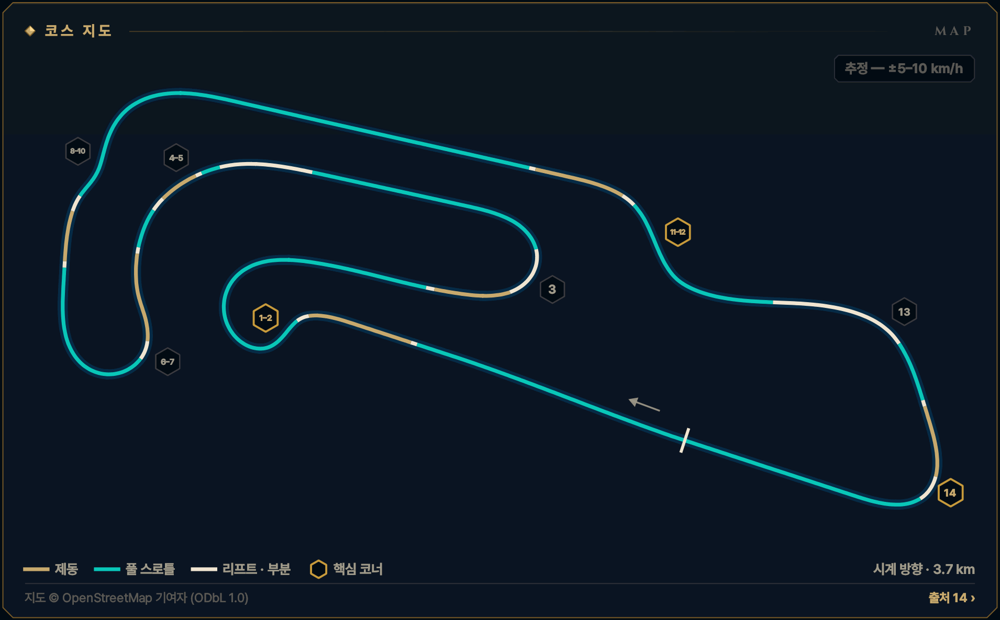
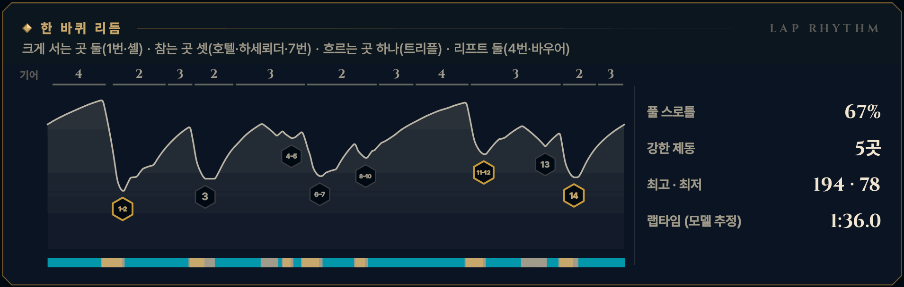

> **GRID서당 : iRacing**은 심레이싱이 처음인 동아리 신입을 위해 만든 드라이빙 아카데미 프로그램입니다. 이 글은 그 안의 **서킷 공략** 모드 — 이번 시즌 리그가 도는 서킷을 코스 개관과 코너별 애니메이션으로 미리 익히는 화면 — 를 블로그로 옮긴 것으로, 글과 애니메이션 모두 프로그램에서 그대로 가져왔습니다. 차는 iRacing의 Ray FF1600이고, 기준은 진도가 없는 루키(입문 렌즈)입니다. 강의는 [GRID서당 시리즈](/posts/untitled_life/motorsport/sim-racing/grid-seodang/)에, 낯선 말은 [용어 사전](/posts/untitled_life/motorsport/sim-racing/grid-seodang/glossary/)에 모아 두었습니다.

## 이번 시즌 일정

> **2026 시즌 4 · 포뮬러 1600 루키 시리즈 · 8주차** — 11.03(화)–11.09(월)
>
> - 루키 FF1600 · 기본 포함 · 12분 레이스 · 스탠딩 스타트 (차: Ray FF1600)
> - iRacing 트랙 이름: Motorsport Arena Oschersleben - Grand Prix
> - 주차는 매주 화요일 09:00(한국 시간)에 바뀝니다.
>
> iRacing 일정은 시즌마다 바뀝니다. 이 글의 주차는 2026 시즌 4 기준이고, 같은 서킷이 다른 시즌에 돌아오면 그 시즌 일정에서 주차와 레이아웃을 다시 확인하세요.

## 코스 개관

3.7 km, 시계 방향, 14코너의 평평한 '아레나' 서킷입니다. 관중석이 트랙보다 높게 둘러싸 언덕은 거의 없고, 어려운 것은 리듬입니다. 시계 방향이지만 인필드는 대부분 왼쪽 코너라 핸들도 목도 양쪽으로 일합니다.

- **시계 방향 · 그랑프리 · 3.7 km · 14코너**
- **코너 번호** — 번호는 지도에서 센 14개(왼쪽 7·오른쪽 7)이며 iRacing 지도 번호와 다를 수 있습니다 — Test Drive에서 확인하세요. 이름은 호텔·하세뢰더·트리플·셸·바우어·체펠린을 먼저 부릅니다.
- **루키 포인트** — 두 번 서고, 세 번 참고, 한 번 흐른다 — 랩타임은 체펠린·10번·하세뢰더의 탈출에서
- **속도 표기: 추정 — ±5–10 km/h** — 이 서킷에는 기준이 되는 실주행 텔레메트리가 없습니다. 공개된 FF1600 트랙 가이드 등에서 맞춘 코너 최저 속도에 보정한 FF1600 물리 모델을 맞춰 계산했기 때문에, 글과 영상의 속도·페달·기어는 모두 **추정값**(±5–10 km/h)입니다. Test Drive에서 직접 확인하세요.

*지도 © OpenStreetMap 기여자 (ODbL 1.0) · 선 색: 골드 = 제동, 시안 = 풀 스로틀, 흰색 = 리프트 · 부분 · 금테 육각형 = 핵심 코너 · 번호 = 이 글의 코너 공략 단위*

## 한 바퀴 리듬

크게 서는 곳 둘(1번·셸) · 참는 곳 셋(호텔·하세뢰더·7번) · 흐르는 곳 하나(트리플) · 리프트 둘(4번·바우어)

*풀 스로틀 67% · 강한 제동 5곳 · 최고 · 최저 194 · 78 km/h · 랩타임 (모델 추정) 1:36.0 — 위 그림의 기어 줄·속도 곡선·입력 띠(골드 = 제동, 시안 = 풀 스로틀)와 코너 번호는 이 기준 랩입니다.*

## 먼저 볼 코너

1. **[T1–2 1번 + 호텔](#w08-u1)** — 1랩 첫 제동 · 랩에서 가장 큰 제동 · iRacing이 경고하는 코너
2. **[T14 체펠린](#w08-u8)** — 랩에서 가장 값진 탈출 — 약 720 m 메인 직선
3. **[T11–12 셸 S](#w08-u6)** — 뒷직선 끝 두 번째 큰 제동 · 추월이 시작되는 곳

> **루키 포인트** — 두 번 서고, 세 번 참고, 한 번 흐른다 — 랩타임은 체펠린·10번·하세뢰더의 탈출에서

## 루키 안전 노트

- **1번 코너 스탠딩 스타트** — iRacing 공식 설명도 경고하는 곳 — 두세 줄로 몰려 강하게 섭니다. 평소보다 늦게 밟지 말고, 막히면 한 줄로.
- **피트 출구·입구** — 피트 출구는 호텔 왼쪽으로 합류하고, 피트 입구는 체펠린 앞 왼쪽으로 갈라집니다(지도 기준, 확인 필요). 왼쪽 거울을 봅니다.
- **시케인 연석** — 안쪽 볼라드·높은 연석은 가벼운 FF1600을 튕겨 냅니다. 연석에서 2\~3 m, 넘지 않습니다.
- **스핀 대처** — 브레이크를 꽉 밟아 세우고, 차들이 지나간 뒤 트랙과 나란히 복귀합니다.
- **트랙 리밋** — 차의 절반 이상이 노면 경계 밖이면 1x — 일부 트랙의 표시 구간만 네 바퀴 기준. 루키 규칙: 두 바퀴는 늘 선·연석 안쪽. 체펠린·10번·12번 출구가 가장 위험하고, 2026 S4에서 3D 연석의 끝부분이 부드럽게 바뀌었습니다.

**1랩 · 스탠딩 스타트** — 1랩: 평소 제동 지점보다 늦게 밟지 않습니다. 앞차에 맞춰 더 일찍, 부드럽게 밟고, 차 한 대 폭을 남깁니다. 바깥이나 가운데를 지키고 안쪽 다툼에 끼지 않습니다.

## 영상 보는 법

코너마다 앱의 코너 공략 화면을 그대로 녹화했습니다. ▶를 눌러 재생하세요 — 앱의 **가이드** 재생(실제 속도의 0.4배, 화면에서 차가 너무 빠른 코너는 0.25배)이라 단계(접근·제동·턴인·에이펙스·탈출)마다 잠깐 멈추고, 멈춤 링이 차면 다음 단계로 넘어갑니다. 블로그 영상은 단계 시작의 멈춤만 짧게 줄였고 (캡션을 읽을 시간은 그대로), 끝에 앱의 끝 카드가 나옵니다. **급수별 브레이크 시연**을 펼치면 같은 코너를 7급·6급·5급 렌즈로, **흔한 실수 고스트**를 펼치면 실수한 차(빨간 점선)와 나란히 달린 영상을 볼 수 있습니다.

- **제동** — 골드 — 두께·밝기 = 브레이크 압력
- **가속** — 시안 — 스로틀
- **관성** — 흰색 — 두 페달 모두 뗀 구간
- **흔한 실수** — 빨간 점선 고스트 — 한 번에 하나만
- **▼ 제동 시작** — 루키 기준선의 제동 시작점
- **◆ 턴인** — 핸들을 감기 시작하는 곳
- **○ 에이펙스** — 가장 안쪽·가장 느린 곳
- **◇ 트랙아웃** — 탈출에서 닿는 바깥 끝
- **보드 (?)** — 확인 전 참고값 — Test Drive에서 기준점을 정하세요
- **입력 지도** — 골드 띠 = 브레이크, 흰 리본(안쪽) = 핸들. 겹치면 트레일
- **손 칸 · 내림 ×N · 올림** — 왼쪽 패들 N번 내림(블립은 오토 블립이) · 오른쪽 패들 한 번 올림

화면과 글의 속도는 모두 **추정값**(±5–10 km/h)입니다 — 기준 텔레메트리가 없는 서킷이라 모델로 계산했습니다.

## 코너 공략

### T1–2 1번 + 호텔

**좌·우 복합 · 2단 · 최저 약 75 km/h · 핵심 코너 · 추정 — ±5–10 km/h**  
랩에서 가장 큰 제동 · 약 190→75 km/h · 1랩 첫 코너 (Hotelkurve)

<figure>
  <video src="images/u1.mp4" poster="images/u1_poster.png" controls preload="none" playsinline style="width:100%;max-width:960px"></video>
  <figcaption>시범 — 루키 기준선 · 입문 렌즈(직선 제동) · 가이드 0.4× · 접근 → 제동 → 턴인 → 에이펙스 → 리프트 ② → 에이펙스 ② → 탈출</figcaption>
</figure>

급수별 브레이크 시연 — 7급 · 6급 · 5급 렌즈 (영상 3)

라인과 기준점은 그대로, 페달 쓰는 법만 지금 급수에 맞춥니다. 위 영상은 **직선 제동 — 기초·심화·9·8급** 렌즈입니다 — 턴인 전에 브레이크를 다 뗍니다 (브레이크 끝 = 턴인).

**릴리스 — 7급** — 턴인을 향해 0.4초 넘게 흘려서 0으로 · 7급 기준: 릴리스 0.4초 이상

<figure>
  <video src="images/u1_release.mp4" poster="images/u1_release_poster.png" controls preload="none" playsinline style="width:100%;max-width:960px"></video>
  <figcaption>7급 렌즈(릴리스) · 가이드 0.4× · 접근 → 제동 → 턴인 → 에이펙스 → 리프트 ② → 에이펙스 ② → 탈출</figcaption>
</figure>

- 제동 — **턴인 쪽으로 흘려 놓는다** · 피크 약 75% · 1.1초에 걸쳐 놓기 · 발 · 하나-둘-셋 놓기
- 턴인 — **턴인에서 0에 닿는다** · 턴인에서 약 0\~3% · 발 · 3% → 0

**트레일 — 6급·4\~1급·졸업** — 턴인 때 15\~20%를 남기고, 감는 만큼 풉니다 · 6급 기준: 턴인 때 15% 이상 남기기

<figure>
  <video src="images/u1_trail.mp4" poster="images/u1_trail_poster.png" controls preload="none" playsinline style="width:100%;max-width:960px"></video>
  <figcaption>6급 렌즈(트레일) · 가이드 0.4× · 접근 → 제동 → 턴인 → 에이펙스 → 리프트 ② → 에이펙스 ② → 탈출</figcaption>
</figure>

- 제동 — **턴인까지 조금 남긴다** · 피크 약 72% · 턴인에서 약 18% · 발 · 놓으며 남기기
- 턴인 — **에이펙스 전 0, 깊게 끌지 않는다** · 약 18% → 에이펙스 전 0 · 바로 호텔이라 가볍게 · 발 · 18% → 0 / 손 · 놓는 만큼 감기

**깊은 트레일 — 5급** — 턴인 때 30% 이상, 에이펙스 앞까지 끌고 갑니다 · 5급 기준: 턴인 때 30% 이상 남기기

<figure>
  <video src="images/u1_deep.mp4" poster="images/u1_deep_poster.png" controls preload="none" playsinline style="width:100%;max-width:960px"></video>
  <figcaption>5급 렌즈(깊은 트레일) · 가이드 0.4× · 접근 → 제동 → 턴인 → 에이펙스 → 리프트 ② → 에이펙스 ② → 탈출</figcaption>
</figure>

- 제동 — **더 깊게, 턴인 32%** · 피크 약 67% · 턴인에서 약 32% · 발 · 천천히 남기기
- 턴인 — **깊게 남기면 호텔이 좁다** · 약 32% → 에이펙스 무렵 0 · 5급 연습은 하세뢰더·체펠린에서 · 발 · 32% → 0

4\~1급은 같은 영상의 캡션에 강조 한 줄(◆)이 더 붙습니다:

- ◆ 4급(턴인·에이펙스) — 브레이크 끝 = 스로틀 시작 — 1번 에이펙스 앞 빈 시간 0.4초 이하

흔한 실수 고스트 — 늦은 제동 → 잠김 → 직진

<figure>
  <video src="images/u1_ghost.mp4" poster="images/u1_ghost_poster.png" controls preload="none" playsinline style="width:100%;max-width:960px"></video>
  <figcaption>흔한 실수: 늦은 제동 → 잠김 → 직진 — 25 m 늦게 100% → 바퀴가 잠겨 직진 · 트랙 밖</figcaption>
</figure>

흔한 실수: **늦은 제동 → 잠김 → 직진** — 25 m 늦게 100% → 바퀴가 잠겨 직진 · 트랙 밖. 빨간 점선과 붉은 차가 실수 고스트, 흰 차가 루키 기준선입니다. 두 차는 같은 시계로 달리므로 늦어지거나 밀려나는 만큼이 그대로 보입니다. 영상은 앱에서 [흔한 실수]를 눌렀을 때처럼 그 실수가 시작되는 단계부터 재생합니다. 끝 카드의 '트레일 렌즈 기준'은 결과의 시간 차를 트레일(6급) 렌즈 주행과 비교한 값이라는 뜻입니다.

> **1랩 · 스탠딩 스타트** — 1랩: 평소 제동 지점보다 늦게 밟지 않습니다. 앞차에 맞춰 더 일찍, 부드럽게 밟고, 차 한 대 폭을 남깁니다. 바깥이나 가운데를 지키고 안쪽 다툼에 끼지 않습니다. 1번의 바깥(오른쪽)은 곧 호텔의 안쪽이니 1번을 브레이크로 이기려 하지 마세요.

#### 접근

메인 직선 끝, 4단 약 190 km/h로 직선의 오른쪽, 왼쪽 코너의 바깥을 탑니다. 오른쪽 거리 보드가 iRacing에 있는지는 아직 확인되지 않았으니, Test Drive에서 고정된 기준물 하나를 정해 이름을 붙여 두세요. 1랩에는 차들이 두세 줄로 몰려 이 코너에 옵니다.

*지금 손과 발 — 발 · 풀스로틀 / 손 · 곧게 / 눈 · 제동 기준물*

**보드 · 기준점** — 모두 확인 전 참고값입니다. Test Drive에서 직접 보고 정하세요.

- **제동 · 기준점**? 오른쪽 거리 보드 — iRacing에 있는지 미확인. 애니메이션은 턴인 약 125 m 앞에서 밟음 *(확인 전 참고값)*
- **턴인**? 왼쪽 연석이 시작되는 근처 — Test Drive에서 확인 *(확인 전 참고값)*
- **에이펙스**? 왼쪽 연석 뒷부분 — 안쪽 물체·페인트는 밟지 않기 *(확인 전 참고값)*

#### 제동

랩에서 가장 큰 제동입니다. 차가 곧을 때 한 음절로 '꾹' 약 75%까지 — ABS가 없어 100%는 바퀴를 잠급니다. 그 사이 4→3→2단으로 하나씩 내리고, 턴인까지 하나-둘-셋으로 풉니다.

*지금 손과 발 — 발 · 꾹 / 손 · 곧게 · 내림 ×2 / 눈 · 턴인 지점*

#### 턴인

보이는 것보다 늦게, 오른쪽 끝에서 한 번에 감습니다. 아직 세게 밟고 있다면 너무 빠른 것입니다. 실제 서킷은 안쪽 연석 옆 타이어 더미가 출구를 가리니, 눈은 안쪽 연석 너머 호텔 쪽으로 먼저 보냅니다.

*지금 손과 발 — 발 · 0 → 유지 스로틀 / 손 · 한 번에 감기 / 눈 · 왼쪽 연석*

#### 에이펙스

1번의 에이펙스는 늦게, 왼쪽 연석 가까이 둡니다. 최저 약 75 km/h, 2단입니다. 1번의 출구를 다 쓰지 않고, 에이펙스에서 곧장 호텔 입구의 오른쪽으로 비스듬히 건너갑니다.

*지금 손과 발 — 발 · 유지 스로틀 / 손 · 풀며 반대로 / 눈 · 호텔 안쪽*

#### 리프트 ②

1번에서 나오자마자 풀스로틀은 금물입니다 — 흔들리는 차로 호텔에 들어가게 됩니다. 스로틀을 약 79%에 멈춰 두고, 핸들은 왼쪽에서 오른쪽으로 한 번에 넘깁니다.

*지금 손과 발 — 발 · 약 79% 유지 / 손 · 왼→오 한 번 / 눈 · 호텔 안쪽 연석*

**급수 시험 주행에서 호텔 입구는 스로틀로만 조절합니다 — 10%를 넘는 톡도 제동 코너로 채점됩니다.**

#### 에이펙스 ②

호텔은 입구가 가장 조여 듭니다. 안쪽 연석에서 1 m쯤 떨어져 핸들 각도를 하나로 정하고 더 감지 않습니다. 앞이 밀리면 스로틀만 10\~15% 덜어 주세요 — 발을 완전히 떼면 뒤가 돕니다.

*지금 손과 발 — 발 · 유지 / 손 · 각도 고정 / 눈 · 호텔 출구 쪽*

#### 탈출

입구를 지나면 호텔은 길게 이어지는 오른쪽입니다. 스로틀은 앞으로만 열고, 코너가 열리는 만큼 핸들을 풀며 왼쪽 끝으로 흘러 나갑니다. 피트에서 나온 차가 호텔 왼쪽으로 합류할 수 있으니 왼쪽 거울을 봅니다.

*지금 손과 발 — 발 · 앞으로만 / 손 · 푸는 만큼 / 눈 · 하부 직선*

#### 흔한 실수

- 늦게, 세게 — 100%로 밟아 앞바퀴가 잠기고 그대로 직진  
  → 평소 기준물에서 약 75%; 잠기면 바퀴가 구를 만큼 풀고, 애매하면 곧장 런오프로
- 이른 턴인 → 이른 에이펙스 → 호텔 입구에서 왼쪽으로 넓어짐  
  → 반 박자 늦게, 왼쪽 연석 뒷부분을 겨눈다
- 1번 출구에서 풀스로틀 → 호텔 입구에서 앞이 밀리고 차가 흔들림  
  → 반쯤 열어 기다렸다가, 호텔이 열릴 때 끝까지

#### 이 코너에서 확인할 것

- [ ] 1번 앞 오른쪽 200·150·100 보드가 iRacing에 있는지
- [ ] 1번 안쪽 타이어 더미(실제 서킷)가 iRacing에도 있는지
- [ ] 피트 출구가 호텔 왼쪽으로 합류하는 선이 어디서 끝나는지

#### 연결된 강의 · 드릴

- 강의: [심화 1강(출발의 기술)](/posts/untitled_life/motorsport/sim-racing/grid-seodang/advanced/d1-the-start/) · [기초 4강(레이싱 라인의 문법)](/posts/untitled_life/motorsport/sim-racing/grid-seodang/basics/f4-racing-line/) · [8급(제동의 기본)](/posts/untitled_life/motorsport/sim-racing/grid-seodang/grades/g8-braking-basics/) · [7급(릴리스 수양)](/posts/untitled_life/motorsport/sim-racing/grid-seodang/grades/g7-release/) · [6급(트레일 입문)](/posts/untitled_life/motorsport/sim-racing/grid-seodang/grades/g6-trail-intro/) · [심화 2강(코너의 다섯 얼굴)](/posts/untitled_life/motorsport/sim-racing/grid-seodang/advanced/d2-five-corner-faces/) · [2급(스티어링 일필휘지)](/posts/untitled_life/motorsport/sim-racing/grid-seodang/grades/g2-one-stroke-steering/) · [3급(스로틀 서예)](/posts/untitled_life/motorsport/sim-racing/grid-seodang/grades/g3-throttle-calligraphy/) · [4급(전환 수련)](/posts/untitled_life/motorsport/sim-racing/grid-seodang/grades/g4-transition/) · [심화 3강(상황의 라인)](/posts/untitled_life/motorsport/sim-racing/grid-seodang/advanced/d3-situational-lines/)
- 훈련장 드릴: 정밀 압력 · 제동 수양 · 조향 일필 · 스로틀 서예

<small>근거: S1 · S4 · S5 · S7 · S9 · S13 · S14 (아래 출처 목록) · 신뢰도 L</small>

### T3 하세뢰더

**좌코너 · 2단 · 최저 약 90 km/h · 추정 — ±5–10 km/h**  
크고 넓은 왼쪽 헤어핀 · 약 155→90 km/h · 트레일 교실 (Hasseröder-Kurve)

<figure>
  <video src="images/u2.mp4" poster="images/u2_poster.png" controls preload="none" playsinline style="width:100%;max-width:960px"></video>
  <figcaption>시범 — 루키 기준선 · 입문 렌즈(직선 제동) · 가이드 0.4× · 접근 → 제동 → 턴인 → 에이펙스 → 탈출</figcaption>
</figure>

급수별 브레이크 시연 — 7급 · 6급 · 5급 렌즈 (영상 3)

라인과 기준점은 그대로, 페달 쓰는 법만 지금 급수에 맞춥니다. 위 영상은 **직선 제동 — 기초·심화·9·8급** 렌즈입니다 — 턴인 전에 브레이크를 다 뗍니다 (브레이크 끝 = 턴인).

**릴리스 — 7급** — 턴인을 향해 0.4초 넘게 흘려서 0으로 · 7급 기준: 릴리스 0.4초 이상

<figure>
  <video src="images/u2_release.mp4" poster="images/u2_release_poster.png" controls preload="none" playsinline style="width:100%;max-width:960px"></video>
  <figcaption>7급 렌즈(릴리스) · 가이드 0.4× · 접근 → 제동 → 턴인 → 에이펙스 → 탈출</figcaption>
</figure>

- 제동 — **턴인 쪽으로 흘려 놓는다** · 피크 약 69% · 0.9초에 걸쳐 놓기 · 발 · 하나-둘-셋 놓기
- 턴인 — **턴인에서 0에 닿는다** · 턴인에서 약 0\~3% · 발 · 3% → 0

**트레일 — 6급·4\~1급·졸업** — 턴인 때 15\~20%를 남기고, 감는 만큼 풉니다 · 6급 기준: 턴인 때 15% 이상 남기기

<figure>
  <video src="images/u2_trail.mp4" poster="images/u2_trail_poster.png" controls preload="none" playsinline style="width:100%;max-width:960px"></video>
  <figcaption>6급 렌즈(트레일) · 가이드 0.4× · 접근 → 제동 → 턴인 → 에이펙스 → 탈출</figcaption>
</figure>

- 제동 — **턴인까지 조금 남긴다** · 피크 약 55% · 턴인에서 약 18% · 발 · 놓으며 남기기
- 턴인 — **가운데 전 0으로 흘린다** · 약 18% → 가운데 전 0 · 발 · 18% → 0 / 손 · 놓는 만큼 감기

**깊은 트레일 — 5급** — 턴인 때 30% 이상, 에이펙스 앞까지 끌고 갑니다 · 5급 기준: 턴인 때 30% 이상 남기기

<figure>
  <video src="images/u2_deep.mp4" poster="images/u2_deep_poster.png" controls preload="none" playsinline style="width:100%;max-width:960px"></video>
  <figcaption>5급 렌즈(깊은 트레일) · 가이드 0.4× · 접근 → 제동 → 턴인 → 에이펙스 → 탈출</figcaption>
</figure>

- 제동 — **랩에서 가장 좋은 교실, 32%** · 피크 약 45% · 턴인에서 약 32% · 발 · 천천히 남기기
- 턴인 — **앞을 누른 채 돌린다** · 약 32% → 가운데 무렵 0 · 발 · 32% → 0

4\~1급은 같은 영상의 캡션에 강조 한 줄(◆)이 더 붙습니다:

- ◆ 4급(턴인·에이펙스) — 브레이크 끝 = 스로틀 시작 — 긴 헤어핀 안의 빈 시간 0.4초 이하

#### 접근

호텔을 나와 하부 직선을 3단 약 155 km/h로 달립니다. 직선의 오른쪽, 왼쪽 헤어핀의 바깥을 타며, 크고 넓은 헤어핀이 멀리서도 다 보입니다. 보드는 확인되지 않았으니 턴인 약 75 m 앞의 고정 기준물 하나를 Test Drive에서 정하세요.

*지금 손과 발 — 발 · 풀스로틀 / 손 · 곧게 / 눈 · 제동 기준물*

**보드 · 기준점** — 모두 확인 전 참고값입니다. Test Drive에서 직접 보고 정하세요.

- **제동 · 기준점**? 보드 미확인 — 턴인 약 75 m 앞의 고정 기준물을 Test Drive에서 정하기 *(확인 전 참고값)*
- **에이펙스**? 헤어핀 가운데를 지난 왼쪽 연석 *(확인 전 참고값)*

#### 제동

곧은 상태에서 '꾹' 약 68%, 그리고 서서히 풀며 3→2단으로 내립니다. 실제 하세뢰더는 코너 안에 범프가 있다고 알려져 있어 깊은 곳에서 세게 밟지 않습니다. 입문 기준선은 감속 대부분을 턴인 전에 끝냅니다.

*지금 손과 발 — 발 · 꾹, 서서히 풀기 / 손 · 곧게 · 내림 ×1 / 눈 · 턴인 지점*

#### 턴인

오른쪽 끝에서, 보이는 것보다 조금 늦게 감기 시작합니다. 반지름이 일정한 긴 헤어핀은 일찍 들어가고 싶게 만들고, 이른 턴인은 이른 에이펙스를 부릅니다. 핸들은 천천히 더해 가며 한 획으로 — 중간에 풀었다 다시 감지 않습니다.

*지금 손과 발 — 발 · 0 → 유지 스로틀 / 손 · 천천히 감기 / 눈 · 왼쪽 연석*

#### 에이펙스

왼쪽 연석에 가장 가까워지는 곳은 헤어핀 가운데를 지나서입니다. 최저 약 90 km/h, 2단 — 이때 차는 이미 직선 쪽을 바라봐야 합니다(U가 아니라 V). 실제 서킷은 안쪽으로 살짝 기울어 있다고 하니 핸들을 더 감기보다 차를 믿습니다.

*지금 손과 발 — 발 · 유지 → 열기 / 손 · 거의 그대로 / 눈 · 오른쪽 출구*

#### 탈출

핸들을 푸는 만큼 스로틀을 한 번에 끝까지 엽니다. 오른쪽 끝으로 흘러 나가며 3단으로 올립니다. 이 출구 속도가 다음 직선과 빠른 트리플까지 그대로 이어집니다.

*지금 손과 발 — 발 · 앞으로만 / 손 · 풀기 / 눈 · 상부 직선*

#### 흔한 실수

- 이른 턴인 → 이른 에이펙스 → 출구에서 오른쪽 밖으로 밀리거나 발을 뗌  
  → 턴인을 늦추고 에이펙스를 헤어핀 가운데 뒤로
- 핸들을 감은 채 스로틀을 확 → 앞이 밀려 바깥으로(파워 언더스티어)  
  → 스로틀 = 1 − 조향, 푸는 만큼만 연다
- 브레이크는 뗐는데 스로틀은 아직인 빈 시간  
  → 브레이크 끝 = 스로틀 시작, 5\~10%로 다리를 놓는다

#### 이 코너에서 확인할 것

- [ ] 하세뢰더 안쪽 기울기와 범프가 iRacing에도 있는지
- [ ] 턴인 약 75 m 앞에 쓸 수 있는 고정 기준물

#### 연결된 강의 · 드릴

- 강의: [심화 2강(코너의 다섯 얼굴)](/posts/untitled_life/motorsport/sim-racing/grid-seodang/advanced/d2-five-corner-faces/) · [8급(제동의 기본)](/posts/untitled_life/motorsport/sim-racing/grid-seodang/grades/g8-braking-basics/) · [7급(릴리스 수양)](/posts/untitled_life/motorsport/sim-racing/grid-seodang/grades/g7-release/) · [6급(트레일 입문)](/posts/untitled_life/motorsport/sim-racing/grid-seodang/grades/g6-trail-intro/) · [5급(트레일 숙달)](/posts/untitled_life/motorsport/sim-racing/grid-seodang/grades/g5-trail-mastery/) · [4급(전환 수련)](/posts/untitled_life/motorsport/sim-racing/grid-seodang/grades/g4-transition/) · [3급(스로틀 서예)](/posts/untitled_life/motorsport/sim-racing/grid-seodang/grades/g3-throttle-calligraphy/) · [심화 6강(교본 차 해부)](/posts/untitled_life/motorsport/sim-racing/grid-seodang/advanced/d8-training-car-and-shifting/)
- 훈련장 드릴: 트레일 브레이킹 · 제동 수양 · 전환

<small>근거: S4 · S11 · S12 · S14 · S15 (아래 출처 목록) · 신뢰도 L</small>

### T4–5 트리플

**좌코너 · 3단 · 최저 약 140 km/h · 추정 — ±5–10 km/h**  
4번은 리프트, 5번은 짧은 제동 · 약 140 km/h

<figure>
  <video src="images/u3.mp4" poster="images/u3_poster.png" controls preload="none" playsinline style="width:100%;max-width:960px"></video>
  <figcaption>시범 — 루키 기준선 · 입문 렌즈(직선 제동) · 가이드 0.4× · 접근 → 리프트 → 턴인 → 에이펙스 → 제동 ② → 에이펙스 ② → 탈출</figcaption>
</figure>

급수별 브레이크 시연 — 7급 · 6급 렌즈 (영상 2)

라인과 기준점은 그대로, 페달 쓰는 법만 지금 급수에 맞춥니다. 위 영상은 **직선 제동 — 기초·심화·9·8급** 렌즈입니다 — 턴인 전에 브레이크를 다 뗍니다 (브레이크 끝 = 턴인).

**릴리스 — 7급** — 턴인을 향해 0.4초 넘게 흘려서 0으로 · 7급 기준: 릴리스 0.4초 이상

<figure>
  <video src="images/u3_release.mp4" poster="images/u3_release_poster.png" controls preload="none" playsinline style="width:100%;max-width:960px"></video>
  <figcaption>7급 렌즈(릴리스) · 가이드 0.4× · 접근 → 리프트 → 턴인 → 에이펙스 → 제동 ② → 에이펙스 ② → 탈출</figcaption>
</figure>

- 제동 ② — **짧게, 흘려 놓는다** · 피크 약 40% · 0.5초에 걸쳐 놓기 · 발 · 하나-둘 놓기

**트레일 — 6급·4\~1급·졸업** — 턴인 때 15\~20%를 남기고, 감는 만큼 풉니다 · 가벼운 제동 코너 — 15% 기준보다 적게 남깁니다

<figure>
  <video src="images/u3_trail.mp4" poster="images/u3_trail_poster.png" controls preload="none" playsinline style="width:100%;max-width:960px"></video>
  <figcaption>6급 렌즈(트레일) · 가이드 0.4× · 접근 → 리프트 → 턴인 → 에이펙스 → 제동 ② → 에이펙스 ② → 탈출</figcaption>
</figure>

- 제동 ② — **가벼운 톡, 턴인 전 0** · 피크 약 40% · 빠른 코너라 잔압 없이 · 발 · 톡 → 0

**깊은 트레일 — 5급** — 턴인 때 30% 이상, 에이펙스 앞까지 끌고 갑니다 · 가벼운 제동 코너 — 30% 기준보다 적게 남깁니다 — 이 코너에서는 **트레일 — 6급·4\~1급·졸업** 영상과 그림이 같아 따로 싣지 않았습니다.

흔한 실수 고스트 — 너무 세게, 너무 오래

<figure>
  <video src="images/u3_ghost.mp4" poster="images/u3_ghost_poster.png" controls preload="none" playsinline style="width:100%;max-width:960px"></video>
  <figcaption>흔한 실수: 너무 세게, 너무 오래 — 95%로 꾹, 굴러가며 최저 약 110 km/h → 약 0.6초 늦음</figcaption>
</figure>

흔한 실수: **너무 세게, 너무 오래** — 95%로 꾹, 굴러가며 최저 약 110 km/h → 약 0.6초 늦음. 빨간 점선과 붉은 차가 실수 고스트, 흰 차가 루키 기준선입니다. 두 차는 같은 시계로 달리므로 늦어지거나 밀려나는 만큼이 그대로 보입니다. 영상은 앱에서 [흔한 실수]를 눌렀을 때처럼 그 실수가 시작되는 단계부터 재생합니다. 끝 카드의 '트레일 렌즈 기준'은 결과의 시간 차를 트레일(6급) 렌즈 주행과 비교한 값이라는 뜻입니다.

#### 접근

하세뢰더를 나와 상부 직선을 3단으로, 리미터 가까이 달립니다. 트리플은 왼쪽으로 세 번 휘는 빠른 구간 — 이 장면은 4번과 5번이고, 6번은 다음 장면의 7번 제동 안에 있습니다. 직선의 오른쪽에서, 4번에 있을 때 이미 5번 에이펙스를 봅니다.

*지금 손과 발 — 발 · 풀스로틀 / 손 · 곧게 / 눈 · 5번 에이펙스*

**보드 · 기준점** — 모두 확인 전 참고값입니다. Test Drive에서 직접 보고 정하세요.

- **제동 · 기준점**? 4번을 지나 5번 턴인 약 35 m 앞 — 기준물은 Test Drive에서 *(확인 전 참고값)*
- **리프트 시작**? 차가 아직 곧을 때, 4번 턴인 전 *(확인 전 참고값)*

#### 리프트

4번은 브레이크 없이 발만 뗍니다. 차가 아직 곧을 때 스로틀을 완전히 떼면, 굴러가며 속도가 조금씩 줄어듭니다. 4번에서 브레이크를 '톡' 대는 습관은 여기서 버립니다.

*지금 손과 발 — 발 · 완전히 떼기 / 손 · 곧게 / 눈 · 4번 안쪽*

**급수 시험 주행: 4번은 리프트만 — 10%를 넘는 톡은 제동 코너로 채점됩니다. 5번의 짧은 제동은 그대로 채점됩니다.**

#### 턴인

부드러운 왼쪽 호 하나를 시작합니다. 발은 뗀 채, 핸들은 작게 한 번 — 4번과 5번 사이에서 오른쪽으로 크게 벌리지 않습니다.

*지금 손과 발 — 발 · 떼고 기다리기 / 손 · 작게 감기 / 눈 · 4번 연석*

#### 에이펙스

4번 연석은 껴안지 말고 스칩니다. 깊게 찍으면 코너 하나가 셋이 되고 그만큼 느립니다. 스로틀을 살짝 다시 열었다가, 5번 제동점이 오면 부드럽게 뗍니다.

*지금 손과 발 — 발 · 살짝 다시 / 손 · 그대로 / 눈 · 5번 제동점*

#### 제동 ②

5번 앞에서 한 번, 짧게 제동합니다 — 약 40%로 1초가 안 되게 '톡-꾹' 하고 부드럽게 놓습니다. 차가 아직 조금 왼쪽으로 돌고 있으니 세게 밟지 않습니다. 기어는 3단 그대로입니다.

*지금 손과 발 — 발 · 톡-꾹, 놓기 / 손 · 거의 그대로 / 눈 · 5번 에이펙스*

#### 에이펙스 ②

5번이 이 구간에서 가장 조입니다. 왼쪽 연석에서 2\~3 m 안으로 지나며 최저 약 140 km/h, 3단입니다. 브레이크가 0이 되는 순간 스로틀을 다시 열어 둡니다.

*지금 손과 발 — 발 · 유지 스로틀 / 손 · 한 번 더 / 눈 · 출구*

#### 탈출

5번을 나오며 핸들을 푸는 만큼 끝까지 엽니다. 바로 뒤의 6번 왼쪽 꺾임에서 7번 제동이 시작되니 차를 곧게 세워 둡니다 — 이어지는 장면이 다음 코너 공략(6번 → 7번)입니다.

*지금 손과 발 — 발 · 앞으로만 / 손 · 풀기 / 눈 · 7번 쪽*

#### 흔한 실수

- 세 굽이 모두 세게 — 5번에서 꾹 밟고 굴러가 느리고 출렁인다  
  → 4번은 리프트, 5번은 짧게 한 번, 그다음은 흘려보내기
- 핸들 톱질 — 고치는 횟수가 많으면 앞바퀴가 끌린다  
  → 호 하나로; 고치고 있다면 4번 진입이 2\~3 km/h 빨랐다는 뜻
- 호 한가운데서 발을 확 떼기 → 뒤가 가벼워져 돈다  
  → 리프트는 턴인 전에만, 코너 안에서는 스로틀을 부드럽게

#### 이 코너에서 확인할 것

- [ ] 트리플에서 3단이 리미터에 닿는지(닿으면 4단으로)
- [ ] 트리플 안쪽 연석의 높이

#### 연결된 강의 · 드릴

- 강의: [심화 2강(코너의 다섯 얼굴)](/posts/untitled_life/motorsport/sim-racing/grid-seodang/advanced/d2-five-corner-faces/) · [2급(스티어링 일필휘지)](/posts/untitled_life/motorsport/sim-racing/grid-seodang/grades/g2-one-stroke-steering/) · [심화 8강(페달의 문법)](/posts/untitled_life/motorsport/sim-racing/grid-seodang/advanced/d6-pedal-grammar/) · [심화 4강(차의 균형)](/posts/untitled_life/motorsport/sim-racing/grid-seodang/advanced/d4-car-balance/) · [심화 10강(라임락 교본)](/posts/untitled_life/motorsport/sim-racing/grid-seodang/advanced/d11-lime-rock-textbook/)
- 훈련장 드릴: 조향 일필 · 정밀 압력 · 전환

<small>근거: S4 · S11 · S14 · S15 (아래 출처 목록) · 신뢰도 L</small>

### T6–7 6번 → 7번

**우코너 · 2단 · 최저 약 90 km/h · 추정 — ±5–10 km/h**  
6번 꺾임 전에 서고 7번 루프를 길게 · 약 90 km/h

<figure>
  <video src="images/u4.mp4" poster="images/u4_poster.png" controls preload="none" playsinline style="width:100%;max-width:960px"></video>
  <figcaption>시범 — 루키 기준선 · 입문 렌즈(직선 제동) · 가이드 0.4× · 접근 → 제동 → 턴인 → 에이펙스 → 탈출</figcaption>
</figure>

급수별 브레이크 시연 — 7급 · 6급 · 5급 렌즈 (영상 3)

라인과 기준점은 그대로, 페달 쓰는 법만 지금 급수에 맞춥니다. 위 영상은 **직선 제동 — 기초·심화·9·8급** 렌즈입니다 — 턴인 전에 브레이크를 다 뗍니다 (브레이크 끝 = 턴인).

**릴리스 — 7급** — 턴인을 향해 0.4초 넘게 흘려서 0으로 · 7급 기준: 릴리스 0.4초 이상

<figure>
  <video src="images/u4_release.mp4" poster="images/u4_release_poster.png" controls preload="none" playsinline style="width:100%;max-width:960px"></video>
  <figcaption>7급 렌즈(릴리스) · 가이드 0.4× · 접근 → 제동 → 턴인 → 에이펙스 → 탈출</figcaption>
</figure>

- 제동 — **턴인 쪽으로 흘려 놓는다** · 피크 약 73% · 0.8초에 걸쳐 놓기 · 발 · 하나-둘-셋 놓기
- 턴인 — **턴인에서 0에 닿는다** · 턴인에서 약 0\~3% · 발 · 3% → 0

**트레일 — 6급·4\~1급·졸업** — 턴인 때 15\~20%를 남기고, 감는 만큼 풉니다 · 6급 기준: 턴인 때 15% 이상 남기기

<figure>
  <video src="images/u4_trail.mp4" poster="images/u4_trail_poster.png" controls preload="none" playsinline style="width:100%;max-width:960px"></video>
  <figcaption>6급 렌즈(트레일) · 가이드 0.4× · 접근 → 제동 → 턴인 → 에이펙스 → 탈출</figcaption>
</figure>

- 제동 — **6번에서 남기며 푼다** · 피크 약 66% · 턴인에서 약 18% · 발 · 놓으며 남기기
- 턴인 — **에이펙스 전 0으로 흘린다** · 약 18% → 에이펙스 전 0 · 발 · 18% → 0 / 손 · 놓는 만큼 감기

**깊은 트레일 — 5급** — 턴인 때 30% 이상, 에이펙스 앞까지 끌고 갑니다 · 5급 기준: 턴인 때 30% 이상 남기기

<figure>
  <video src="images/u4_deep.mp4" poster="images/u4_deep_poster.png" controls preload="none" playsinline style="width:100%;max-width:960px"></video>
  <figcaption>5급 렌즈(깊은 트레일) · 가이드 0.4× · 접근 → 제동 → 턴인 → 에이펙스 → 탈출</figcaption>
</figure>

- 제동 — **더 깊게, 턴인 32%** · 피크 약 56% · 턴인에서 약 32% · 발 · 천천히 남기기
- 턴인 — **느리고 긴 코너, 깊게** · 약 32% → 에이펙스 무렵 0 · 발 · 32% → 0

흔한 실수 고스트 — 너무 세게, 너무 오래

<figure>
  <video src="images/u4_ghost.mp4" poster="images/u4_ghost_poster.png" controls preload="none" playsinline style="width:100%;max-width:960px"></video>
  <figcaption>흔한 실수: 너무 세게, 너무 오래 — 95%로 꾹, 굴러가며 최저 약 65 km/h → 약 2.1초 늦음</figcaption>
</figure>

흔한 실수: **너무 세게, 너무 오래** — 95%로 꾹, 굴러가며 최저 약 65 km/h → 약 2.1초 늦음. 빨간 점선과 붉은 차가 실수 고스트, 흰 차가 루키 기준선입니다. 두 차는 같은 시계로 달리므로 늦어지거나 밀려나는 만큼이 그대로 보입니다. 영상은 앱에서 [흔한 실수]를 눌렀을 때처럼 그 실수가 시작되는 단계부터 재생합니다. 끝 카드의 '트레일 렌즈 기준'은 결과의 시간 차를 트레일(6급) 렌즈 주행과 비교한 값이라는 뜻입니다.

#### 접근

5번을 나와 차가 곧아지는 짧은 직선이 7번을 위한 제동 창입니다. 앞에 왼쪽 6번 꺾임, 그 너머로 길게 도는 오른쪽 7번 루프가 보입니다. 3단 약 150 km/h입니다.

*지금 손과 발 — 발 · 풀스로틀 / 손 · 곧게 / 눈 · 7번 연석*

**보드 · 기준점** — 모두 확인 전 참고값입니다. Test Drive에서 직접 보고 정하세요.

- **제동 · 기준점**? 5번을 나와 차가 곧아지는 순간 — 6번 왼쪽 꺾임 전 *(확인 전 참고값)*
- **에이펙스**? 루프 앞부분의 오른쪽 연석 *(확인 전 참고값)*

#### 제동

6번 왼쪽 꺾임 전, 차가 곧을 때 '꾹' 약 72%. 6번은 손목만 살짝 왼쪽으로 — 꺾는 동안 페달을 더 세게 밟지 않고 같은 압력을 지키며 3→2단으로 내리고, 7번 턴인을 향해 흘려 놓습니다. 빠른 랩보다 12 m 일찍입니다.

*지금 손과 발 — 발 · 꾹 → 풀기 / 손 · 왼쪽 살짝 · 내림 ×1 / 눈 · 7번 입구*

#### 턴인

6번에서 왼쪽으로 살짝 돌던 핸들을 곧바로 오른쪽으로 — 왼쪽에서 오른쪽으로 넘어가는 짧은 S입니다. 확 꺾지 말고 부드럽게 감습니다.

*지금 손과 발 — 발 · 0 → 유지 / 손 · 부드럽게 감기 / 눈 · 안쪽 연석*

#### 에이펙스

루프 앞부분에서 안쪽 연석에 처음 닿고, 이곳이 가장 느립니다 — 최저 약 90 km/h, 2단입니다. 그다음 루프 내내 안쪽을 따라 각도 하나로 돕니다.

*지금 손과 발 — 발 · 유지 → 앞으로 / 손 · 각도 고정 / 눈 · 루프 안쪽*

#### 탈출

애니메이션도 루프 가운데부터 핸들을 푸는 만큼만 스로틀을 열고, 타이어가 한계라 속도는 천천히만 오릅니다. 앞이 밀리면 핸들을 더 감지 말고 스로틀을 10\~15% 덜어 줍니다. 루프 끝에서 푸는 만큼 왼쪽 끝으로 흘러 나가면, 이 속도가 시케인까지 갑니다.

*지금 손과 발 — 발 · 앞으로만 / 손 · 끝에서 풀기 / 눈 · 시케인*

#### 흔한 실수

- 너무 세게, 너무 오래 — 꾹 밟고 루프 입구까지 굴러간다  
  → 같은 지점, 약 72%; 6번에서 풀고 놓는 끝에서 스로틀
- 6번 속도를 그대로 들고 7번에 → 루프 내내 언더스티어  
  → 5번 뒤 직선에서, 곧을 때 일찍 끝낸다
- 루프 중간에 핸들을 더 감기 → 앞이 더 밀린다  
  → 각도는 그대로, 스로틀만 10\~15% 덜기

#### 이 코너에서 확인할 것

- [ ] 7번 출구 바깥이 잔디인지 자갈인지
- [ ] 5번 뒤 짧은 직선에 쓸 고정 기준물

#### 연결된 강의 · 드릴

- 강의: [8급(제동의 기본)](/posts/untitled_life/motorsport/sim-racing/grid-seodang/grades/g8-braking-basics/) · [7급(릴리스 수양)](/posts/untitled_life/motorsport/sim-racing/grid-seodang/grades/g7-release/) · [6급(트레일 입문)](/posts/untitled_life/motorsport/sim-racing/grid-seodang/grades/g6-trail-intro/) · [5급(트레일 숙달)](/posts/untitled_life/motorsport/sim-racing/grid-seodang/grades/g5-trail-mastery/) · [2급(스티어링 일필휘지)](/posts/untitled_life/motorsport/sim-racing/grid-seodang/grades/g2-one-stroke-steering/) · [3급(스로틀 서예)](/posts/untitled_life/motorsport/sim-racing/grid-seodang/grades/g3-throttle-calligraphy/) · [4급(전환 수련)](/posts/untitled_life/motorsport/sim-racing/grid-seodang/grades/g4-transition/) · [심화 2강(코너의 다섯 얼굴)](/posts/untitled_life/motorsport/sim-racing/grid-seodang/advanced/d2-five-corner-faces/)
- 훈련장 드릴: 트레일 브레이킹 · 스로틀 서예 · 조향 일필

<small>근거: S4 · S11 · S14 (아래 출처 목록) · 신뢰도 M</small>

### T8–10 시케인 + 10번

**우·좌·우 복합 · 2단 · 최저 약 115 km/h · 추정 — ±5–10 km/h**  
가볍게 한 번, 시케인을 곧게 · 10번 출구가 뒷직선 (Schikane)

<figure>
  <video src="images/u5.mp4" poster="images/u5_poster.png" controls preload="none" playsinline style="width:100%;max-width:960px"></video>
  <figcaption>시범 — 루키 기준선 · 입문 렌즈(직선 제동) · 가이드 0.4× · 접근 → 제동 → 턴인 → 에이펙스 → 에이펙스 ② → 전환 ③ → 에이펙스 ③ → 탈출</figcaption>
</figure>

급수별 브레이크 시연 — 7급 · 6급 · 5급 렌즈 (영상 3)

라인과 기준점은 그대로, 페달 쓰는 법만 지금 급수에 맞춥니다. 위 영상은 **직선 제동 — 기초·심화·9·8급** 렌즈입니다 — 턴인 전에 브레이크를 다 뗍니다 (브레이크 끝 = 턴인).

**릴리스 — 7급** — 턴인을 향해 0.4초 넘게 흘려서 0으로 · 7급 기준: 릴리스 0.4초 이상

<figure>
  <video src="images/u5_release.mp4" poster="images/u5_release_poster.png" controls preload="none" playsinline style="width:100%;max-width:960px"></video>
  <figcaption>7급 렌즈(릴리스) · 가이드 0.4× · 접근 → 제동 → 턴인 → 에이펙스 → 에이펙스 ② → 전환 ③ → 에이펙스 ③ → 탈출</figcaption>
</figure>

- 제동 — **가볍게, 흘려 놓는다** · 피크 약 35% · 0.7초에 걸쳐 놓기 · 발 · 하나-둘 놓기
- 턴인 — **턴인에서 0에 닿는다** · 턴인에서 약 0\~3% · 발 · 3% → 0

**트레일 — 6급·4\~1급·졸업** — 턴인 때 15\~20%를 남기고, 감는 만큼 풉니다 · 6급 기준: 턴인 때 15% 이상 남기기

<figure>
  <video src="images/u5_trail.mp4" poster="images/u5_trail_poster.png" controls preload="none" playsinline style="width:100%;max-width:960px"></video>
  <figcaption>6급 렌즈(트레일) · 가이드 0.4× · 접근 → 제동 → 턴인 → 에이펙스 → 에이펙스 ② → 전환 ③ → 에이펙스 ③ → 탈출</figcaption>
</figure>

- 제동 — **8번 턴인까지 살짝** · 피크 약 35% · 턴인에서 약 18% · 발 · 가볍게 남기기
- 턴인 — **에이펙스 전 0으로 흘린다** · 약 18% → 에이펙스 전 0 · 발 · 18% → 0 / 손 · 놓는 만큼 감기

**깊은 트레일 — 5급** — 턴인 때 30% 이상, 에이펙스 앞까지 끌고 갑니다 · 가벼운 제동 코너 — 30% 기준보다 적게 남깁니다

<figure>
  <video src="images/u5_deep.mp4" poster="images/u5_deep_poster.png" controls preload="none" playsinline style="width:100%;max-width:960px"></video>
  <figcaption>5급 렌즈(깊은 트레일) · 가이드 0.4× · 접근 → 제동 → 턴인 → 에이펙스 → 에이펙스 ② → 전환 ③ → 에이펙스 ③ → 탈출</figcaption>
</figure>

- 제동 — **빠른 시케인이라 얕게** · 피크 약 29% · 턴인에서 약 20% · 발 · 얕게 남기기
- 턴인 — **얕게, 에이펙스 무렵 0** · 약 20% → 에이펙스 무렵 0 · 깊은 트레일은 체펠린에서 · 발 · 20% → 0

흔한 실수 고스트 — 첫 코너 욕심 → 두 번째를 잃음

<figure>
  <video src="images/u5_ghost.mp4" poster="images/u5_ghost_poster.png" controls preload="none" playsinline style="width:100%;max-width:960px"></video>
  <figcaption>흔한 실수: 첫 코너 욕심 → 두 번째를 잃음 — 첫 코너에 욕심내면 두 번째를 잃는다 → 약 0.1초 늦음 · 트랙 밖</figcaption>
</figure>

흔한 실수: **첫 코너 욕심 → 두 번째를 잃음** — 첫 코너에 욕심내면 두 번째를 잃는다 → 약 0.1초 늦음 · 트랙 밖. 빨간 점선과 붉은 차가 실수 고스트, 흰 차가 루키 기준선입니다. 두 차는 같은 시계로 달리므로 늦어지거나 밀려나는 만큼이 그대로 보입니다. 영상은 앱에서 [흔한 실수]를 눌렀을 때처럼 그 실수가 시작되는 단계부터 재생합니다. 끝 카드의 '트레일 렌즈 기준'은 결과의 시간 차를 트레일(6급) 렌즈 주행과 비교한 값이라는 뜻입니다.

#### 접근

7번을 나온 그대로 왼쪽을 지킵니다 — 첫 굽이(8번)가 오른쪽이기 때문입니다. 약 135 km/h입니다. 시케인 안쪽의 연석·볼라드가 iRacing에서 어떻게 생겼는지는 확인 전이니, 그 '위'가 아니라 '옆'을 겨눕니다.

*지금 손과 발 — 발 · 풀스로틀 / 손 · 곧게 / 눈 · 8번 안쪽*

**보드 · 기준점** — 모두 확인 전 참고값입니다. Test Drive에서 직접 보고 정하세요.

- **제동 · 기준점**? 8번 턴인 약 45 m 앞 — 기준물은 Test Drive에서 *(확인 전 참고값)*
- **에이펙스**? 8번 안쪽 연석에서 2\~3 m — 볼라드·칠한 구역 위 금지 *(확인 전 참고값)*

#### 제동

가벼운 제동 한 번이면 충분합니다 — 약 35%로 코에 하중만 싣습니다. 이 구간의 시간은 브레이크가 아니라 스로틀에서 나옵니다. 기어는 2단 그대로입니다.

*지금 손과 발 — 발 · 가볍게 톡 / 손 · 곧게 / 눈 · 8번 안쪽*

#### 턴인

왼쪽에서 8번으로 감고, 브레이크가 0이 되는 순간 스로틀을 다시 엽니다. 8번과 9번은 오른쪽-왼쪽으로 한 번에 넘어가는 한 리듬이고, 기준 라인은 S를 곧게 폅니다.

*지금 손과 발 — 발 · 0 → 다시 열기 / 손 · 오른쪽 작게 / 눈 · 9번 안쪽*

#### 에이펙스

8번 에이펙스는 안쪽 연석에서 2\~3 m — 넘지 않습니다. 최저 약 115 km/h입니다. 핸들을 오른쪽에서 왼쪽으로 멈춤 없이 넘기고, 스로틀은 앞으로만 엽니다.

*지금 손과 발 — 발 · 앞으로만 / 손 · 오→왼 넘기기 / 눈 · 9번 안쪽*

#### 에이펙스 ②

9번 왼쪽도 연석을 넘지 않고 스칩니다. 9번의 출구가 곧 10번의 입구이니, 9번 뒤에 차를 오른쪽 끝으로 내보내지 말고 10번 쪽으로 흘려보냅니다.

*지금 손과 발 — 발 · 풀스로틀 / 손 · 왼쪽 작게 / 눈 · 10번 안쪽*

#### 전환 ③

풀스로틀을 지키며 10번을 맞습니다. 10번은 끝으로 갈수록 열리는 긴 오른쪽이라, 일찍 돌리고 일찍 열수록 이득입니다.

*지금 손과 발 — 발 · 풀스로틀 / 손 · 곧게 / 눈 · 10번 안쪽*

#### 에이펙스 ③

10번 오른쪽 안쪽에 붙어 핸들을 한 번 감고, 코너가 열리는 만큼 풉니다. 스로틀은 끝까지 열린 채입니다.

*지금 손과 발 — 발 · 풀스로틀 / 손 · 한 번 감기 / 눈 · 출구 왼쪽 끝*

#### 탈출

핸들을 풀며 왼쪽 끝까지 흘러 나갑니다. 이 출구가 약 480 m 뒷직선을 정합니다 — 랩에서 두 번째로 값진 탈출입니다. 출구 선 밖으로 차의 절반이 나가지 않게 반 폭을 남깁니다.

*지금 손과 발 — 발 · 앞으로만 / 손 · 풀기 / 눈 · 뒷직선*

#### 흔한 실수

- 8번에 욕심내 연석·볼라드를 타고 넘기 → 차가 튀고 9번이 어긋난다  
  → 8번은 연석에서 2\~3 m, 9번을 위해 반 박자 양보
- 시케인 앞 과한 제동 → 10번까지 느리다  
  → 가벼운 한 번 — 시간은 스로틀에서
- 10번을 늦고 넓게 돌다 출구에서 발을 뗀다  
  → 9번에서 10번 안쪽으로 이어 붙이고 일찍, 부드럽게 연다

#### 이 코너에서 확인할 것

- [ ] 시케인 안쪽 볼라드와 칠한 구역의 위치
- [ ] 10번 출구의 트랙 리밋

#### 연결된 강의 · 드릴

- 강의: [심화 2강(코너의 다섯 얼굴)](/posts/untitled_life/motorsport/sim-racing/grid-seodang/advanced/d2-five-corner-faces/) · [기초 4강(레이싱 라인의 문법)](/posts/untitled_life/motorsport/sim-racing/grid-seodang/basics/f4-racing-line/) · [2급(스티어링 일필휘지)](/posts/untitled_life/motorsport/sim-racing/grid-seodang/grades/g2-one-stroke-steering/) · [3급(스로틀 서예)](/posts/untitled_life/motorsport/sim-racing/grid-seodang/grades/g3-throttle-calligraphy/) · [심화 8강(페달의 문법)](/posts/untitled_life/motorsport/sim-racing/grid-seodang/advanced/d6-pedal-grammar/)
- 훈련장 드릴: 조향 일필 · 전환 · 스로틀 서예

<small>근거: S4 · S9 · S14 · S18 · S19 (아래 출처 목록) · 신뢰도 L</small>

### T11–12 셸 S

**우·좌 복합 · 3단 · 최저 약 120 km/h · 핵심 코너 · 추정 — ±5–10 km/h**  
뒷직선 끝 큰 제동 · 약 190→120 km/h · 12번이 우선 (Shell-Kurve)

<figure>
  <video src="images/u6.mp4" poster="images/u6_poster.png" controls preload="none" playsinline style="width:100%;max-width:960px"></video>
  <figcaption>시범 — 루키 기준선 · 입문 렌즈(직선 제동) · 가이드 0.4× · 접근 → 제동 → 턴인 → 에이펙스 → 전환 → 에이펙스 ② → 탈출</figcaption>
</figure>

급수별 브레이크 시연 — 7급 · 6급 · 5급 렌즈 (영상 3)

라인과 기준점은 그대로, 페달 쓰는 법만 지금 급수에 맞춥니다. 위 영상은 **직선 제동 — 기초·심화·9·8급** 렌즈입니다 — 턴인 전에 브레이크를 다 뗍니다 (브레이크 끝 = 턴인).

**릴리스 — 7급** — 턴인을 향해 0.4초 넘게 흘려서 0으로 · 7급 기준: 릴리스 0.4초 이상

<figure>
  <video src="images/u6_release.mp4" poster="images/u6_release_poster.png" controls preload="none" playsinline style="width:100%;max-width:960px"></video>
  <figcaption>7급 렌즈(릴리스) · 가이드 0.4× · 접근 → 제동 → 턴인 → 에이펙스 → 전환 → 에이펙스 ② → 탈출</figcaption>
</figure>

- 제동 — **턴인 쪽으로 흘려 놓는다** · 피크 약 78% · 0.9초에 걸쳐 놓기 · 발 · 하나-둘-셋 놓기
- 턴인 — **턴인에서 0에 닿는다** · 턴인에서 약 0\~3% · 발 · 3% → 0

**트레일 — 6급·4\~1급·졸업** — 턴인 때 15\~20%를 남기고, 감는 만큼 풉니다 · 6급 기준: 턴인 때 15% 이상 남기기

<figure>
  <video src="images/u6_trail.mp4" poster="images/u6_trail_poster.png" controls preload="none" playsinline style="width:100%;max-width:960px"></video>
  <figcaption>6급 렌즈(트레일) · 가이드 0.4× · 접근 → 제동 → 턴인 → 에이펙스 → 전환 → 에이펙스 ② → 탈출</figcaption>
</figure>

- 제동 — **턴인까지 조금 남긴다** · 피크 약 68% · 턴인에서 약 18% · 발 · 놓으며 남기기
- 턴인 — **에이펙스 전 0으로 흘린다** · 약 18% → 에이펙스 전 0 · 발 · 18% → 0 / 손 · 놓는 만큼 감기

**깊은 트레일 — 5급** — 턴인 때 30% 이상, 에이펙스 앞까지 끌고 갑니다 · 5급 기준: 턴인 때 30% 이상 남기기

<figure>
  <video src="images/u6_deep.mp4" poster="images/u6_deep_poster.png" controls preload="none" playsinline style="width:100%;max-width:960px"></video>
  <figcaption>5급 렌즈(깊은 트레일) · 가이드 0.4× · 접근 → 제동 → 턴인 → 에이펙스 → 전환 → 에이펙스 ② → 탈출</figcaption>
</figure>

- 제동 — **더 깊게, 턴인 32%** · 피크 약 55% · 턴인에서 약 32% · 발 · 천천히 남기기
- 턴인 — **앞을 누른 채 돌린다** · 약 32% → 에이펙스 무렵 0 · 발 · 32% → 0

#### 접근

뒷직선 끝, 4단 약 190 km/h입니다. 직선의 왼쪽, 오른쪽 코너의 바깥을 탑니다. 슬립스트림 추월이 시작되는 곳이니 공격할지 지킬지는 직선 중간에 미리 정합니다.

*지금 손과 발 — 발 · 풀스로틀 / 손 · 곧게 / 눈 · 제동 기준물*

**보드 · 기준점** — 모두 확인 전 참고값입니다. Test Drive에서 직접 보고 정하세요.

- **제동 · 기준점**? 보드 미확인 — 턴인 약 90 m 앞 고정 기준물을 Test Drive에서 *(확인 전 참고값)*
- **에이펙스**? 11번 오른쪽 연석 *(확인 전 참고값)*

#### 제동

랩에서 두 번째로 큰 제동입니다. 곧게 '꾹' 약 77%, 하나-둘-셋으로 풀며 4→3단으로 내립니다. 보드는 확인되지 않았으니 턴인 약 90 m 앞의 고정 기준물을 Test Drive에서 정합니다.

*지금 손과 발 — 발 · 꾹 / 손 · 곧게 · 내림 ×1 / 눈 · 턴인 지점*

#### 턴인

왼쪽 끝에서 11번으로, 중간 크기로 한 번 감습니다. 풀기 시작이 곧 감기 시작 — 아직 세게 밟고 있다면 너무 빠른 것입니다.

*지금 손과 발 — 발 · 0 → 유지 / 손 · 한 번 감기 / 눈 · 오른쪽 연석*

#### 에이펙스

11번 에이펙스는 오른쪽 연석, 최저 약 120 km/h, 3단입니다. 12번이 왼쪽이니 우선순위는 12번의 탈출 — 11번은 조금 양보합니다.

*지금 손과 발 — 발 · 유지 → 열기 / 손 · 풀기 시작 / 눈 · 12번 안쪽*

#### 전환

11번을 나오며 차를 왼쪽 끝까지 보내지 말고 가운데 쪽으로만 흘립니다. 스로틀은 앞으로만 열고, 핸들을 오른쪽에서 왼쪽으로 넘깁니다.

*지금 손과 발 — 발 · 앞으로만 / 손 · 오→왼 / 눈 · 12번 안쪽*

#### 에이펙스 ②

12번 에이펙스는 왼쪽 연석입니다. 기준 라인은 12번을 풀스로틀로 지나니, 자신이 없으면 12번 전에 짧게 들되 코너 안에서는 떼지 않습니다. 핸들은 작게 한 번입니다.

*지금 손과 발 — 발 · 풀스로틀 / 손 · 작게 한 번 / 눈 · 오른쪽 출구*

#### 탈출

12번을 나오며 풀스로틀로 오른쪽 끝까지 흘러 나갑니다. 차의 절반 이상이 출구 선 밖이면 1x이니 반 폭의 여유를 둡니다. 짧은 직선 뒤에 바우어가 옵니다.

*지금 손과 발 — 발 · 앞으로만 / 손 · 풀기 / 눈 · 바우어*

#### 흔한 실수

- 턴인에서 브레이크를 '탁' 놓기 → 앞이 가벼워져 11번 바깥으로  
  → 0.4초 넘게 하나-둘-셋, 놓는 만큼 감는다
- 최고속에서 늦은 제동 → 앞바퀴 락업, 11번 지나침  
  → 같은 기준물, 약 77%, 부드러운 릴리스
- 11번 출구를 왼쪽 끝까지 다 쓰기 → 12번에 쓸 길이 없다  
  → 11번 에이펙스를 조금 늦게, 가운데까지만

#### 이 코너에서 확인할 것

- [ ] 뒷직선 끝 거리 보드가 있는지
- [ ] 12번 출구의 트랙 리밋

#### 연결된 강의 · 드릴

- 강의: [8급(제동의 기본)](/posts/untitled_life/motorsport/sim-racing/grid-seodang/grades/g8-braking-basics/) · [7급(릴리스 수양)](/posts/untitled_life/motorsport/sim-racing/grid-seodang/grades/g7-release/) · [6급(트레일 입문)](/posts/untitled_life/motorsport/sim-racing/grid-seodang/grades/g6-trail-intro/) · [심화 2강(코너의 다섯 얼굴)](/posts/untitled_life/motorsport/sim-racing/grid-seodang/advanced/d2-five-corner-faces/) · [4급(전환 수련)](/posts/untitled_life/motorsport/sim-racing/grid-seodang/grades/g4-transition/) · [심화 3강(상황의 라인)](/posts/untitled_life/motorsport/sim-racing/grid-seodang/advanced/d3-situational-lines/)
- 훈련장 드릴: 제동 수양 · 전환 · 정밀 압력

<small>근거: S4 · S11 · S12 · S14 (아래 출처 목록) · 신뢰도 L</small>

### T13 바우어

**우코너 · 3단 · 최저 약 130 km/h · 추정 — ±5–10 km/h**  
서지 말고 들기만 · 약 125 km/h · 출구에 피트 입구 (Bauer-Kurve)

<figure>
  <video src="images/u7.mp4" poster="images/u7_poster.png" controls preload="none" playsinline style="width:100%;max-width:960px"></video>
  <figcaption>시범 — 루키 기준선 · 렌즈 공통 · 가이드 0.4× · 접근 → 리프트 → 턴인 → 에이펙스 → 탈출</figcaption>
</figure>

급수별 브레이크 시연 — 모든 급수가 같은 그림

이 코너는 렌즈가 같습니다 — 리프트·풀스로틀 코너는 브레이크를 쓰지 않아 모든 급수가 같은 페달 그림을 봅니다.

흔한 실수 고스트 — 늦은 리프트 → 바깥으로

<figure>
  <video src="images/u7_ghost.mp4" poster="images/u7_ghost_poster.png" controls preload="none" playsinline style="width:100%;max-width:960px"></video>
  <figcaption>흔한 실수: 늦은 리프트 → 바깥으로 — 늦게 떼면 바깥으로 밀린다 · 트랙 밖</figcaption>
</figure>

흔한 실수: **늦은 리프트 → 바깥으로** — 늦게 떼면 바깥으로 밀린다 · 트랙 밖. 빨간 점선과 붉은 차가 실수 고스트, 흰 차가 루키 기준선입니다. 두 차는 같은 시계로 달리므로 늦어지거나 밀려나는 만큼이 그대로 보입니다. 영상은 앱에서 [흔한 실수]를 눌렀을 때처럼 그 실수가 시작되는 단계부터 재생합니다.

#### 접근

12번에서 오른쪽으로 나온 차를 짧은 직선에서 왼쪽, 오른쪽 코너의 바깥으로 옮겨 둡니다. 3단 약 155 km/h입니다. 바우어는 서는 곳이 아니라 '들기만' 하는 빠른 오른쪽입니다.

*지금 손과 발 — 발 · 풀스로틀 / 손 · 왼쪽으로 / 눈 · 에이펙스 연석*

**보드 · 기준점** — 모두 확인 전 참고값입니다. Test Drive에서 직접 보고 정하세요.

- **리프트 시작**? 차가 아직 곧을 때 — 턴인 한참 전(애니메이션은 턴인 약 80 m 앞) *(확인 전 참고값)*
- **에이펙스**? 오른쪽 평평한 연석 *(확인 전 참고값)*

#### 리프트

처음엔 일찍, 차가 아직 곧을 때 스로틀을 완전히 뗍니다. 이 리프트가 바우어의 브레이크이고, 굴러가며 속도가 천천히 줄어듭니다. 기준 랩이 발만 떼는 곳에서 세게 서는 것이 입문자의 가장 흔한 손해입니다.

*지금 손과 발 — 발 · 완전히 떼기 / 손 · 곧게 / 눈 · 에이펙스 연석*

**급수 시험 주행에서는 리프트만 — 10%를 넘는 톡도 제동 코너로 채점됩니다.**

#### 턴인

부드럽게, 한 번에 감기 시작합니다. 핸들은 천천히 더해 가며, 코너 한가운데에서 다시 발을 떼거나 핸들을 확 더하지 않습니다.

*지금 손과 발 — 발 · 떼고 기다리기 / 손 · 천천히 감기 / 눈 · 오른쪽 연석*

#### 에이펙스

오른쪽 연석, 평평한 연석만 씁니다. 최저 약 125 km/h, 3단 그대로 — 여기서 스로틀을 한 번에 다시 엽니다.

*지금 손과 발 — 발 · 한 번에 다시 / 손 · 그대로 / 눈 · 왼쪽 출구*

#### 탈출

푸는 만큼 끝까지 열며 왼쪽 끝으로 흘러 나갑니다. 바로 그 왼쪽에서 피트 입구가 갈라지니, 미러와 렐러티브로 피트에 들어가는 느린 차를 먼저 확인합니다. 곧바로 체펠린 제동입니다.

*지금 손과 발 — 발 · 앞으로만 / 손 · 풀기 / 눈 · 체펠린*

#### 흔한 실수

- 늦게 떼기 — 빠른 채로 들어가 출구에서 왼쪽 밖으로  
  → 처음엔 곧을 때 일찍, 완전히; 랩마다 조금씩 늦춘다
- 리프트 코너에서 세게 제동 → 느리고 체펠린까지 손해  
  → 브레이크 대신 리프트, 속도는 리프트 시점으로 맞춘다
- 코너 중간에 다시 떼기 → 뒤가 가벼워져 돈다  
  → 에이펙스부터 스로틀은 앞으로만

#### 이 코너에서 확인할 것

- [ ] 피트 입구가 바우어 출구 왼쪽에서 갈라지는지
- [ ] 리프트 지점의 고정 기준물

#### 연결된 강의 · 드릴

- 강의: [심화 2강(코너의 다섯 얼굴)](/posts/untitled_life/motorsport/sim-racing/grid-seodang/advanced/d2-five-corner-faces/) · [심화 8강(페달의 문법)](/posts/untitled_life/motorsport/sim-racing/grid-seodang/advanced/d6-pedal-grammar/) · [심화 4강(차의 균형)](/posts/untitled_life/motorsport/sim-racing/grid-seodang/advanced/d4-car-balance/) · [2급(스티어링 일필휘지)](/posts/untitled_life/motorsport/sim-racing/grid-seodang/grades/g2-one-stroke-steering/) · [심화 10강(라임락 교본)](/posts/untitled_life/motorsport/sim-racing/grid-seodang/advanced/d11-lime-rock-textbook/)
- 훈련장 드릴: 조향 일필 · 스로틀 서예

<small>근거: S4 · S11 · S13 (아래 출처 목록) · 신뢰도 L</small>

### T14 체펠린

**우코너 · 2단 · 최저 약 90 km/h · 핵심 코너 · 추정 — ±5–10 km/h**  
메인 직선을 여는 마지막 오른쪽 · 약 90 km/h · 늦은 에이펙스 (Zeppelin-Kurve)

<figure>
  <video src="images/u8.mp4" poster="images/u8_poster.png" controls preload="none" playsinline style="width:100%;max-width:960px"></video>
  <figcaption>시범 — 루키 기준선 · 입문 렌즈(직선 제동) · 가이드 0.4× · 접근 → 제동 → 턴인 → 에이펙스 → 탈출</figcaption>
</figure>

급수별 브레이크 시연 — 7급 · 6급 · 5급 렌즈 (영상 3)

라인과 기준점은 그대로, 페달 쓰는 법만 지금 급수에 맞춥니다. 위 영상은 **직선 제동 — 기초·심화·9·8급** 렌즈입니다 — 턴인 전에 브레이크를 다 뗍니다 (브레이크 끝 = 턴인).

**릴리스 — 7급** — 턴인을 향해 0.4초 넘게 흘려서 0으로 · 7급 기준: 릴리스 0.4초 이상

<figure>
  <video src="images/u8_release.mp4" poster="images/u8_release_poster.png" controls preload="none" playsinline style="width:100%;max-width:960px"></video>
  <figcaption>7급 렌즈(릴리스) · 가이드 0.4× · 접근 → 제동 → 턴인 → 에이펙스 → 탈출</figcaption>
</figure>

- 제동 — **턴인 쪽으로 흘려 놓는다** · 피크 약 85% · 0.9초에 걸쳐 놓기 · 발 · 하나-둘-셋 놓기
- 턴인 — **턴인에서 0에 닿는다** · 턴인에서 약 0\~3% · 발 · 3% → 0

**트레일 — 6급·4\~1급·졸업** — 턴인 때 15\~20%를 남기고, 감는 만큼 풉니다 · 6급 기준: 턴인 때 15% 이상 남기기

<figure>
  <video src="images/u8_trail.mp4" poster="images/u8_trail_poster.png" controls preload="none" playsinline style="width:100%;max-width:960px"></video>
  <figcaption>6급 렌즈(트레일) · 가이드 0.4× · 접근 → 제동 → 턴인 → 에이펙스 → 탈출</figcaption>
</figure>

- 제동 — **턴인까지 조금 남긴다** · 피크 약 74% · 턴인에서 약 18% · 발 · 놓으며 남기기
- 턴인 — **조여 드는 쪽으로 흘린다** · 약 18% → 에이펙스 전 0 · 발 · 18% → 0 / 손 · 놓는 만큼 감기

**깊은 트레일 — 5급** — 턴인 때 30% 이상, 에이펙스 앞까지 끌고 갑니다 · 5급 기준: 턴인 때 30% 이상 남기기

<figure>
  <video src="images/u8_deep.mp4" poster="images/u8_deep_poster.png" controls preload="none" playsinline style="width:100%;max-width:960px"></video>
  <figcaption>5급 렌즈(깊은 트레일) · 가이드 0.4× · 접근 → 제동 → 턴인 → 에이펙스 → 탈출</figcaption>
</figure>

- 제동 — **조이는 코너, 트레일 교과서** · 피크 약 54% · 턴인에서 약 32% · 발 · 천천히 남기기
- 턴인 — **조이는 곳까지 남긴다** · 약 32% → 늦은 에이펙스 무렵 0 · 발 · 32% → 0

4\~1급은 같은 영상의 캡션에 강조 한 줄(◆)이 더 붙습니다:

- ◆ 4급(턴인·에이펙스) — 브레이크 끝 = 스로틀 시작 — 메인 직선 앞의 빈 시간이 가장 비쌉니다
- ◆ 3급(탈출) — 에이펙스부터 한 획 — 한 번 다시 떼면 720 m 내내 손해

흔한 실수 고스트 — 이른 턴인 → 출구에서 밀림

<figure>
  <video src="images/u8_ghost.mp4" poster="images/u8_ghost_poster.png" controls preload="none" playsinline style="width:100%;max-width:960px"></video>
  <figcaption>흔한 실수: 이른 턴인 → 출구에서 밀림 — 일찍 꺾으면 출구에서 바깥으로 밀린다 → 약 0.3초 늦음 · 트랙 밖</figcaption>
</figure>

흔한 실수: **이른 턴인 → 출구에서 밀림** — 일찍 꺾으면 출구에서 바깥으로 밀린다 → 약 0.3초 늦음 · 트랙 밖. 빨간 점선과 붉은 차가 실수 고스트, 흰 차가 루키 기준선입니다. 두 차는 같은 시계로 달리므로 늦어지거나 밀려나는 만큼이 그대로 보입니다. 영상은 앱에서 [흔한 실수]를 눌렀을 때처럼 그 실수가 시작되는 단계부터 재생합니다. 끝 카드의 '트레일 렌즈 기준'은 결과의 시간 차를 트레일(6급) 렌즈 주행과 비교한 값이라는 뜻입니다.

#### 접근

바우어를 나오면 이미 왼쪽, 바깥에 있습니다. 3단 약 145 km/h입니다. 기준물은 왼쪽으로 갈라지는 피트 입구이며, 지도(OSM)로 잡은 위치라 Test Drive에서 꼭 확인합니다.

*지금 손과 발 — 발 · 풀스로틀 / 손 · 곧게 / 눈 · 피트 갈림길*

**보드 · 기준점** — 모두 확인 전 참고값입니다. Test Drive에서 직접 보고 정하세요.

- **제동 · 기준점**? 왼쪽 피트 입구 갈림길 — 애니메이션은 거기서 밟기 시작(턴인까지 약 55 m) *(확인 전 참고값)*
- **에이펙스**? 코너 뒷부분의 오른쪽 연석 *(확인 전 참고값)*

#### 제동

피트 입구 갈림길에서 곧게 '꾹' 약 85%, 하나-둘-셋으로 풀며 3→2단으로 내립니다. 피트에 들어가는 차가 같은 왼쪽에서 속도를 줄일 수 있으니 미러를 봅니다. 빠른 랩은 이보다 약 13 m 늦게 밟습니다.

*지금 손과 발 — 발 · 꾹 / 손 · 곧게 · 내림 ×1 / 눈 · 턴인 지점*

#### 턴인

늦게, 왼쪽 끝에서 감기 시작합니다. 코너가 뒤로 갈수록 조여 드니 핸들도 천천히 더해 갑니다 — 한 번에 확 감지 않습니다.

*지금 손과 발 — 발 · 0 → 유지 / 손 · 천천히 더하기 / 눈 · 늦은 에이펙스*

#### 에이펙스

에이펙스는 반드시 늦게 — 코너 뒷부분, 가장 조인 곳에서 오른쪽 연석에 가장 가깝습니다. 최저 약 90 km/h, 2단입니다. 그다음에야 핸들을 풉니다.

*지금 손과 발 — 발 · 유지 → 열기 / 손 · 가장 많이 / 눈 · 왼쪽 출구*

#### 탈출

핸들을 푸는 만큼 스로틀을 한 번에 끝까지 열고 왼쪽 끝까지 흘러 나갑니다. 이 탈출 속도가 약 720 m를 따라 1번 코너까지 그대로 갑니다 — 랩에서 가장 값진 탈출이자 1번 추월의 시작입니다.

*지금 손과 발 — 발 · 앞으로만 / 손 · 풀기 / 눈 · 메인 직선*

#### 흔한 실수

- 이른 턴인 → 이른 에이펙스 → 출구에 길이 없어 발을 떼거나 1x  
  → 늦게 돌고 에이펙스는 뒷부분에 — 언제나 '더 늦게'
- 핸들을 감은 채 스로틀 → 앞이 밀려 바깥으로(파워 언더스티어)  
  → 스로틀 = 1 − 조향, 푸는 만큼만 연다
- 매 랩 다른 제동점 → 매 랩 다른 탈출  
  → 피트 입구 갈림길이라는 고정 기준물 하나만 쓴다

#### 이 코너에서 확인할 것

- [ ] 피트 입구 갈림길의 실제 위치(제동 기준)
- [ ] 출구 바깥의 트랙 리밋(잔디)

#### 연결된 강의 · 드릴

- 강의: [심화 2강(코너의 다섯 얼굴)](/posts/untitled_life/motorsport/sim-racing/grid-seodang/advanced/d2-five-corner-faces/) · [6급(트레일 입문)](/posts/untitled_life/motorsport/sim-racing/grid-seodang/grades/g6-trail-intro/) · [5급(트레일 숙달)](/posts/untitled_life/motorsport/sim-racing/grid-seodang/grades/g5-trail-mastery/) · [3급(스로틀 서예)](/posts/untitled_life/motorsport/sim-racing/grid-seodang/grades/g3-throttle-calligraphy/) · [4급(전환 수련)](/posts/untitled_life/motorsport/sim-racing/grid-seodang/grades/g4-transition/) · [1급(일관성 담금질)](/posts/untitled_life/motorsport/sim-racing/grid-seodang/grades/g1-consistency/)
- 훈련장 드릴: 트레일 브레이킹 · 스로틀 서예 · 전환

<small>근거: S4 · S11 · S12 · S13 · S14 (아래 출처 목록) · 신뢰도 M</small>

## Test Drive에서 확인할 것 5

보드·표지물·연석은 모두 확인 전 참고값입니다. Test Drive에서 직접 보고 기준점을 정하세요.

- [ ] 1번·셸·체펠린 앞에 거리 보드가 있는지, 있다면 숫자
- [ ] 1번 안쪽 타이어 더미와 시케인 볼라드의 실제 모양
- [ ] 체펠린 앞 피트 입구 갈림길과 호텔의 피트 출구 합류선 위치
- [ ] iRacing 지도의 턴 번호(T1–T14)와 이 강의 번호 비교
- [ ] 트리플에서 3단이 리미터에 닿는지

## 출처

- **S1** [iRacing track page: Motorsport Arena Oschersleben](https://www.iracing.com/tracks/motorsport-arena-oschersleben/) — 3.696 km GP layout, hard left T1 into the sweeping Hotel, T1 start-incident warning
- **S4** [Track Titan Ray FF1600 Oschersleben GP guide (segment minimum speeds and gears only)](https://app.tracktitan.io/track-guides/en/ray_formula_1600-oschersleben_gp-iRacing-Track-Guide) — corner minimum speeds and gears (T3 93, T7 97, chicane 120, Shell 129, Bauer 138, Zeppelin 96)
- **S5** [Track Titan Oschersleben GP guides for BMW M4 GT4 and FIA F4 (cross-check)](https://app.tracktitan.io/track-guides/en/bmw_m4_gt4-oschersleben_gp-iRacing-Track-Guide) — T1–T2 segment speed estimate (no FF1600 segment)
- **S7** [Autosport: 'The most challenging corner in the DTM' (Oschersleben Turn 1)](https://www.autosport.com/dtm/news/the-most-challenging-corner-in-the-dtm-5091347/5091347/) — T1 braking window, inside tire stack, early power into T2 unsettles the car, pit exit
- **S9** [Wikipedia: Motorsport Arena Oschersleben](https://en.wikipedia.org/wiki/Motorsport_Arena_Oschersleben) — 2007 T1 reprofile, first-lap accidents, chicane curbs, width
- **S11** [Wikimedia Commons: Motorsport Arena Oschersleben map](https://commons.wikimedia.org/wiki/File:Motorsport_Arena_Oschersleben.svg) — corner names by position (Hotel, Hasseröder, Triple, Shell, Bauer, Zeppelin)
- **S12** [Driver61 Oschersleben track map sheet](https://driver61.com/wp-content/uploads/2020/10/Oschersleben-Track-Map-Driver61.pdf) — corner names (Shell-S, Schikane), direction, S/F position
- **S13** [OpenStreetMap raceway ways (Hotelkurve, Triple, Schikane, Zeppelin-Kurve, pit lane)](https://www.openstreetmap.org/way/299890015) — centerline geometry, pit entry before T14 and pit exit into the Hotel
- **S14** [CrewChief track landmarks data (oschersleben gp)](https://gitlab.com/mr_belowski/CrewChiefV4/-/raw/master/CrewChiefV4/trackLandmarksData.json) — corner groups with lap distances, overtaking spots T1 and the final corner
- **S15** [Speedweek IDM Superbike lap walk-through of Oschersleben (rider name omitted)](https://www.speedweek.com/a/idm-superbike/) — Hasseröder banking and bump, Triple as one arc (motorcycle; characters only)
- **S18** [iRacing Oschersleben track screenshots](https://members-assets.iracing.com/public/track-maps-screenshots/410_screenshots/01.jpg) — anti-cut bollards on painted run-off, gravel traps
- **S19** [racing4fun.de forum thread on the McDonald's chicane (2011)](https://www.racing4fun.de/forum/viewtopic.php?t=26109) — chicane modified against curb-hopping, slippery curbs (real world)
- **R1** [iRacing 2021 Season 3 release notes (off-track detection)](https://support.iracing.com/support/solutions/articles/31000161130) — 1x when half or more of the car is beyond the racing surface
- **R2** [iRacing 2026 Season 4 initial release notes](https://support.iracing.com/support/solutions/articles/31000179517) — Oschersleben GP: ending segments of the 3D curbs smoothed

## 지도·데이터 출처와 라이선스

- **지도 © OpenStreetMap 기여자 (ODbL 1.0)** — 코스 지도와 코너 영상의 노면·라인은 OpenStreetMap 중심선(way 299890024, 299890030, 299890025, 299890017, 89251023, 300009193, 300009191, 89254333, 300009191, 299890015)에서 만든 2차 데이터이며 [ODbL 1.0](https://opendatacommons.org/licenses/odbl/1-0/)을 따릅니다 ([OpenStreetMap 저작권 안내](https://www.openstreetmap.org/copyright)).
- 고도: OpenTopoData · Copernicus EU-DEM 25 m — produced using Copernicus data and information funded by the European Union
- 코너 설명은 GRID서당이 위 출처를 바탕으로 정리한 자체 요약이고, 속도·페달·기어·조향은 보정한 Ray FF1600 질점 모델의 계산값입니다. 제3자 텔레메트리와 드라이버 이름은 싣지 않았습니다.
