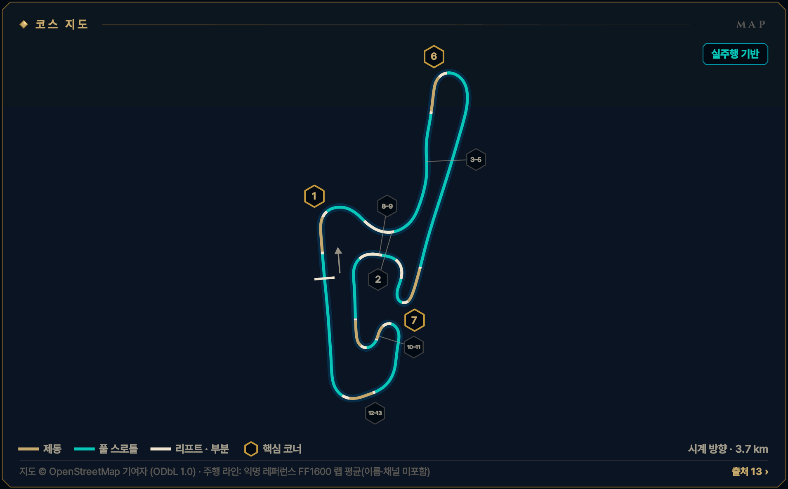
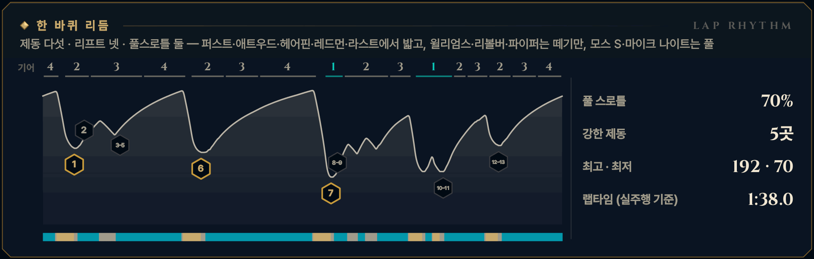

> **GRID서당 : iRacing**은 심레이싱이 처음인 동아리 신입을 위해 만든 드라이빙 아카데미 프로그램입니다. 이 글은 그 안의 **서킷 공략** 모드 — 이번 시즌 리그가 도는 서킷을 코스 개관과 코너별 애니메이션으로 미리 익히는 화면 — 를 블로그로 옮긴 것으로, 글과 애니메이션 모두 프로그램에서 그대로 가져왔습니다. 차는 iRacing의 Ray FF1600이고, 기준은 진도가 없는 루키(입문 렌즈)입니다. 강의는 [GRID서당 시리즈](/posts/untitled_life/motorsport/sim-racing/grid-seodang/)에, 낯선 말은 [용어 사전](/posts/untitled_life/motorsport/sim-racing/grid-seodang/glossary/)에 모아 두었습니다.

## 이번 시즌 일정

> **2026 시즌 4 · 포뮬러 1600 루키 시리즈 · 9주차** — 11.10(화)–11.16(월)
>
> - 루키 FF1600 · 기본 포함 · 12분 레이스 · 스탠딩 스타트 (차: Ray FF1600)
> - iRacing 트랙 이름: Okayama International Circuit - Full Course
> - 주차는 매주 화요일 09:00(한국 시간)에 바뀝니다.
>
> iRacing 일정은 시즌마다 바뀝니다. 이 글의 주차는 2026 시즌 4 기준이고, 같은 서킷이 다른 시즌에 돌아오면 그 시즌 일정에서 주차와 레이아웃을 다시 확인하세요.

## 코스 개관

3.7 km, 시계 방향. 두 직선을 이름 붙은 코너 열한 개가 잇는 아담하고 기술적인 서킷입니다. 높낮이 29 m — 애트우드가 바닥, 홉스 뒤가 꼭대기입니다. 랩타임은 대부분 코너 탈출에서 나옵니다.

- **시계 방향 · 풀 코스 · 3.7 km · 13코너**
- **코너 번호** — 이름을 먼저 부릅니다. 번호는 공식 ①–⑬이고, iRacing은 11개 턴(T1–T11)으로 셉니다(모스 S를 하나로).
- **루키 포인트** — 브레이크는 '꾹, 길게 놓고, 놓는 끝에서 스로틀' — 100%와 코스팅이 가장 큰 손실입니다
- **속도 표기: 실주행 기반** — 익명 레퍼런스 FF1600 랩으로 맞춘 속도입니다(이름·채널은 싣지 않았습니다). 그래도 내 차·내 페이스와는 다를 수 있으니 Test Drive에서 확인하세요.

*지도 © OpenStreetMap 기여자 (ODbL 1.0) · 선 색: 골드 = 제동, 시안 = 풀 스로틀, 흰색 = 리프트 · 부분 · 금테 육각형 = 핵심 코너 · 번호 = 이 글의 코너 공략 단위*

## 한 바퀴 리듬

제동 다섯 · 리프트 넷 · 풀스로틀 둘 — 퍼스트·애트우드·헤어핀·레드먼·라스트에서 밟고, 윌리엄스·리볼버·파이퍼는 떼기만, 모스 S·마이크 나이트는 풀

*풀 스로틀 70% · 강한 제동 5곳 · 최고 · 최저 192 · 70 km/h · 랩타임 (실주행 기준) 1:38.0 — 위 그림의 기어 줄·속도 곡선·입력 띠(골드 = 제동, 시안 = 풀 스로틀)와 코너 번호는 이 기준 랩입니다.*

## 먼저 볼 코너

1. **[헤어핀 ⑦](#w09-u5)** — 랩에서 가장 큰 제동 · 약 190→67 km/h · 1단
2. **[애트우드 ⑥](#w09-u4)** — 랩에서 가장 비싼 탈출 — 700 m 오르막 직선
3. **[퍼스트 코너 ①](#w09-u1)** — 1랩 스탠딩 스타트 뒤 첫 제동

> **루키 포인트** — 브레이크는 '꾹, 길게 놓고, 놓는 끝에서 스로틀' — 100%와 코스팅이 가장 큰 손실입니다

## 루키 안전 노트

- **1랩 퍼스트 코너** — 출발선에서 턴인까지 약 200 m뿐 — 차들이 뭉친 채 도착합니다. 앞차에 맞춰 일찍, 부드럽게.
- **헤어핀 추월 지점** — 700 m 슬립스트림 끝이라 서넛이 나란히 들어옵니다. 200 보드 전에 차선을 정하고 바꾸지 않습니다.
- **파이퍼·레드먼** — 레이스 리포트의 단골 사고 지점입니다. 핸들이 감긴 채 스로틀을 서두르지 않고, 안쪽 다이브는 하지 않습니다.
- **스핀 대처** — 브레이크를 꽉 밟아 세우고, 차들이 지나간 뒤 트랙과 나란히 복귀합니다.
- **트랙 리밋** — 차의 절반 이상이 노면 경계 밖이면 1x — 일부 트랙의 표시 구간만 네 바퀴 기준. 루키 규칙: 두 바퀴는 늘 선·연석 안쪽. 연석 너머 초록 구역은 쓰지 않습니다.

**1랩 · 스탠딩 스타트** — 1랩: 평소 제동 지점보다 늦게 밟지 않습니다. 앞차에 맞춰 더 일찍, 부드럽게 밟고, 차 한 대 폭을 남깁니다. 바깥이나 가운데를 지키고 안쪽 다툼에 끼지 않습니다.

## 영상 보는 법

코너마다 앱의 코너 공략 화면을 그대로 녹화했습니다. ▶를 눌러 재생하세요 — 앱의 **가이드** 재생(실제 속도의 0.4배, 화면에서 차가 너무 빠른 코너는 0.25배)이라 단계(접근·제동·턴인·에이펙스·탈출)마다 잠깐 멈추고, 멈춤 링이 차면 다음 단계로 넘어갑니다. 블로그 영상은 단계 시작의 멈춤만 짧게 줄였고 (캡션을 읽을 시간은 그대로), 끝에 앱의 끝 카드가 나옵니다. **급수별 브레이크 시연**을 펼치면 같은 코너를 7급·6급·5급 렌즈로, **흔한 실수 고스트**를 펼치면 실수한 차(빨간 점선)와 나란히 달린 영상을 볼 수 있습니다.

- **제동** — 골드 — 두께·밝기 = 브레이크 압력
- **가속** — 시안 — 스로틀
- **관성** — 흰색 — 두 페달 모두 뗀 구간
- **흔한 실수** — 빨간 점선 고스트 — 한 번에 하나만
- **▼ 제동 시작** — 루키 기준선의 제동 시작점
- **◆ 턴인** — 핸들을 감기 시작하는 곳
- **○ 에이펙스** — 가장 안쪽·가장 느린 곳
- **◇ 트랙아웃** — 탈출에서 닿는 바깥 끝
- **보드 (?)** — 확인 전 참고값 — Test Drive에서 기준점을 정하세요
- **입력 지도** — 골드 띠 = 브레이크, 흰 리본(안쪽) = 핸들. 겹치면 트레일
- **손 칸 · 내림 ×N · 올림** — 왼쪽 패들 N번 내림(블립은 오토 블립이) · 오른쪽 패들 한 번 올림

화면과 글의 속도는 실주행 기반 값입니다.

## 코너 공략

### 퍼스트 코너 ①

**우코너 · 2단 · 최저 약 105 km/h · 핵심 코너**  
1랩 첫 제동 · 약 188→105 km/h · 2단 (1コーナー · iRacing 표기 T1)

<figure>
  <video src="images/u1.mp4" poster="images/u1_poster.png" controls preload="none" playsinline style="width:100%;max-width:960px"></video>
  <figcaption>시범 — 루키 기준선 · 입문 렌즈(직선 제동) · 가이드 0.4× · 접근 → 제동 → 턴인 → 에이펙스 → 탈출</figcaption>
</figure>

급수별 브레이크 시연 — 7급 · 6급 · 5급 렌즈 (영상 3)

라인과 기준점은 그대로, 페달 쓰는 법만 지금 급수에 맞춥니다. 위 영상은 **직선 제동 — 기초·심화·9·8급** 렌즈입니다 — 턴인 전에 브레이크를 다 뗍니다 (브레이크 끝 = 턴인).

**릴리스 — 7급** — 턴인을 향해 0.4초 넘게 흘려서 0으로 · 7급 기준: 릴리스 0.4초 이상

<figure>
  <video src="images/u1_release.mp4" poster="images/u1_release_poster.png" controls preload="none" playsinline style="width:100%;max-width:960px"></video>
  <figcaption>7급 렌즈(릴리스) · 가이드 0.4× · 접근 → 제동 → 턴인 → 에이펙스 → 탈출</figcaption>
</figure>

- 제동 — **길게 흘려서 놓는다** · 피크 약 79% · 1.0초에 걸쳐 놓기 · 발 · 하나-둘-셋 놓기
- 턴인 — **다 놓으며 감기 시작** · 턴인에서 약 3% → 곧 0 · 발 · 3% → 0

**트레일 — 6급·4\~1급·졸업** — 턴인 때 15\~20%를 남기고, 감는 만큼 풉니다 · 6급 기준: 턴인 때 15% 이상 남기기

<figure>
  <video src="images/u1_trail.mp4" poster="images/u1_trail_poster.png" controls preload="none" playsinline style="width:100%;max-width:960px"></video>
  <figcaption>6급 렌즈(트레일) · 가이드 0.4× · 접근 → 제동 → 턴인 → 에이펙스 → 탈출</figcaption>
</figure>

- 제동 — **턴인까지 끌고 간다** · 피크 약 70% · 턴인 때 약 18% · 발 · 놓으며 남기기
- 턴인 — **푸는 만큼 감는다** · 턴인 약 18% → 에이펙스 전 0 · 발 · 18% → 0 / 손 · 놓는 만큼 감기

**깊은 트레일 — 5급** — 턴인 때 30% 이상, 에이펙스 앞까지 끌고 갑니다 · 5급 기준: 턴인 때 30% 이상 남기기

<figure>
  <video src="images/u1_deep.mp4" poster="images/u1_deep_poster.png" controls preload="none" playsinline style="width:100%;max-width:960px"></video>
  <figcaption>5급 렌즈(깊은 트레일) · 가이드 0.4× · 접근 → 제동 → 턴인 → 에이펙스 → 탈출</figcaption>
</figure>

- 제동 — **더 깊게, 턴인 32%** · 피크 약 59% · 턴인 때 약 32% · 발 · 천천히 남기기
- 턴인 — **앞을 누른 채 감는다** · 약 32% → 에이펙스 앞에서 0 · 발 · 32% → 0

4\~1급은 같은 영상의 캡션에 강조 한 줄(◆)이 더 붙습니다:

- ◆ 4급(턴인·에이펙스) — 브레이크 끝 = 스로틀 시작 — 굴러가는 틈 0.4초 이하

흔한 실수 고스트 — 늦은 제동 → 잠김 → 직진

<figure>
  <video src="images/u1_ghost.mp4" poster="images/u1_ghost_poster.png" controls preload="none" playsinline style="width:100%;max-width:960px"></video>
  <figcaption>흔한 실수: 늦은 제동 → 잠김 → 직진 — 25 m 늦게 100% → 바퀴가 잠겨 직진 · 트랙 밖</figcaption>
</figure>

흔한 실수: **늦은 제동 → 잠김 → 직진** — 25 m 늦게 100% → 바퀴가 잠겨 직진 · 트랙 밖. 빨간 점선과 붉은 차가 실수 고스트, 흰 차가 루키 기준선입니다. 두 차는 같은 시계로 달리므로 늦어지거나 밀려나는 만큼이 그대로 보입니다. 영상은 앱에서 [흔한 실수]를 눌렀을 때처럼 그 실수가 시작되는 단계부터 재생합니다. 끝 카드의 '트레일 렌즈 기준'은 결과의 시간 차를 트레일(6급) 렌즈 주행과 비교한 값이라는 뜻입니다.

> **1랩 · 스탠딩 스타트** — 1랩: 평소 제동 지점보다 늦게 밟지 않습니다. 앞차에 맞춰 더 일찍, 부드럽게 밟고, 차 한 대 폭을 남깁니다. 바깥이나 가운데를 지키고 안쪽 다툼에 끼지 않습니다.

#### 접근

메인 직선 끝, 4단 약 188 km/h로 트랙 왼쪽(바깥)에 붙습니다. 거리 보드는 왼쪽에 200·100·50 순서로 섭니다. 숫자는 '턴인까지 남은 미터'에 가깝습니다.

*지금 손과 발 — 발 · 풀스로틀 / 손 · 곧게 / 눈 · 100 보드*

**보드 · 기준점** — 모두 확인 전 참고값입니다. Test Drive에서 직접 보고 정하세요.

- **제동 · 기준점**? 왼쪽 100 보드 — 애니메이션은 그보다 조금 앞(턴인까지 약 100 m) *(확인 전 참고값)*
- **턴인**? 50 보드를 지나 약 50 m *(확인 전 참고값)*
- **에이펙스**? 안쪽 연석 — 바퀴로 입만 맞춤 *(확인 전 참고값)*

#### 제동

100 보드 조금 앞에서 '꾹' 한 음절로 약 78%까지 — 100%가 아닙니다. 차가 곧은 동안 왼쪽 패들로 4→3→2단까지 한 단씩 내리고, 1초 넘게 천천히 놓습니다. 깨끗한 랩이 이어지면 차 한 대 길이씩 늦춥니다.

*지금 손과 발 — 발 · 꾹 / 손 · 곧게 · 내림 ×2 / 눈 · 턴인 지점*

#### 턴인

50 보드를 지나 약 50 m, 보드의 셈이 0이 되는 곳에서 꺾기 시작합니다. 이 렌즈에서는 브레이크가 막 0이 된 순간입니다. 에이펙스가 늦은 코너라 첫 감기는 생각보다 부드럽게 합니다.

*지금 손과 발 — 발 · 0 → 살짝 스로틀 / 손 · 부드럽게 감기 / 눈 · 안쪽 연석*

#### 에이펙스

에이펙스는 턴인에서 약 35 m 뒤의 안쪽 연석입니다. 오른쪽 바퀴가 연석에 입을 맞추는 정도로만, 올라타지 않습니다. 속도는 약 105 km/h, 2단입니다(빠른 랩 약 111).

*지금 손과 발 — 발 · 유지 스로틀 / 손 · 잠깐 유지 / 눈 · 왼쪽 출구*

#### 탈출

핸들을 푸는 만큼 스로틀을 한 획으로 끝까지 엽니다. 차가 왼쪽으로 흘러가게 두되, 핸들이 감긴 채 왼쪽 끝에 닿지 않게 합니다. 핸들이 곧아지면 3단, 차분히 오른쪽으로 옮겨 윌리엄스를 준비합니다.

*지금 손과 발 — 발 · 앞으로만 / 손 · 풀기 / 눈 · 윌리엄스 진입*

#### 흔한 실수

- 더 늦게, 100%로 밟기 — 앞바퀴가 잠겨 곧장 바깥 자갈로  
  → 제동점은 그대로 두고 피크는 90% 아래, 늦추기는 차 한 대 길이씩
- 브레이크를 세게 밟은 채 꺾기 — 곧장 가거나 뒤가 돈다  
  → 대부분은 곧을 때 줄이고, 턴인에는 조금만 남긴다
- 100%로 꾹, 그리고 1\~2초 굴러가기 — 한 루키 랩은 여기서 1.7초 잃음  
  → 피크는 90% 아래, 놓기는 길게, 놓는 끝에서 스로틀

#### 이 코너에서 확인할 것

- [ ] 100 보드 위치(빠른 랩은 100 보드를 15 m쯤 지나서 밟음)
- [ ] 100 보드 근처 구름다리가 보이는지

#### 연결된 강의 · 드릴

- 강의: [기초 4강(레이싱 라인의 문법)](/posts/untitled_life/motorsport/sim-racing/grid-seodang/basics/f4-racing-line/) · [8급(제동의 기본)](/posts/untitled_life/motorsport/sim-racing/grid-seodang/grades/g8-braking-basics/) · [7급(릴리스 수양)](/posts/untitled_life/motorsport/sim-racing/grid-seodang/grades/g7-release/) · [6급(트레일 입문)](/posts/untitled_life/motorsport/sim-racing/grid-seodang/grades/g6-trail-intro/) · [4급(전환 수련)](/posts/untitled_life/motorsport/sim-racing/grid-seodang/grades/g4-transition/) · [심화 6강(교본 차 해부)](/posts/untitled_life/motorsport/sim-racing/grid-seodang/advanced/d8-training-car-and-shifting/) · [심화 1강(출발의 기술)](/posts/untitled_life/motorsport/sim-racing/grid-seodang/advanced/d1-the-start/) · [심화 3강(상황의 라인)](/posts/untitled_life/motorsport/sim-racing/grid-seodang/advanced/d3-situational-lines/)
- 훈련장 드릴: 제동 수양 · 정밀 압력 · 전환

<small>근거: O1 · O2 · I2 · I5 · TEL (아래 출처 목록) · 신뢰도 M</small>

### 윌리엄스 ②

**좌코너 · 3단 · 최저 약 124 km/h**  
브레이크 없는 리프트 코너 · 약 123 km/h (ウィリアムズコーナー · iRacing 표기 T2)

<figure>
  <video src="images/u2.mp4" poster="images/u2_poster.png" controls preload="none" playsinline style="width:100%;max-width:960px"></video>
  <figcaption>시범 — 루키 기준선 · 렌즈 공통 · 가이드 0.4× · 접근 → 리프트 → 턴인 → 에이펙스 → 탈출</figcaption>
</figure>

급수별 브레이크 시연 — 모든 급수가 같은 그림

이 코너는 렌즈가 같습니다 — 리프트·풀스로틀 코너는 브레이크를 쓰지 않아 모든 급수가 같은 페달 그림을 봅니다.

흔한 실수 고스트 — 늦은 리프트 → 바깥으로

<figure>
  <video src="images/u2_ghost.mp4" poster="images/u2_ghost_poster.png" controls preload="none" playsinline style="width:100%;max-width:960px"></video>
  <figcaption>흔한 실수: 늦은 리프트 → 바깥으로 — 늦게 떼면 바깥으로 밀린다 · 트랙 밖</figcaption>
</figure>

흔한 실수: **늦은 리프트 → 바깥으로** — 늦게 떼면 바깥으로 밀린다 · 트랙 밖. 빨간 점선과 붉은 차가 실수 고스트, 흰 차가 루키 기준선입니다. 두 차는 같은 시계로 달리므로 늦어지거나 밀려나는 만큼이 그대로 보입니다. 영상은 앱에서 [흔한 실수]를 눌렀을 때처럼 그 실수가 시작되는 단계부터 재생합니다.

#### 접근

퍼스트 코너를 3단으로 나오면 약 144 km/h입니다. 윌리엄스는 반경 80 m의 길고 빠른 왼쪽이고, 진입로가 코너를 향해 내리막입니다. 레퍼런스 네 랩 모두 브레이크를 밟지 않습니다.

*지금 손과 발 — 발 · 풀스로틀 / 손 · 곧게 / 눈 · 왼쪽 안쪽 끝*

**보드 · 기준점** — 모두 확인 전 참고값입니다. Test Drive에서 직접 보고 정하세요.

- **리프트 시작**? 차가 아직 곧을 때 — 빠른 랩은 감기 시작 뒤 *(확인 전 참고값)*
- **에이펙스**? 안쪽 연석이 가장 깊은 곳 *(확인 전 참고값)*

#### 리프트

처음에는 차가 곧을 때, 턴인 전에 스로틀에서 발을 완전히 뗍니다. 이 리프트가 이 코너의 브레이크입니다. 빠른 랩은 감기 시작한 뒤에 떼지만, 루키는 일찍 떼고 깨끗해지면 조금씩 늦춥니다.

*지금 손과 발 — 발 · 완전히 떼기 / 손 · 곧게 / 눈 · 코너 안쪽*

**급수 시험 주행에서는 리프트만 — 10%를 넘는 톡도 제동 코너로 채점됩니다.**

#### 턴인

두 번 감는 코너입니다. 처음엔 살짝 감아 원을 그리기 시작하고, 발을 뗀 채 굴러가며 속도가 떨어지기를 기다립니다. 코너가 조여 드는 후반에 한 번 더 감아 늦은 에이펙스로 들어갑니다.

*지금 손과 발 — 발 · 떼고 기다리기 / 손 · 작게 감기 / 눈 · 늦은 에이펙스*

#### 에이펙스

에이펙스는 코너 후반, 안쪽 연석이 가장 깊어지는 곳입니다. 속도는 약 123 km/h, 3단 그대로입니다. 여기서 스로틀을 한 번에 다시 엽니다.

*지금 손과 발 — 발 · 한 번에 다시 / 손 · 한 번 더 감기 / 눈 · 오른쪽 출구 연석*

#### 탈출

코너 한가운데서 다시 발을 떼지 않습니다 — 뒤가 가벼워 돕니다. 핸들을 풀며 오른쪽 출구 연석 쪽으로 흘러가고, 모스 S에 들어서며 4단입니다. 이 탈출 속도가 애트우드 제동점까지 약 500 m를 갑니다.

*지금 손과 발 — 발 · 앞으로만 / 손 · 풀기 / 눈 · 모스 S*

#### 흔한 실수

- 늦게 떼기 — 빠른 채로 들어가 출구에서 바깥으로 밀린다  
  → 처음엔 곧을 때 일찍 완전히 떼고, 랩마다 조금씩 늦춘다
- 내리막 진입에서 브레이크를 '톡' 찍기 — 뒤가 가벼워 돈다  
  → 브레이크 대신 리프트, 속도는 리프트 시점으로 맞춘다
- 코너 중간에 다시 떼기 또는 일찍 크게 꺾기 — 출구에서 길이 모자람  
  → 감기는 두 번, 스로틀은 에이펙스에서 한 번에

#### 이 코너에서 확인할 것

- [ ] 리프트 시점의 기준물(진입 직전 구조물)을 정하기

#### 연결된 강의 · 드릴

- 강의: [심화 2강(코너의 다섯 얼굴)](/posts/untitled_life/motorsport/sim-racing/grid-seodang/advanced/d2-five-corner-faces/) · [심화 4강(차의 균형)](/posts/untitled_life/motorsport/sim-racing/grid-seodang/advanced/d4-car-balance/) · [심화 9강(기울어진 트랙)](/posts/untitled_life/motorsport/sim-racing/grid-seodang/advanced/d7-banked-track/) · [2급(스티어링 일필휘지)](/posts/untitled_life/motorsport/sim-racing/grid-seodang/grades/g2-one-stroke-steering/) · [3급(스로틀 서예)](/posts/untitled_life/motorsport/sim-racing/grid-seodang/grades/g3-throttle-calligraphy/) · [심화 10강(라임락 교본)](/posts/untitled_life/motorsport/sim-racing/grid-seodang/advanced/d11-lime-rock-textbook/)
- 훈련장 드릴: 조향 일필 · 스로틀 서예

<small>근거: O1 · J1 · J2 · I5 · TEL (아래 출처 목록) · 신뢰도 H</small>

### 모스 S ③–⑤

**좌·우 복합 · 3단**  
풀스로틀 세 굽이 — S를 곧게 편다 (モスS · iRacing 표기 T3)

<figure>
  <video src="images/u3.mp4" poster="images/u3_poster.png" controls preload="none" playsinline style="width:100%;max-width:960px"></video>
  <figcaption>시범 — 루키 기준선 · 렌즈 공통 · 가이드 0.4× · 접근 → 턴인 → 에이펙스 → 전환 → 에이펙스 ② → 탈출</figcaption>
</figure>

급수별 브레이크 시연 — 모든 급수가 같은 그림

이 코너는 렌즈가 같습니다 — 리프트·풀스로틀 코너는 브레이크를 쓰지 않아 모든 급수가 같은 페달 그림을 봅니다.

#### 접근

왼쪽–오른쪽–왼쪽, 작은 굽이 셋입니다. FF1600에서는 셋 모두 풀스로틀이고, 길은 애트우드까지 조금씩 내려갑니다. 1랩에는 나란히 달리지 말고 한 줄로 지납니다.

*지금 손과 발 — 발 · 풀스로틀 / 손 · 손목만 / 눈 · 첫 굽이 안쪽*

**보드 · 기준점** — 모두 확인 전 참고값입니다. Test Drive에서 직접 보고 정하세요.

- **턴인**? 굽이마다 안쪽 연석 *(확인 전 참고값)*

#### 턴인

핸들은 10도 남짓, 팔이 아니라 손목만 씁니다. 목표는 S를 곧게 펴는 것 — 세 굽이를 이어 가능한 한 직선에 가까운 선을 긋습니다.

*지금 손과 발 — 발 · 풀스로틀 / 손 · 작게 왼쪽 / 눈 · 다음 굽이*

#### 에이펙스

굽이마다 안쪽 연석 가까이를 스치되 높은 연석에는 올라타지 않습니다. FF1600은 가벼워서 연석에 쉽게 튕깁니다.

*지금 손과 발 — 발 · 풀스로틀 / 손 · 조용히 / 눈 · 오른쪽 굽이*

#### 전환

굽이와 굽이 사이, 핸들이 곧을 때 3→4단을 올립니다. 차가 옆으로 실려 있을 때는 변속하지 않습니다.

*지금 손과 발 — 발 · 풀스로틀 / 손 · 곧게 · 올림 / 눈 · 오른쪽 굽이*

#### 에이펙스 ②

오른쪽 굽이도 손목으로만 지납니다. 마지막 굽이를 지나며 트랙 왼쪽, 애트우드의 바깥에 미리 붙기 시작합니다.

*지금 손과 발 — 발 · 풀스로틀 / 손 · 작게 오른쪽 / 눈 · 트랙 왼쪽*

#### 탈출

애트우드 제동이 시작되기 전에 왼쪽에 자리를 잡습니다. 제동하면서 옆으로 옮겨 가면 곧은 제동을 할 수 없습니다.

*지금 손과 발 — 발 · 풀스로틀 / 손 · 곧게 / 눈 · 애트우드 보드*

#### 흔한 실수

- 괜한 리프트 — 이 탈출이 애트우드까지 이어진다  
  → 윌리엄스를 잘 나오면 셋 다 풀스로틀
- 톱질하는 핸들, 굽이 한가운데서 변속  
  → 손목만, 변속은 굽이 사이 곧을 때
- 애트우드 직전까지 오른쪽에 있다가 밟으며 옮기기  
  → 마지막 굽이를 지나며 일찍 왼쪽으로

#### 이 코너에서 확인할 것

- [ ] 연석 높이 — 바퀴 폭만큼 써도 튕기지 않는지

#### 연결된 강의 · 드릴

- 강의: [심화 2강(코너의 다섯 얼굴)](/posts/untitled_life/motorsport/sim-racing/grid-seodang/advanced/d2-five-corner-faces/) · [2급(스티어링 일필휘지)](/posts/untitled_life/motorsport/sim-racing/grid-seodang/grades/g2-one-stroke-steering/) · [심화 6강(교본 차 해부)](/posts/untitled_life/motorsport/sim-racing/grid-seodang/advanced/d8-training-car-and-shifting/) · [3급(스로틀 서예)](/posts/untitled_life/motorsport/sim-racing/grid-seodang/grades/g3-throttle-calligraphy/)
- 훈련장 드릴: 조향 일필

<small>근거: O1 · J2 · C1 · TEL (아래 출처 목록) · 신뢰도 M</small>

### 애트우드 ⑥

**우코너 · 2단 · 최저 약 100 km/h · 핵심 코너**  
랩에서 가장 비싼 탈출 · 약 100 km/h (アトウッドカーブ · iRacing 표기 T4)

<figure>
  <video src="images/u4.mp4" poster="images/u4_poster.png" controls preload="none" playsinline style="width:100%;max-width:960px"></video>
  <figcaption>시범 — 루키 기준선 · 입문 렌즈(직선 제동) · 가이드 0.4× · 접근 → 제동 → 턴인 → 에이펙스 → 탈출</figcaption>
</figure>

급수별 브레이크 시연 — 7급 · 6급 · 5급 렌즈 (영상 3)

라인과 기준점은 그대로, 페달 쓰는 법만 지금 급수에 맞춥니다. 위 영상은 **직선 제동 — 기초·심화·9·8급** 렌즈입니다 — 턴인 전에 브레이크를 다 뗍니다 (브레이크 끝 = 턴인).

**릴리스 — 7급** — 턴인을 향해 0.4초 넘게 흘려서 0으로 · 7급 기준: 릴리스 0.4초 이상

<figure>
  <video src="images/u4_release.mp4" poster="images/u4_release_poster.png" controls preload="none" playsinline style="width:100%;max-width:960px"></video>
  <figcaption>7급 렌즈(릴리스) · 가이드 0.4× · 접근 → 제동 → 턴인 → 에이펙스 → 탈출</figcaption>
</figure>

- 제동 — **1.0초쯤 흘려 놓기** · 피크 약 78% · 1.0초에 걸쳐 놓기 · 발 · 하나-둘-셋 놓기
- 턴인 — **다 놓으며 감기 시작** · 턴인에서 약 3% → 곧 0 · 발 · 3% → 0

**트레일 — 6급·4\~1급·졸업** — 턴인 때 15\~20%를 남기고, 감는 만큼 풉니다 · 6급 기준: 턴인 때 15% 이상 남기기

<figure>
  <video src="images/u4_trail.mp4" poster="images/u4_trail_poster.png" controls preload="none" playsinline style="width:100%;max-width:960px"></video>
  <figcaption>6급 렌즈(트레일) · 가이드 0.4× · 접근 → 제동 → 턴인 → 에이펙스 → 탈출</figcaption>
</figure>

- 제동 — **턴인까지 끌고 간다** · 피크 약 71% · 턴인 때 약 18% · 발 · 놓으며 남기기
- 턴인 — **브레이크를 남긴 채 턴인** · 약 18% → 에이펙스 전 0 · 연습 1순위 · 발 · 18% → 0 / 손 · 놓는 만큼 감기

**깊은 트레일 — 5급** — 턴인 때 30% 이상, 에이펙스 앞까지 끌고 갑니다 · 5급 기준: 턴인 때 30% 이상 남기기

<figure>
  <video src="images/u4_deep.mp4" poster="images/u4_deep_poster.png" controls preload="none" playsinline style="width:100%;max-width:960px"></video>
  <figcaption>5급 렌즈(깊은 트레일) · 가이드 0.4× · 접근 → 제동 → 턴인 → 에이펙스 → 탈출</figcaption>
</figure>

- 제동 — **더 깊게, 턴인 32%** · 피크 약 63% · 턴인 때 약 32% · 발 · 천천히 남기기
- 턴인 — **앞을 누른 채 감는다** · 약 32% → 에이펙스 앞에서 0 · 발 · 32% → 0

4\~1급은 같은 영상의 캡션에 강조 한 줄(◆)이 더 붙습니다:

- ◆ 3급(탈출) — 스로틀은 한 획 — 출구에서 다시 떼지 않는다

흔한 실수 고스트 — 이른 턴인 → 출구에서 밀림

<figure>
  <video src="images/u4_ghost.mp4" poster="images/u4_ghost_poster.png" controls preload="none" playsinline style="width:100%;max-width:960px"></video>
  <figcaption>흔한 실수: 이른 턴인 → 출구에서 밀림 — 일찍 꺾으면 출구에서 바깥으로 밀린다 → 약 0.4초 늦음</figcaption>
</figure>

흔한 실수: **이른 턴인 → 출구에서 밀림** — 일찍 꺾으면 출구에서 바깥으로 밀린다 → 약 0.4초 늦음. 빨간 점선과 붉은 차가 실수 고스트, 흰 차가 루키 기준선입니다. 두 차는 같은 시계로 달리므로 늦어지거나 밀려나는 만큼이 그대로 보입니다. 영상은 앱에서 [흔한 실수]를 눌렀을 때처럼 그 실수가 시작되는 단계부터 재생합니다. 끝 카드의 '트레일 렌즈 기준'은 결과의 시간 차를 트레일(6급) 렌즈 주행과 비교한 값이라는 뜻입니다.

#### 접근

모스 S를 지나 4단 약 189 km/h, 트랙 왼쪽입니다. 애트우드는 서킷에서 가장 낮은 곳의 긴 오른쪽으로, 약 180도를 돌아 700 m 오르막 직선으로 이어집니다. 섹터 1 라인 뒤 왼쪽에 100, 50 보드가 있습니다.

*지금 손과 발 — 발 · 풀스로틀 / 손 · 곧게 / 눈 · 100 보드*

**보드 · 기준점** — 모두 확인 전 참고값입니다. Test Drive에서 직접 보고 정하세요.

- **제동 · 기준점**? 왼쪽 100 보드 — 애니메이션은 그보다 약 20 m 앞(턴인까지 약 105 m) *(확인 전 참고값)*
- **턴인**? 50 보드를 지나 약 40\~50 m *(확인 전 참고값)*
- **에이펙스**? 가장 조인 곳의 안쪽 연석 *(확인 전 참고값)*

#### 제동

100 보드보다 조금 앞에서 꾹 약 77%. 진입이 내리막이라 평지보다 제동 거리가 깁니다. 곧은 동안 4→3→2단, 그리고 약 0.7초에 걸쳐 놓습니다.

*지금 손과 발 — 발 · 꾹 / 손 · 곧게 · 내림 ×2 / 눈 · 턴인 지점*

#### 턴인

50 보드를 지나 약 40\~50 m에서 턴인합니다. 너무 일찍 꺾으면 긴 출구에서 밖으로 밀립니다. 핸들이 감기는 만큼 발이 빠집니다.

*지금 손과 발 — 발 · 0 → 살짝 스로틀 / 손 · 감기 / 눈 · 안쪽 연석*

#### 에이펙스

코너가 가장 조인 안쪽 연석, 턴인에서 약 35 m 뒤가 에이펙스입니다. 속도는 약 100 km/h, 2단. 출구가 오르막이라 이 1 km/h가 랩에서 가장 비쌉니다.

*지금 손과 발 — 발 · 스로틀 거의 끝까지 / 손 · 잠깐 유지 / 눈 · 출구 왼쪽 끝*

#### 탈출

출구는 길게 열리는 모양이라 핸들을 약 150 m에 걸쳐 천천히 풉니다. 핸들이 많이 감긴 채 스로틀을 확 열면 앞이 밀립니다. 핸들이 곧아질 무렵 3단, 오르막 중간에 4단입니다.

*지금 손과 발 — 발 · 풀스로틀 / 손 · 천천히 풀기 / 눈 · 백스트레이트*

#### 흔한 실수

- 일찍 턴인 — 긴 출구에서 밖으로 밀려 발을 떼고 직선을 잃는다  
  → 50 보드 지나 40\~50 m까지 기다리고, 늦은 에이펙스
- 100% 꾹, 1.3초 굴러가기 — 한 루키 랩은 최저 92 km/h  
  → 피크 90% 아래, 놓는 끝에서 스로틀
- 핸들이 많이 감긴 채 스로틀을 확 — 앞이 밀리거나 안쪽 바퀴가 헛돈다  
  → 푸는 만큼만 열고, 150 m에 걸쳐 푼다

#### 이 코너에서 확인할 것

- [ ] 섹터 1 라인 뒤 100·50 보드 위치

#### 연결된 강의 · 드릴

- 강의: [기초 4강(레이싱 라인의 문법)](/posts/untitled_life/motorsport/sim-racing/grid-seodang/basics/f4-racing-line/) · [6급(트레일 입문)](/posts/untitled_life/motorsport/sim-racing/grid-seodang/grades/g6-trail-intro/) · [5급(트레일 숙달)](/posts/untitled_life/motorsport/sim-racing/grid-seodang/grades/g5-trail-mastery/) · [3급(스로틀 서예)](/posts/untitled_life/motorsport/sim-racing/grid-seodang/grades/g3-throttle-calligraphy/) · [4급(전환 수련)](/posts/untitled_life/motorsport/sim-racing/grid-seodang/grades/g4-transition/) · [심화 2강(코너의 다섯 얼굴)](/posts/untitled_life/motorsport/sim-racing/grid-seodang/advanced/d2-five-corner-faces/) · [심화 9강(기울어진 트랙)](/posts/untitled_life/motorsport/sim-racing/grid-seodang/advanced/d7-banked-track/)
- 훈련장 드릴: 트레일 브레이킹 · 스로틀 서예 · 전환

<small>근거: O1 · O2 · J1 · J2 · I4 · TEL (아래 출처 목록) · 신뢰도 M</small>

### 헤어핀 ⑦

**우코너 · 1단 · 최저 약 67 km/h · 핵심 코너**  
랩에서 가장 큰 제동 · 190→67 km/h · 1단 (ヘアピンコーナー · iRacing 표기 T5)

<figure>
  <video src="images/u5.mp4" poster="images/u5_poster.png" controls preload="none" playsinline style="width:100%;max-width:960px"></video>
  <figcaption>시범 — 루키 기준선 · 입문 렌즈(직선 제동) · 가이드 0.4× · 접근 → 제동 → 턴인 → 에이펙스 → 탈출</figcaption>
</figure>

급수별 브레이크 시연 — 7급 · 6급 · 5급 렌즈 (영상 3)

라인과 기준점은 그대로, 페달 쓰는 법만 지금 급수에 맞춥니다. 위 영상은 **직선 제동 — 기초·심화·9·8급** 렌즈입니다 — 턴인 전에 브레이크를 다 뗍니다 (브레이크 끝 = 턴인).

**릴리스 — 7급** — 턴인을 향해 0.4초 넘게 흘려서 0으로 · 7급 기준: 릴리스 0.4초 이상

<figure>
  <video src="images/u5_release.mp4" poster="images/u5_release_poster.png" controls preload="none" playsinline style="width:100%;max-width:960px"></video>
  <figcaption>7급 렌즈(릴리스) · 가이드 0.4× · 접근 → 제동 → 턴인 → 에이펙스 → 탈출</figcaption>
</figure>

- 제동 — **길게 흘려서 놓는다** · 피크 약 73% · 1.1초에 걸쳐 놓기 · 발 · 하나-둘-셋 놓기
- 턴인 — **다 놓으며 감기 시작** · 턴인에서 약 3% → 곧 0 · 발 · 3% → 0

**트레일 — 6급·4\~1급·졸업** — 턴인 때 15\~20%를 남기고, 감는 만큼 풉니다 · 6급 기준: 턴인 때 15% 이상 남기기

<figure>
  <video src="images/u5_trail.mp4" poster="images/u5_trail_poster.png" controls preload="none" playsinline style="width:100%;max-width:960px"></video>
  <figcaption>6급 렌즈(트레일) · 가이드 0.4× · 접근 → 제동 → 턴인 → 에이펙스 → 탈출</figcaption>
</figure>

- 제동 — **턴인까지 끌고 간다** · 피크 약 71% · 턴인 때 약 18% · 발 · 놓으며 남기기
- 턴인 — **푸는 만큼 감는다** · 턴인 약 18% → 에이펙스 전 0 · 발 · 18% → 0 / 손 · 놓는 만큼 감기

**깊은 트레일 — 5급** — 턴인 때 30% 이상, 에이펙스 앞까지 끌고 갑니다 · 5급 기준: 턴인 때 30% 이상 남기기

<figure>
  <video src="images/u5_deep.mp4" poster="images/u5_deep_poster.png" controls preload="none" playsinline style="width:100%;max-width:960px"></video>
  <figcaption>5급 렌즈(깊은 트레일) · 가이드 0.4× · 접근 → 제동 → 턴인 → 에이펙스 → 탈출</figcaption>
</figure>

- 제동 — **더 깊게, 턴인 32%** · 피크 약 67% · 6급 코너, 5급은 선택 · 발 · 천천히 남기기
- 턴인 — **앞을 누른 채 감는다** · 약 32% → 에이펙스 앞에서 0 · 발 · 32% → 0

4\~1급은 같은 영상의 캡션에 강조 한 줄(◆)이 더 붙습니다:

- ◆ 4급(턴인·에이펙스) — 브레이크 끝 = 스로틀 시작 — 루키 랩은 여기서 2.6초를 굴러갔다

흔한 실수 고스트 — 너무 세게, 너무 오래

<figure>
  <video src="images/u5_ghost.mp4" poster="images/u5_ghost_poster.png" controls preload="none" playsinline style="width:100%;max-width:960px"></video>
  <figcaption>흔한 실수: 너무 세게, 너무 오래 — 95%로 꾹, 굴러가며 최저 약 45 km/h → 약 2.7초 늦음</figcaption>
</figure>

흔한 실수: **너무 세게, 너무 오래** — 95%로 꾹, 굴러가며 최저 약 45 km/h → 약 2.7초 늦음. 빨간 점선과 붉은 차가 실수 고스트, 흰 차가 루키 기준선입니다. 두 차는 같은 시계로 달리므로 늦어지거나 밀려나는 만큼이 그대로 보입니다. 영상은 앱에서 [흔한 실수]를 눌렀을 때처럼 그 실수가 시작되는 단계부터 재생합니다. 끝 카드의 '트레일 렌즈 기준'은 결과의 시간 차를 트레일(6급) 렌즈 주행과 비교한 값이라는 뜻입니다.

#### 접근

백스트레이트는 약 700 m 오르막이고, 4단 약 190 km/h로 랩 최고 속도가 나옵니다. 끝에서 살짝 왼쪽으로 휘므로 제동 전에 트랙 왼쪽, 헤어핀의 바깥에 붙습니다. 왼쪽에 200, 100, 50 보드가 섭니다.

*지금 손과 발 — 발 · 풀스로틀 / 손 · 곧게 / 눈 · 200·100 보드*

**보드 · 기준점** — 모두 확인 전 참고값입니다. Test Drive에서 직접 보고 정하세요.

- **제동 · 기준점**? 200과 100 보드 사이(턴인까지 약 130 m) — 익숙해지면 100 보드로 *(확인 전 참고값)*
- **턴인**? 50 보드를 지나 약 50 m, 왼쪽 끝 *(확인 전 참고값)*
- **에이펙스**? 코가 출구를 향할 때 *(확인 전 참고값)*

#### 제동

200과 100 보드 사이에서 시작하고, 깨끗한 랩마다 차 한 대 길이씩 100 보드 쪽으로 늦춥니다. 가장 강한 제동이지만 약 73%까지 — ABS가 없어 앞바퀴가 잠기면 핸들이 듣지 않습니다. 곧은 동안 4→3→2→1단, 2→1은 100 km/h 아래에서, 모두 턴인 전에 끝냅니다.

*지금 손과 발 — 발 · 꾹 / 손 · 곧게 · 내림 ×3 / 눈 · 왼쪽 턴인*

#### 턴인

50 보드를 지나 약 50 m, 트랙 왼쪽에서 꺾습니다. 진입을 살짝 둥글게 그립니다 — 이 헤어핀에는 뱅크가 있어 차를 얹어 줄수록 잘 돕니다. 핸들은 이 랩에서 가장 많이 감깁니다.

*지금 손과 발 — 발 · 0 → 살짝 스로틀 / 손 · 크게 감기 / 눈 · 늦은 에이펙스*

#### 에이펙스

늦은 에이펙스 — 'U가 아니라 V'입니다. 최저 약 67 km/h, 1단. 차의 코가 출구를 향했을 때가 에이펙스입니다.

*지금 손과 발 — 발 · 조금씩 열기 / 손 · 최대 조향 / 눈 · 출구 가운데*

#### 탈출

1단이라 힘이 세니 핸들을 푸는 만큼만, 그러나 멈추지 않고 엽니다. 출구에서 왼쪽 끝까지 다 쓰지 말고 가운데쯤에서 곧바로 오른쪽으로 갑니다 — 100 m 뒤에 리볼버(왼쪽)가 있습니다. 1→2단.

*지금 손과 발 — 발 · 푸는 만큼 / 손 · 풀기 / 눈 · 리볼버 진입*

#### 흔한 실수

- 너무 세게, 너무 오래 — 100%로 밟고 2.6초 굴러가 최저 54 km/h  
  → 약 73%까지 꾹, 턴인까지 놓고, 놓는 끝에서 스로틀
- 돌면서 2→1단 — 뒤가 털린다  
  → 2→1은 100 km/h 아래, 턴인 전에 끝낸다
- 이른 에이펙스 — 출구에서 밀려 리볼버를 망친다  
  → 왼쪽 끝에서 늦게, V자로

#### 이 코너에서 확인할 것

- [ ] 200·100·50 보드가 헤어핀 앞에 있는지
- [ ] 뱅크가 느껴지는지

#### 연결된 강의 · 드릴

- 강의: [8급(제동의 기본)](/posts/untitled_life/motorsport/sim-racing/grid-seodang/grades/g8-braking-basics/) · [7급(릴리스 수양)](/posts/untitled_life/motorsport/sim-racing/grid-seodang/grades/g7-release/) · [6급(트레일 입문)](/posts/untitled_life/motorsport/sim-racing/grid-seodang/grades/g6-trail-intro/) · [5급(트레일 숙달)](/posts/untitled_life/motorsport/sim-racing/grid-seodang/grades/g5-trail-mastery/) · [4급(전환 수련)](/posts/untitled_life/motorsport/sim-racing/grid-seodang/grades/g4-transition/) · [심화 2강(코너의 다섯 얼굴)](/posts/untitled_life/motorsport/sim-racing/grid-seodang/advanced/d2-five-corner-faces/) · [심화 6강(교본 차 해부)](/posts/untitled_life/motorsport/sim-racing/grid-seodang/advanced/d8-training-car-and-shifting/) · [심화 7강(한계의 신호)](/posts/untitled_life/motorsport/sim-racing/grid-seodang/advanced/d9-signals-at-the-limit/) · [심화 1강(출발의 기술)](/posts/untitled_life/motorsport/sim-racing/grid-seodang/advanced/d1-the-start/) · [심화 3강(상황의 라인)](/posts/untitled_life/motorsport/sim-racing/grid-seodang/advanced/d3-situational-lines/)
- 훈련장 드릴: 제동 수양 · 정밀 압력 · 트레일 브레이킹 · 전환

<small>근거: O1 · O2 · J2 · J6 · I4 · I5 · TEL (아래 출처 목록) · 신뢰도 M</small>

### 리볼버 → 파이퍼 ⑧–⑨

**좌코너 · 1단 · 최저 약 98 km/h**  
왼쪽 둘 — 리볼버의 트랙아웃이 파이퍼의 턴인 (リボルバー / パイパー · iRacing 표기 T6–T7)

<figure>
  <video src="images/u6.mp4" poster="images/u6_poster.png" controls preload="none" playsinline style="width:100%;max-width:960px"></video>
  <figcaption>시범 — 루키 기준선 · 렌즈 공통 · 가이드 0.4× · 접근 → 리프트 → 턴인 → 에이펙스 → 리프트 ② → 에이펙스 ② → 탈출</figcaption>
</figure>

급수별 브레이크 시연 — 모든 급수가 같은 그림

이 코너는 렌즈가 같습니다 — 리프트·풀스로틀 코너는 브레이크를 쓰지 않아 모든 급수가 같은 페달 그림을 봅니다.

#### 접근

헤어핀을 2단으로 나와 약 104 km/h, 트랙 오른쪽에서 리볼버를 맞습니다. 두 코너 모두 리프트 코너입니다. 길은 리볼버를 지나며 내려가다 파이퍼에서 평평해집니다.

*지금 손과 발 — 발 · 풀스로틀 / 손 · 곧게 / 눈 · 리볼버 안쪽*

**보드 · 기준점** — 모두 확인 전 참고값입니다. Test Drive에서 직접 보고 정하세요.

- **리프트 시작**? 트랙 오른쪽, 차가 곧을 때 *(확인 전 참고값)*
- **에이펙스**? 안쪽 연석, 넘지 않기 *(확인 전 참고값)*

#### 리프트

차가 곧을 때 스로틀을 뗍니다. 레퍼런스도 대부분 이 정도뿐입니다. 출구가 내리막으로 떨어지니 진입 속도를 욕심내지 않습니다.

*지금 손과 발 — 발 · 떼기 / 손 · 곧게 / 눈 · 리볼버 안쪽*

**급수 시험 주행에서는 리프트만 — 10%를 넘는 톡도 제동 코너로 채점됩니다.**

#### 턴인

살짝 감고 1초쯤 굴러가며 속도를 맞춘 뒤, 후반에 더 감아 늦은 에이펙스로 들어갑니다. 리볼버 최저는 약 98 km/h입니다.

*지금 손과 발 — 발 · 떼고 기다리기 / 손 · 작게 → 크게 / 눈 · 늦은 에이펙스*

#### 에이펙스

에이펙스에서 스로틀을 한 번에, 핸들을 푸는 만큼 엽니다. 에이펙스 뒤에 안쪽 연석을 넘어가지 않습니다.

*지금 손과 발 — 발 · 한 번에 열기 / 손 · 풀기 / 눈 · 오른쪽 출구*

#### 리프트 ②

리볼버를 나와 오른쪽으로 흘러가면 그곳이 파이퍼의 진입입니다. 차가 곧을 때 다시 뗍니다. 앞 출구 연석의 진동이 남아 있으니 브레이크 '톡'은 쓰지 않습니다.

*지금 손과 발 — 발 · 다시 떼기 / 손 · 곧게 / 눈 · 파이퍼 안쪽*

**급수 시험 주행에서는 리프트만 — 10%를 넘는 톡도 제동 코너로 채점됩니다.**

#### 에이펙스 ②

파이퍼는 일찍 살짝 감아 둥글게 들어가는 늦은 에이펙스입니다. 스로틀은 푸는 만큼 한 획으로 — 핸들이 감긴 채 서두르면 뒤가 돕니다.

*지금 손과 발 — 발 · 푸는 만큼 / 손 · 둥글게 / 눈 · 오른쪽 출구*

#### 탈출

파이퍼를 나와서도 오른쪽에 남아 3단으로 올리며 레드먼을 준비합니다. 출구 연석은 핸들이 곧아진 뒤에만 씁니다.

*지금 손과 발 — 발 · 앞으로만 / 손 · 풀기 / 눈 · 레드먼 보드*

#### 흔한 실수

- 늦게 떼기 — 내리막 리볼버에서 밖으로 밀려 자갈로  
  → 곧을 때 일찍 떼고, 랩마다 조금씩 늦춘다
- 파이퍼 출구에서 핸들이 감긴 채 스로틀 서두르기 — 뒤가 돈다  
  → 푸는 만큼만, 한 획으로 연다
- 헤어핀을 너무 느리게 나와 리볼버까지 1단으로 끌려가기  
  → 헤어핀 출구에서 1→2단을 잊지 않는다

#### 이 코너에서 확인할 것

- [ ] 리볼버 출구 연석 너머 초록 구역이 트랙 밖으로 잡히는지

#### 연결된 강의 · 드릴

- 강의: [심화 2강(코너의 다섯 얼굴)](/posts/untitled_life/motorsport/sim-racing/grid-seodang/advanced/d2-five-corner-faces/) · [심화 4강(차의 균형)](/posts/untitled_life/motorsport/sim-racing/grid-seodang/advanced/d4-car-balance/) · [3급(스로틀 서예)](/posts/untitled_life/motorsport/sim-racing/grid-seodang/grades/g3-throttle-calligraphy/) · [2급(스티어링 일필휘지)](/posts/untitled_life/motorsport/sim-racing/grid-seodang/grades/g2-one-stroke-steering/) · [4급(전환 수련)](/posts/untitled_life/motorsport/sim-racing/grid-seodang/grades/g4-transition/) · [심화 10강(라임락 교본)](/posts/untitled_life/motorsport/sim-racing/grid-seodang/advanced/d11-lime-rock-textbook/)
- 훈련장 드릴: 스로틀 서예 · 조향 일필 · 정밀 압력

<small>근거: O1 · J1 · J2 · J6 · I7 · TEL (아래 출처 목록) · 신뢰도 H</small>

### 레드먼 → 홉스 ⑩–⑪

**좌·우 복합 · 1단 · 최저 약 74 km/h**  
W 헤어핀 — 첫째를 팔아 둘째를 산다 (レッドマン / ホッブス · iRacing 표기 T8–T9)

<figure>
  <video src="images/u7.mp4" poster="images/u7_poster.png" controls preload="none" playsinline style="width:100%;max-width:960px"></video>
  <figcaption>시범 — 루키 기준선 · 입문 렌즈(직선 제동) · 가이드 0.4× · 접근 → 제동 → 턴인 → 에이펙스 → 제동 ② → 에이펙스 ② → 탈출</figcaption>
</figure>

급수별 브레이크 시연 — 7급 · 6급 · 5급 렌즈 (영상 3)

라인과 기준점은 그대로, 페달 쓰는 법만 지금 급수에 맞춥니다. 위 영상은 **직선 제동 — 기초·심화·9·8급** 렌즈입니다 — 턴인 전에 브레이크를 다 뗍니다 (브레이크 끝 = 턴인).

**릴리스 — 7급** — 턴인을 향해 0.4초 넘게 흘려서 0으로 · 7급 기준: 릴리스 0.4초 이상

<figure>
  <video src="images/u7_release.mp4" poster="images/u7_release_poster.png" controls preload="none" playsinline style="width:100%;max-width:960px"></video>
  <figcaption>7급 렌즈(릴리스) · 가이드 0.4× · 접근 → 제동 → 턴인 → 에이펙스 → 제동 ② → 에이펙스 ② → 탈출</figcaption>
</figure>

- 제동 — **1.0초쯤 흘려 놓기** · 피크 약 64% · 1.0초에 걸쳐 놓기 · 발 · 하나-둘-셋 놓기
- 턴인 — **다 놓으며 감기 시작** · 턴인에서 약 3% → 곧 0 · 발 · 3% → 0

**트레일 — 6급·4\~1급·졸업** — 턴인 때 15\~20%를 남기고, 감는 만큼 풉니다 · 6급 기준: 턴인 때 15% 이상 남기기

<figure>
  <video src="images/u7_trail.mp4" poster="images/u7_trail_poster.png" controls preload="none" playsinline style="width:100%;max-width:960px"></video>
  <figcaption>6급 렌즈(트레일) · 가이드 0.4× · 접근 → 제동 → 턴인 → 에이펙스 → 제동 ② → 에이펙스 ② → 탈출</figcaption>
</figure>

- 제동 — **턴인까지 끌고 간다** · 피크 약 57% · 턴인 때 약 18% · 발 · 놓으며 남기기
- 턴인 — **푸는 만큼 감는다** · 턴인 약 18% → 에이펙스 전 0 · 발 · 18% → 0

**깊은 트레일 — 5급** — 턴인 때 30% 이상, 에이펙스 앞까지 끌고 갑니다 · 5급 기준: 턴인 때 30% 이상 남기기

<figure>
  <video src="images/u7_deep.mp4" poster="images/u7_deep_poster.png" controls preload="none" playsinline style="width:100%;max-width:960px"></video>
  <figcaption>5급 렌즈(깊은 트레일) · 가이드 0.4× · 접근 → 제동 → 턴인 → 에이펙스 → 제동 ② → 에이펙스 ② → 탈출</figcaption>
</figure>

- 제동 — **더 깊게, 턴인 32%** · 피크 약 48% · 턴인 때 약 32% · 발 · 천천히 남기기
- 턴인 — **앞을 누른 채 감는다** · 약 32% → 에이펙스 앞에서 0 · 발 · 32% → 0

흔한 실수 고스트 — 첫 코너 욕심 → 두 번째를 잃음

<figure>
  <video src="images/u7_ghost.mp4" poster="images/u7_ghost_poster.png" controls preload="none" playsinline style="width:100%;max-width:960px"></video>
  <figcaption>흔한 실수: 첫 코너 욕심 → 두 번째를 잃음 — 첫 코너에 욕심내면 두 번째를 잃는다 → 약 0.9초 늦음</figcaption>
</figure>

흔한 실수: **첫 코너 욕심 → 두 번째를 잃음** — 첫 코너에 욕심내면 두 번째를 잃는다 → 약 0.9초 늦음. 빨간 점선과 붉은 차가 실수 고스트, 흰 차가 루키 기준선입니다. 두 차는 같은 시계로 달리므로 늦어지거나 밀려나는 만큼이 그대로 보입니다. 영상은 앱에서 [흔한 실수]를 눌렀을 때처럼 그 실수가 시작되는 단계부터 재생합니다. 끝 카드의 '트레일 렌즈 기준'은 결과의 시간 차를 트레일(6급) 렌즈 주행과 비교한 값이라는 뜻입니다.

#### 접근

파이퍼에서 3단 약 152 km/h로 트랙 오른쪽 끝에 붙습니다. 왼쪽 헤어핀 레드먼과 오른쪽 헤어핀 홉스가 약 75 m 간격으로 붙어 있고, 둘 다 오르막입니다. 오른쪽에 100, 50 보드가 보입니다.

*지금 손과 발 — 발 · 풀스로틀 / 손 · 곧게 / 눈 · 100 보드*

**보드 · 기준점** — 모두 확인 전 참고값입니다. Test Drive에서 직접 보고 정하세요.

- **제동 · 기준점**? 오른쪽 100 보드 근처(턴인까지 약 85 m) *(확인 전 참고값)*
- **턴인**? 왼쪽 연석이 시작될 즈음 *(확인 전 참고값)*
- **에이펙스**? 레드먼 안쪽 연석 *(확인 전 참고값)*

#### 제동

100 보드 또는 차 한 대 길이 뒤에서 꾹 약 64%. 오르막이라 차가 잘 섭니다. 3→2→1단, 1단은 100 km/h 아래에서, 그리고 약 0.7초에 걸쳐 놓습니다.

*지금 손과 발 — 발 · 꾹 / 손 · 곧게 · 내림 ×2 / 눈 · 왼쪽 연석 시작*

#### 턴인

50 보드를 지나 약 50 m, 왼쪽 연석이 시작될 즈음 꺾습니다. 레드먼은 두 번째를 위해 파는 코너입니다.

*지금 손과 발 — 발 · 0 → 유지 / 손 · 감기 / 눈 · 레드먼 에이펙스*

#### 에이펙스

레드먼 최저 약 74 km/h, 1단. 출구에서 오른쪽 끝까지 흘러가지 말고 차 한 대 폭을 남깁니다.

*지금 손과 발 — 발 · 조금 열기 / 손 · 유지 / 눈 · 홉스 진입*

#### 제동 ②

재빨리 차를 왼쪽으로 옮겨 곧게 세웁니다. 1단 그대로, 발을 떼고 가벼운 브레이크를 짧게만 — 오르막이 나머지를 해 줍니다.

*지금 손과 발 — 발 · 가볍게 짧게 / 손 · 왼쪽으로 옮기며 / 눈 · 홉스 안쪽*

#### 에이펙스 ②

홉스는 핸들을 60 m쯤에 걸쳐 천천히 감습니다 — 차가 돌아설 때까지 참는 코너입니다. 출구가 가파른 오르막이라 일찍 여는 것보다 최저 속도를 지키는 쪽이 이득입니다.

*지금 손과 발 — 발 · 참았다가 한 획 / 손 · 천천히 감기 / 눈 · 왼쪽 출구*

#### 탈출

핸들을 일찍 펴서 빨리 풀스로틀, 왼쪽으로 트랙아웃하고 꼭대기를 넘으며 2단입니다. 이 탈출이 라스트 코너 제동점까지 약 320 m를 갑니다.

*지금 손과 발 — 발 · 풀스로틀 / 손 · 곧게 / 눈 · 마이크 나이트*

#### 흔한 실수

- 레드먼에 욕심 — 출구에서 오른쪽 끝까지 밀려 홉스를 엉뚱한 쪽에서 맞는다  
  → 레드먼은 팔고, 차 한 대 폭을 남겨 곧바로 왼쪽으로
- 레드먼에서 100% 꾹, 1.8초 굴러가기  
  → 피크 85% 아래, 놓는 끝에서 스로틀
- 1단에서 핸들을 감은 채 스로틀을 확 — 안쪽 바퀴가 헛돈다  
  → 푸는 만큼만 연다

#### 이 코너에서 확인할 것

- [ ] 레드먼 앞 구름다리가 보이는지 — 보이면 '밑을 지날 때 제동' 기준

#### 연결된 강의 · 드릴

- 강의: [심화 2강(코너의 다섯 얼굴)](/posts/untitled_life/motorsport/sim-racing/grid-seodang/advanced/d2-five-corner-faces/) · [심화 9강(기울어진 트랙)](/posts/untitled_life/motorsport/sim-racing/grid-seodang/advanced/d7-banked-track/) · [6급(트레일 입문)](/posts/untitled_life/motorsport/sim-racing/grid-seodang/grades/g6-trail-intro/) · [5급(트레일 숙달)](/posts/untitled_life/motorsport/sim-racing/grid-seodang/grades/g5-trail-mastery/) · [4급(전환 수련)](/posts/untitled_life/motorsport/sim-racing/grid-seodang/grades/g4-transition/) · [3급(스로틀 서예)](/posts/untitled_life/motorsport/sim-racing/grid-seodang/grades/g3-throttle-calligraphy/) · [심화 7강(한계의 신호)](/posts/untitled_life/motorsport/sim-racing/grid-seodang/advanced/d9-signals-at-the-limit/) · [심화 3강(상황의 라인)](/posts/untitled_life/motorsport/sim-racing/grid-seodang/advanced/d3-situational-lines/)
- 훈련장 드릴: 트레일 브레이킹 · 정밀 압력 · 스로틀 서예 · 전환

<small>근거: O1 · I2 · J1 · J2 · J6 · TEL (아래 출처 목록) · 신뢰도 M</small>

### 마이크 나이트 → 라스트 코너 ⑫–⑬

**우코너 · 2단 · 최저 약 109 km/h**  
마이크 나이트는 풀, 라스트 코너는 짧은 제동 (マイクナイト / 最終コーナー · iRacing 표기 T10–T11)

<figure>
  <video src="images/u8.mp4" poster="images/u8_poster.png" controls preload="none" playsinline style="width:100%;max-width:960px"></video>
  <figcaption>시범 — 루키 기준선 · 입문 렌즈(직선 제동) · 가이드 0.4× · 접근 → 턴인 → 에이펙스 → 제동 ② → 에이펙스 ② → 탈출</figcaption>
</figure>

급수별 브레이크 시연 — 7급 · 6급 · 5급 렌즈 (영상 3)

라인과 기준점은 그대로, 페달 쓰는 법만 지금 급수에 맞춥니다. 위 영상은 **직선 제동 — 기초·심화·9·8급** 렌즈입니다 — 턴인 전에 브레이크를 다 뗍니다 (브레이크 끝 = 턴인).

**릴리스 — 7급** — 턴인을 향해 0.4초 넘게 흘려서 0으로 · 7급 기준: 릴리스 0.4초 이상

<figure>
  <video src="images/u8_release.mp4" poster="images/u8_release_poster.png" controls preload="none" playsinline style="width:100%;max-width:960px"></video>
  <figcaption>7급 렌즈(릴리스) · 가이드 0.4× · 접근 → 턴인 → 에이펙스 → 제동 ② → 에이펙스 ② → 탈출</figcaption>
</figure>

- 제동 ② — **짧게, 흘려서 놓기** · 피크 약 85% · 0.9초에 걸쳐 놓기 · 발 · 하나-둘 놓기

**트레일 — 6급·4\~1급·졸업** — 턴인 때 15\~20%를 남기고, 감는 만큼 풉니다 · 6급 기준: 턴인 때 15% 이상 남기기

<figure>
  <video src="images/u8_trail.mp4" poster="images/u8_trail_poster.png" controls preload="none" playsinline style="width:100%;max-width:960px"></video>
  <figcaption>6급 렌즈(트레일) · 가이드 0.4× · 접근 → 턴인 → 에이펙스 → 제동 ② → 에이펙스 ② → 탈출</figcaption>
</figure>

- 제동 ② — **가볍게 남기며 꺾는다** · 피크 약 85% · 턴인 때 약 18% · 발 · 놓으며 남기기

**깊은 트레일 — 5급** — 턴인 때 30% 이상, 에이펙스 앞까지 끌고 갑니다 · 5급 기준: 턴인 때 30% 이상 남기기

<figure>
  <video src="images/u8_deep.mp4" poster="images/u8_deep_poster.png" controls preload="none" playsinline style="width:100%;max-width:960px"></video>
  <figcaption>5급 렌즈(깊은 트레일) · 가이드 0.4× · 접근 → 턴인 → 에이펙스 → 제동 ② → 에이펙스 ② → 탈출</figcaption>
</figure>

- 제동 ② — **턴인 32%까지 남긴다** · 피크 약 66% · 턴인 때 약 32% · 발 · 천천히 남기기

흔한 실수 고스트 — 이른 턴인 → 출구에서 밀림

<figure>
  <video src="images/u8_ghost.mp4" poster="images/u8_ghost_poster.png" controls preload="none" playsinline style="width:100%;max-width:960px"></video>
  <figcaption>흔한 실수: 이른 턴인 → 출구에서 밀림 — 일찍 꺾으면 출구에서 바깥으로 밀린다 → 약 0.2초 늦음 · 트랙 밖</figcaption>
</figure>

흔한 실수: **이른 턴인 → 출구에서 밀림** — 일찍 꺾으면 출구에서 바깥으로 밀린다 → 약 0.2초 늦음 · 트랙 밖. 빨간 점선과 붉은 차가 실수 고스트, 흰 차가 루키 기준선입니다. 두 차는 같은 시계로 달리므로 늦어지거나 밀려나는 만큼이 그대로 보입니다. 영상은 앱에서 [흔한 실수]를 눌렀을 때처럼 그 실수가 시작되는 단계부터 재생합니다. 끝 카드의 '트레일 렌즈 기준'은 결과의 시간 차를 트레일(6급) 렌즈 주행과 비교한 값이라는 뜻입니다.

#### 접근

홉스를 나와 트랙 왼쪽에서 마이크 나이트를 맞습니다. 빠른 오른쪽이고 타이어가 따뜻하면 풀스로틀입니다. 안쪽에 피트 입구가 있으니 피트로 들어가는 차를 조심합니다.

*지금 손과 발 — 발 · 풀스로틀 / 손 · 곧게 / 눈 · 안쪽 연석*

**보드 · 기준점** — 모두 확인 전 참고값입니다. Test Drive에서 직접 보고 정하세요.

- **제동 · 기준점**? 왼쪽에서 차가 곧게 자리 잡기 직전(턴인까지 약 60 m) — 나만의 기준점을 Test Drive에서 정하세요 *(확인 전 참고값)*
- **턴인**? 브레이크를 거의 다 놓은 뒤 *(확인 전 참고값)*
- **에이펙스**? 안쪽 연석을 차 한 대 길이쯤 *(확인 전 참고값)*

#### 턴인

턴인 직전에 2→3단, 핸들 30도 남짓으로 안쪽 연석을 스칩니다. 1랩이나 타이어가 차가우면 작은 리프트는 괜찮습니다.

*지금 손과 발 — 발 · 풀스로틀 / 손 · 작게 감기 / 눈 · 바깥 연석*

#### 에이펙스

안쪽 연석을 지나 바깥(왼쪽) 연석까지 흘러갑니다. 그 왼쪽이 곧 라스트 코너의 진입 자리입니다.

*지금 손과 발 — 발 · 풀스로틀 / 손 · 풀기 / 눈 · 왼쪽 끝*

#### 제동 ②

거리 보드가 없습니다. 왼쪽으로 흘러간 차가 곧게 자리 잡는 순간보다 차 한 대 길이 먼저 밟습니다 — 내리막입니다. 피크 약 85%, 3→2단, 짧게 밟고 약 0.5초에 걸쳐 놓습니다.

*지금 손과 발 — 발 · 약 85%, 짧게 / 손 · 조금 감긴 채 · 내림 ×1 / 눈 · 늦은 턴인*

#### 에이펙스 ②

브레이크를 거의 다 놓은 뒤 늦게 꺾습니다. 오른쪽 바퀴로 안쪽 연석을 차 한 대 길이쯤 따라가고, 최저는 약 109 km/h, 2단입니다.

*지금 손과 발 — 발 · 0 → 스로틀 / 손 · 감기 / 눈 · 왼쪽 출구 연석*

#### 탈출

에이펙스에서 거의 바로 풀스로틀, 핸들을 풀며 왼쪽 출구 연석까지 — 그 너머 초록 구역은 쓰지 않습니다. 2→3단, 직선에서 4단. 이 탈출이 퍼스트 코너까지 약 550 m를 갑니다.

*지금 손과 발 — 발 · 풀스로틀 / 손 · 풀기 / 눈 · 메인 직선*

#### 흔한 실수

- 일찍 꺾기 — 출구에서 밖으로 밀려 발을 떼고 직선을 잃는다  
  → 브레이크를 거의 다 놓은 뒤 늦게, 연석을 따라간다
- 내리막에서 늦고 세게 100% — 2단을 잊고 1.5초 굴러간 루키 랩  
  → 약 85%로 짧게, 3→2, 놓는 끝에서 스로틀
- 안쪽으로 너무 파고들다 돈다 — 피트 쪽 안쪽 벽이 가깝다  
  → 연석은 바퀴로만 따라간다

#### 이 코너에서 확인할 것

- [ ] 라스트 코너 제동 기준물(왼쪽 연석 끝 등) 하나 정하기
- [ ] ⑫·⑬ 이름(마이크 나이트·라스트 코너)이 iRacing 지도와 맞는지

#### 연결된 강의 · 드릴

- 강의: [심화 9강(기울어진 트랙)](/posts/untitled_life/motorsport/sim-racing/grid-seodang/advanced/d7-banked-track/) · [7급(릴리스 수양)](/posts/untitled_life/motorsport/sim-racing/grid-seodang/grades/g7-release/) · [6급(트레일 입문)](/posts/untitled_life/motorsport/sim-racing/grid-seodang/grades/g6-trail-intro/) · [기초 4강(레이싱 라인의 문법)](/posts/untitled_life/motorsport/sim-racing/grid-seodang/basics/f4-racing-line/) · [3급(스로틀 서예)](/posts/untitled_life/motorsport/sim-racing/grid-seodang/grades/g3-throttle-calligraphy/) · [1급(일관성 담금질)](/posts/untitled_life/motorsport/sim-racing/grid-seodang/grades/g1-consistency/)
- 훈련장 드릴: 제동 수양 · 정밀 압력 · 스로틀 서예 · 전환

<small>근거: O1 · I2 · J1 · J2 · J4 · TEL (아래 출처 목록) · 신뢰도 L</small>

## Test Drive에서 확인할 것 5

보드·표지물·연석은 모두 확인 전 참고값입니다. Test Drive에서 직접 보고 기준점을 정하세요.

- [ ] 퍼스트 코너·애트우드·헤어핀·레드먼의 200·100·50 보드가 실제로 있는지, 어디에 있는지
- [ ] 100 m 지점과 레드먼 앞의 구름다리(육교)가 보이는지 — 보이면 두 번째 기준점
- [ ] 라스트 코너의 나만의 고정 기준점(연석 끝·표지물) 하나 정하기
- [ ] iRacing 지도에서 턴 번호(T1–T11) 확인
- [ ] 헤어핀의 뱅크와 연석 높이 느낌

## 출처

- **O1** [Okayama International Circuit official course sheet (2025-01-28)](https://www.okayama-international-circuit.jp/guide/pdf/course.pdf) — numbering, names, radii, boards, elevation profile
- **O2** [Honda HRC circuit info: Okayama](https://www.honda.co.jp/HRC/technical/circuit/okayama/) — length, height difference, straights
- **I1** [iRacing track page: Okayama International Circuit](https://www.iracing.com/tracks/okayama-international-circuit/) — 11 turns, corner names
- **I2** [iRacing MX-5 Cup track guide: Okayama (Short Course)](https://www.iracing.com/mazda-mx-5-cup-track-guide-okayama-international-circuit-short-course/) — shared corners: braking and turn-in landmarks
- **I4** [iRacing race report 'Epic Okayama'](https://www.iracing.com/epic-okayama/) — hairpin and Attwood incidents
- **I5** [iRacing race report 'Okaya-Mamma Mia!'](https://www.iracing.com/okaya-mamma-mia/) — lap-1 First Corner and Williams incidents
- **I7** [iRacing race report (60Plus series at Okayama)](https://www.iracing.com/the-60plus-racing-adventures-series-tackles-okayama/) — Revolver gravel, Piper grief, Last Corner wide
- **J1** [TM-SQUARE: Okayama technique (2011)](https://www.tm-square.com/minoru/?p=6116) — pro corner-by-corner advice
- **J2** [TM-SQUARE: Okayama technique (2013)](https://www.tm-square.com/minoru/?p=5999) — firm-then-release braking, hairpin banking, Hobbs
- **J4** [Minkara GT-R track-day guide, part 2](https://minkara.carview.co.jp/userid/890020/blog/46696545/) — Redman/Hobbs, Mike Knight, Last Corner, inner wall
- **J6** [Ameblo motorcycle lap-record notes](https://ameblo.jp/f41078rr/entry-12509702749.html) — uphill/downhill character per corner
- **C1** [Coach Dave Academy FF1600 guide](https://coachdaveacademy.com/tutorials/iracing-guide-ray-ff1600) — FF1600 traits, tall curbs, open differential
- **TEL** Anonymized reference Ray FF1600 laps in the project (4 laps, 1:35.8–1:36.1) — racing line, speeds, events (no names kept)

## 지도·데이터 출처와 라이선스

- **지도 © OpenStreetMap 기여자 (ODbL 1.0)** — 코스 지도와 코너 영상의 노면·라인은 OpenStreetMap 중심선(way 177330893)에서 만든 2차 데이터이며 [ODbL 1.0](https://opendatacommons.org/licenses/odbl/1-0/)을 따릅니다 ([OpenStreetMap 저작권 안내](https://www.openstreetmap.org/copyright)).
- 고도: OpenTopoData · NASA SRTM 30 m (퍼블릭 도메인)
- 주행 라인: 익명 레퍼런스 FF1600 랩 평균(이름·채널 미포함)
- 코너 설명은 GRID서당이 위 출처를 바탕으로 정리한 자체 요약이고, 속도·페달·기어·조향은 보정한 Ray FF1600 질점 모델의 계산값입니다. 제3자 텔레메트리와 드라이버 이름은 싣지 않았습니다.
