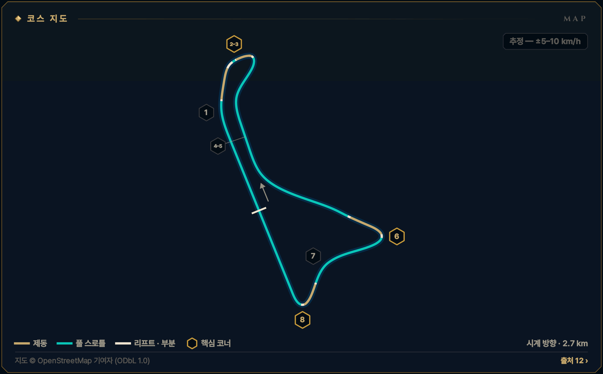
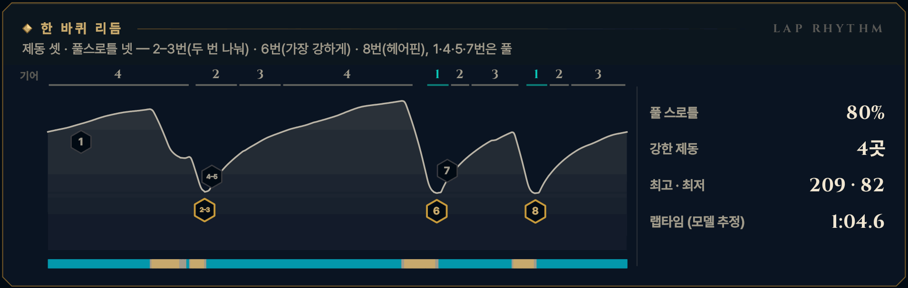

> **GRID서당 : iRacing**은 심레이싱이 처음인 동아리 신입을 위해 만든 드라이빙 아카데미 프로그램입니다. 이 글은 그 안의 **서킷 공략** 모드 — 이번 시즌 리그가 도는 서킷을 코스 개관과 코너별 애니메이션으로 미리 익히는 화면 — 를 블로그로 옮긴 것으로, 글과 애니메이션 모두 프로그램에서 그대로 가져왔습니다. 차는 iRacing의 Ray FF1600이고, 기준은 진도가 없는 루키(입문 렌즈)입니다. 강의는 [GRID서당 시리즈](/posts/untitled_life/motorsport/sim-racing/grid-seodang/)에, 낯선 말은 [용어 사전](/posts/untitled_life/motorsport/sim-racing/grid-seodang/glossary/)에 모아 두었습니다.

## 이번 시즌 일정

> **2026 시즌 4 · 포뮬러 1600 루키 시리즈 · 10주차** — 11.17(화)–11.23(월)
>
> - 루키 FF1600 · 기본 포함 · 12분 레이스 · 스탠딩 스타트 (차: Ray FF1600)
> - iRacing 트랙 이름: Circuito de Navarra - Speed Circuit - Medium
> - 주차는 매주 화요일 09:00(한국 시간)에 바뀝니다.
>
> iRacing 일정은 시즌마다 바뀝니다. 이 글의 주차는 2026 시즌 4 기준이고, 같은 서킷이 다른 시즌에 돌아오면 그 시즌 일정에서 주차와 레이아웃을 다시 확인하세요.

## 코스 개관

2.67 km, 시계 방향, 8코너. 긴 직선 둘과 헤어핀 둘, 랩 초반의 복합 하나로 된 단순한 트랙입니다. 고저차 약 25 m — 8번이 가장 낮고 3번 마루가 가장 높습니다. iRacing은 2024년 개조 전 레이아웃이라 최근 실차 영상은 다른 트랙입니다.

- **시계 방향 · 스피드 서킷 미디엄 · 2.7 km · 8코너**
- **코너 번호** — iRacing 안내 영상들이 쓰는 1–8번을 따릅니다. 실제 서킷은 2024년에 다시 지어졌지만 iRacing은 그 이전의 8코너 레이아웃입니다.
- **루키 포인트** — 큰 제동 둘, 복합 하나, 풀스로틀 넷 — 3번과 8번의 탈출이 랩타임
- **속도 표기: 추정 — ±5–10 km/h** — 이 서킷에는 기준이 되는 실주행 텔레메트리가 없습니다. 공개된 FF1600 트랙 가이드 등에서 맞춘 코너 최저 속도에 보정한 FF1600 물리 모델을 맞춰 계산했기 때문에, 글과 영상의 속도·페달·기어는 모두 **추정값**(±5–10 km/h)입니다. Test Drive에서 직접 확인하세요.

*지도 © OpenStreetMap 기여자 (ODbL 1.0) · 선 색: 골드 = 제동, 시안 = 풀 스로틀, 흰색 = 리프트 · 부분 · 금테 육각형 = 핵심 코너 · 번호 = 이 글의 코너 공략 단위*

## 한 바퀴 리듬

제동 셋 · 풀스로틀 넷 — 2–3번(두 번 나눠) · 6번(가장 강하게) · 8번(헤어핀), 1·4·5·7번은 풀

*풀 스로틀 80% · 강한 제동 4곳 · 최고 · 최저 209 · 82 km/h · 랩타임 (모델 추정) 1:04.6 — 위 그림의 기어 줄·속도 곡선·입력 띠(골드 = 제동, 시안 = 풀 스로틀)와 코너 번호는 이 기준 랩입니다.*

## 먼저 볼 코너

1. **[T2–3 2–3번 복합](#w10-u2)** — 1랩 첫 제동 · 차가운 타이어로 차를 잃기 가장 쉬운 곳
2. **[T8 8번 헤어핀](#w10-u6)** — 약 900 m 메인 직선을 여는 탈출
3. **[T6 6번 헤어핀](#w10-u4)** — 랩에서 가장 강한 제동 · 가장 많은 추월

> **루키 포인트** — 큰 제동 둘, 복합 하나, 풀스로틀 넷 — 3번과 8번의 탈출이 랩타임

## 루키 안전 노트

- **오르막 스탠딩 스타트** — 오르막 직선 출발입니다 — 1단에서 브레이크로 차를 잡고 기다렸다가 초록에 떼고(그 전에 구르면 점프 스타트), 클러치 페달로 출발한다면 휠스핀에 주의합니다. 1번은 풀스로틀이니 옆차와 차선만 지킵니다.
- **1랩 2–3번** — 차가운 타이어로 처음 서는 곳 — 연습보다 일찍, 곧게 밟고 한 줄로 들어갑니다.
- **6번 추월** — 가장 빠른 속도에서 서는 추월 지점. 상대가 턴인하기 전에 안쪽을 확보하지 못했다면 들이밀지 않습니다.
- **스핀 대처** — 브레이크를 꽉 밟아 세우고, 차들이 지나간 뒤 트랙과 나란히 복귀합니다. 3번 마루 너머는 뒤차가 늦게 봅니다.
- **트랙 리밋** — 차의 절반 이상이 노면 경계 밖이면 1x — 일부 트랙의 표시 구간만 네 바퀴 기준. 루키 규칙: 두 바퀴는 늘 선·연석 안쪽. 3·6·8번 출구는 빨강·흰 연석이 한계이고, 2번 차단 연석과 3·6번 안쪽 소시지 연석은 밟지 않습니다.

**1랩 · 스탠딩 스타트** — 1랩: 평소 제동 지점보다 늦게 밟지 않습니다. 앞차에 맞춰 더 일찍, 부드럽게 밟고, 차 한 대 폭을 남깁니다. 바깥이나 가운데를 지키고 안쪽 다툼에 끼지 않습니다.

## 영상 보는 법

코너마다 앱의 코너 공략 화면을 그대로 녹화했습니다. ▶를 눌러 재생하세요 — 앱의 **가이드** 재생(실제 속도의 0.4배, 화면에서 차가 너무 빠른 코너는 0.25배)이라 단계(접근·제동·턴인·에이펙스·탈출)마다 잠깐 멈추고, 멈춤 링이 차면 다음 단계로 넘어갑니다. 블로그 영상은 단계 시작의 멈춤만 짧게 줄였고 (캡션을 읽을 시간은 그대로), 끝에 앱의 끝 카드가 나옵니다. **급수별 브레이크 시연**을 펼치면 같은 코너를 7급·6급·5급 렌즈로, **흔한 실수 고스트**를 펼치면 실수한 차(빨간 점선)와 나란히 달린 영상을 볼 수 있습니다.

- **제동** — 골드 — 두께·밝기 = 브레이크 압력
- **가속** — 시안 — 스로틀
- **관성** — 흰색 — 두 페달 모두 뗀 구간
- **흔한 실수** — 빨간 점선 고스트 — 한 번에 하나만
- **▼ 제동 시작** — 루키 기준선의 제동 시작점
- **◆ 턴인** — 핸들을 감기 시작하는 곳
- **○ 에이펙스** — 가장 안쪽·가장 느린 곳
- **◇ 트랙아웃** — 탈출에서 닿는 바깥 끝
- **보드 (?)** — 확인 전 참고값 — Test Drive에서 기준점을 정하세요
- **입력 지도** — 골드 띠 = 브레이크, 흰 리본(안쪽) = 핸들. 겹치면 트레일
- **손 칸 · 내림 ×N · 올림** — 왼쪽 패들 N번 내림(블립은 오토 블립이) · 오른쪽 패들 한 번 올림

화면과 글의 속도는 모두 **추정값**(±5–10 km/h)입니다 — 기준 텔레메트리가 없는 서킷이라 모델로 계산했습니다.

## 코너 공략

### T1 1번 코너

**우코너 · 4단 · 추정 — ±5–10 km/h**  
브레이크도 리프트도 없는 오른쪽 · 약 195 km/h

<figure>
  <video src="images/u1.mp4" poster="images/u1_poster.png" controls preload="none" playsinline style="width:100%;max-width:960px"></video>
  <figcaption>시범 — 루키 기준선 · 렌즈 공통 · 가이드 0.4× · 접근 → 턴인 → 에이펙스 → 탈출</figcaption>
</figure>

급수별 브레이크 시연 — 모든 급수가 같은 그림

이 코너는 렌즈가 같습니다 — 리프트·풀스로틀 코너는 브레이크를 쓰지 않아 모든 급수가 같은 페달 그림을 봅니다.

#### 접근

8번을 나와 오르막 메인 직선을 4단으로 달립니다. 1번은 약 195 km/h에서 풀스로틀로 지나는 완만한 오른쪽이고, 직선의 왼쪽에 붙어 옵니다. 스탠딩 스타트에서는 차들이 나란히 몰려 오니 차선을 지킵니다.

*지금 손과 발 — 발 · 풀스로틀 / 손 · 곧게 / 눈 · 100 보드*

**보드 · 기준점** — 모두 확인 전 참고값입니다. Test Drive에서 직접 보고 정하세요.

- **턴인**? 100 m 보드 근처에서 턴인 — 영상 기준, 위치는 Test Drive에서 확인 *(확인 전 참고값)*

#### 턴인

100 m 보드 근처에서 핸들을 한 번에, 손목 하나만큼만 감습니다. 빠른 코너에서 핸들은 '꺾는' 것이 아니라 '기울이는' 것입니다. 발을 떼고 싶다면 속도가 아니라 핸들이 급하다는 신호입니다.

*지금 손과 발 — 발 · 풀스로틀 / 손 · 작게 감기 / 눈 · 안쪽 연석*

#### 에이펙스

안쪽 연석을 깊게 자를 필요는 없습니다 — 안쪽에서 1\~2 m 떨어져 지나갑니다. 1번의 진짜 목적은 2번을 넓게 들어가는 것입니다.

*지금 손과 발 — 발 · 풀스로틀 / 손 · 그대로 / 눈 · 왼쪽 가장자리*

#### 탈출

핸들을 풀며 차를 다시 왼쪽 가장자리로 흘려보냅니다. 왼쪽에 서야 2번 제동을 차가 곧은 채로 시작할 수 있습니다.

*지금 손과 발 — 발 · 풀스로틀 / 손 · 풀기 / 눈 · 2번 제동점*

#### 흔한 실수

- 1번 안쪽으로 깊게 파고들어 오른쪽에 남은 채 2번 제동 → 감으면서 밟게 된다  
  → 1번은 '오른쪽으로 살짝, 다시 왼쪽으로'
- 겁이 나서 발을 뗀다 → 뒤가 가벼워지고 2번까지 손해  
  → 핸들을 덜 감으면 뗄 이유가 없다 — 한 획, 작게

#### 이 코너에서 확인할 것

- [ ] 1번 앞 100 m 보드의 위치
- [ ] S/F 라인 위치(지도 추정 ±60 m)

#### 연결된 강의 · 드릴

- 강의: [심화 2강(코너의 다섯 얼굴)](/posts/untitled_life/motorsport/sim-racing/grid-seodang/advanced/d2-five-corner-faces/) · [2급(스티어링 일필휘지)](/posts/untitled_life/motorsport/sim-racing/grid-seodang/grades/g2-one-stroke-steering/) · [심화 9강(기울어진 트랙)](/posts/untitled_life/motorsport/sim-racing/grid-seodang/advanced/d7-banked-track/) · [심화 1강(출발의 기술)](/posts/untitled_life/motorsport/sim-racing/grid-seodang/advanced/d1-the-start/)
- 훈련장 드릴: 조향 일필

<small>근거: Y1 · Y2 · Y4 · I1 (아래 출처 목록) · 신뢰도 M</small>

### T2–3 2–3번 복합

**우코너 · 2단 · 최저 약 120–130 km/h · 핵심 코너 · 추정 — ±5–10 km/h**  
첫 복합, 3번이 왕 · 약 195→125 km/h · 1랩 첫 제동

<figure>
  <video src="images/u2.mp4" poster="images/u2_poster.png" controls preload="none" playsinline style="width:100%;max-width:960px"></video>
  <figcaption>시범 — 루키 기준선 · 입문 렌즈(직선 제동) · 가이드 0.4× · 접근 → 제동 → 턴인 → 에이펙스 → 제동 ② → 에이펙스 ② → 탈출</figcaption>
</figure>

급수별 브레이크 시연 — 7급 · 6급 · 5급 렌즈 (영상 3)

라인과 기준점은 그대로, 페달 쓰는 법만 지금 급수에 맞춥니다. 위 영상은 **직선 제동 — 기초·심화·9·8급** 렌즈입니다 — 턴인 전에 브레이크를 다 뗍니다 (브레이크 끝 = 턴인).

**릴리스 — 7급** — 턴인을 향해 0.4초 넘게 흘려서 0으로 · 7급 기준: 릴리스 0.4초 이상

<figure>
  <video src="images/u2_release.mp4" poster="images/u2_release_poster.png" controls preload="none" playsinline style="width:100%;max-width:960px"></video>
  <figcaption>7급 렌즈(릴리스) · 가이드 0.4× · 접근 → 제동 → 턴인 → 에이펙스 → 제동 ② → 에이펙스 ② → 탈출</figcaption>
</figure>

- 제동 — **턴인 쪽으로 흘려 놓는다** · 피크 약 55% · 1.0초에 걸쳐 놓기 · 발 · 하나-둘-셋 놓기
- 턴인 — **턴인에서 0에 닿는다** · 턴인에서 약 0\~3% · 발 · 3% → 0

**트레일 — 6급·4\~1급·졸업** — 턴인 때 15\~20%를 남기고, 감는 만큼 풉니다 · 6급 기준: 턴인 때 15% 이상 남기기

<figure>
  <video src="images/u2_trail.mp4" poster="images/u2_trail_poster.png" controls preload="none" playsinline style="width:100%;max-width:960px"></video>
  <figcaption>6급 렌즈(트레일) · 가이드 0.4× · 접근 → 제동 → 턴인 → 에이펙스 → 제동 ② → 에이펙스 ② → 탈출</figcaption>
</figure>

- 제동 — **턴인까지 조금 남긴다** · 피크 약 52% · 턴인에서 약 18% · 발 · 놓으며 남기기
- 턴인 — **에이펙스 전 0으로 흘린다** · 약 18% → 에이펙스 전 0 · 발 · 18% → 0 / 손 · 놓는 만큼 감기
- 제동 ② — **3번도 턴인까지 조금** · 3번 턴인에서 약 15\~20% · 에이펙스 전 0 · 발 · 놓으며 남기기

**깊은 트레일 — 5급** — 턴인 때 30% 이상, 에이펙스 앞까지 끌고 갑니다 · 5급 기준: 턴인 때 30% 이상 남기기

<figure>
  <video src="images/u2_deep.mp4" poster="images/u2_deep_poster.png" controls preload="none" playsinline style="width:100%;max-width:960px"></video>
  <figcaption>5급 렌즈(깊은 트레일) · 가이드 0.4× · 접근 → 제동 → 턴인 → 에이펙스 → 제동 ② → 에이펙스 ② → 탈출</figcaption>
</figure>

- 제동 — **더 깊게, 턴인 32%** · 피크 약 45% · 턴인에서 약 32% · 발 · 천천히 남기기
- 턴인 — **앞을 누른 채 돌린다** · 약 32% → 에이펙스 무렵 0 · 발 · 32% → 0
- 제동 ② — **3번은 더 깊게** · 3번 턴인에서 약 30% · 마루 앞이라 부드럽게 · 발 · 천천히 남기기

4\~1급은 같은 영상의 캡션에 강조 한 줄(◆)이 더 붙습니다:

- ◆ 4급(턴인·에이펙스) — 브레이크 끝 = 스로틀 시작 — 3번 에이펙스의 빈 시간 0.4초 이하

흔한 실수 고스트 — 첫 코너 욕심 → 두 번째를 잃음

<figure>
  <video src="images/u2_ghost.mp4" poster="images/u2_ghost_poster.png" controls preload="none" playsinline style="width:100%;max-width:960px"></video>
  <figcaption>흔한 실수: 첫 코너 욕심 → 두 번째를 잃음 — 첫 코너에 욕심내면 두 번째를 잃는다 · 트랙 밖</figcaption>
</figure>

흔한 실수: **첫 코너 욕심 → 두 번째를 잃음** — 첫 코너에 욕심내면 두 번째를 잃는다 · 트랙 밖. 빨간 점선과 붉은 차가 실수 고스트, 흰 차가 루키 기준선입니다. 두 차는 같은 시계로 달리므로 늦어지거나 밀려나는 만큼이 그대로 보입니다. 영상은 앱에서 [흔한 실수]를 눌렀을 때처럼 그 실수가 시작되는 단계부터 재생합니다. 끝 카드의 '트레일 렌즈 기준'은 결과의 시간 차를 트레일(6급) 렌즈 주행과 비교한 값이라는 뜻입니다.

> **1랩 · 스탠딩 스타트** — 1랩: 평소 제동 지점보다 늦게 밟지 않습니다. 앞차에 맞춰 더 일찍, 부드럽게 밟고, 차 한 대 폭을 남깁니다. 바깥이나 가운데를 지키고 안쪽 다툼에 끼지 않습니다. 차가운 타이어로 처음 서는 곳이라 영상들도 차를 잃기 가장 쉬운 곳으로 꼽습니다 — 세 줄로는 3번에 들어갈 수 없으니 한 줄로.

#### 접근

2번과 3번은 오른쪽으로 두 번 감기는 한 코너로 읽습니다. 마지막인 3번이 왕입니다 — 3번을 나오면 6번 제동까지 약 900 m를 풀스로틀로 달립니다. 1번을 지나 왼쪽 가장자리에 차를 둡니다.

*지금 손과 발 — 발 · 풀스로틀 / 손 · 곧게 / 눈 · 오른쪽 방호벽*

**보드 · 기준점** — 모두 확인 전 참고값입니다. Test Drive에서 직접 보고 정하세요.

- **제동 · 기준점**? 영상 기준: 오른쪽 방호벽이 트랙에서 멀어지는 곳(빠른 랩). 입문 기준선은 그보다 일찍 — 턴인 약 125 m 앞 *(확인 전 참고값)*
- **에이펙스**? 3번 안쪽 소시지 연석 앞의 평평한 연석 *(확인 전 참고값)*

#### 제동

영상의 빠른 드라이버는 오른쪽 방호벽이 트랙에서 멀어지기 시작하는 곳에서 밟습니다. 입문 기준선은 그보다 일찍, 1번을 빠져나가 차가 곧아지자마자 '꾹' 약 55%로 2번 입구까지 줄이고 턴인 전에 하나-둘-셋으로 풉니다. 기어는 4단 그대로입니다.

*지금 손과 발 — 발 · 꾹, 하나-둘-셋 / 손 · 거의 곧게 / 눈 · 2번 입구*

#### 턴인

2번은 안쪽에 바짝 붙지 않고 넓게 돕니다 — 안쪽의 차단 연석을 밟으면 차가 튑니다. 브레이크가 0이 되면 유지 스로틀로 속도를 지킵니다.

*지금 손과 발 — 발 · 0 → 유지 / 손 · 작게 감기 / 눈 · 2번 안쪽*

#### 에이펙스

2번 에이펙스는 욕심내지 않습니다. 최저 약 125 km/h — 3번을 위해 2번을 버리고, 출구에서 차를 왼쪽으로 다시 데려옵니다.

*지금 손과 발 — 발 · 유지 / 손 · 풀기 / 눈 · 3번 입구*

#### 제동 ②

2번 안쪽 연석을 지나 차가 왼쪽에서 다시 곧아지면 두 번째 제동입니다 — 짧게, 곧게 절반쯤 밟고 3단, 2단으로 내립니다. 핸들이 감긴 채 세게 밟으면 뒤가 돕니다. 3번 턴인을 향해 천천히 풉니다.

*지금 손과 발 — 발 · 꾹 / 손 · 곧게 · 내림 ×2 / 눈 · 3번 턴인*

#### 에이펙스 ②

3번은 늦은 에이펙스입니다. 안쪽의 높은 소시지 연석은 피하고 그 앞 평평한 연석까지만 씁니다. 브레이크가 0이 되는 순간 스로틀을 시작합니다.

*지금 손과 발 — 발 · 0 → 스로틀 / 손 · 가장 많이 / 눈 · 왼쪽 출구 연석*

#### 탈출

3번은 언덕 꼭대기라 탈출하며 길이 아래로 떨어집니다. 차가 가벼워져 안쪽 뒷바퀴가 헛돌기 쉬우니 스로틀은 핸들을 푸는 만큼, 한 번에 끝까지 엽니다. 왼쪽 출구 연석까지 쓰되 바퀴 두 개는 연석 안쪽에 남깁니다.

*지금 손과 발 — 발 · 앞으로만 / 손 · 풀기 / 눈 · 4번*

#### 흔한 실수

- 2번 에이펙스에 욕심 → 3번 입구가 좁아지고 출구에서 밖으로  
  → 2번은 버리고 넓게, 3번을 위해 왼쪽으로
- 핸들을 감은 채 세게 밟기 → 뒤가 돈다  
  → 세게 밟는 것은 차가 곧을 때만
- 마루 위에서 스로틀을 한 번에 → 안쪽 뒷바퀴가 헛돈다  
  → 핸들이 풀리는 만큼만 연다

#### 이 코너에서 확인할 것

- [ ] 3번 기어(1단/2단)와 실제 최저 속도
- [ ] 2번 차단 연석·3번 소시지 연석의 위치
- [ ] 2번 제동에 쓸 고정 기준물(방호벽 꺾임)

#### 연결된 강의 · 드릴

- 강의: [심화 1강(출발의 기술)](/posts/untitled_life/motorsport/sim-racing/grid-seodang/advanced/d1-the-start/) · [심화 2강(코너의 다섯 얼굴)](/posts/untitled_life/motorsport/sim-racing/grid-seodang/advanced/d2-five-corner-faces/) · [심화 8강(페달의 문법)](/posts/untitled_life/motorsport/sim-racing/grid-seodang/advanced/d6-pedal-grammar/) · [8급(제동의 기본)](/posts/untitled_life/motorsport/sim-racing/grid-seodang/grades/g8-braking-basics/) · [7급(릴리스 수양)](/posts/untitled_life/motorsport/sim-racing/grid-seodang/grades/g7-release/) · [6급(트레일 입문)](/posts/untitled_life/motorsport/sim-racing/grid-seodang/grades/g6-trail-intro/) · [4급(전환 수련)](/posts/untitled_life/motorsport/sim-racing/grid-seodang/grades/g4-transition/) · [3급(스로틀 서예)](/posts/untitled_life/motorsport/sim-racing/grid-seodang/grades/g3-throttle-calligraphy/) · [심화 9강(기울어진 트랙)](/posts/untitled_life/motorsport/sim-racing/grid-seodang/advanced/d7-banked-track/) · [심화 7강(한계의 신호)](/posts/untitled_life/motorsport/sim-racing/grid-seodang/advanced/d9-signals-at-the-limit/)
- 훈련장 드릴: 트레일 브레이킹 · 제동 수양 · 전환 · 정밀 압력

<small>근거: Y1 · Y2 · Y3 · Y4 · Y5 · Y7 (아래 출처 목록) · 신뢰도 L</small>

### T4–5 4·5번 코너

**좌코너 · 2단 · 추정 — ±5–10 km/h**  
조용한 풀스로틀 왼쪽 둘 · 덜 감을수록 빠르다

<figure>
  <video src="images/u3.mp4" poster="images/u3_poster.png" controls preload="none" playsinline style="width:100%;max-width:960px"></video>
  <figcaption>시범 — 루키 기준선 · 렌즈 공통 · 가이드 0.4× · 접근 → 턴인 → 에이펙스 → 전환 → 에이펙스 ② → 탈출</figcaption>
</figure>

급수별 브레이크 시연 — 모든 급수가 같은 그림

이 코너는 렌즈가 같습니다 — 리프트·풀스로틀 코너는 브레이크를 쓰지 않아 모든 급수가 같은 페달 그림을 봅니다.

#### 접근

3번을 나와 왼쪽에 있던 차를 가운데쯤으로만 옮겨 4번을 맞습니다. 4번과 5번은 둘 다 브레이크도 리프트도 없는 풀스로틀 왼쪽입니다. 이 두 코너에서 시간을 버는 방법은 '덜 감는 것'입니다.

*지금 손과 발 — 발 · 풀스로틀 / 손 · 곧게 / 눈 · 4번 연석*

**보드 · 기준점** — 모두 확인 전 참고값입니다. Test Drive에서 직접 보고 정하세요.

- **턴인**? 트랙 가운데에서 4번 턴인 *(확인 전 참고값)*

#### 턴인

트랙 가운데에서 한 번에, 부드럽게 감습니다. 타이어가 비비는 소리가 나면 너무 많이 감은 것입니다.

*지금 손과 발 — 발 · 풀스로틀 / 손 · 작게 감기 / 눈 · 4번 연석*

#### 에이펙스

4번 안쪽 연석을 자릅니다 — 차의 절반까지는 연석 위로 올려도 되지만, 그 너머 잔디까지 가면 1x입니다. 출구는 트랙 가운데까지만입니다.

*지금 손과 발 — 발 · 풀스로틀 / 손 · 그대로 / 눈 · 5번 쪽*

#### 전환

4번과 5번 사이 직선에서 오른쪽 끝으로 옮겨 두고, 변속은 직선에서 끝냅니다 — FF1600에는 5단이 없어 4단이 마지막입니다. 코너 안에서는 변속하지 않습니다.

*지금 손과 발 — 발 · 풀스로틀 / 손 · 곧게 / 눈 · 5번 연석 시작*

#### 에이펙스 ②

오른쪽 연석이 시작되는 곳에서 턴인해 긴 왼쪽을 한 획으로 돕니다. 안쪽 연석을 자르되 타이어는 '조용하게' — 비비면 속도를 잃습니다.

*지금 손과 발 — 발 · 풀스로틀 / 손 · 한 번 감기 / 눈 · 출구 가운데*

#### 탈출

출구에서 바깥 끝까지 달려 나갈 필요는 없습니다 — 트랙 가운데까지만입니다. 그다음 6번 제동을 위해 차를 왼쪽으로 옮기며 내리막을 탑니다.

*지금 손과 발 — 발 · 풀스로틀 / 손 · 풀기 / 눈 · 6번 제동점*

#### 흔한 실수

- 핸들을 크게 감아 타이어가 비비며 속도를 잃는다  
  → 풀스로틀 코너는 한 획, 작게 — 덜 감을수록 빠르다
- 연석을 너무 깊게 잘라 차의 절반 이상이 나간다(1x)  
  → 안쪽 바퀴만 연석 위, 잔디는 절대 안 된다
- 5번에서 겁이 나 중간에 발을 뗀다 → 뒤가 가벼워진다  
  → 랩마다 한 뼘씩 자신감 — 떼려면 턴인 전에

#### 이 코너에서 확인할 것

- [ ] 4·5번 안쪽 연석을 어디까지 써도 되는지(트랙 리밋)
- [ ] 5번 앞 직선에서 4단 변속을 끝낼 수 있는지

#### 연결된 강의 · 드릴

- 강의: [심화 2강(코너의 다섯 얼굴)](/posts/untitled_life/motorsport/sim-racing/grid-seodang/advanced/d2-five-corner-faces/) · [2급(스티어링 일필휘지)](/posts/untitled_life/motorsport/sim-racing/grid-seodang/grades/g2-one-stroke-steering/) · [기초 4강(레이싱 라인의 문법)](/posts/untitled_life/motorsport/sim-racing/grid-seodang/basics/f4-racing-line/) · [심화 3강(상황의 라인)](/posts/untitled_life/motorsport/sim-racing/grid-seodang/advanced/d3-situational-lines/)
- 훈련장 드릴: 조향 일필

<small>근거: Y1 · Y3 · Y4 · Y5 · Y6 (아래 출처 목록) · 신뢰도 M</small>

### T6 6번 헤어핀

**우코너 · 1단 · 최저 약 75–85 km/h · 핵심 코너 · 추정 — ±5–10 km/h**  
랩에서 가장 강한 제동 · 약 205→80 km/h · 1단

<figure>
  <video src="images/u4.mp4" poster="images/u4_poster.png" controls preload="none" playsinline style="width:100%;max-width:960px"></video>
  <figcaption>시범 — 루키 기준선 · 입문 렌즈(직선 제동) · 가이드 0.4× · 접근 → 제동 → 턴인 → 에이펙스 → 탈출</figcaption>
</figure>

급수별 브레이크 시연 — 7급 · 6급 · 5급 렌즈 (영상 3)

라인과 기준점은 그대로, 페달 쓰는 법만 지금 급수에 맞춥니다. 위 영상은 **직선 제동 — 기초·심화·9·8급** 렌즈입니다 — 턴인 전에 브레이크를 다 뗍니다 (브레이크 끝 = 턴인).

**릴리스 — 7급** — 턴인을 향해 0.4초 넘게 흘려서 0으로 · 7급 기준: 릴리스 0.4초 이상

<figure>
  <video src="images/u4_release.mp4" poster="images/u4_release_poster.png" controls preload="none" playsinline style="width:100%;max-width:960px"></video>
  <figcaption>7급 렌즈(릴리스) · 가이드 0.4× · 접근 → 제동 → 턴인 → 에이펙스 → 탈출</figcaption>
</figure>

- 제동 — **턴인 쪽으로 흘려 놓는다** · 피크 약 76% · 1.2초에 걸쳐 놓기 · 발 · 하나-둘-셋 놓기
- 턴인 — **턴인에서 0에 닿는다** · 턴인에서 약 0\~3% · 발 · 3% → 0

**트레일 — 6급·4\~1급·졸업** — 턴인 때 15\~20%를 남기고, 감는 만큼 풉니다 · 6급 기준: 턴인 때 15% 이상 남기기

<figure>
  <video src="images/u4_trail.mp4" poster="images/u4_trail_poster.png" controls preload="none" playsinline style="width:100%;max-width:960px"></video>
  <figcaption>6급 렌즈(트레일) · 가이드 0.4× · 접근 → 제동 → 턴인 → 에이펙스 → 탈출</figcaption>
</figure>

- 제동 — **턴인까지 조금 남긴다** · 피크 약 74% · 턴인에서 약 18% · 발 · 놓으며 남기기
- 턴인 — **에이펙스 전 0으로 흘린다** · 약 18% → 에이펙스 전 0 · 발 · 18% → 0 / 손 · 놓는 만큼 감기

**깊은 트레일 — 5급** — 턴인 때 30% 이상, 에이펙스 앞까지 끌고 갑니다 · 5급 기준: 턴인 때 30% 이상 남기기

<figure>
  <video src="images/u4_deep.mp4" poster="images/u4_deep_poster.png" controls preload="none" playsinline style="width:100%;max-width:960px"></video>
  <figcaption>5급 렌즈(깊은 트레일) · 가이드 0.4× · 접근 → 제동 → 턴인 → 에이펙스 → 탈출</figcaption>
</figure>

- 제동 — **더 깊게, 턴인 32%** · 피크 약 72% · 턴인에서 약 32% · 발 · 천천히 남기기
- 턴인 — **앞을 누른 채 돌린다** · 약 32% → 에이펙스 무렵 0 · 발 · 32% → 0

4\~1급은 같은 영상의 캡션에 강조 한 줄(◆)이 더 붙습니다:

- ◆ 4급(턴인·에이펙스) — 브레이크 끝 = 스로틀 시작 — 1단 헤어핀의 빈 시간 0.4초 이하

흔한 실수 고스트 — 늦은 제동 → 잠김 → 직진

<figure>
  <video src="images/u4_ghost.mp4" poster="images/u4_ghost_poster.png" controls preload="none" playsinline style="width:100%;max-width:960px"></video>
  <figcaption>흔한 실수: 늦은 제동 → 잠김 → 직진 — 25 m 늦게 100% → 바퀴가 잠겨 직진 · 트랙 밖</figcaption>
</figure>

흔한 실수: **늦은 제동 → 잠김 → 직진** — 25 m 늦게 100% → 바퀴가 잠겨 직진 · 트랙 밖. 빨간 점선과 붉은 차가 실수 고스트, 흰 차가 루키 기준선입니다. 두 차는 같은 시계로 달리므로 늦어지거나 밀려나는 만큼이 그대로 보입니다. 영상은 앱에서 [흔한 실수]를 눌렀을 때처럼 그 실수가 시작되는 단계부터 재생합니다. 끝 카드의 '트레일 렌즈 기준'은 결과의 시간 차를 트레일(6급) 렌즈 주행과 비교한 값이라는 뜻입니다.

#### 접근

5번에서 6번까지는 내리막 직선입니다. 4단 약 205 km/h로 왼쪽 끝에 붙어 옵니다. 영상들의 기준점은 오른쪽 피트 진입로의 흰 선이 트랙에서 갈라지기 시작하는 곳이고, 입문 기준선은 그보다 앞에서 밟습니다.

*지금 손과 발 — 발 · 풀스로틀 / 손 · 곧게 / 눈 · 피트 흰 선*

**보드 · 기준점** — 모두 확인 전 참고값입니다. Test Drive에서 직접 보고 정하세요.

- **제동 · 기준점**? 오른쪽 피트 진입 흰 선이 갈라지는 곳(빠른 랩 기준) — 입문 기준선은 그보다 앞, 턴인 약 145 m 앞 *(확인 전 참고값)*
- **에이펙스**? 안쪽 평평한 빨강·흰 연석(소시지 연석 앞) *(확인 전 참고값)*

#### 제동

한 바퀴에서 가장 강한 제동입니다. 차가 곧을 때 '꾹' 약 76% — 100%는 잠김입니다. 내리막이라 평지보다 몇 미터 더 걸리고, 왼쪽 패들로 4→3→2→1단까지 한 단씩 내립니다(1단은 100 km/h 아래에서만).

*지금 손과 발 — 발 · 꾹 / 손 · 곧게 · 내림 ×3 / 눈 · 턴인 지점*

#### 턴인

왼쪽 끝, 바깥 진입 연석 근처에서 늦게 턴인합니다. 브레이크 끝 = 턴인 — 앞이 눌려 있으면 차가 잘 돕니다.

*지금 손과 발 — 발 · 0 → 유지 / 손 · 한 번에 감기 / 눈 · 안쪽 연석*

#### 에이펙스

늦은 에이펙스입니다. 안쪽 높은 소시지 연석은 밟지 말고 평평한 빨강·흰 연석에 안쪽 바퀴를 붙입니다. 최저 약 80 km/h, 1단 — 차가 출구를 바라보는 순간 스로틀이 시작됩니다.

*지금 손과 발 — 발 · 0 → 스로틀 / 손 · 가장 많이 / 눈 · 출구*

#### 탈출

1단이라 뒷바퀴가 헛돌기 쉽습니다. 스로틀은 핸들을 푸는 만큼 1\~2초에 걸쳐 끝까지 엽니다. 바깥 출구 연석까지 쓰고, 7번을 위해 오른쪽으로 건너가며 2단, 3단으로 올립니다.

*지금 손과 발 — 발 · 앞으로만 / 손 · 풀기 / 눈 · 7번*

#### 흔한 실수

- 슬립스트림으로 더 빨리 왔는데 같은 곳에서 100%로 → 잠기고 직진  
  → 빠르면 일찍, 약 76%로 — 잠기면 바로 푼다
- 너무 일찍 1단 → 엔진이 넘치고 뒤가 잠긴다  
  → 속도가 100 km/h 아래로 떨어진 뒤에 1단
- 이른 에이펙스 → 출구에서 바깥으로 밀린다  
  → U가 아니라 V, 늦은 에이펙스

#### 이 코너에서 확인할 것

- [ ] 피트 진입 흰 선이 갈라지는 실제 위치
- [ ] 6번 안쪽 소시지 연석의 위치
- [ ] 6번 출구 초록 페인트의 트랙 리밋

#### 연결된 강의 · 드릴

- 강의: [심화 2강(코너의 다섯 얼굴)](/posts/untitled_life/motorsport/sim-racing/grid-seodang/advanced/d2-five-corner-faces/) · [심화 8강(페달의 문법)](/posts/untitled_life/motorsport/sim-racing/grid-seodang/advanced/d6-pedal-grammar/) · [8급(제동의 기본)](/posts/untitled_life/motorsport/sim-racing/grid-seodang/grades/g8-braking-basics/) · [7급(릴리스 수양)](/posts/untitled_life/motorsport/sim-racing/grid-seodang/grades/g7-release/) · [6급(트레일 입문)](/posts/untitled_life/motorsport/sim-racing/grid-seodang/grades/g6-trail-intro/) · [4급(전환 수련)](/posts/untitled_life/motorsport/sim-racing/grid-seodang/grades/g4-transition/) · [3급(스로틀 서예)](/posts/untitled_life/motorsport/sim-racing/grid-seodang/grades/g3-throttle-calligraphy/) · [심화 6강(교본 차 해부)](/posts/untitled_life/motorsport/sim-racing/grid-seodang/advanced/d8-training-car-and-shifting/) · [심화 7강(한계의 신호)](/posts/untitled_life/motorsport/sim-racing/grid-seodang/advanced/d9-signals-at-the-limit/) · [심화 3강(상황의 라인)](/posts/untitled_life/motorsport/sim-racing/grid-seodang/advanced/d3-situational-lines/)
- 훈련장 드릴: 정밀 압력 · 제동 수양 · 트레일 브레이킹 · 전환 · 스로틀 서예

<small>근거: Y1 · Y3 · Y4 · Y5 · Y6 · OSM (아래 출처 목록) · 신뢰도 M</small>

### T7 7번 코너

**좌코너 · 3단 · 추정 — ±5–10 km/h**  
8번을 위한 왼쪽 꺾임 · 풀스로틀 약 140 km/h

<figure>
  <video src="images/u5.mp4" poster="images/u5_poster.png" controls preload="none" playsinline style="width:100%;max-width:960px"></video>
  <figcaption>시범 — 루키 기준선 · 렌즈 공통 · 가이드 0.4× · 접근 → 턴인 → 에이펙스 → 탈출</figcaption>
</figure>

급수별 브레이크 시연 — 모든 급수가 같은 그림

이 코너는 렌즈가 같습니다 — 리프트·풀스로틀 코너는 브레이크를 쓰지 않아 모든 급수가 같은 페달 그림을 봅니다.

#### 접근

6번을 나오면 2단, 3단으로 올리며 차를 오른쪽 끝으로 옮깁니다. 7번은 풀스로틀로 지나는 왼쪽 꺾임입니다.

*지금 손과 발 — 발 · 풀스로틀 / 손 · 곧게 / 눈 · 7번 연석*

**보드 · 기준점** — 모두 확인 전 참고값입니다. Test Drive에서 직접 보고 정하세요.

- **턴인**? 오른쪽 끝에서 턴인 *(확인 전 참고값)*

#### 턴인

오른쪽 끝에서 한 번에, 작게 감습니다. 풀스로틀 그대로입니다.

*지금 손과 발 — 발 · 풀스로틀 / 손 · 작게 감기 / 눈 · 안쪽 연석*

#### 에이펙스

왼쪽 바퀴를 안쪽 연석 위로 살짝 올립니다. 차의 절반 이상이 연석 너머로 가면 1x입니다.

*지금 손과 발 — 발 · 풀스로틀 / 손 · 그대로 / 눈 · 왼쪽 끝*

#### 탈출

그대로 왼쪽에 남습니다. 8번은 오른쪽 헤어핀이라 왼쪽에서 차가 곧은 채로 제동해야 합니다 — 7번에서 8번까지는 왼쪽에 머무는 한 줄입니다.

*지금 손과 발 — 발 · 풀스로틀 / 손 · 곧게 / 눈 · 8번 연석*

#### 흔한 실수

- 7번 출구에서 오른쪽으로 흘러가 8번 제동을 핸들 감은 채 시작  
  → 7번에서 8번까지 왼쪽에 머무는 한 줄
- 핸들을 크게 감아 속도를 잃는다  
  → 한 획, 작게 — 풀스로틀 코너는 덜 감을수록 빠르다

#### 이 코너에서 확인할 것

- [ ] 7번 안쪽 연석을 어디까지 써도 되는지

#### 연결된 강의 · 드릴

- 강의: [심화 2강(코너의 다섯 얼굴)](/posts/untitled_life/motorsport/sim-racing/grid-seodang/advanced/d2-five-corner-faces/) · [2급(스티어링 일필휘지)](/posts/untitled_life/motorsport/sim-racing/grid-seodang/grades/g2-one-stroke-steering/) · [기초 4강(레이싱 라인의 문법)](/posts/untitled_life/motorsport/sim-racing/grid-seodang/basics/f4-racing-line/)
- 훈련장 드릴: 조향 일필

<small>근거: Y1 · Y3 · Y4 (아래 출처 목록) · 신뢰도 M</small>

### T8 8번 헤어핀

**우코너 · 1단 · 최저 약 75–85 km/h · 핵심 코너 · 추정 — ±5–10 km/h**  
메인 직선을 여는 헤어핀 · 약 160→80 km/h

<figure>
  <video src="images/u6.mp4" poster="images/u6_poster.png" controls preload="none" playsinline style="width:100%;max-width:960px"></video>
  <figcaption>시범 — 루키 기준선 · 입문 렌즈(직선 제동) · 가이드 0.4× · 접근 → 제동 → 턴인 → 에이펙스 → 탈출</figcaption>
</figure>

급수별 브레이크 시연 — 모든 급수가 같은 그림

이 코너는 앱이 모든 급수에 **직선 제동 — 기초·심화·9·8급** 렌즈 하나만 보여 줍니다 — 턴인 전에 브레이크를 다 뗍니다 (브레이크 끝 = 턴인). 급수별 영상이 따로 없습니다.

4\~1급은 같은 영상의 캡션에 강조 한 줄(◆)이 더 붙습니다:

- ◆ 3급(탈출) — 에이펙스부터 한 획 — 900 m 직선 앞의 재조작이 가장 비쌉니다

흔한 실수 고스트 — 이른 턴인 → 출구에서 밀림

<figure>
  <video src="images/u6_ghost.mp4" poster="images/u6_ghost_poster.png" controls preload="none" playsinline style="width:100%;max-width:960px"></video>
  <figcaption>흔한 실수: 이른 턴인 → 출구에서 밀림 — 일찍 꺾으면 출구에서 바깥으로 밀린다 → 약 0.9초 늦음 · 트랙 밖</figcaption>
</figure>

흔한 실수: **이른 턴인 → 출구에서 밀림** — 일찍 꺾으면 출구에서 바깥으로 밀린다 → 약 0.9초 늦음 · 트랙 밖. 빨간 점선과 붉은 차가 실수 고스트, 흰 차가 루키 기준선입니다. 두 차는 같은 시계로 달리므로 늦어지거나 밀려나는 만큼이 그대로 보입니다. 영상은 앱에서 [흔한 실수]를 눌렀을 때처럼 그 실수가 시작되는 단계부터 재생합니다. 끝 카드의 '트레일 렌즈 기준'은 결과의 시간 차를 트레일(6급) 렌즈 주행과 비교한 값이라는 뜻입니다.

#### 접근

마지막 헤어핀입니다. 3단 약 160 km/h로 왼쪽 끝에서 옵니다. 영상들의 기준점은 왼쪽 진입 연석이 시작되기 약 두 차 길이 앞이고, 처음엔 네 차 길이 앞에서 밟습니다.

*지금 손과 발 — 발 · 풀스로틀 / 손 · 곧게 / 눈 · 왼쪽 연석 시작*

**보드 · 기준점** — 모두 확인 전 참고값입니다. Test Drive에서 직접 보고 정하세요.

- **제동 · 기준점**? 왼쪽 진입 연석 시작 약 두 차 길이 앞(영상 기준) — 처음엔 네 차 길이 앞 *(확인 전 참고값)*
- **에이펙스**? 안쪽 빨강·흰 연석 *(확인 전 참고값)*

#### 제동

곧게 '꾹' 약 64%, 왼쪽 패들로 3→2→1단까지 내리고 턴인 전에 다 놓습니다. 턴인 지점에서 차가 작은 둔덕을 넘어 가벼워지니 이 코너는 모든 급수가 턴인 전에 브레이크를 끝냅니다. 둔덕 위에서 갑자기 놓거나 더 밟지 않습니다.

*지금 손과 발 — 발 · 꾹, 하나-둘-셋 / 손 · 곧게 · 내림 ×2 / 눈 · 턴인 지점*

#### 턴인

왼쪽 진입 연석까지 써서 넓게 들어가고 늦게 턴인합니다. 둔덕에서 차가 가벼울 때 핸들을 확 감지 않습니다.

*지금 손과 발 — 발 · 0 → 유지 / 손 · 부드럽게 감기 / 눈 · 안쪽 연석*

#### 에이펙스

늦은 에이펙스, 안쪽 빨강·흰 연석에 붙습니다. 최저 약 80 km/h, 1단입니다. 에이펙스 직전에 스로틀을 시작합니다.

*지금 손과 발 — 발 · 스로틀 시작 / 손 · 가장 많이 / 눈 · 출구 연석*

#### 탈출

이 출구가 다음 약 900 m를 정합니다. 1단의 헛돎을 조심하며 일찍, 그러나 한 번에 끝까지 엽니다. 출구 연석까지만 씁니다.

*지금 손과 발 — 발 · 앞으로만 / 손 · 풀기 / 눈 · 메인 직선*

#### 흔한 실수

- 이른 에이펙스 → 출구에서 밖으로 밀리고 발을 뗀다  
  → 늦게 턴인, 늦은 에이펙스 — 출구가 직선을 산다
- 서두르다 1단에서 뒤가 돈다, 특히 1랩 차가운 타이어  
  → 스로틀은 푸는 만큼만 — 1랩은 모든 입력을 10% 부드럽게
- 레이스에서 안쪽을 막다가 내 라인을 망친다  
  → 8번은 지킬 곳이 아니라 빠져나갈 곳 — 직선에서 싸운다

#### 이 코너에서 확인할 것

- [ ] 턴인 지점 둔덕이 iRacing에서 얼마나 큰지
- [ ] 8번 앞에 50 보드가 있는지

#### 연결된 강의 · 드릴

- 강의: [심화 2강(코너의 다섯 얼굴)](/posts/untitled_life/motorsport/sim-racing/grid-seodang/advanced/d2-five-corner-faces/) · [8급(제동의 기본)](/posts/untitled_life/motorsport/sim-racing/grid-seodang/grades/g8-braking-basics/) · [7급(릴리스 수양)](/posts/untitled_life/motorsport/sim-racing/grid-seodang/grades/g7-release/) · [4급(전환 수련)](/posts/untitled_life/motorsport/sim-racing/grid-seodang/grades/g4-transition/) · [3급(스로틀 서예)](/posts/untitled_life/motorsport/sim-racing/grid-seodang/grades/g3-throttle-calligraphy/) · [심화 9강(기울어진 트랙)](/posts/untitled_life/motorsport/sim-racing/grid-seodang/advanced/d7-banked-track/) · [심화 6강(교본 차 해부)](/posts/untitled_life/motorsport/sim-racing/grid-seodang/advanced/d8-training-car-and-shifting/) · [심화 3강(상황의 라인)](/posts/untitled_life/motorsport/sim-racing/grid-seodang/advanced/d3-situational-lines/) · [1급(일관성 담금질)](/posts/untitled_life/motorsport/sim-racing/grid-seodang/grades/g1-consistency/)
- 훈련장 드릴: 스로틀 서예 · 전환 · 제동 수양

<small>근거: Y1 · Y2 · Y3 · Y4 · Y5 · Y6 (아래 출처 목록) · 신뢰도 M</small>

## Test Drive에서 확인할 것 5

보드·표지물·연석은 모두 확인 전 참고값입니다. Test Drive에서 직접 보고 기준점을 정하세요.

- [ ] 1번 앞 100 보드와 6·8번 기준물(피트 흰 선, 진입 연석) 위치
- [ ] 3번 기어(1단/2단)와 3번 최저 속도
- [ ] 8번 턴인 둔덕의 크기
- [ ] S/F 라인 위치(지도 추정 ±60 m)
- [ ] 트랙 Rules 탭에 타이어 4개 기준 감지 구간이 따로 있는지

## 출처

- **Y1** [YouTube: iRacing FF1600 Navarra Speed Circuit Medium track guide (rookie fixed, 1:04.694)](https://www.youtube.com/watch?v=LOtILFMXmyU) — FF1600 references: 100 board at T1, T2 light brake, T3 straight-line brake, pit-line split at T6, curb start at T8, wheelspin
- **Y2** [YouTube: iRacing Formula Vee Navarra Speed Medium guide](https://www.youtube.com/watch?v=58pzvOsmbhk) — 100 board, T2 lift / T3 braking, no-cut curb inside T3, curb starts as markers
- **Y3** [YouTube: iRacing Mazda MX-5 Navarra Medium track guide and hot lap](https://www.youtube.com/watch?v=GgV1oYTpKKQ) — lap-1 danger at T2–T3, sausage curbs inside T3/T6, exit limits, T4/T5/T7 flat, racecraft at T6/T8
- **Y4** [YouTube: Track guide Navarra Medium (MX-5)](https://www.youtube.com/watch?v=HRyp7kaGtbc) — T2–T3 as one turn, T6 hardest braking zone, keep one set of wheels inside
- **Y5** [YouTube: Track guide Navarra Medium (Toyota GR86)](https://www.youtube.com/watch?v=uvBEfTWhphk) — anti-cut curb inside T2, T6 overtaking spot, T6 inside curb unsettles the car
- **Y6** [YouTube: iRacing Toyota GR86 Fixed, Navarra Speed Medium](https://www.youtube.com/watch?v=EYpcf96N9ZQ) — T2–T3 the tricky part, T8 marker = start of the left curb, no-cut curb at T6
- **Y7** [YouTube: MX-5 guide, Navarra Medium](https://www.youtube.com/watch?v=qiAROQFy1O4) — barrier on the right as the T2 brake marker, no braking on the left curb before T2
- **I1** [iRacing track page: Circuito de Navarra](https://www.iracing.com/tracks/circuito-de-navarra/) — configurations, gentle right first corner
- **W1** [Wikipedia: Circuito de Navarra (layout table)](https://en.wikipedia.org/wiki/Circuito_de_Navarra) — original Medium 2.672 km / 8 turns; 2024 rebuild
- **C1** [Circuito de Navarra official site](https://circuitodenavarra.com/circuit) — 2024 works (T6 re-profiled, extension) — real-world footage after 2024 differs
- **OSM** [OpenStreetMap ways 103746067 / 103746068 (pre-2024 geometry, approximate drawing)](https://www.openstreetmap.org/way/103746068) — centerline, link road, pit lane split before T6
- **R1** [iRacing 2021 Season 3 release notes (off-track detection)](https://support.iracing.com/support/solutions/articles/31000161130) — 1x when half or more of the car is beyond the racing surface

## 지도·데이터 출처와 라이선스

- **지도 © OpenStreetMap 기여자 (ODbL 1.0)** — 코스 지도와 코너 영상의 노면·라인은 OpenStreetMap 중심선(way 103746067, 103746068)에서 만든 2차 데이터이며 [ODbL 1.0](https://opendatacommons.org/licenses/odbl/1-0/)을 따릅니다 ([OpenStreetMap 저작권 안내](https://www.openstreetmap.org/copyright)).
- 고도: OpenTopoData · Copernicus EU-DEM 25 m — produced using Copernicus data and information funded by the European Union
- 코너 설명은 GRID서당이 위 출처를 바탕으로 정리한 자체 요약이고, 속도·페달·기어·조향은 보정한 Ray FF1600 질점 모델의 계산값입니다. 제3자 텔레메트리와 드라이버 이름은 싣지 않았습니다.
