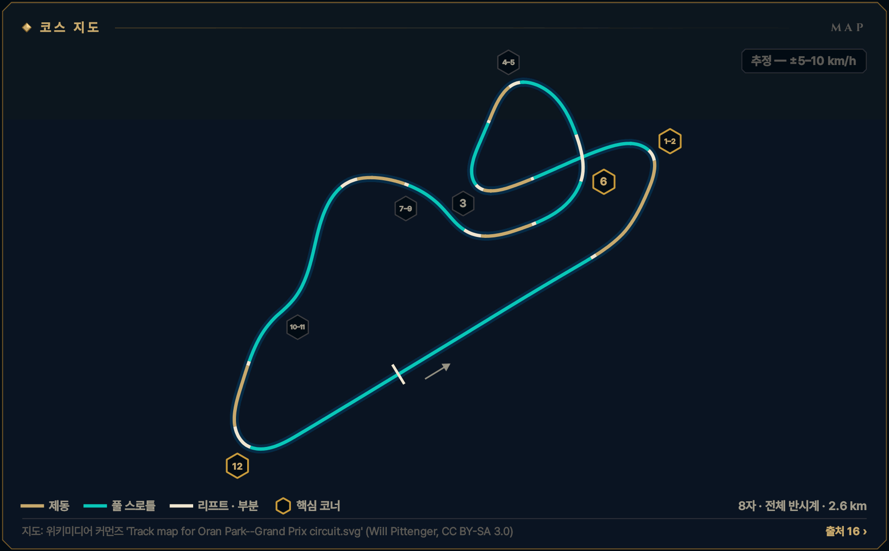
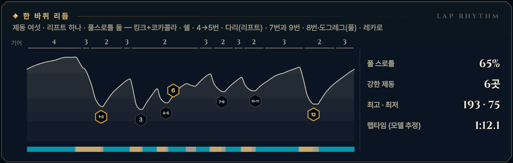

> **GRID서당 : iRacing**은 심레이싱이 처음인 동아리 신입을 위해 만든 드라이빙 아카데미 프로그램입니다. 이 글은 그 안의 **서킷 공략** 모드 — 이번 시즌 리그가 도는 서킷을 코스 개관과 코너별 애니메이션으로 미리 익히는 화면 — 를 블로그로 옮긴 것으로, 글과 애니메이션 모두 프로그램에서 그대로 가져왔습니다. 차는 iRacing의 Ray FF1600이고, 기준은 진도가 없는 루키(입문 렌즈)입니다. 강의는 [GRID서당 시리즈](/posts/untitled_life/motorsport/sim-racing/grid-seodang/)에, 낯선 말은 [용어 사전](/posts/untitled_life/motorsport/sim-racing/grid-seodang/glossary/)에 모아 두었습니다.

## 이번 시즌 일정

> **2026 시즌 4 · 포뮬러 1600 루키 시리즈 · 11주차** — 11.24(화)–11.30(월)
>
> - 루키 FF1600 · 기본 포함 · 12분 레이스 · 스탠딩 스타트 (차: Ray FF1600)
> - iRacing 트랙 이름: Oran Park Raceway - Grand Prix
> - 주차는 매주 화요일 09:00(한국 시간)에 바뀝니다.
>
> iRacing 일정은 시즌마다 바뀝니다. 이 글의 주차는 2026 시즌 4 기준이고, 같은 서킷이 다른 시즌에 돌아오면 그 시즌 일정에서 주차와 레이아웃을 다시 확인하세요.

## 코스 개관

약 2.6 km, 12코너의 좁고 기술적인 8자 서킷입니다. 트랙이 다리 하나로 자기 자신을 가로지르며 전체로는 반시계 방향입니다. 2010년 철거 전 iRacing이 레이저로 스캔해 그대로 달릴 수 있고, 노면은 울퉁불퉁하고 미끄럽다는 평이 많습니다.

- **8자 · 전체 반시계 · 그랑프리 · 2.6 km · 12코너**
- **코너 번호** — iRacing 레이스 리포트와 위키미디어 지도의 12코너 번호를 씁니다: 2번 코카콜라, 3번 쉘, 10–11번 도그레그, 12번 레카로. 1번 '킹크'와 다리 이름은 출처가 하나뿐이라 다리는 '다리'라고만 부릅니다.
- **루키 포인트** — 마루는 곧게, 큰 입력은 직선에서 — 12번 레카로의 탈출이 랩타임
- **속도 표기: 추정 — ±5–10 km/h** — 이 서킷에는 기준이 되는 실주행 기록이 없어, 보정한 FF1600 물리 모델의 계산을 그대로 씁니다. 글과 영상의 속도·페달·기어는 모두 **추정값**(±5–10 km/h)입니다. Test Drive에서 직접 확인하세요.

*지도: 위키미디어 커먼즈 'Track map for Oran Park--Grand Prix circuit.svg' (Will Pittenger, CC BY-SA 3.0) · 선 색: 골드 = 제동, 시안 = 풀 스로틀, 흰색 = 리프트 · 부분 · 금테 육각형 = 핵심 코너 · 번호 = 이 글의 코너 공략 단위*

## 한 바퀴 리듬

제동 여섯 · 리프트 하나 · 풀스로틀 둘 — 킹크+코카콜라 · 쉘 · 4→5번 · 다리(리프트) · 7번과 9번 · 8번·도그레그(풀) · 레카로

*풀 스로틀 65% · 강한 제동 6곳 · 최고 · 최저 193 · 75 km/h · 랩타임 (모델 추정) 1:12.1 — 위 그림의 기어 줄·속도 곡선·입력 띠(골드 = 제동, 시안 = 풀 스로틀)와 코너 번호는 이 기준 랩입니다.*

## 먼저 볼 코너

1. **[T1–2 킹크 + 코카콜라](#w11-u1)** — 1랩 첫 제동 · 킹크와 코카콜라를 제동 하나로
2. **[T12 레카로 코너](#w11-u7)** — 가장 긴 약 660 m 직선을 여는 탈출 · 출구 바깥은 벽
3. **[T6 다리 넘어 6번](#w11-u4)** — 앞이 안 보이는 다리 마루 — 마루 전에 속도를 끝내는 법

> **루키 포인트** — 마루는 곧게, 큰 입력은 직선에서 — 12번 레카로의 탈출이 랩타임

## 루키 안전 노트

- **1랩 킹크** — 출발 후 약 450 m 만에 킹크와 코카콜라 제동 — 차들이 뭉쳐 있습니다. 제동 전에 차선을 정하고 바꾸지 않습니다.
- **다리·도그레그 마루** — 앞이 안 보이는 마루 너머에 멈춘 차가 있을 수 있습니다. 노란 깃발을 꼭 보고, 마루 위에서는 큰 입력을 하지 않습니다.
- **레카로 벽** — 12번 출구 바깥은 콘크리트 벽 — 익숙해질 때까지 차 한 대 폭을 남깁니다.
- **스핀 대처** — 브레이크를 꽉 밟아 세우고, 차들이 지나간 뒤 트랙과 나란히 복귀합니다. 잔디로 나갔다면 차들 사이로 바로 들어오지 않습니다.
- **트랙 리밋** — 차의 절반 이상이 노면 경계 밖이면 1x — 일부 트랙의 표시 구간만 네 바퀴 기준. 루키 규칙: 두 바퀴는 늘 선·연석 안쪽. 오란 파크 전용 규칙은 찾지 못했으니 트랙 Rules 탭을 확인합니다.

**1랩 · 스탠딩 스타트** — 1랩: 평소 제동 지점보다 늦게 밟지 않습니다. 앞차에 맞춰 더 일찍, 부드럽게 밟고, 차 한 대 폭을 남깁니다. 바깥이나 가운데를 지키고 안쪽 다툼에 끼지 않습니다.

## 영상 보는 법

코너마다 앱의 코너 공략 화면을 그대로 녹화했습니다. ▶를 눌러 재생하세요 — 앱의 **가이드** 재생(실제 속도의 0.4배, 화면에서 차가 너무 빠른 코너는 0.25배)이라 단계(접근·제동·턴인·에이펙스·탈출)마다 잠깐 멈추고, 멈춤 링이 차면 다음 단계로 넘어갑니다. 블로그 영상은 단계 시작의 멈춤만 짧게 줄였고 (캡션을 읽을 시간은 그대로), 끝에 앱의 끝 카드가 나옵니다. **급수별 브레이크 시연**을 펼치면 같은 코너를 7급·6급·5급 렌즈로, **흔한 실수 고스트**를 펼치면 실수한 차(빨간 점선)와 나란히 달린 영상을 볼 수 있습니다.

- **제동** — 골드 — 두께·밝기 = 브레이크 압력
- **가속** — 시안 — 스로틀
- **관성** — 흰색 — 두 페달 모두 뗀 구간
- **흔한 실수** — 빨간 점선 고스트 — 한 번에 하나만
- **▼ 제동 시작** — 루키 기준선의 제동 시작점
- **◆ 턴인** — 핸들을 감기 시작하는 곳
- **○ 에이펙스** — 가장 안쪽·가장 느린 곳
- **◇ 트랙아웃** — 탈출에서 닿는 바깥 끝
- **보드 (?)** — 확인 전 참고값 — Test Drive에서 기준점을 정하세요
- **입력 지도** — 골드 띠 = 브레이크, 흰 리본(안쪽) = 핸들. 겹치면 트레일
- **손 칸 · 내림 ×N · 올림** — 왼쪽 패들 N번 내림(블립은 오토 블립이) · 오른쪽 패들 한 번 올림

화면과 글의 속도는 모두 **추정값**(±5–10 km/h)입니다 — 기준 텔레메트리가 없는 서킷이라 모델로 계산했습니다.

## 코너 공략

### T1–2 킹크 + 코카콜라

**좌코너 · 2단 · 최저 약 80 km/h · 핵심 코너 · 추정 — ±5–10 km/h**  
제동 하나, 코너 둘 · 약 190→80 km/h · 1랩 첫 제동

<figure>
  <video src="images/u1.mp4" poster="images/u1_poster.png" controls preload="none" playsinline style="width:100%;max-width:960px"></video>
  <figcaption>시범 — 루키 기준선 · 입문 렌즈(직선 제동) · 가이드 0.4× · 접근 → 제동 → 턴인 → 에이펙스 → 탈출</figcaption>
</figure>

급수별 브레이크 시연 — 7급 · 6급 · 5급 렌즈 (영상 3)

라인과 기준점은 그대로, 페달 쓰는 법만 지금 급수에 맞춥니다. 위 영상은 **직선 제동 — 기초·심화·9·8급** 렌즈입니다 — 턴인 전에 브레이크를 다 뗍니다 (브레이크 끝 = 턴인).

**릴리스 — 7급** — 턴인을 향해 0.4초 넘게 흘려서 0으로 · 7급 기준: 릴리스 0.4초 이상

<figure>
  <video src="images/u1_release.mp4" poster="images/u1_release_poster.png" controls preload="none" playsinline style="width:100%;max-width:960px"></video>
  <figcaption>7급 렌즈(릴리스) · 가이드 0.4× · 접근 → 제동 → 턴인 → 에이펙스 → 탈출</figcaption>
</figure>

- 제동 — **턴인 쪽으로 흘려 놓는다** · 피크 약 54% · 1.0초에 걸쳐 놓기 · 발 · 하나-둘-셋 놓기
- 턴인 — **턴인에서 0에 닿는다** · 턴인에서 약 0\~3% · 발 · 3% → 0

**트레일 — 6급·4\~1급·졸업** — 턴인 때 15\~20%를 남기고, 감는 만큼 풉니다 · 6급 기준: 턴인 때 15% 이상 남기기

<figure>
  <video src="images/u1_trail.mp4" poster="images/u1_trail_poster.png" controls preload="none" playsinline style="width:100%;max-width:960px"></video>
  <figcaption>6급 렌즈(트레일) · 가이드 0.4× · 접근 → 제동 → 턴인 → 에이펙스 → 탈출</figcaption>
</figure>

- 제동 — **턴인까지 조금 남긴다** · 피크 약 50% · 턴인에서 약 18% · 발 · 놓으며 남기기
- 턴인 — **에이펙스 전 0으로 흘린다** · 약 18% → 에이펙스 전 0 · 발 · 18% → 0 / 손 · 놓는 만큼 감기

**깊은 트레일 — 5급** — 턴인 때 30% 이상, 에이펙스 앞까지 끌고 갑니다 · 5급 기준: 턴인 때 30% 이상 남기기

<figure>
  <video src="images/u1_deep.mp4" poster="images/u1_deep_poster.png" controls preload="none" playsinline style="width:100%;max-width:960px"></video>
  <figcaption>5급 렌즈(깊은 트레일) · 가이드 0.4× · 접근 → 제동 → 턴인 → 에이펙스 → 탈출</figcaption>
</figure>

- 제동 — **더 깊게, 턴인 32%** · 피크 약 46% · 턴인에서 약 32% · 발 · 천천히 남기기
- 턴인 — **앞을 누른 채 돌린다** · 약 32% → 에이펙스 무렵 0 · 발 · 32% → 0

4\~1급은 같은 영상의 캡션에 강조 한 줄(◆)이 더 붙습니다:

- ◆ 4급(턴인·에이펙스) — 브레이크 끝 = 스로틀 시작 — 코카콜라 안 빈 시간 0.4초 이하

흔한 실수 고스트 — 늦은 제동 → 잠김 → 직진

<figure>
  <video src="images/u1_ghost.mp4" poster="images/u1_ghost_poster.png" controls preload="none" playsinline style="width:100%;max-width:960px"></video>
  <figcaption>흔한 실수: 늦은 제동 → 잠김 → 직진 — 25 m 늦게 100% → 바퀴가 잠겨 직진 · 트랙 밖</figcaption>
</figure>

흔한 실수: **늦은 제동 → 잠김 → 직진** — 25 m 늦게 100% → 바퀴가 잠겨 직진 · 트랙 밖. 빨간 점선과 붉은 차가 실수 고스트, 흰 차가 루키 기준선입니다. 두 차는 같은 시계로 달리므로 늦어지거나 밀려나는 만큼이 그대로 보입니다. 영상은 앱에서 [흔한 실수]를 눌렀을 때처럼 그 실수가 시작되는 단계부터 재생합니다. 끝 카드의 '트레일 렌즈 기준'은 결과의 시간 차를 트레일(6급) 렌즈 주행과 비교한 값이라는 뜻입니다.

> **1랩 · 스탠딩 스타트** — 1랩: 평소 제동 지점보다 늦게 밟지 않습니다. 앞차에 맞춰 더 일찍, 부드럽게 밟고, 차 한 대 폭을 남깁니다. 바깥이나 가운데를 지키고 안쪽 다툼에 끼지 않습니다. 출발 후 약 450 m 만에 킹크가 오니 제동 전에 차선을 정하고, 제동 중에는 바꾸지 않습니다.

#### 접근

12번을 나와 약 660 m 메인 직선을 4단 약 190 km/h로 달립니다. 직선의 오른쪽에 붙어 오고, 살짝 왼쪽인 1번 킹크와 느린 2번 코카콜라를 '제동 하나에 코너 둘'로 읽습니다. 킹크 앞의 고정 기준물(보드·연석 시작·노면 이음매) 하나를 Test Drive에서 정합니다.

*지금 손과 발 — 발 · 풀스로틀 / 손 · 곧게 / 눈 · 킹크 앞 기준물*

**보드 · 기준점** — 모두 확인 전 참고값입니다. Test Drive에서 직접 보고 정하세요.

- **제동 · 기준점**? 킹크 전 직선 — 보드 미확인. 애니메이션은 2번 턴인 약 185 m 앞에서 밟음 *(확인 전 참고값)*
- **턴인**? 킹크를 지나 오른쪽 끝에서 *(확인 전 참고값)*
- **에이펙스**? 코너를 3분의 2쯤 돈 왼쪽 가장자리 *(확인 전 참고값)*

#### 제동

킹크 전, 핸들이 곧을 때 한 음절로 '꾹' 약 54%. 킹크에서는 그 압력을 더하지 않고 그대로 지킨 채 핸들만 살짝 감고, 짧은 직선에서 4→3→2단으로 내린 뒤 2번 턴인 직전 약 0.8초에 걸쳐 놓습니다. ABS가 없어 꺾으면서 더 세게 밟으면 안쪽 앞바퀴가 잠깁니다.

*지금 손과 발 — 발 · 꾹 → 천천히 / 손 · 킹크만 살짝 · 내림 ×2 / 눈 · 코카콜라 입구*

#### 턴인

킹크는 거의 곧게 펴서 지나고, 출구에서 차를 오른쪽에 둡니다 — 그 자리가 2번 진입 자리입니다. 2번이 보이기 시작해도 반 박자 참았다가 오른쪽 끝에서 늦게 감습니다.

*지금 손과 발 — 발 · 0 → 유지 / 손 · 한 번에 감기 / 눈 · 왼쪽 가장자리*

#### 에이펙스

2번 에이펙스는 코너를 3분의 2쯤 돈 왼쪽 가장자리, 차 머리가 다리 쪽을 가리키는 곳입니다. 최저 약 80 km/h, 2단. 핸들은 한 번 감아 그대로 두고, 브레이크가 0이 되면 스로틀을 엽니다.

*지금 손과 발 — 발 · 유지 → 열기 / 손 · 그대로 / 눈 · 다리*

#### 탈출

핸들을 푸는 만큼 스로틀을 열어, 다 풀었을 때 100%. 출구는 오른쪽 끝까지 쓰고, 다리 밑 직선에서 3번을 위해 왼쪽으로 돌아갑니다.

*지금 손과 발 — 발 · 앞으로만 / 손 · 풀기 / 눈 · 다리 밑*

#### 흔한 실수

- 늦게 밟고 킹크 안에서 세게 → 앞바퀴가 잠겨 그대로 자갈밭  
  → 더 일찍, 곧을 때 밟고 감을수록 던다
- 2번이 보인다고 일찍 감기 → 출구에서 오른쪽 잔디로  
  → 반 박자 늦게, 에이펙스는 3분의 2 지점
- 턴인에서 브레이크를 탁 놓기 → 앞이 밀린다  
  → 하나-둘-셋으로 세며 놓는다

#### 이 코너에서 확인할 것

- [ ] 빠른 드라이버는 킹크를 리프트만으로 지나는지(루키는 제동)
- [ ] 킹크 앞의 고정 기준물
- [ ] 피트 출구가 1번 근처 바깥(오른쪽)으로 합류하는지

#### 연결된 강의 · 드릴

- 강의: [심화 1강(출발의 기술)](/posts/untitled_life/motorsport/sim-racing/grid-seodang/advanced/d1-the-start/) · [심화 2강(코너의 다섯 얼굴)](/posts/untitled_life/motorsport/sim-racing/grid-seodang/advanced/d2-five-corner-faces/) · [심화 8강(페달의 문법)](/posts/untitled_life/motorsport/sim-racing/grid-seodang/advanced/d6-pedal-grammar/) · [심화 6강(교본 차 해부)](/posts/untitled_life/motorsport/sim-racing/grid-seodang/advanced/d8-training-car-and-shifting/) · [심화 7강(한계의 신호)](/posts/untitled_life/motorsport/sim-racing/grid-seodang/advanced/d9-signals-at-the-limit/) · [8급(제동의 기본)](/posts/untitled_life/motorsport/sim-racing/grid-seodang/grades/g8-braking-basics/) · [7급(릴리스 수양)](/posts/untitled_life/motorsport/sim-racing/grid-seodang/grades/g7-release/) · [6급(트레일 입문)](/posts/untitled_life/motorsport/sim-racing/grid-seodang/grades/g6-trail-intro/) · [4급(전환 수련)](/posts/untitled_life/motorsport/sim-racing/grid-seodang/grades/g4-transition/)
- 훈련장 드릴: 제동 수양 · 정밀 압력 · 트레일 브레이킹

<small>근거: S3 · S5 · S6 · S8 · S9 · S17 (아래 출처 목록) · 신뢰도 L</small>

### T3 쉘 코너

**우코너 · 2단 · 최저 약 70 km/h · 추정 — ±5–10 km/h**  
다리가 카운트다운 · 약 140→70 km/h · 추월 지점

<figure>
  <video src="images/u2.mp4" poster="images/u2_poster.png" controls preload="none" playsinline style="width:100%;max-width:960px"></video>
  <figcaption>시범 — 루키 기준선 · 입문 렌즈(직선 제동) · 가이드 0.4× · 접근 → 제동 → 턴인 → 에이펙스 → 탈출</figcaption>
</figure>

급수별 브레이크 시연 — 7급 · 6급 · 5급 렌즈 (영상 3)

라인과 기준점은 그대로, 페달 쓰는 법만 지금 급수에 맞춥니다. 위 영상은 **직선 제동 — 기초·심화·9·8급** 렌즈입니다 — 턴인 전에 브레이크를 다 뗍니다 (브레이크 끝 = 턴인).

**릴리스 — 7급** — 턴인을 향해 0.4초 넘게 흘려서 0으로 · 7급 기준: 릴리스 0.4초 이상

<figure>
  <video src="images/u2_release.mp4" poster="images/u2_release_poster.png" controls preload="none" playsinline style="width:100%;max-width:960px"></video>
  <figcaption>7급 렌즈(릴리스) · 가이드 0.4× · 접근 → 제동 → 턴인 → 에이펙스 → 탈출</figcaption>
</figure>

- 제동 — **턴인 쪽으로 흘려 놓는다** · 피크 약 56% · 0.9초에 걸쳐 놓기 · 발 · 하나-둘-셋 놓기
- 턴인 — **턴인에서 0에 닿는다** · 턴인에서 약 0\~3% · 발 · 3% → 0

**트레일 — 6급·4\~1급·졸업** — 턴인 때 15\~20%를 남기고, 감는 만큼 풉니다 · 6급 기준: 턴인 때 15% 이상 남기기

<figure>
  <video src="images/u2_trail.mp4" poster="images/u2_trail_poster.png" controls preload="none" playsinline style="width:100%;max-width:960px"></video>
  <figcaption>6급 렌즈(트레일) · 가이드 0.4× · 접근 → 제동 → 턴인 → 에이펙스 → 탈출</figcaption>
</figure>

- 제동 — **턴인까지 조금 남긴다** · 피크 약 51% · 턴인에서 약 18% · 발 · 놓으며 남기기
- 턴인 — **에이펙스 전 0으로 흘린다** · 약 18% → 에이펙스 전 0 · 발 · 18% → 0 / 손 · 놓는 만큼 감기

**깊은 트레일 — 5급** — 턴인 때 30% 이상, 에이펙스 앞까지 끌고 갑니다 · 5급 기준: 턴인 때 30% 이상 남기기

<figure>
  <video src="images/u2_deep.mp4" poster="images/u2_deep_poster.png" controls preload="none" playsinline style="width:100%;max-width:960px"></video>
  <figcaption>5급 렌즈(깊은 트레일) · 가이드 0.4× · 접근 → 제동 → 턴인 → 에이펙스 → 탈출</figcaption>
</figure>

- 제동 — **느린 코너, 깊게 32%** · 피크 약 45% · 턴인에서 약 32% · 발 · 천천히 남기기
- 턴인 — **앞을 누른 채 돌린다** · 약 32% → 에이펙스 무렵 0 · 발 · 32% → 0

흔한 실수 고스트 — 너무 세게, 너무 오래

<figure>
  <video src="images/u2_ghost.mp4" poster="images/u2_ghost_poster.png" controls preload="none" playsinline style="width:100%;max-width:960px"></video>
  <figcaption>흔한 실수: 너무 세게, 너무 오래 — 95%로 꾹, 굴러가며 최저 약 50 km/h → 약 2.6초 늦음</figcaption>
</figure>

흔한 실수: **너무 세게, 너무 오래** — 95%로 꾹, 굴러가며 최저 약 50 km/h → 약 2.6초 늦음. 빨간 점선과 붉은 차가 실수 고스트, 흰 차가 루키 기준선입니다. 두 차는 같은 시계로 달리므로 늦어지거나 밀려나는 만큼이 그대로 보입니다. 영상은 앱에서 [흔한 실수]를 눌렀을 때처럼 그 실수가 시작되는 단계부터 재생합니다. 끝 카드의 '트레일 렌즈 기준'은 결과의 시간 차를 트레일(6급) 렌즈 주행과 비교한 값이라는 뜻입니다.

#### 접근

2번을 나와 다리 밑을 지나면 길이 3번을 향해 살짝 내려갑니다. 이 코너에는 누구나 볼 수 있는 기준점이 있습니다 — 다리입니다. 2단 약 140 km/h, 직선의 왼쪽(오른쪽 코너의 바깥)을 탑니다.

*지금 손과 발 — 발 · 풀스로틀 / 손 · 곧게 / 눈 · 다리 그림자*

**보드 · 기준점** — 모두 확인 전 참고값입니다. Test Drive에서 직접 보고 정하세요.

- **제동 · 기준점**? 다리 밑을 지나 '하나' — 애니메이션은 다리 약 65 m 뒤, 턴인 약 75 m 앞 *(확인 전 참고값)*
- **에이펙스**? 오른쪽 안쪽 가장자리(늦게) *(확인 전 참고값)*

#### 제동

다리 밑을 빠져나가며 '하나'를 세고 곧게 '꾹' 약 56% — 익숙해지면 '둘'까지 늦춥니다. 내리막이라 평지보다 멈추는 거리가 깁니다. 턴인까지 하나-둘-셋으로 풉니다.

*지금 손과 발 — 발 · 꾹, 하나-둘-셋 / 손 · 곧게 / 눈 · 턴인 지점*

#### 턴인

왼쪽 끝에서, 생각보다 늦게 감습니다. 라인은 U가 아니라 V — 가장 깊은 곳에서 차를 돌려 세웁니다.

*지금 손과 발 — 발 · 0 → 유지 / 손 · 한 번에 감기 / 눈 · 오른쪽 가장자리*

#### 에이펙스

늦은 에이펙스, 오른쪽 안쪽 가장자리입니다. 최저 약 70 km/h, 2단. 핸들은 한 번 감아 그대로 두고, 브레이크가 0이 되는 순간 스로틀을 엽니다.

*지금 손과 발 — 발 · 0 → 스로틀 / 손 · 그대로 / 눈 · 왼쪽 출구*

#### 탈출

푸는 만큼 열어 100%. 왼쪽 끝으로 나가면 바로 이어지는 4번(오른쪽)을 위한 자리도 저절로 만들어집니다.

*지금 손과 발 — 발 · 앞으로만 / 손 · 풀기 / 눈 · 4번*

#### 흔한 실수

- 너무 세게, 너무 오래 — 꾹 밟고 에이펙스까지 굴러간다  
  → 같은 카운트, 약 56%, 놓는 끝에서 스로틀
- 내리막에서 늦게 세게 → 앞바퀴가 잠겨 에이펙스를 지나친다  
  → 다리 카운트로 일찍, 점진적으로
- U 라인으로 안쪽을 끌어안기 → 출구에서 왼쪽 잔디  
  → V, 늦은 에이펙스

#### 이 코너에서 확인할 것

- [ ] 다리 그림자에서 '하나·둘' 카운트가 맞는지
- [ ] 3번 기어(1단/2단)

#### 연결된 강의 · 드릴

- 강의: [심화 2강(코너의 다섯 얼굴)](/posts/untitled_life/motorsport/sim-racing/grid-seodang/advanced/d2-five-corner-faces/) · [심화 3강(상황의 라인)](/posts/untitled_life/motorsport/sim-racing/grid-seodang/advanced/d3-situational-lines/) · [심화 8강(페달의 문법)](/posts/untitled_life/motorsport/sim-racing/grid-seodang/advanced/d6-pedal-grammar/) · [8급(제동의 기본)](/posts/untitled_life/motorsport/sim-racing/grid-seodang/grades/g8-braking-basics/) · [7급(릴리스 수양)](/posts/untitled_life/motorsport/sim-racing/grid-seodang/grades/g7-release/) · [6급(트레일 입문)](/posts/untitled_life/motorsport/sim-racing/grid-seodang/grades/g6-trail-intro/) · [5급(트레일 숙달)](/posts/untitled_life/motorsport/sim-racing/grid-seodang/grades/g5-trail-mastery/) · [3급(스로틀 서예)](/posts/untitled_life/motorsport/sim-racing/grid-seodang/grades/g3-throttle-calligraphy/)
- 훈련장 드릴: 제동 수양 · 트레일 브레이킹 · 스로틀 서예 · 정밀 압력

<small>근거: S5 · S7 · S8 · S15 · S17 · S20 (아래 출처 목록) · 신뢰도 M</small>

### T4–5 4→5번 코너

**우코너 · 2단 · 최저 약 85 km/h · 추정 — ±5–10 km/h**  
오른쪽 호 하나 · 약 85 km/h · 다리 오르막 시작

<figure>
  <video src="images/u3.mp4" poster="images/u3_poster.png" controls preload="none" playsinline style="width:100%;max-width:960px"></video>
  <figcaption>시범 — 루키 기준선 · 입문 렌즈(직선 제동) · 가이드 0.4× · 접근 → 제동 → 턴인 → 에이펙스 → 탈출</figcaption>
</figure>

급수별 브레이크 시연 — 7급 · 6급 · 5급 렌즈 (영상 3)

라인과 기준점은 그대로, 페달 쓰는 법만 지금 급수에 맞춥니다. 위 영상은 **직선 제동 — 기초·심화·9·8급** 렌즈입니다 — 턴인 전에 브레이크를 다 뗍니다 (브레이크 끝 = 턴인).

**릴리스 — 7급** — 턴인을 향해 0.4초 넘게 흘려서 0으로 · 7급 기준: 릴리스 0.4초 이상

<figure>
  <video src="images/u3_release.mp4" poster="images/u3_release_poster.png" controls preload="none" playsinline style="width:100%;max-width:960px"></video>
  <figcaption>7급 렌즈(릴리스) · 가이드 0.4× · 접근 → 제동 → 턴인 → 에이펙스 → 탈출</figcaption>
</figure>

- 제동 — **턴인 쪽으로 흘려 놓는다** · 피크 약 66% · 0.8초에 걸쳐 놓기 · 발 · 하나-둘-셋 놓기
- 턴인 — **턴인에서 0에 닿는다** · 턴인에서 약 0\~3% · 발 · 3% → 0

**트레일 — 6급·4\~1급·졸업** — 턴인 때 15\~20%를 남기고, 감는 만큼 풉니다 · 6급 기준: 턴인 때 15% 이상 남기기

<figure>
  <video src="images/u3_trail.mp4" poster="images/u3_trail_poster.png" controls preload="none" playsinline style="width:100%;max-width:960px"></video>
  <figcaption>6급 렌즈(트레일) · 가이드 0.4× · 접근 → 제동 → 턴인 → 에이펙스 → 탈출</figcaption>
</figure>

- 제동 — **턴인까지 조금 남긴다** · 피크 약 51% · 턴인에서 약 18% · 발 · 놓으며 남기기
- 턴인 — **에이펙스 전 0으로 흘린다** · 약 18% → 에이펙스 전 0 · 발 · 18% → 0 / 손 · 놓는 만큼 감기

**깊은 트레일 — 5급** — 턴인 때 30% 이상, 에이펙스 앞까지 끌고 갑니다 · 5급 기준: 턴인 때 30% 이상 남기기

<figure>
  <video src="images/u3_deep.mp4" poster="images/u3_deep_poster.png" controls preload="none" playsinline style="width:100%;max-width:960px"></video>
  <figcaption>5급 렌즈(깊은 트레일) · 가이드 0.4× · 접근 → 제동 → 턴인 → 에이펙스 → 탈출</figcaption>
</figure>

- 제동 — **더 깊게, 턴인 32%** · 피크 약 45% · 턴인에서 약 32% · 발 · 천천히 남기기
- 턴인 — **앞을 누른 채 돌린다** · 약 32% → 에이펙스 무렵 0 · 발 · 32% → 0

흔한 실수 고스트 — 이른 턴인 → 출구에서 밀림

<figure>
  <video src="images/u3_ghost.mp4" poster="images/u3_ghost_poster.png" controls preload="none" playsinline style="width:100%;max-width:960px"></video>
  <figcaption>흔한 실수: 이른 턴인 → 출구에서 밀림 — 일찍 꺾으면 출구에서 바깥으로 밀린다 → 약 0.8초 늦음 · 트랙 밖</figcaption>
</figure>

흔한 실수: **이른 턴인 → 출구에서 밀림** — 일찍 꺾으면 출구에서 바깥으로 밀린다 → 약 0.8초 늦음 · 트랙 밖. 빨간 점선과 붉은 차가 실수 고스트, 흰 차가 루키 기준선입니다. 두 차는 같은 시계로 달리므로 늦어지거나 밀려나는 만큼이 그대로 보입니다. 영상은 앱에서 [흔한 실수]를 눌렀을 때처럼 그 실수가 시작되는 단계부터 재생합니다. 끝 카드의 '트레일 렌즈 기준'은 결과의 시간 차를 트레일(6급) 렌즈 주행과 비교한 값이라는 뜻입니다.

#### 접근

3번에서 짧게 가속하면 곧 4번입니다. 4번과 5번은 사이에 직선이 거의 없는 오른쪽이라 하나의 호로 읽습니다 — 5번을 나오면 다리까지 오르막이 이어지니, 이 호의 끝이 더 중요합니다.

*지금 손과 발 — 발 · 풀스로틀 / 손 · 곧게 / 눈 · 4번 안쪽*

**보드 · 기준점** — 모두 확인 전 참고값입니다. Test Drive에서 직접 보고 정하세요.

- **제동 · 기준점**? 3번 출구에서 보이는 고정 물체 — 턴인 약 40 m 앞 *(확인 전 참고값)*
- **에이펙스**? 4번 오른쪽 가장자리 *(확인 전 참고값)*

#### 제동

짧게 '꾹' 약 64%, 그리고 턴인까지 풉니다. 기준물은 3번 출구에서 보이는 고정 물체 하나로 정합니다(턴인 약 40 m 앞).

*지금 손과 발 — 발 · 꾹, 놓기 / 손 · 곧게 / 눈 · 4번 안쪽*

#### 턴인

3번이 남겨 준 왼쪽 자리에서 조금 늦게 감아 4번의 오른쪽 가장자리를 에이펙스로 삼습니다. 핸들은 한 번에, 천천히 더해 갑니다.

*지금 손과 발 — 발 · 0 → 유지 / 손 · 천천히 감기 / 눈 · 4번 연석*

#### 에이펙스

4번 에이펙스(최저 약 85 km/h) 뒤에는 핸들을 조금만 풀고, 남은 각도로 5번까지 호를 이어 갑니다. 핸들은 한 획 — 다시 감지 않고, 두 페달이 모두 쉬는 시간도 없습니다.

*지금 손과 발 — 발 · 앞으로만 / 손 · 조금 풀기 / 눈 · 5번 쪽*

#### 탈출

5번을 지나며 핸들을 마저 풀고 풀스로틀, 왼쪽 끝으로 나가 다리를 향한 오르막에 속도를 싣습니다.

*지금 손과 발 — 발 · 앞으로만 / 손 · 풀기 / 눈 · 다리*

#### 흔한 실수

- 4번에 일찍 감기 → 5번에서 길이 모자라 오르막에서 바깥으로  
  → 4번은 조금 늦게, 5번을 위해 2\~3 km/h 덜
- 두 코너를 안쪽에 붙은 큰 원으로, 핸들을 더 감기 → 느리다  
  → 4번 에이펙스 뒤 조금 풀고 한 획으로 이어 간다
- 4번과 5번 사이에서 두 페달 모두 쉬기(코스팅)  
  → 유지 스로틀로 이어 붙인다

#### 이 코너에서 확인할 것

- [ ] 4번 제동 기준물
- [ ] 4번이 리프트로도 되는지

#### 연결된 강의 · 드릴

- 강의: [심화 2강(코너의 다섯 얼굴)](/posts/untitled_life/motorsport/sim-racing/grid-seodang/advanced/d2-five-corner-faces/) · [심화 8강(페달의 문법)](/posts/untitled_life/motorsport/sim-racing/grid-seodang/advanced/d6-pedal-grammar/) · [6급(트레일 입문)](/posts/untitled_life/motorsport/sim-racing/grid-seodang/grades/g6-trail-intro/) · [4급(전환 수련)](/posts/untitled_life/motorsport/sim-racing/grid-seodang/grades/g4-transition/) · [2급(스티어링 일필휘지)](/posts/untitled_life/motorsport/sim-racing/grid-seodang/grades/g2-one-stroke-steering/)
- 훈련장 드릴: 전환 · 조향 일필

<small>근거: S3 · S17 (아래 출처 목록) · 신뢰도 L</small>

### T6 다리 넘어 6번

**우코너 · 2단 · 최저 약 120 km/h · 핵심 코너 · 추정 — ±5–10 km/h**  
다리 마루 — 오르막에서 덜고, 넘어서 감는다 · 약 120 km/h

<figure>
  <video src="images/u4.mp4" poster="images/u4_poster.png" controls preload="none" playsinline style="width:100%;max-width:960px"></video>
  <figcaption>시범 — 루키 기준선 · 렌즈 공통 · 가이드 0.4× · 접근 → 리프트 → 턴인 → 에이펙스 → 탈출</figcaption>
</figure>

급수별 브레이크 시연 — 모든 급수가 같은 그림

이 코너는 렌즈가 같습니다 — 리프트·풀스로틀 코너는 브레이크를 쓰지 않아 모든 급수가 같은 페달 그림을 봅니다.

#### 접근

5번을 나와 오르막을 2단으로 오르면 다리입니다. 꼭대기는 앞이 안 보이는 마루이고, 넘자마자 길고 빠른 오른쪽 6번이 시작됩니다. 속도 조절은 모두 마루 전, 오르막에서 끝냅니다.

*지금 손과 발 — 발 · 풀스로틀 / 손 · 작게 오른쪽 / 눈 · 다리 난간*

**보드 · 기준점** — 모두 확인 전 참고값입니다. Test Drive에서 직접 보고 정하세요.

- **리프트 시작**? 다리(난간)가 가까워질 때 — 애니메이션은 다리 약 65 m 앞에서 덜기 시작 *(확인 전 참고값)*
- **턴인**? 다리 마루를 넘어 내려앉는 순간 *(확인 전 참고값)*

#### 리프트

다리 약 65 m 앞, 오르막에서 스로틀을 약 20%까지 덜어 속도를 맞춥니다 — 이 장면에는 브레이크가 없습니다. 마루 위에서는 차가 가벼우니 스로틀을 일정하게 둔 채, 핸들을 크게 더 감지 않고 넘습니다.

*지금 손과 발 — 발 · 약 20% 유지 / 손 · 크게 감지 않기 / 눈 · 다리 너머*

**급수 시험 주행에서는 리프트만 — 10%를 넘는 톡도 제동 코너로 채점됩니다.**

#### 턴인

차가 마루를 넘어 내려앉는 순간 감습니다. 이 코너는 다리 바로 뒤가 가장 조입니다.

*지금 손과 발 — 발 · 일정하게 / 손 · 감기 / 눈 · 오른쪽 가장자리*

#### 에이펙스

오른쪽 가장자리, 코너의 앞부분이 에이펙스입니다. 최저 약 120 km/h — 손은 고요히, 스로틀은 여기서부터 앞으로만. 너무 빠르다 싶으면 10\~15%만 덜고 핸들은 더 감지 않습니다.

*지금 손과 발 — 발 · 앞으로만 / 손 · 고요히 / 눈 · 왼쪽 출구*

#### 탈출

코너가 열리는 만큼 핸들을 풀고 끝까지 엽니다. 내리막에서 3단으로 올리고, 왼쪽 끝으로 나가면 7번 진입 자리입니다.

*지금 손과 발 — 발 · 앞으로만 / 손 · 풀기 / 눈 · 7번*

#### 흔한 실수

- 늦게 덜기 — 빠른 채로 마루에 올라 바깥으로 밀린다  
  → 다리 전, 오르막에서 일찍 덜고 랩마다 조금씩 늦춘다
- 마루 위에서 브레이크 → 가벼운 차의 바퀴가 잠기거나 튄다  
  → 속도는 마루 전에 — 마루 위에서는 아무것도 하지 않는다
- 마루에서 핸들을 크게 감거나 코너 중간에 발을 확 떼기 → 뒤가 돈다  
  → 내려앉은 뒤 감고, 코너 안에서는 작은 스로틀 조절만

#### 이 코너에서 확인할 것

- [ ] 다리 마루에서 차가 얼마나 가벼워지는지
- [ ] 리프트 기준물(다리 난간 시작)
- [ ] 빠른 드라이버가 여기서 브레이크를 쓰는지

#### 연결된 강의 · 드릴

- 강의: [심화 9강(기울어진 트랙)](/posts/untitled_life/motorsport/sim-racing/grid-seodang/advanced/d7-banked-track/) · [심화 2강(코너의 다섯 얼굴)](/posts/untitled_life/motorsport/sim-racing/grid-seodang/advanced/d2-five-corner-faces/) · [심화 4강(차의 균형)](/posts/untitled_life/motorsport/sim-racing/grid-seodang/advanced/d4-car-balance/) · [심화 8강(페달의 문법)](/posts/untitled_life/motorsport/sim-racing/grid-seodang/advanced/d6-pedal-grammar/) · [2급(스티어링 일필휘지)](/posts/untitled_life/motorsport/sim-racing/grid-seodang/grades/g2-one-stroke-steering/) · [3급(스로틀 서예)](/posts/untitled_life/motorsport/sim-racing/grid-seodang/grades/g3-throttle-calligraphy/) · [심화 10강(라임락 교본)](/posts/untitled_life/motorsport/sim-racing/grid-seodang/advanced/d11-lime-rock-textbook/)
- 훈련장 드릴: 조향 일필 · 스로틀 서예

<small>근거: S4 · S5 · S14 · S15 · S16 (아래 출처 목록) · 신뢰도 L</small>

### T7–9 7→8→9번 코너

**우·좌·좌 복합 · 2단 · 최저 약 110 km/h · 추정 — ±5–10 km/h**  
마지막 코너가 왕 · 7번 양보, 8번 풀, 9번 탈출

<figure>
  <video src="images/u5.mp4" poster="images/u5_poster.png" controls preload="none" playsinline style="width:100%;max-width:960px"></video>
  <figcaption>시범 — 루키 기준선 · 입문 렌즈(직선 제동) · 가이드 0.4× · 접근 → 제동 → 턴인 → 전환 → 에이펙스 ② → 제동 ③ → 에이펙스 ③ → 탈출</figcaption>
</figure>

급수별 브레이크 시연 — 7급 · 6급 · 5급 렌즈 (영상 3)

라인과 기준점은 그대로, 페달 쓰는 법만 지금 급수에 맞춥니다. 위 영상은 **직선 제동 — 기초·심화·9·8급** 렌즈입니다 — 턴인 전에 브레이크를 다 뗍니다 (브레이크 끝 = 턴인).

**릴리스 — 7급** — 턴인을 향해 0.4초 넘게 흘려서 0으로 · 7급 기준: 릴리스 0.4초 이상

<figure>
  <video src="images/u5_release.mp4" poster="images/u5_release_poster.png" controls preload="none" playsinline style="width:100%;max-width:960px"></video>
  <figcaption>7급 렌즈(릴리스) · 가이드 0.4× · 접근 → 제동 → 턴인 → 전환 → 에이펙스 ② → 제동 ③ → 에이펙스 ③ → 탈출</figcaption>
</figure>

- 제동 — **턴인 쪽으로 흘려 놓는다** · 피크 약 85% · 0.8초에 걸쳐 놓기 · 발 · 하나-둘-셋 놓기
- 턴인 — **턴인에서 0에 닿는다** · 턴인에서 약 0\~3% · 발 · 3% → 0

**트레일 — 6급·4\~1급·졸업** — 턴인 때 15\~20%를 남기고, 감는 만큼 풉니다 · 6급 기준: 턴인 때 15% 이상 남기기

<figure>
  <video src="images/u5_trail.mp4" poster="images/u5_trail_poster.png" controls preload="none" playsinline style="width:100%;max-width:960px"></video>
  <figcaption>6급 렌즈(트레일) · 가이드 0.4× · 접근 → 제동 → 턴인 → 전환 → 에이펙스 ② → 제동 ③ → 에이펙스 ③ → 탈출</figcaption>
</figure>

- 제동 — **턴인까지 조금 남긴다** · 피크 약 75% · 턴인에서 약 18% · 발 · 놓으며 남기기
- 턴인 — **에이펙스 전 0으로 흘린다** · 약 18% → 에이펙스 전 0 · 발 · 18% → 0 / 손 · 놓는 만큼 감기
- 제동 ③ — **9번도 턴인까지 조금** · 9번 턴인에서 약 15\~20% · 에이펙스 전 0 · 발 · 놓으며 남기기

**깊은 트레일 — 5급** — 턴인 때 30% 이상, 에이펙스 앞까지 끌고 갑니다 · 5급 기준: 턴인 때 30% 이상 남기기

<figure>
  <video src="images/u5_deep.mp4" poster="images/u5_deep_poster.png" controls preload="none" playsinline style="width:100%;max-width:960px"></video>
  <figcaption>5급 렌즈(깊은 트레일) · 가이드 0.4× · 접근 → 제동 → 턴인 → 전환 → 에이펙스 ② → 제동 ③ → 에이펙스 ③ → 탈출</figcaption>
</figure>

- 제동 — **더 깊게, 턴인 32%** · 피크 약 45% · 턴인에서 약 32% · 발 · 천천히 남기기
- 턴인 — **앞을 누른 채 돌린다** · 약 32% → 에이펙스 무렵 0 · 발 · 32% → 0
- 제동 ③ — **9번은 더 깊게** · 9번 턴인에서 약 30% · 에이펙스 무렵 0 · 발 · 천천히 남기기

흔한 실수 고스트 — 첫 코너 욕심 → 두 번째를 잃음

<figure>
  <video src="images/u5_ghost.mp4" poster="images/u5_ghost_poster.png" controls preload="none" playsinline style="width:100%;max-width:960px"></video>
  <figcaption>흔한 실수: 첫 코너 욕심 → 두 번째를 잃음 — 첫 코너에 욕심내면 두 번째를 잃는다 → 약 0.1초 늦음 · 트랙 밖</figcaption>
</figure>

흔한 실수: **첫 코너 욕심 → 두 번째를 잃음** — 첫 코너에 욕심내면 두 번째를 잃는다 → 약 0.1초 늦음 · 트랙 밖. 빨간 점선과 붉은 차가 실수 고스트, 흰 차가 루키 기준선입니다. 두 차는 같은 시계로 달리므로 늦어지거나 밀려나는 만큼이 그대로 보입니다. 영상은 앱에서 [흔한 실수]를 눌렀을 때처럼 그 실수가 시작되는 단계부터 재생합니다. 끝 카드의 '트레일 렌즈 기준'은 결과의 시간 차를 트레일(6급) 렌즈 주행과 비교한 값이라는 뜻입니다.

#### 접근

6번에서 나오면 오른쪽 7번, 완만한 왼쪽 8번, 그리고 왼쪽 9번이 이어집니다. 9번을 나오면 도그레그를 지나 12번 제동까지 약 300 m를 밟고 가므로, 이 세 코너는 9번의 탈출을 위해 거꾸로 설계합니다.

*지금 손과 발 — 발 · 풀스로틀 / 손 · 곧게 / 눈 · 7번 안쪽*

**보드 · 기준점** — 모두 확인 전 참고값입니다. Test Drive에서 직접 보고 정하세요.

- **제동 · 기준점**? 6번 출구 직후 — 기준물은 Test Drive에서(턴인 약 50 m 앞) *(확인 전 참고값)*
- **에이펙스**? 9번 왼쪽 가장자리, 늦은 에이펙스 *(확인 전 참고값)*

#### 제동

6번 출구 직후, 곧게 '꾹' 약 85%로 7번을 위해 줄이고 3→2단으로 내립니다. 기준물은 Test Drive에서 하나 정합니다(턴인 약 50 m 앞).

*지금 손과 발 — 발 · 꾹, 놓기 / 손 · 곧게 · 내림 ×1 / 눈 · 7번 안쪽*

#### 턴인

왼쪽에서 들어가 7번 오른쪽 가장자리를 짚습니다(최저 약 110 km/h). 브레이크 끝 = 스로틀 시작, 그리고 출구에서 왼쪽 끝까지 나가지 않고 가운데쯤에서 멈춥니다.

*지금 손과 발 — 발 · 0 → 유지 / 손 · 한 번 감기 / 눈 · 8번*

#### 전환

스로틀을 앞으로만 열며 핸들을 오른쪽에서 왼쪽으로 넘깁니다. 8번은 풀스로틀입니다.

*지금 손과 발 — 발 · 풀스로틀 / 손 · 오→왼 / 눈 · 8번 안쪽*

#### 에이펙스 ②

8번은 거의 핸들 없이 왼쪽을 스치며 지나고, 오른쪽으로 흘러 9번 진입을 오른쪽 끝에서 맞습니다.

*지금 손과 발 — 발 · 풀스로틀 / 손 · 아주 작게 / 눈 · 9번 제동점*

#### 제동 ③

9번 앞에서 짧게 한 번 더, 차가 곧을 때 밟고 턴인까지 풉니다. 이 제동이 끝나는 순간 스로틀이 시작됩니다.

*지금 손과 발 — 발 · 꾹, 놓기 / 손 · 곧게 / 눈 · 9번 턴인*

#### 에이펙스 ③

9번은 늦은 에이펙스, 왼쪽 가장자리입니다. 7번 한 획, 8번은 거의 없음, 9번 한 획 — 이 구간은 입력이 적고 작을수록 빠릅니다.

*지금 손과 발 — 발 · 유지 → 열기 / 손 · 한 번 감기 / 눈 · 오른쪽 출구*

#### 탈출

9번에서 핸들을 푸는 만큼 끝까지, 한 번 열면 되돌리지 않습니다. 오른쪽 끝까지 쓰고 도그레그를 향해 오릅니다.

*지금 손과 발 — 발 · 앞으로만 / 손 · 풀기 / 눈 · 도그레그*

#### 흔한 실수

- 7번에 욕심 → 출구에서 왼쪽 끝까지 나가 9번을 엉뚱한 쪽에서  
  → 7번 출구는 가운데, 9번을 위해 양보
- 9번 진입에서 잔디를 밟고 차들 사이로 바로 복귀 → 큰 사고  
  → 벗어났다면 속도를 줄이고 나란히, 비었을 때 복귀
- 9번 출구에서 발이 한 번 떨어진다  
  → 에이펙스가 이른 것 — 더 늦은 에이펙스

#### 이 코너에서 확인할 것

- [ ] 7번·9번 제동 기준물
- [ ] 8번이 정말 풀스로틀인지

#### 연결된 강의 · 드릴

- 강의: [심화 2강(코너의 다섯 얼굴)](/posts/untitled_life/motorsport/sim-racing/grid-seodang/advanced/d2-five-corner-faces/) · [심화 3강(상황의 라인)](/posts/untitled_life/motorsport/sim-racing/grid-seodang/advanced/d3-situational-lines/) · [4급(전환 수련)](/posts/untitled_life/motorsport/sim-racing/grid-seodang/grades/g4-transition/) · [2급(스티어링 일필휘지)](/posts/untitled_life/motorsport/sim-racing/grid-seodang/grades/g2-one-stroke-steering/) · [3급(스로틀 서예)](/posts/untitled_life/motorsport/sim-racing/grid-seodang/grades/g3-throttle-calligraphy/) · [6급(트레일 입문)](/posts/untitled_life/motorsport/sim-racing/grid-seodang/grades/g6-trail-intro/)
- 훈련장 드릴: 전환 · 조향 일필 · 스로틀 서예

<small>근거: S3 · S8 · S17 (아래 출처 목록) · 신뢰도 L</small>

### T10–11 도그레그

**우·좌 복합 · 3단 · 추정 — ±5–10 km/h**  
앞이 안 보이는 마루 위 오른쪽-왼쪽 · 풀스로틀

<figure>
  <video src="images/u6.mp4" poster="images/u6_poster.png" controls preload="none" playsinline style="width:100%;max-width:960px"></video>
  <figcaption>시범 — 루키 기준선 · 렌즈 공통 · 가이드 0.4× · 접근 → 턴인 → 에이펙스 → 전환 → 에이펙스 ② → 탈출</figcaption>
</figure>

급수별 브레이크 시연 — 모든 급수가 같은 그림

이 코너는 렌즈가 같습니다 — 리프트·풀스로틀 코너는 브레이크를 쓰지 않아 모든 급수가 같은 페달 그림을 봅니다.

#### 접근

9번에서 오르막을 타면 오른쪽-왼쪽으로 꺾이는 도그레그입니다. 꼭대기는 앞이 안 보이는 마루이고, 넘으면 움푹 꺼진 곳으로 떨어집니다. 이 트랙을 실제로 달린 포뮬러 포드 드라이버는 여기를 실력을 가르는 곳이라 불렀습니다.

*지금 손과 발 — 발 · 풀스로틀 / 손 · 곧게 / 눈 · 마루 너머*

**보드 · 기준점** — 모두 확인 전 참고값입니다. Test Drive에서 직접 보고 정하세요.

- **턴인**? 왼쪽-가운데에서 오른쪽 꺾임 시작 *(확인 전 참고값)*

#### 턴인

오른쪽 꺾임은 왼쪽-가운데에서 시작해 오른쪽을 살짝만 스치며 왼쪽 꺾임을 겨눕니다. 핸들은 평소 코너의 몇 분의 일입니다.

*지금 손과 발 — 발 · 풀스로틀 / 손 · 아주 작게 / 눈 · 11번 쪽*

#### 에이펙스

마루 위에서는 차가 가벼우니 손을 고요히 둡니다. 겁이 나서 마루 위에서 발을 떼면 뒤가 돌아 나갑니다 — 떼려면 마루 전에, 아니면 떼지 않습니다.

*지금 손과 발 — 발 · 풀스로틀 / 손 · 고요히 / 눈 · 11번*

#### 전환

핸들을 오른쪽에서 왼쪽으로 작게 넘깁니다. 변속은 마루 전이나 내려앉은 뒤에 하고, 차가 가벼울 때는 하지 않습니다.

*지금 손과 발 — 발 · 풀스로틀 / 손 · 오→왼 작게 / 눈 · 11번 안쪽*

#### 에이펙스 ②

11번 왼쪽 가장자리를 스치고 차가 곧은 채로 내려앉게 합니다. S를 곧게 펼수록 핸들이 줄고 빨라집니다.

*지금 손과 발 — 발 · 풀스로틀 / 손 · 풀기 / 눈 · 12번 쪽*

#### 탈출

내려앉으며 오른쪽으로 자리 잡습니다 — 12번의 진입 자리입니다. 12번 제동은 차가 내려앉고 곧아진 뒤에 시작합니다.

*지금 손과 발 — 발 · 풀스로틀 / 손 · 곧게 / 눈 · 12번 제동점*

#### 흔한 실수

- 마루 위에서 핸들을 크게 → 비틀린 채 내려앉아 스핀하거나 벽으로  
  → 더 곧은 라인, 더 작은 입력
- 무서워서 마루 위에서 발을 뗀다 → 뒤가 가벼워진다  
  → 떼려면 마루 전에, 아니면 떼지 않기
- 내려앉기 전에 12번 제동 시작  
  → 내려앉고 곧아진 뒤에 밟는다

#### 이 코너에서 확인할 것

- [ ] 도그레그 마루에서 차가 얼마나 가벼워지는지
- [ ] 4단 변속 위치(마루 전/후)

#### 연결된 강의 · 드릴

- 강의: [심화 2강(코너의 다섯 얼굴)](/posts/untitled_life/motorsport/sim-racing/grid-seodang/advanced/d2-five-corner-faces/) · [심화 9강(기울어진 트랙)](/posts/untitled_life/motorsport/sim-racing/grid-seodang/advanced/d7-banked-track/) · [2급(스티어링 일필휘지)](/posts/untitled_life/motorsport/sim-racing/grid-seodang/grades/g2-one-stroke-steering/) · [심화 6강(교본 차 해부)](/posts/untitled_life/motorsport/sim-racing/grid-seodang/advanced/d8-training-car-and-shifting/)
- 훈련장 드릴: 조향 일필

<small>근거: S4 · S7 · S14 (아래 출처 목록) · 신뢰도 L</small>

### T12 레카로 코너

**좌코너 · 2단 · 최저 약 85 km/h · 핵심 코너 · 추정 — ±5–10 km/h**  
메인 직선을 사는 코너 · 약 165→85 km/h · 출구는 벽

<figure>
  <video src="images/u7.mp4" poster="images/u7_poster.png" controls preload="none" playsinline style="width:100%;max-width:960px"></video>
  <figcaption>시범 — 루키 기준선 · 입문 렌즈(직선 제동) · 가이드 0.4× · 접근 → 제동 → 턴인 → 에이펙스 → 탈출</figcaption>
</figure>

급수별 브레이크 시연 — 7급 · 6급 · 5급 렌즈 (영상 3)

라인과 기준점은 그대로, 페달 쓰는 법만 지금 급수에 맞춥니다. 위 영상은 **직선 제동 — 기초·심화·9·8급** 렌즈입니다 — 턴인 전에 브레이크를 다 뗍니다 (브레이크 끝 = 턴인).

**릴리스 — 7급** — 턴인을 향해 0.4초 넘게 흘려서 0으로 · 7급 기준: 릴리스 0.4초 이상

<figure>
  <video src="images/u7_release.mp4" poster="images/u7_release_poster.png" controls preload="none" playsinline style="width:100%;max-width:960px"></video>
  <figcaption>7급 렌즈(릴리스) · 가이드 0.4× · 접근 → 제동 → 턴인 → 에이펙스 → 탈출</figcaption>
</figure>

- 제동 — **턴인 쪽으로 흘려 놓는다** · 피크 약 74% · 1.0초에 걸쳐 놓기 · 발 · 하나-둘-셋 놓기
- 턴인 — **턴인에서 0에 닿는다** · 턴인에서 약 0\~3% · 발 · 3% → 0

**트레일 — 6급·4\~1급·졸업** — 턴인 때 15\~20%를 남기고, 감는 만큼 풉니다 · 6급 기준: 턴인 때 15% 이상 남기기

<figure>
  <video src="images/u7_trail.mp4" poster="images/u7_trail_poster.png" controls preload="none" playsinline style="width:100%;max-width:960px"></video>
  <figcaption>6급 렌즈(트레일) · 가이드 0.4× · 접근 → 제동 → 턴인 → 에이펙스 → 탈출</figcaption>
</figure>

- 제동 — **턴인까지 조금 남긴다** · 피크 약 64% · 턴인에서 약 18% · 발 · 놓으며 남기기
- 턴인 — **에이펙스 전 0으로 흘린다** · 약 18% → 에이펙스 전 0 · 발 · 18% → 0 / 손 · 놓는 만큼 감기

**깊은 트레일 — 5급** — 턴인 때 30% 이상, 에이펙스 앞까지 끌고 갑니다 · 5급 기준: 턴인 때 30% 이상 남기기

<figure>
  <video src="images/u7_deep.mp4" poster="images/u7_deep_poster.png" controls preload="none" playsinline style="width:100%;max-width:960px"></video>
  <figcaption>5급 렌즈(깊은 트레일) · 가이드 0.4× · 접근 → 제동 → 턴인 → 에이펙스 → 탈출</figcaption>
</figure>

- 제동 — **더 깊게, 턴인 32%** · 피크 약 52% · 턴인에서 약 32% · 발 · 천천히 남기기
- 턴인 — **긴 코너, 천천히 놓으며 돌린다** · 약 32% → 에이펙스 무렵 0 · 벽 쪽 주의 · 발 · 32% → 0

4\~1급은 같은 영상의 캡션에 강조 한 줄(◆)이 더 붙습니다:

- ◆ 3급(탈출) — 에이펙스부터 한 획 — 다시 떼면 660 m 내내 손해

#### 접근

도그레그에서 내려앉으면 12번 제동입니다. 3단 약 165 km/h, 차를 오른쪽에 둡니다. 출구 바깥에는 콘크리트 벽, 출구 뒤로는 이 트랙에서 가장 긴 약 660 m 직선이 있습니다.

*지금 손과 발 — 발 · 풀스로틀 / 손 · 곧게 / 눈 · 제동 기준물*

**보드 · 기준점** — 모두 확인 전 참고값입니다. Test Drive에서 직접 보고 정하세요.

- **제동 · 기준점**? 도그레그를 내려앉아 곧아진 직후 — 기준물은 Test Drive에서(턴인 약 90 m 앞) *(확인 전 참고값)*
- **에이펙스**? 코너를 3분의 2쯤 돈 왼쪽 가장자리 *(확인 전 참고값)*

#### 제동

차가 내려앉고 곧아진 뒤 '꾹' 약 74%, 3→2단으로 내립니다. 그리고 하나-둘-셋으로 길게 풉니다. 도그레그의 속도를 그대로 들고 늦게 밟는 것이 이 코너의 가장 흔한 사고 원인입니다.

*지금 손과 발 — 발 · 꾹, 하나-둘-셋 / 손 · 곧게 · 내림 ×1 / 눈 · 턴인 지점*

#### 턴인

오른쪽 끝에서 감기 시작합니다. 길게 도는 코너라 차를 돌리는 시간이 깁니다 — 핸들을 천천히 더해 가며 출구가 보일 때까지 기다립니다.

*지금 손과 발 — 발 · 0 → 유지 / 손 · 천천히 더하기 / 눈 · 늦은 에이펙스*

#### 에이펙스

늦은 에이펙스, 코너를 3분의 2쯤 돈 왼쪽 가장자리입니다. 최저 약 85 km/h, 2단. 여기서부터 핸들을 푸는 만큼 한 번에, 끝까지 엽니다.

*지금 손과 발 — 발 · 한 번에 열기 / 손 · 가장 많이 / 눈 · 벽 쪽 출구*

#### 탈출

출구 바깥은 벽입니다. 익숙해질 때까지는 벽과 차 한 대 폭을 남깁니다 — 벽 접촉은 대개 레이스를 끝냅니다. 여기서 한 번 발을 떼면 그 손해를 직선 끝까지 끌고 갑니다.

*지금 손과 발 — 발 · 앞으로만 / 손 · 풀기 / 눈 · 메인 직선*

#### 흔한 실수

- 길어서 참지 못하고 일찍 감기 → 출구에 길이 없어 발을 떼거나 벽  
  → 더 늦게 감고, 출구가 보일 때까지 기다린다
- 도그레그 속도 그대로 늦게 밟기 → 벽  
  → 내려앉고 곧아진 뒤, 같은 기준물에서
- 스로틀을 일찍, 급하게 → 앞이 밀려 벽 쪽으로  
  → 스로틀은 핸들 푸는 속도를 따라간다

#### 이 코너에서 확인할 것

- [ ] 레카로 출구 벽까지의 여유
- [ ] 12번 제동 기준물

#### 연결된 강의 · 드릴

- 강의: [심화 2강(코너의 다섯 얼굴)](/posts/untitled_life/motorsport/sim-racing/grid-seodang/advanced/d2-five-corner-faces/) · [심화 8강(페달의 문법)](/posts/untitled_life/motorsport/sim-racing/grid-seodang/advanced/d6-pedal-grammar/) · [7급(릴리스 수양)](/posts/untitled_life/motorsport/sim-racing/grid-seodang/grades/g7-release/) · [6급(트레일 입문)](/posts/untitled_life/motorsport/sim-racing/grid-seodang/grades/g6-trail-intro/) · [3급(스로틀 서예)](/posts/untitled_life/motorsport/sim-racing/grid-seodang/grades/g3-throttle-calligraphy/) · [2급(스티어링 일필휘지)](/posts/untitled_life/motorsport/sim-racing/grid-seodang/grades/g2-one-stroke-steering/) · [1급(일관성 담금질)](/posts/untitled_life/motorsport/sim-racing/grid-seodang/grades/g1-consistency/)
- 훈련장 드릴: 스로틀 서예 · 제동 수양 · 트레일 브레이킹 · 조향 일필

<small>근거: S6 · S7 · S14 · S17 · S20 (아래 출처 목록) · 신뢰도 L</small>

## Test Drive에서 확인할 것 5

보드·표지물·연석은 모두 확인 전 참고값입니다. Test Drive에서 직접 보고 기준점을 정하세요.

- [ ] 1번 킹크 앞 제동 기준물(보드·연석·이음매) 하나
- [ ] 다리 마루에서 차가 얼마나 가벼워지는지와 리프트 지점
- [ ] 7·9·12번 제동 기준물
- [ ] 레카로 출구 벽과의 거리
- [ ] 킹크를 리프트만으로 지날 수 있는지(빠른 드라이버) — 루키는 제동

## 출처

- **S1** [iRacing track page: Oran Park Raceway](https://www.iracing.com/tracks/oran-park/) — GP configuration, 1974 loop and bridge, laser scan before the 2010 demolition
- **S2** [Wikipedia: Oran Park Raceway](https://en.wikipedia.org/wiki/Oran_Park_Raceway) — 2.620 km, 12 turns, counterclockwise despite the figure-eight
- **S3** [Wikimedia Commons: Track map for Oran Park--Grand Prix circuit.svg (CC BY-SA 3.0)](https://commons.wikimedia.org/wiki/File:Track_map_for_Oran_Park--Grand_Prix_circuit.svg) — turn numbers 1–12, geometry, S/F
- **S4** [iRacing news, 2014 RUF Cup week at Oran Park](https://www.iracing.com/?p=178331) — narrow, blind corners, bridge leading into a sweeping right, T10–11 airborne at speed
- **S5** [iRacing V8 race report (2014 S3 W9)](https://www.iracing.com/?p=186049) — slippery surface, few passing places, Coca-Cola Corner, bridge up a hill
- **S6** [iRacing V8 race report (2014 S2 W9)](https://www.iracing.com/?p=180461) — Recaro wall after a fast dogleg exit, T1 run wide into the dirt, pit-exit incident
- **S7** [iRacing V8 race report (2015 round 7)](https://iracing.com/?p=207602) — T2 Coca-Cola, T3 Shell, T10–11 dogleg, T12 Recaro
- **S8** [iRacing V8 race report (round 12)](https://www.iracing.com/?p=159475) — lane changes under braking at T1–T2, T3 passes, T9 grass and unsafe rejoin
- **S9** [iRacing MX-5 'Race to Reality' final report](https://www.iracing.com/?p=163685) — 'The Kink': overshoot into gravel
- **S14** [Motorsport Retro: 'Chequered flag falls on Oran Park' (former Formula Ford racer)](http://motorsportretro.com/2010/01/chequered-flag-falls-on-oran-park/) — dogleg flat over a blind crest into a dip, wall on the exit onto the straight, bumpy surface
- **S15** [The Race Torque (2021) on Oran Park](https://www.theracetorque.com/?p=12570) — fast right off the bridge, T3 after the underpass is the passing spot
- **S16** [YouTube: F3 onboard at Oran Park, 2009 test (description only)](https://www.youtube.com/watch?v=JAhpeHWCmzg) — a big moment off the bridge at speed
- **S17** [Track Titan Oran Park GP guides (MX-5, Vee, SRF; minimum speeds only)](https://app.tracktitan.io/track-guides/en/mx-5_cup-oran_gp-iRacing-Track-Guide) — segment minimum speeds for cross-checking the model
- **S18** [YouTube: FF1600 Oran Park GP fixed-setup hot laps (1:08.9–1:10.0)](https://www.youtube.com/watch?v=Q7g60_ga-nI) — lap-time benchmark for the model (68.9–70 s)
- **S20** [iRacing Oran Park track screenshots](https://members-assets.iracing.com/public/track-maps-screenshots/126_screenshots/02.jpg) — bridge, north-loop hairpin, wall-lined corner
- **R1** [iRacing 2021 Season 3 release notes (off-track detection)](https://support.iracing.com/support/solutions/articles/31000161130) — 1x when half or more of the car is beyond the racing surface

## 지도·데이터 출처와 라이선스

- **지도: 위키미디어 커먼즈 'Track map for Oran Park--Grand Prix circuit.svg' (Will Pittenger, CC BY-SA 3.0)** — 원본: [Track map for Oran Park--Grand Prix circuit.svg](https://commons.wikimedia.org/wiki/File:Track_map_for_Oran_Park--Grand_Prix_circuit.svg) (Will Pittenger, [CC BY-SA 3.0](https://creativecommons.org/licenses/by-sa/3.0/)). 오란 파크는 2010년에 철거된 서킷이라 이 지도를 디지털화해 중심선을 만들었습니다. 이 글의 코스 지도·한 바퀴 리듬 그림과 코너 영상의 노면은 그 지도를 바탕으로 만든 2차 저작물이며, **같은 CC BY-SA 3.0 조건으로 배포합니다**(저작자 표시 · 동일조건변경허락).
- 고도: OpenTopoData · NASA SRTM 30 m (퍼블릭 도메인)
- 코너 설명은 GRID서당이 위 출처를 바탕으로 정리한 자체 요약이고, 속도·페달·기어·조향은 보정한 Ray FF1600 질점 모델의 계산값입니다. 제3자 텔레메트리와 드라이버 이름은 싣지 않았습니다.
