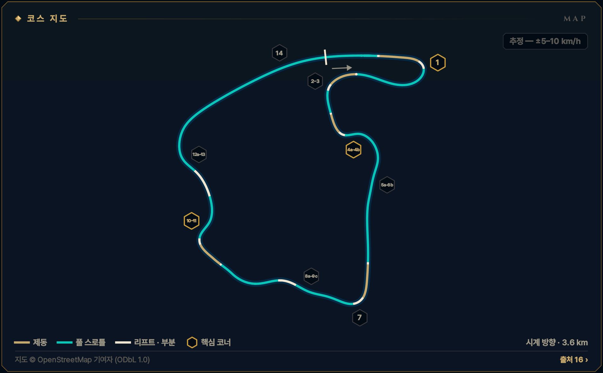
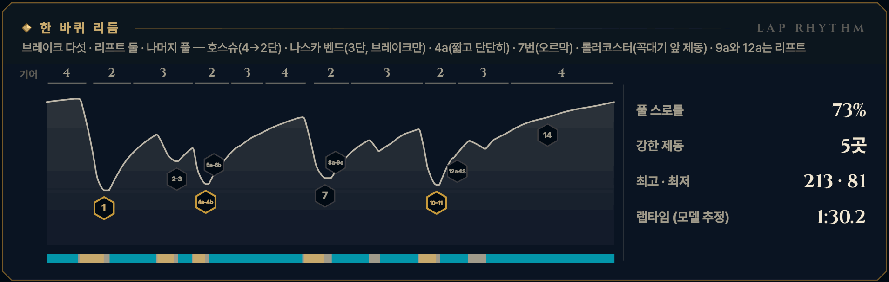

> **GRID서당 : iRacing**은 심레이싱이 처음인 동아리 신입을 위해 만든 드라이빙 아카데미 프로그램입니다. 이 글은 그 안의 **서킷 공략** 모드 — 이번 시즌 리그가 도는 서킷을 코스 개관과 코너별 애니메이션으로 미리 익히는 화면 — 를 블로그로 옮긴 것으로, 글과 애니메이션 모두 프로그램에서 그대로 가져왔습니다. 차는 iRacing의 Ray FF1600이고, 기준은 진도가 없는 루키(입문 렌즈)입니다. 강의는 [GRID서당 시리즈](/posts/untitled_life/motorsport/sim-racing/grid-seodang/)에, 낯선 말은 [용어 사전](/posts/untitled_life/motorsport/sim-racing/grid-seodang/glossary/)에 모아 두었습니다.

## 이번 시즌 일정

> **2026 시즌 4 · 포뮬러 1600 루키 시리즈 · 12주차** — 12.01(화)–12.07(월)
>
> - 루키 FF1600 · 기본 포함 · 12분 레이스 · 스탠딩 스타트 (차: Ray FF1600)
> - iRacing 트랙 이름: Virginia International Raceway - North Course
> - 주차는 매주 화요일 09:00(한국 시간)에 바뀝니다.
>
> iRacing 일정은 시즌마다 바뀝니다. 이 글의 주차는 2026 시즌 4 기준이고, 같은 서킷이 다른 시즌에 돌아오면 그 시즌 일정에서 주차와 레이아웃을 다시 확인하세요.

## 코스 개관

약 3.6 km, 시계 방향의 북코스입니다. 평평하고 기술적인 앞쪽 절반(1\~6번), 지름길을 따라 가장 높은 곳까지 오르는 오르막(7\~9번), 롤러코스터와 호그 펜을 지나 메인 직선으로 쏟아지는 내리막(10\~13번) — 세 얼굴이고 고저차는 약 36 m입니다. 9a·10번·12b처럼 넘기 전엔 앞이 안 보이는 곳이 많아 기준점을 미리 정해야 합니다.

- **시계 방향 · 노스 코스 · 3.6 km · 14코너**
- **코너 번호** — VIR 공식 2018 북코스 지도 번호(1\~14번, 4a·4b처럼 알파벳 포함)를 씁니다. iRacing 화면의 코너 표지와 본편 트랙 맵의 자동 번호는 다를 수 있습니다 — Test Drive에서 맞춰 적어 두세요.
- **루키 포인트** — 4a는 버리고 출구를 산다 — 7번까지 약 650 m가 그 탈출 속도로 정해집니다
- **속도 표기: 추정 — ±5–10 km/h** — 이 서킷에는 기준이 되는 실주행 텔레메트리가 없습니다. 공개된 FF1600 트랙 가이드 등에서 맞춘 코너 최저 속도에 보정한 FF1600 물리 모델을 맞춰 계산했기 때문에, 글과 영상의 속도·페달·기어는 모두 **추정값**(±5–10 km/h)입니다. Test Drive에서 직접 확인하세요.

*지도 © OpenStreetMap 기여자 (ODbL 1.0) · 선 색: 골드 = 제동, 시안 = 풀 스로틀, 흰색 = 리프트 · 부분 · 금테 육각형 = 핵심 코너 · 번호 = 이 글의 코너 공략 단위*

## 한 바퀴 리듬

브레이크 다섯 · 리프트 둘 · 나머지 풀 — 호스슈(4→2단) · 나스카 벤드(3단, 브레이크만) · 4a(짧고 단단히) · 7번(오르막) · 롤러코스터(꼭대기 앞 제동) · 9a와 12a는 리프트

*풀 스로틀 73% · 강한 제동 5곳 · 최고 · 최저 213 · 81 km/h · 랩타임 (모델 추정) 1:30.2 — 위 그림의 기어 줄·속도 곡선·입력 띠(골드 = 제동, 시안 = 풀 스로틀)와 코너 번호는 이 기준 랩입니다.*

## 먼저 볼 코너

1. **[T1 호스슈](#w12-u1)** — 1랩 첫 제동 · 가장 긴 직선 끝의 가장 큰 제동
2. **[T4a–4b 4a·4b](#w12-u3)** — 랩의 열쇠 — 4a 탈출이 7번까지 약 650 m 풀스로틀로 이어진다
3. **[T10–11 롤러코스터](#w12-u7)** — 제동 구간 끝에 언덕 꼭대기 — 큰 제동은 오르막에서 끝낸다

> **루키 포인트** — 4a는 버리고 출구를 산다 — 7번까지 약 650 m가 그 탈출 속도로 정해집니다

## 루키 안전 노트

- **스탠딩 스타트** — 출발 뒤 약 400 m 앞이 1번(출발선 위치는 근사) — 차가운 타이어·브레이크로 맞는 랩에서 가장 큰 제동입니다. 앞차에 맞춰 일찍 밟습니다.
- **보이지 않는 언덕** — 9a·10번·12b는 넘기 전엔 앞이 안 보입니다. 노란 깃발이면 즉시 줄이고, 여기서는 추월하지 않습니다.
- **7번 추월 지점** — 긴 직선 끝 7번은 다이브가 잦습니다. 상대의 턴인 전에 나란히 서지 못했다면 기다립니다.
- **피트 입구·출구** — 피트 입구는 13번 출구 오른쪽 — 느려지는 차를 조심합니다. 피트에서 나올 때는 합류선을 넘지 않습니다.
- **스핀 대처** — 브레이크를 꽉 밟아 세우고(시동은 안티스톨이 지킵니다), 차들이 지나간 뒤 1단(왼쪽 패들)으로 트랙과 나란히 복귀합니다. 블라인드 언덕 뒤(9a·10번·12b)에서 멈췄다면 Relative(F3)로 뒤를 확인하고 나갑니다. 17x면 실격입니다. 사고 누적 드라이브스루는 없지만(출발 위반 등은 있음) 깨끗한 12분이 가장 빠른 길입니다.
- **트랙 리밋** — 차의 절반 이상이 노면 경계 밖이면 1x — 일부 트랙의 표시 구간만 네 바퀴 기준. 루키 규칙: 두 바퀴는 늘 선·연석 안쪽. 3번 출구의 포장 런오프와 7번 꼭대기 너머의 다른 코스 포장은 트랙이 아닙니다(인게임 확인 전).

**1랩 · 스탠딩 스타트** — 1랩: 평소 제동 지점보다 늦게 밟지 않습니다. 앞차에 맞춰 더 일찍, 부드럽게 밟고, 차 한 대 폭을 남깁니다. 바깥이나 가운데를 지키고 안쪽 다툼에 끼지 않습니다.

## 영상 보는 법

코너마다 앱의 코너 공략 화면을 그대로 녹화했습니다. ▶를 눌러 재생하세요 — 앱의 **가이드** 재생(실제 속도의 0.4배, 화면에서 차가 너무 빠른 코너는 0.25배)이라 단계(접근·제동·턴인·에이펙스·탈출)마다 잠깐 멈추고, 멈춤 링이 차면 다음 단계로 넘어갑니다. 블로그 영상은 단계 시작의 멈춤만 짧게 줄였고 (캡션을 읽을 시간은 그대로), 끝에 앱의 끝 카드가 나옵니다. **급수별 브레이크 시연**을 펼치면 같은 코너를 7급·6급·5급 렌즈로, **흔한 실수 고스트**를 펼치면 실수한 차(빨간 점선)와 나란히 달린 영상을 볼 수 있습니다.

- **제동** — 골드 — 두께·밝기 = 브레이크 압력
- **가속** — 시안 — 스로틀
- **관성** — 흰색 — 두 페달 모두 뗀 구간
- **흔한 실수** — 빨간 점선 고스트 — 한 번에 하나만
- **▼ 제동 시작** — 루키 기준선의 제동 시작점
- **◆ 턴인** — 핸들을 감기 시작하는 곳
- **○ 에이펙스** — 가장 안쪽·가장 느린 곳
- **◇ 트랙아웃** — 탈출에서 닿는 바깥 끝
- **보드 (?)** — 확인 전 참고값 — Test Drive에서 기준점을 정하세요
- **입력 지도** — 골드 띠 = 브레이크, 흰 리본(안쪽) = 핸들. 겹치면 트레일
- **손 칸 · 내림 ×N · 올림** — 왼쪽 패들 N번 내림(블립은 오토 블립이) · 오른쪽 패들 한 번 올림

화면과 글의 속도는 모두 **추정값**(±5–10 km/h)입니다 — 기준 텔레메트리가 없는 서킷이라 모델로 계산했습니다.

## 코너 공략

### T1 호스슈

**우코너 · 2단 · 최저 약 80 km/h · 핵심 코너 · 추정 — ±5–10 km/h**  
1랩 첫 제동 · 랩에서 가장 큰 제동 · 늦은 에이펙스

<figure>
  <video src="images/u1.mp4" poster="images/u1_poster.png" controls preload="none" playsinline style="width:100%;max-width:960px"></video>
  <figcaption>시범 — 루키 기준선 · 입문 렌즈(직선 제동) · 가이드 0.4× · 접근 → 제동 → 턴인 → 에이펙스 → 탈출</figcaption>
</figure>

급수별 브레이크 시연 — 7급 · 6급 · 5급 렌즈 (영상 3)

라인과 기준점은 그대로, 페달 쓰는 법만 지금 급수에 맞춥니다. 위 영상은 **직선 제동 — 기초·심화·9·8급** 렌즈입니다 — 턴인 전에 브레이크를 다 뗍니다 (브레이크 끝 = 턴인).

**릴리스 — 7급** — 턴인을 향해 0.4초 넘게 흘려서 0으로 · 7급 기준: 릴리스 0.4초 이상

<figure>
  <video src="images/u1_release.mp4" poster="images/u1_release_poster.png" controls preload="none" playsinline style="width:100%;max-width:960px"></video>
  <figcaption>7급 렌즈(릴리스) · 가이드 0.4× · 접근 → 제동 → 턴인 → 에이펙스 → 탈출</figcaption>
</figure>

- 제동 — **턴인을 향해 흘려 놓는다** · 피크 약 81% · 1.2초에 걸쳐 놓기 · 발 · 하나-둘-셋 놓기
- 턴인 — **연석 맞은편에서 0에 닿는다** · 턴인에서 약 0\~3% → 곧 0 · 발 · 3% → 0

**트레일 — 6급·4\~1급·졸업** — 턴인 때 15\~20%를 남기고, 감는 만큼 풉니다 · 6급 기준: 턴인 때 15% 이상 남기기

<figure>
  <video src="images/u1_trail.mp4" poster="images/u1_trail_poster.png" controls preload="none" playsinline style="width:100%;max-width:960px"></video>
  <figcaption>6급 렌즈(트레일) · 가이드 0.4× · 접근 → 제동 → 턴인 → 에이펙스 → 탈출</figcaption>
</figure>

- 제동 — **턴인까지 끌고 간다** · 피크 약 76% · 턴인 때 약 18% · 발 · 놓으며 남기기
- 턴인 — **푸는 만큼 감는다** · 약 18% → 에이펙스 전 0 · 발 · 18% → 0 / 손 · 놓는 만큼 감기

**깊은 트레일 — 5급** — 턴인 때 30% 이상, 에이펙스 앞까지 끌고 갑니다 · 5급 기준: 턴인 때 30% 이상 남기기

<figure>
  <video src="images/u1_deep.mp4" poster="images/u1_deep_poster.png" controls preload="none" playsinline style="width:100%;max-width:960px"></video>
  <figcaption>5급 렌즈(깊은 트레일) · 가이드 0.4× · 접근 → 제동 → 턴인 → 에이펙스 → 탈출</figcaption>
</figure>

- 제동 — **더 깊게, 턴인 32%** · 피크 약 70% · 턴인 때 약 32% · 발 · 천천히 남기기
- 턴인 — **앞을 누른 채 감는다** · 약 32% → 에이펙스 앞에서 0 · 발 · 32% → 0

4\~1급은 같은 영상의 캡션에 강조 한 줄(◆)이 더 붙습니다:

- ◆ 4급(턴인·에이펙스) — 브레이크 끝 = 스로틀 시작 — 넓어지는 코너를 너무 줄이면 에이펙스까지 굴러간다

흔한 실수 고스트 — 늦은 제동 → 잠김 → 직진

<figure>
  <video src="images/u1_ghost.mp4" poster="images/u1_ghost_poster.png" controls preload="none" playsinline style="width:100%;max-width:960px"></video>
  <figcaption>흔한 실수: 늦은 제동 → 잠김 → 직진 — 33 m 늦게 100% → 바퀴가 잠겨 직진 · 트랙 밖</figcaption>
</figure>

흔한 실수: **늦은 제동 → 잠김 → 직진** — 33 m 늦게 100% → 바퀴가 잠겨 직진 · 트랙 밖. 빨간 점선과 붉은 차가 실수 고스트, 흰 차가 루키 기준선입니다. 두 차는 같은 시계로 달리므로 늦어지거나 밀려나는 만큼이 그대로 보입니다. 영상은 앱에서 [흔한 실수]를 눌렀을 때처럼 그 실수가 시작되는 단계부터 재생합니다. 끝 카드의 '트레일 렌즈 기준'은 결과의 시간 차를 트레일(6급) 렌즈 주행과 비교한 값이라는 뜻입니다.

> **1랩 · 스탠딩 스타트** — 1랩: 평소 제동 지점보다 늦게 밟지 않습니다. 앞차에 맞춰 더 일찍, 부드럽게 밟고, 차 한 대 폭을 남깁니다. 바깥이나 가운데를 지키고 안쪽 다툼에 끼지 않습니다. 차가운 타이어·브레이크로 맞는 랩에서 가장 큰 제동이라, 3번과 4a까지 아코디언이 이어집니다.

#### 접근

가장 긴 직선 끝, 4단 이 랩의 최고 속도에서 맞는 오른쪽 헤어핀입니다. 직선 중간의 완만한 오른쪽 꺾임(14번)을 지나면 차를 왼쪽 가장자리에 곧게 붙입니다. 제동 기준은 왼쪽 카운트다운 보드이고, 숫자는 Test Drive에서 확인합니다.

*지금 손과 발 — 발 · 풀스로틀 / 손 · 곧게 / 눈 · 왼쪽 보드*

**보드 · 기준점** — 모두 확인 전 참고값입니다. Test Drive에서 직접 보고 정하세요.

- **제동 · 기준점**? 왼쪽 카운트다운 보드 — 숫자 미확인. 애니메이션은 턴인 약 140 m 전에서 밟음 *(확인 전 참고값)*
- **턴인**? 안쪽 연석이 시작되는 곳 맞은편 *(확인 전 참고값)*
- **에이펙스**? 긴 안쪽 연석의 뒤쪽 절반(평평한 연석, 반 바퀴까지) *(확인 전 참고값)*

#### 제동

처음엔 빠른 랩보다 보드 하나 앞에서, 곧은 차로 한 음절 '꾹' 약 81%까지 — ABS가 없어 100%는 잠김입니다. 가운데 토막에서 4→3→2단으로 하나씩 내리고, 마지막 토막에서 천천히 풀며 턴인으로 갑니다. 턴인까지 약 140 m입니다.

*지금 손과 발 — 발 · 꾹 / 손 · 곧게 · 내림 ×2 / 눈 · 연석 시작점*

#### 턴인

안쪽 연석이 시작되는 곳 맞은편에서 감기 시작합니다. 이 코너는 보기보다 느리고, 보기보다 깁니다 — 반 박자 기다렸다가 한 번에 감습니다. 이 렌즈에서는 브레이크가 막 0입니다.

*지금 손과 발 — 발 · 0 → 유지 스로틀 / 손 · 한 번 감기 / 눈 · 연석 뒤쪽*

#### 에이펙스

늦은 에이펙스 — 긴 안쪽 연석의 뒤쪽 절반, 끝에 가까운 곳에 붙습니다. 평평한 안쪽 연석은 바퀴 반 개까지 써도 됩니다. 감은 핸들은 그대로 두고, 최저 약 80 km/h, 2단입니다.

*지금 손과 발 — 발 · 유지 스로틀 / 손 · 그대로 / 눈 · 왼쪽 출구*

#### 탈출

넓어지는 코너라 핸들을 푸는 만큼 한 획으로 100%까지 갑니다. 차는 왼쪽 출구 연석 쪽으로 흘려보낸 뒤, 다시 오른쪽으로 호를 그려 2번을 준비합니다. 연석 너머는 트랙이 아니니 두 바퀴는 안쪽에 둡니다.

*지금 손과 발 — 발 · 앞으로만 / 손 · 풀기 / 눈 · 2번 안쪽*

#### 흔한 실수

- 1랩이나 슬립스트림 뒤에 늦게, 세게 밟아 바퀴가 잠기고 직진  
  → 평소 보드보다 늦게 밟지 않기 · 곧은 차로 85\~90%까지만
- 이른 턴인 — 출구에서 길이 모자라 바깥으로 밀린다  
  → 연석 시작 맞은편까지 반 박자 기다리기
- 넓어지는 코너를 너무 줄이고 에이펙스까지 굴러가기  
  → 일찍 풀고, 발이 브레이크를 떠나면 바로 스로틀

#### 이 코너에서 확인할 것

- [ ] 왼쪽 카운트다운 보드의 숫자와 위치
- [ ] 이 시리즈의 출발 그리드에서 1번까지의 거리

#### 연결된 강의 · 드릴

- 강의: [기초 4강(레이싱 라인의 문법)](/posts/untitled_life/motorsport/sim-racing/grid-seodang/basics/f4-racing-line/) · [심화 1강(출발의 기술)](/posts/untitled_life/motorsport/sim-racing/grid-seodang/advanced/d1-the-start/) · [심화 2강(코너의 다섯 얼굴)](/posts/untitled_life/motorsport/sim-racing/grid-seodang/advanced/d2-five-corner-faces/) · [심화 3강(상황의 라인)](/posts/untitled_life/motorsport/sim-racing/grid-seodang/advanced/d3-situational-lines/) · [심화 6강(교본 차 해부)](/posts/untitled_life/motorsport/sim-racing/grid-seodang/advanced/d8-training-car-and-shifting/) · [심화 7강(한계의 신호)](/posts/untitled_life/motorsport/sim-racing/grid-seodang/advanced/d9-signals-at-the-limit/) · [8급(제동의 기본)](/posts/untitled_life/motorsport/sim-racing/grid-seodang/grades/g8-braking-basics/) · [7급(릴리스 수양)](/posts/untitled_life/motorsport/sim-racing/grid-seodang/grades/g7-release/) · [6급(트레일 입문)](/posts/untitled_life/motorsport/sim-racing/grid-seodang/grades/g6-trail-intro/) · [4급(전환 수련)](/posts/untitled_life/motorsport/sim-racing/grid-seodang/grades/g4-transition/) · [3급(스로틀 서예)](/posts/untitled_life/motorsport/sim-racing/grid-seodang/grades/g3-throttle-calligraphy/)
- 훈련장 드릴: 제동 수양 · 정밀 압력 · 트레일 브레이킹 · 전환

<small>근거: S1 · S3 · S4 · S5 · S9 · S15 · S21 · REC (아래 출처 목록) · 신뢰도 L</small>

### T2–3 나스카 벤드

**좌코너 · 3단 · 최저 약 115 km/h · 추정 — ±5–10 km/h**  
2번은 풀 · 3번은 3단 그대로 브레이크만 · 조여드는 왼쪽

<figure>
  <video src="images/u2.mp4" poster="images/u2_poster.png" controls preload="none" playsinline style="width:100%;max-width:960px"></video>
  <figcaption>시범 — 루키 기준선 · 입문 렌즈(직선 제동) · 가이드 0.4× · 접근 → 제동 → 턴인 → 에이펙스 → 탈출</figcaption>
</figure>

급수별 브레이크 시연 — 7급 · 6급 · 5급 렌즈 (영상 3)

라인과 기준점은 그대로, 페달 쓰는 법만 지금 급수에 맞춥니다. 위 영상은 **직선 제동 — 기초·심화·9·8급** 렌즈입니다 — 턴인 전에 브레이크를 다 뗍니다 (브레이크 끝 = 턴인).

**릴리스 — 7급** — 턴인을 향해 0.4초 넘게 흘려서 0으로 · 7급 기준: 릴리스 0.4초 이상

<figure>
  <video src="images/u2_release.mp4" poster="images/u2_release_poster.png" controls preload="none" playsinline style="width:100%;max-width:960px"></video>
  <figcaption>7급 렌즈(릴리스) · 가이드 0.4× · 접근 → 제동 → 턴인 → 에이펙스 → 탈출</figcaption>
</figure>

- 제동 — **턴인을 향해 흘려 놓는다** · 피크 약 55% · 0.7초에 걸쳐 놓기 · 발 · 하나-둘-셋 놓기
- 턴인 — **연석 끝에서 0에 닿는다** · 턴인에서 약 0\~3% → 곧 0 · 발 · 3% → 0

**트레일 — 6급·4\~1급·졸업** — 턴인 때 15\~20%를 남기고, 감는 만큼 풉니다 · 6급 기준: 턴인 때 15% 이상 남기기

<figure>
  <video src="images/u2_trail.mp4" poster="images/u2_trail_poster.png" controls preload="none" playsinline style="width:100%;max-width:960px"></video>
  <figcaption>6급 렌즈(트레일) · 가이드 0.4× · 접근 → 제동 → 턴인 → 에이펙스 → 탈출</figcaption>
</figure>

- 제동 — **턴인까지 끌고 간다** · 피크 약 50% · 턴인 때 약 18% · 발 · 놓으며 남기기
- 턴인 — **푸는 만큼 감는다** · 약 18% → 에이펙스 전 0 · 발 · 18% → 0 / 손 · 놓는 만큼 감기

**깊은 트레일 — 5급** — 턴인 때 30% 이상, 에이펙스 앞까지 끌고 갑니다 · 5급 기준: 턴인 때 30% 이상 남기기

<figure>
  <video src="images/u2_deep.mp4" poster="images/u2_deep_poster.png" controls preload="none" playsinline style="width:100%;max-width:960px"></video>
  <figcaption>5급 렌즈(깊은 트레일) · 가이드 0.4× · 접근 → 제동 → 턴인 → 에이펙스 → 탈출</figcaption>
</figure>

- 제동 — **더 깊게, 턴인 32%** · 피크 약 45% · 턴인 때 약 32% · 발 · 천천히 남기기
- 턴인 — **앞을 누른 채 감는다** · 약 32% → 에이펙스 앞에서 0 · 발 · 32% → 0

흔한 실수 고스트 — 이른 턴인 → 출구에서 밀림

<figure>
  <video src="images/u2_ghost.mp4" poster="images/u2_ghost_poster.png" controls preload="none" playsinline style="width:100%;max-width:960px"></video>
  <figcaption>흔한 실수: 이른 턴인 → 출구에서 밀림 — 일찍 꺾으면 출구에서 바깥으로 밀린다 → 약 0.2초 늦음 · 트랙 밖</figcaption>
</figure>

흔한 실수: **이른 턴인 → 출구에서 밀림** — 일찍 꺾으면 출구에서 바깥으로 밀린다 → 약 0.2초 늦음 · 트랙 밖. 빨간 점선과 붉은 차가 실수 고스트, 흰 차가 루키 기준선입니다. 두 차는 같은 시계로 달리므로 늦어지거나 밀려나는 만큼이 그대로 보입니다. 영상은 앱에서 [흔한 실수]를 눌렀을 때처럼 그 실수가 시작되는 단계부터 재생합니다. 끝 카드의 '트레일 렌즈 기준'은 결과의 시간 차를 트레일(6급) 렌즈 주행과 비교한 값이라는 뜻입니다.

#### 접근

1번을 나와 오른쪽으로 건너간 뒤, 왼쪽으로 살짝 휘는 2번은 풀스로틀입니다. 2번 안쪽(왼쪽) 연석 가운데를 스치며 3단 약 160 km/h — 그 연석이 3번의 제동 기준입니다.

*지금 손과 발 — 발 · 풀스로틀 / 손 · 살짝 왼쪽 / 눈 · 2번 안쪽 연석*

**보드 · 기준점** — 모두 확인 전 참고값입니다. Test Drive에서 직접 보고 정하세요.

- **제동 · 기준점**? 2번 안쪽(왼쪽) 연석을 지나며 *(확인 전 참고값)*
- **턴인**? 오른쪽 초록·노랑 연석이 끝나는 곳 *(확인 전 참고값)*
- **에이펙스**? 왼쪽 연석의 뒤쪽 절반 *(확인 전 참고값)*

#### 제동

2번 연석을 지나며 중간 세기(약 55%)로 짧게 밟습니다. 핸들은 2번의 작은 각도를 그대로 두고 더 감지 않습니다 — 휘는 길에서 제동과 조향을 함께 크게 쓰면 마찰원을 넘습니다. 기어는 3단 그대로, 브레이크만 씁니다.

*지금 손과 발 — 발 · 중간으로 짧게 / 손 · 각도 그대로 / 눈 · 오른쪽 연석 끝*

#### 턴인

오른쪽 초록·노랑 연석이 끝나는 곳에서 결단 있게 더 감습니다. 생각보다 핸들이 조금 더 필요합니다 — 너무 늦게 꺾으면 그만큼 속도를 더 버립니다.

*지금 손과 발 — 발 · 0 → 유지 스로틀 / 손 · 결단 있게 감기 / 눈 · 왼쪽 연석 뒤쪽*

#### 에이펙스

3번은 안으로 조여드는 코너라 에이펙스가 늦습니다 — 왼쪽 연석의 뒤쪽 절반을 길게 따라갑니다. 앞이 밀리면 핸들을 더 감지 말고 스로틀을 10\~15% 덜어 앞을 눌러 줍니다. 최저 약 115 km/h입니다.

*지금 손과 발 — 발 · 유지 스로틀 / 손 · 그대로 / 눈 · 오른쪽 출구*

#### 탈출

차가 출구를 향한 뒤에 한 획으로 엽니다 — 이 코너는 서두른 스로틀에 꽁무니가 도는 곳으로 유명합니다. 오른쪽 바깥 연석까지 흘려 나가 4a 제동을 오른쪽에서 곧게 준비합니다. 연석 너머 포장 런오프는 보험이지 트랙이 아닙니다.

*지금 손과 발 — 발 · 앞으로만 / 손 · 풀기 / 눈 · 4a 제동점*

#### 흔한 실수

- 조여드는 코너에서 이른 에이펙스 — 출구에서 바깥으로 밀려 트랙 밖  
  → 오른쪽 연석 끝까지 기다렸다가 늦은 에이펙스로
- 휘는 채로 세게 밟아 앞바퀴를 잠그기  
  → 2번 각도를 그대로 두고 중간 세기로 짧게
- 2번에서 3번까지 굴러가기(코스팅)  
  → 2번 연석에서 바로 제동, 놓는 끝에서 스로틀

#### 이 코너에서 확인할 것

- [ ] 2번 안쪽 연석과 3번 오른쪽 연석 끝이 인게임에서 보이는지

#### 연결된 강의 · 드릴

- 강의: [심화 2강(코너의 다섯 얼굴)](/posts/untitled_life/motorsport/sim-racing/grid-seodang/advanced/d2-five-corner-faces/) · [심화 4강(차의 균형)](/posts/untitled_life/motorsport/sim-racing/grid-seodang/advanced/d4-car-balance/) · [심화 8강(페달의 문법)](/posts/untitled_life/motorsport/sim-racing/grid-seodang/advanced/d6-pedal-grammar/) · [7급(릴리스 수양)](/posts/untitled_life/motorsport/sim-racing/grid-seodang/grades/g7-release/) · [6급(트레일 입문)](/posts/untitled_life/motorsport/sim-racing/grid-seodang/grades/g6-trail-intro/) · [4급(전환 수련)](/posts/untitled_life/motorsport/sim-racing/grid-seodang/grades/g4-transition/) · [2급(스티어링 일필휘지)](/posts/untitled_life/motorsport/sim-racing/grid-seodang/grades/g2-one-stroke-steering/) · [3급(스로틀 서예)](/posts/untitled_life/motorsport/sim-racing/grid-seodang/grades/g3-throttle-calligraphy/)
- 훈련장 드릴: 정밀 압력 · 트레일 브레이킹 · 조향 일필

<small>근거: S1 · S3 · S4 · S5 · S9 · REC (아래 출처 목록) · 신뢰도 M</small>

### T4a–4b 4a·4b

**좌·우 복합 · 2단 · 최저 약 85 km/h · 핵심 코너 · 추정 — ±5–10 km/h**  
랩의 열쇠 · 4a를 버리고 출구를 산다

<figure>
  <video src="images/u3.mp4" poster="images/u3_poster.png" controls preload="none" playsinline style="width:100%;max-width:960px"></video>
  <figcaption>시범 — 루키 기준선 · 입문 렌즈(직선 제동) · 가이드 0.4× · 접근 → 제동 → 턴인 → 에이펙스 → 전환 → 에이펙스 ② → 탈출</figcaption>
</figure>

급수별 브레이크 시연 — 7급 · 6급 · 5급 렌즈 (영상 3)

라인과 기준점은 그대로, 페달 쓰는 법만 지금 급수에 맞춥니다. 위 영상은 **직선 제동 — 기초·심화·9·8급** 렌즈입니다 — 턴인 전에 브레이크를 다 뗍니다 (브레이크 끝 = 턴인).

**릴리스 — 7급** — 턴인을 향해 0.4초 넘게 흘려서 0으로 · 7급 기준: 릴리스 0.4초 이상

<figure>
  <video src="images/u3_release.mp4" poster="images/u3_release_poster.png" controls preload="none" playsinline style="width:100%;max-width:960px"></video>
  <figcaption>7급 렌즈(릴리스) · 가이드 0.4× · 접근 → 제동 → 턴인 → 에이펙스 → 전환 → 에이펙스 ② → 탈출</figcaption>
</figure>

- 제동 — **턴인을 향해 흘려 놓는다** · 피크 약 85% · 0.8초에 걸쳐 놓기 · 발 · 하나-둘-셋 놓기
- 턴인 — **4a 턴인에서 0에 닿는다** · 턴인에서 약 0\~3% → 곧 0 · 발 · 3% → 0

**트레일 — 6급·4\~1급·졸업** — 턴인 때 15\~20%를 남기고, 감는 만큼 풉니다 · 6급 기준: 턴인 때 15% 이상 남기기

<figure>
  <video src="images/u3_trail.mp4" poster="images/u3_trail_poster.png" controls preload="none" playsinline style="width:100%;max-width:960px"></video>
  <figcaption>6급 렌즈(트레일) · 가이드 0.4× · 접근 → 제동 → 턴인 → 에이펙스 → 전환 → 에이펙스 ② → 탈출</figcaption>
</figure>

- 제동 — **턴인까지 끌고 간다** · 피크 약 75% · 턴인 때 약 18% · 발 · 놓으며 남기기
- 턴인 — **푸는 만큼 감는다** · 약 18% → 에이펙스 전 0 · 발 · 18% → 0 / 손 · 놓는 만큼 감기

**깊은 트레일 — 5급** — 턴인 때 30% 이상, 에이펙스 앞까지 끌고 갑니다 · 5급 기준: 턴인 때 30% 이상 남기기

<figure>
  <video src="images/u3_deep.mp4" poster="images/u3_deep_poster.png" controls preload="none" playsinline style="width:100%;max-width:960px"></video>
  <figcaption>5급 렌즈(깊은 트레일) · 가이드 0.4× · 접근 → 제동 → 턴인 → 에이펙스 → 전환 → 에이펙스 ② → 탈출</figcaption>
</figure>

- 제동 — **더 깊게, 턴인 32%** · 피크 약 50% · 턴인 때 약 32% · 발 · 천천히 남기기
- 턴인 — **앞을 누른 채 감는다** · 약 32% → 4a 에이펙스 앞에서 0 · 발 · 32% → 0

4\~1급은 같은 영상의 캡션에 강조 한 줄(◆)이 더 붙습니다:

- ◆ 4급(턴인·에이펙스) — 브레이크 끝 = 스로틀 시작 — 4a와 4b 사이에서 굴러가지 않는다

흔한 실수 고스트 — 첫 코너 욕심 → 두 번째를 잃음

<figure>
  <video src="images/u3_ghost.mp4" poster="images/u3_ghost_poster.png" controls preload="none" playsinline style="width:100%;max-width:960px"></video>
  <figcaption>흔한 실수: 첫 코너 욕심 → 두 번째를 잃음 — 첫 코너에 욕심내면 두 번째를 잃는다 · 트랙 밖</figcaption>
</figure>

흔한 실수: **첫 코너 욕심 → 두 번째를 잃음** — 첫 코너에 욕심내면 두 번째를 잃는다 · 트랙 밖. 빨간 점선과 붉은 차가 실수 고스트, 흰 차가 루키 기준선입니다. 두 차는 같은 시계로 달리므로 늦어지거나 밀려나는 만큼이 그대로 보입니다. 영상은 앱에서 [흔한 실수]를 눌렀을 때처럼 그 실수가 시작되는 단계부터 재생합니다. 끝 카드의 '트레일 렌즈 기준'은 결과의 시간 차를 트레일(6급) 렌즈 주행과 비교한 값이라는 뜻입니다.

#### 접근

3번 출구에서 오른쪽에 붙은 채 짧은 오르막 통로를 지나면, 이 랩에서 가장 꽉 조인 왼쪽 4a입니다. 3단 약 140 km/h, 제동 구간이 짧고 공인된 표지가 없습니다 — Test Drive에서 3번 출구 연석 끝처럼 움직이지 않는 기준점을 정합니다.

*지금 손과 발 — 발 · 풀스로틀 / 손 · 곧게 / 눈 · 제동 기준물*

**보드 · 기준점** — 모두 확인 전 참고값입니다. Test Drive에서 직접 보고 정하세요.

- **제동 · 기준점**? 공인 표지 없음 — Test Drive에서 3번 출구 연석 끝 같은 고정물을 정하세요 *(확인 전 참고값)*
- **턴인**? 보기보다 늦게(애니메이션 위치 참고) *(확인 전 참고값)*
- **에이펙스**? 출구 가까이의 왼쪽 안쪽 연석 *(확인 전 참고값)*

#### 제동

곧게, 단단하게 한 음절 '꾹' 약 85% — 오르막이 함께 세워 줍니다. 3→2단을 내리고, 턴인까지 약 50 m 동안 발을 길게 풉니다.

*지금 손과 발 — 발 · 꾹 / 손 · 곧게 · 내림 ×1 / 눈 · 왼쪽 연석*

#### 턴인

보기보다 늦게 꺾습니다. 이 코너는 과속을 부르는 코너입니다 — 서두르지 않는 쪽이 이깁니다.

*지금 손과 발 — 발 · 0 → 유지 스로틀 / 손 · 한 번 감기 / 눈 · 4a 안쪽 연석*

#### 에이펙스

아주 늦은 에이펙스 — 거의 출구와 같은 자리에서 왼쪽 안쪽 연석을 스칩니다. 최저 약 85 km/h, 2단입니다.

*지금 손과 발 — 발 · 살살 열기 / 손 · 그대로 / 눈 · 왼쪽 연석 끝*

#### 전환

여기가 핵심입니다 — 4a를 나와 오른쪽 끝으로 흘려 나가지 않습니다. 볼록한 노면을 비스듬히 가로질러 곧장 4b 에이펙스(오른쪽)로 갑니다.

*지금 손과 발 — 발 · 앞으로만 / 손 · 풀었다 오른쪽 / 눈 · 4b 연석*

#### 에이펙스 ②

4b는 넓어지는 오른쪽입니다. 연석이 가장 튀어나온 뒤쪽 절반에 붙고, 핸들이 풀리는 만큼 확실히 엽니다. 핸들은 두 획 — 왼쪽 한 번, 오른쪽 한 번이며 톱질이 아닙니다.

*지금 손과 발 — 발 · 확실히 / 손 · 오른쪽 한 획 / 눈 · 5a 너머*

#### 탈출

4b를 나와 왼쪽 연석 쪽으로 흐르는 짧은 직선에서 3단으로 올립니다. 여기서부터 7번 제동까지 약 650 m가 풀스로틀이라, 이 탈출 속도가 그대로 실립니다. 눈은 5a 너머 멀리 둡니다.

*지금 손과 발 — 발 · 풀스로틀 / 손 · 풀기 / 눈 · 5a 턴인*

#### 흔한 실수

- 4a에 너무 빨리 들어가 오른쪽으로 밀리기 — 4b·5a가 늦고 7번까지 손해  
  → 더 일찍 밟고 더 늦게 꺾기 — 4a는 버리는 코너
- 4a 출구에서 오른쪽 끝까지 흘러가기  
  → 4a 에이펙스에서 4b 에이펙스로 곧장 비스듬히
- 4a와 4b 사이에서 굴러가기  
  → 4a 에이펙스부터 살살 열어 다리 놓기

#### 이 코너에서 확인할 것

- [ ] 4a 제동에 쓸 고정 기준물
- [ ] 4a 최저 속도(기준 약 91 km/h)

#### 연결된 강의 · 드릴

- 강의: [심화 2강(코너의 다섯 얼굴)](/posts/untitled_life/motorsport/sim-racing/grid-seodang/advanced/d2-five-corner-faces/) · [심화 3강(상황의 라인)](/posts/untitled_life/motorsport/sim-racing/grid-seodang/advanced/d3-situational-lines/) · [심화 6강(교본 차 해부)](/posts/untitled_life/motorsport/sim-racing/grid-seodang/advanced/d8-training-car-and-shifting/) · [8급(제동의 기본)](/posts/untitled_life/motorsport/sim-racing/grid-seodang/grades/g8-braking-basics/) · [7급(릴리스 수양)](/posts/untitled_life/motorsport/sim-racing/grid-seodang/grades/g7-release/) · [6급(트레일 입문)](/posts/untitled_life/motorsport/sim-racing/grid-seodang/grades/g6-trail-intro/) · [5급(트레일 숙달)](/posts/untitled_life/motorsport/sim-racing/grid-seodang/grades/g5-trail-mastery/) · [4급(전환 수련)](/posts/untitled_life/motorsport/sim-racing/grid-seodang/grades/g4-transition/) · [3급(스로틀 서예)](/posts/untitled_life/motorsport/sim-racing/grid-seodang/grades/g3-throttle-calligraphy/) · [2급(스티어링 일필휘지)](/posts/untitled_life/motorsport/sim-racing/grid-seodang/grades/g2-one-stroke-steering/)
- 훈련장 드릴: 트레일 브레이킹 · 전환 · 스로틀 서예

<small>근거: S3 · S4 · S5 · S6 · S7 · S9 · REC (아래 출처 목록) · 신뢰도 L</small>

### T5a–6b 스네이크

**우·좌·좌 복합 · 2단 · 추정 — ±5–10 km/h**  
브레이크 없음 · S자를 펴서 달린다

<figure>
  <video src="images/u4.mp4" poster="images/u4_poster.png" controls preload="none" playsinline style="width:100%;max-width:960px"></video>
  <figcaption>시범 — 루키 기준선 · 렌즈 공통 · 가이드 0.4× · 접근 → 턴인 → 에이펙스 → 전환 → 에이펙스 ② → 전환 ③ → 에이펙스 ③ → 탈출</figcaption>
</figure>

급수별 브레이크 시연 — 모든 급수가 같은 그림

이 코너는 렌즈가 같습니다 — 리프트·풀스로틀 코너는 브레이크를 쓰지 않아 모든 급수가 같은 페달 그림을 봅니다.

#### 접근

4b를 나와 왼쪽에 붙은 채 기다립니다. 5a(오른쪽)의 턴인 기준은 왼쪽 바깥 연석이 끝나는 곳입니다 — 트랙 끝에 먼저 닿아도 핸들을 곧게 두고 반 박자 참습니다.

*지금 손과 발 — 발 · 풀스로틀 / 손 · 곧게 / 눈 · 왼쪽 연석 끝*

**보드 · 기준점** — 모두 확인 전 참고값입니다. Test Drive에서 직접 보고 정하세요.

- **턴인**? 5a: 왼쪽 바깥 연석이 끝나는 곳 *(확인 전 참고값)*

#### 턴인

5a는 노면이 안쪽으로 기울어 차를 받쳐 줍니다. 에이펙스까지 앞이 잘 보이지 않으니 외워서, 한 번에 부드럽게 감습니다.

*지금 손과 발 — 발 · 풀스로틀 / 손 · 한 번 감기 / 눈 · 5a 에이펙스*

#### 에이펙스

5a 에이펙스를 놓치면 기울기의 도움이 사라지고 앞이 밀립니다. 연석은 밟지 않습니다 — 5a·5b 연석은 차를 튕겨 냅니다. 약 130 km/h, 3단입니다.

*지금 손과 발 — 발 · 풀스로틀 / 손 · 그대로 / 눈 · 5b 쪽*

#### 전환

5b·6a·6b는 꺾임이 아니라 휘어진 직선입니다. S자를 따라 그리지 말고 펴서 달립니다 — 핸들이 적을수록 빠릅니다.

*지금 손과 발 — 발 · 풀스로틀 / 손 · 아주 작게 / 눈 · 멀리*

#### 에이펙스 ②

5b는 살짝 왼쪽입니다. 처음 몇 랩은 방향이 바뀌는 이곳에서 스로틀을 한 번 '숨' 쉬어도 됩니다 — 익숙해지면 풀스로틀입니다.

*지금 손과 발 — 발 · 숨 → 풀 / 손 · 작게 / 눈 · 6a*

#### 전환 ③

6a(살짝 오른쪽)도 같은 요령입니다. 핸들은 굽이마다 작은 한 획 — 감고 바로 풉니다.

*지금 손과 발 — 발 · 풀스로틀 / 손 · 작게 한 획 / 눈 · 다리 쪽*

#### 에이펙스 ③

6b를 지나 4단으로 올리고 다리 밑 직선으로 나갑니다. 4a·4b를 잘 나왔다면 여기까지 브레이크 없이 왔습니다.

*지금 손과 발 — 발 · 풀스로틀 / 손 · 곧게 / 눈 · 다리*

#### 탈출

긴 직선이 살짝 왼쪽으로 휘어 있어, 라인은 직선의 오른쪽(휜 안쪽)을 지납니다. 7번 턴인은 왼쪽 끝에서 하니, 제동하며 왼쪽으로 옮겨 갑니다.

*지금 손과 발 — 발 · 풀스로틀 / 손 · 곧게 / 눈 · 7번 앞 다리*

#### 흔한 실수

- 5a 이른 턴인 — 길이 모자라 바깥으로  
  → 왼쪽 연석 끝까지 곧게 참기
- S자를 따라가며 핸들을 크게 쓰기  
  → 펴서 달리기 — 굽이마다 작은 한 획
- 꺾는 중에 5a·5b 연석 밟기  
  → 연석은 밟지 않기 — 튕겨 나간다

#### 이 코너에서 확인할 것

- [ ] 6a·6b의 방향(지도: 6a 살짝 오른쪽, 6b 살짝 왼쪽)

#### 연결된 강의 · 드릴

- 강의: [심화 2강(코너의 다섯 얼굴)](/posts/untitled_life/motorsport/sim-racing/grid-seodang/advanced/d2-five-corner-faces/) · [심화 4강(차의 균형)](/posts/untitled_life/motorsport/sim-racing/grid-seodang/advanced/d4-car-balance/) · [심화 9강(기울어진 트랙)](/posts/untitled_life/motorsport/sim-racing/grid-seodang/advanced/d7-banked-track/) · [심화 6강(교본 차 해부)](/posts/untitled_life/motorsport/sim-racing/grid-seodang/advanced/d8-training-car-and-shifting/) · [2급(스티어링 일필휘지)](/posts/untitled_life/motorsport/sim-racing/grid-seodang/grades/g2-one-stroke-steering/) · [3급(스로틀 서예)](/posts/untitled_life/motorsport/sim-racing/grid-seodang/grades/g3-throttle-calligraphy/)
- 훈련장 드릴: 조향 일필 · 스로틀 서예

<small>근거: S3 · S4 · S5 · S7 · S16 · REC (아래 출처 목록) · 신뢰도 M</small>

### T7 7번 오르막

**우코너 · 2단 · 최저 약 95 km/h · 추정 — ±5–10 km/h**  
긴 직선 끝 추월 지점 · 오르막으로 꺾는 오른쪽

<figure>
  <video src="images/u5.mp4" poster="images/u5_poster.png" controls preload="none" playsinline style="width:100%;max-width:960px"></video>
  <figcaption>시범 — 루키 기준선 · 입문 렌즈(직선 제동) · 가이드 0.4× · 접근 → 제동 → 턴인 → 에이펙스 → 탈출</figcaption>
</figure>

급수별 브레이크 시연 — 7급 · 6급 · 5급 렌즈 (영상 3)

라인과 기준점은 그대로, 페달 쓰는 법만 지금 급수에 맞춥니다. 위 영상은 **직선 제동 — 기초·심화·9·8급** 렌즈입니다 — 턴인 전에 브레이크를 다 뗍니다 (브레이크 끝 = 턴인).

**릴리스 — 7급** — 턴인을 향해 0.4초 넘게 흘려서 0으로 · 7급 기준: 릴리스 0.4초 이상

<figure>
  <video src="images/u5_release.mp4" poster="images/u5_release_poster.png" controls preload="none" playsinline style="width:100%;max-width:960px"></video>
  <figcaption>7급 렌즈(릴리스) · 가이드 0.4× · 접근 → 제동 → 턴인 → 에이펙스 → 탈출</figcaption>
</figure>

- 제동 — **턴인을 향해 흘려 놓는다** · 피크 약 67% · 1.1초에 걸쳐 놓기 · 발 · 하나-둘-셋 놓기
- 턴인 — **V자에서 0에 닿는다** · 턴인에서 약 0\~3% → 곧 0 · 발 · 3% → 0

**트레일 — 6급·4\~1급·졸업** — 턴인 때 15\~20%를 남기고, 감는 만큼 풉니다 · 6급 기준: 턴인 때 15% 이상 남기기

<figure>
  <video src="images/u5_trail.mp4" poster="images/u5_trail_poster.png" controls preload="none" playsinline style="width:100%;max-width:960px"></video>
  <figcaption>6급 렌즈(트레일) · 가이드 0.4× · 접근 → 제동 → 턴인 → 에이펙스 → 탈출</figcaption>
</figure>

- 제동 — **턴인까지 끌고 간다** · 피크 약 58% · 턴인 때 약 18% · 발 · 놓으며 남기기
- 턴인 — **푸는 만큼 감는다** · 약 18% → 에이펙스 전 0 · 발 · 18% → 0 / 손 · 놓는 만큼 감기

**깊은 트레일 — 5급** — 턴인 때 30% 이상, 에이펙스 앞까지 끌고 갑니다 · 5급 기준: 턴인 때 30% 이상 남기기

<figure>
  <video src="images/u5_deep.mp4" poster="images/u5_deep_poster.png" controls preload="none" playsinline style="width:100%;max-width:960px"></video>
  <figcaption>5급 렌즈(깊은 트레일) · 가이드 0.4× · 접근 → 제동 → 턴인 → 에이펙스 → 탈출</figcaption>
</figure>

- 제동 — **더 깊게, 턴인 32%** · 피크 약 47% · 턴인 때 약 32% · 발 · 천천히 남기기
- 턴인 — **앞을 누른 채 감는다** · 약 32% → 에이펙스 앞에서 0 · 발 · 32% → 0

흔한 실수 고스트 — 너무 세게, 너무 오래

<figure>
  <video src="images/u5_ghost.mp4" poster="images/u5_ghost_poster.png" controls preload="none" playsinline style="width:100%;max-width:960px"></video>
  <figcaption>흔한 실수: 너무 세게, 너무 오래 — 95%로 꾹, 굴러가며 최저 약 70 km/h → 약 2.5초 늦음</figcaption>
</figure>

흔한 실수: **너무 세게, 너무 오래** — 95%로 꾹, 굴러가며 최저 약 70 km/h → 약 2.5초 늦음. 빨간 점선과 붉은 차가 실수 고스트, 흰 차가 루키 기준선입니다. 두 차는 같은 시계로 달리므로 늦어지거나 밀려나는 만큼이 그대로 보입니다. 영상은 앱에서 [흔한 실수]를 눌렀을 때처럼 그 실수가 시작되는 단계부터 재생합니다. 끝 카드의 '트레일 렌즈 기준'은 결과의 시간 차를 트레일(6급) 렌즈 주행과 비교한 값이라는 뜻입니다.

#### 접근

다리 밑을 지나는 긴 직선 끝, 4단 약 185 km/h에서 오른쪽으로 꺾어 언덕을 오르는 코너입니다. 직선이 살짝 왼쪽으로 휘어 라인은 오른쪽에서 시작하고, 제동하며 왼쪽으로 비스듬히 옮겨 턴인 때 왼쪽 끝에 닿습니다. 슬립스트림이 통하는 추월 지점이라 다이브를 조심합니다.

*지금 손과 발 — 발 · 풀스로틀 / 손 · 곧게 / 눈 · 다리*

**보드 · 기준점** — 모두 확인 전 참고값입니다. Test Drive에서 직접 보고 정하세요.

- **제동 · 기준점**? 드라이브오버 다리 근처 — 다리와의 거리는 Test Drive에서 확인 *(확인 전 참고값)*
- **턴인**? 두 포장이 만나는 V자의 가운데를 겨눔 *(확인 전 참고값)*
- **에이펙스**? 오른쪽 연석의 끝 쪽 *(확인 전 참고값)*

#### 제동

처음엔 다리 근처에서 곧게 '꾹' 약 67% — 다리와 제동점의 거리는 지도 추정이라 Test Drive에서 확인합니다. 가운데 토막에서 4→3→2단, 턴인까지 약 110 m입니다. 오르막이 함께 세워 주니 익숙해지면 한 차 길이씩 늦춥니다.

*지금 손과 발 — 발 · 꾹 / 손 · 곧게 · 내림 ×2 / 눈 · V자 합류점*

#### 턴인

왼쪽에서, 북코스 포장이 원래 코스와 만나는 V자의 가운데를 겨누고 꺾습니다. 눈은 위로 — 언덕 위 에이펙스 연석을 봅니다.

*지금 손과 발 — 발 · 0 → 유지 스로틀 / 손 · 한 번 감기 / 눈 · 언덕 위 연석*

#### 에이펙스

늦은 에이펙스 — 오른쪽 앞바퀴를 연석의 끝 쪽에 잠시 붙입니다. 노면이 안쪽으로 기울고 가파른 오르막이라 차가 눌리며 돕니다. 최저 약 95 km/h, 2단입니다.

*지금 손과 발 — 발 · 유지 스로틀 / 손 · 그대로 / 눈 · 왼쪽 출구*

#### 탈출

핸들이 풀리기 시작하면 망설이지 말고 한 획으로 엽니다. 꼭대기에서 차가 가벼워질 때 핸들은 이미 풀려 있어야 합니다 — 왼쪽 연석까지 흘러 나갑니다.

*지금 손과 발 — 발 · 앞으로만 / 손 · 풀기 / 눈 · 8a*

#### 흔한 실수

- 너무 일찍·세게 밟고 오르막에서 굴러가기  
  → 오르막이 세워 준다 — 놓는 끝에서 바로 스로틀
- 오른쪽에서 일찍 꺾어 꼭대기에서 밀려 나가기  
  → 왼쪽에서 V자 가운데를 겨누고 꺾기
- 꼭대기에서 발 떼기, 핸들을 쥔 채 넘기  
  → 꼭대기 전에 핸들을 풀고 스로틀은 그대로

#### 이 코너에서 확인할 것

- [ ] 다리와 제동 시작점의 거리(애니메이션은 다리 근처에서 시작)

#### 연결된 강의 · 드릴

- 강의: [심화 9강(기울어진 트랙)](/posts/untitled_life/motorsport/sim-racing/grid-seodang/advanced/d7-banked-track/) · [심화 3강(상황의 라인)](/posts/untitled_life/motorsport/sim-racing/grid-seodang/advanced/d3-situational-lines/) · [심화 6강(교본 차 해부)](/posts/untitled_life/motorsport/sim-racing/grid-seodang/advanced/d8-training-car-and-shifting/) · [8급(제동의 기본)](/posts/untitled_life/motorsport/sim-racing/grid-seodang/grades/g8-braking-basics/) · [7급(릴리스 수양)](/posts/untitled_life/motorsport/sim-racing/grid-seodang/grades/g7-release/) · [6급(트레일 입문)](/posts/untitled_life/motorsport/sim-racing/grid-seodang/grades/g6-trail-intro/) · [4급(전환 수련)](/posts/untitled_life/motorsport/sim-racing/grid-seodang/grades/g4-transition/) · [3급(스로틀 서예)](/posts/untitled_life/motorsport/sim-racing/grid-seodang/grades/g3-throttle-calligraphy/)
- 훈련장 드릴: 제동 수양 · 정밀 압력 · 트레일 브레이킹

<small>근거: S1 · S4 · S7 · S9 · S17 · REC (아래 출처 목록) · 신뢰도 L</small>

### T8a–9c 8a\~9c (오르막 S + 블라인드 크레스트)

**좌·우·좌 복합 · 2단 · 최저 약 135 km/h · 추정 — ±5–10 km/h**  
오르막 S · 9a 앞 리프트 한 번 · 보이지 않는 언덕

<figure>
  <video src="images/u6.mp4" poster="images/u6_poster.png" controls preload="none" playsinline style="width:100%;max-width:960px"></video>
  <figcaption>시범 — 루키 기준선 · 렌즈 공통 · 가이드 0.4× · 접근 → 턴인 → 에이펙스 → 전환 → 에이펙스 ② → 리프트 ③ → 에이펙스 ③ → 탈출</figcaption>
</figure>

급수별 브레이크 시연 — 모든 급수가 같은 그림

이 코너는 렌즈가 같습니다 — 리프트·풀스로틀 코너는 브레이크를 쓰지 않아 모든 급수가 같은 페달 그림을 봅니다.

#### 접근

7번 꼭대기에서 왼쪽 연석까지 흘러간 차는 완만한 왼쪽(8a)과 오른쪽(8b)을 따라 계속 오릅니다. 풀스로틀 그대로, 오르막에서 3단으로 올립니다.

*지금 손과 발 — 발 · 풀스로틀 / 손 · 곧게 / 눈 · 8a 안쪽*

**보드 · 기준점** — 모두 확인 전 참고값입니다. Test Drive에서 직접 보고 정하세요.

- **리프트 시작**? 9a 앞, 차가 곧을 때 — Test Drive에서 이 근처 고정물을 기준점으로 *(확인 전 참고값)*

#### 턴인

8a는 핸들을 아주 조금만 씁니다. 굽이마다 한 획 — 작게 감고, 작게 풉니다.

*지금 손과 발 — 발 · 풀스로틀 / 손 · 작게 감기 / 눈 · 8a 에이펙스*

#### 에이펙스

왼쪽 연석 가까이를 지나 8b로 이어집니다. 연석은 평평한 가장자리까지만 씁니다.

*지금 손과 발 — 발 · 풀스로틀 / 손 · 풀기 / 눈 · 8b*

#### 전환

8b(오른쪽)로 넘어갑니다. 오른쪽 연석이 끝나면 차의 오른쪽을 트랙 오른쪽 가장자리와 나란히 맞춥니다.

*지금 손과 발 — 발 · 풀스로틀 / 손 · 오른쪽 한 획 / 눈 · 8b 에이펙스*

#### 에이펙스 ②

8b 에이펙스(오른쪽)를 지나 트랙을 비스듬히 건너며 9a를 준비합니다. 여기까지는 리프트도 필요 없습니다.

*지금 손과 발 — 발 · 풀스로틀 / 손 · 곧게 / 눈 · 9a 쪽*

#### 리프트 ③

9a 앞의 곧은 곳에서 스로틀을 다 뗍니다. 꺾기 전에 떼고, 9a를 도는 동안은 발을 그대로 두었다가 에이펙스를 지나 다시 엽니다. 기준 랩은 여기서 브레이크를 쓰지 않습니다.

*지금 손과 발 — 발 · 다 떼기 / 손 · 곧게 / 눈 · 9a 연석*

**급수 시험 주행에서는 리프트만 — 10%를 넘는 톡도 제동 코너로 채점됩니다.**

#### 에이펙스 ③

9a는 가파른 오르막 끝의 보이지 않는 왼쪽입니다. 조금 이르다 싶게, 결단 있게 꺾어 왼쪽 앞바퀴를 연석 가까이 둡니다. 최저 약 130 km/h — 길이 보이기 시작하면 핸들을 펴고 다시 엽니다.

*지금 손과 발 — 발 · 그대로 → 열기 / 손 · 한 번 감기 / 눈 · 길이 보이는 곳*

#### 탈출

9a를 넘으면 오른쪽 두 개(9b·9c)가 같은 반경으로 이어집니다. 내려앉은 길이 다시 차를 받쳐 올라올 때까지 오른쪽으로 꺾는 것을 참고, 진짜 에이펙스는 두 번째 연석입니다. 9c를 나와 오른쪽 끝까지 흘린 뒤, 10번 제동 전에 왼쪽으로 건너갑니다.

*지금 손과 발 — 발 · 앞으로만 / 손 · 작게 한 획 / 눈 · 10번 꼭대기*

#### 흔한 실수

- 늦게 떼기 — 9a에서 꺾으며 떼거나 언덕 위에서 떼어 뒤가 가벼워진다  
  → 리프트는 9a 앞, 곧을 때 끝내기
- 9a를 넘자마자 서둘러 오른쪽으로 꺾기  
  → 길이 다시 올라올 때까지 참기 — 에이펙스는 두 번째 연석
- 9b·9c 한가운데서 발 떼기  
  → 속도는 9a 앞에서 맞추고 그 뒤로는 앞으로만

#### 이 코너에서 확인할 것

- [ ] 9a 앞 리프트 기준물
- [ ] 9b·9c 뒤 10번 접근이 트랙 왼쪽인지

#### 연결된 강의 · 드릴

- 강의: [심화 2강(코너의 다섯 얼굴)](/posts/untitled_life/motorsport/sim-racing/grid-seodang/advanced/d2-five-corner-faces/) · [심화 9강(기울어진 트랙)](/posts/untitled_life/motorsport/sim-racing/grid-seodang/advanced/d7-banked-track/) · [심화 8강(페달의 문법)](/posts/untitled_life/motorsport/sim-racing/grid-seodang/advanced/d6-pedal-grammar/) · [심화 10강(라임락 교본)](/posts/untitled_life/motorsport/sim-racing/grid-seodang/advanced/d11-lime-rock-textbook/) · [2급(스티어링 일필휘지)](/posts/untitled_life/motorsport/sim-racing/grid-seodang/grades/g2-one-stroke-steering/) · [3급(스로틀 서예)](/posts/untitled_life/motorsport/sim-racing/grid-seodang/grades/g3-throttle-calligraphy/) · [기초 5강(서킷의 예절)](/posts/untitled_life/motorsport/sim-racing/grid-seodang/basics/f5-flags-etiquette/)
- 훈련장 드릴: 조향 일필 · 정밀 압력

<small>근거: S1 · S4 · S7 · S9 · S17 · REC (아래 출처 목록) · 신뢰도 L</small>

### T10–11 롤러코스터

**우·좌 복합 · 2단 · 최저 약 85 km/h · 핵심 코너 · 추정 — ±5–10 km/h**  
오르막 끝 꼭대기 앞 제동 · 11번은 풀

<figure>
  <video src="images/u7.mp4" poster="images/u7_poster.png" controls preload="none" playsinline style="width:100%;max-width:960px"></video>
  <figcaption>시범 — 루키 기준선 · 입문 렌즈(직선 제동) · 가이드 0.4× · 접근 → 제동 → 턴인 → 에이펙스 → 전환 → 에이펙스 ② → 탈출</figcaption>
</figure>

급수별 브레이크 시연 — 7급 · 6급 · 5급 렌즈 (영상 3)

라인과 기준점은 그대로, 페달 쓰는 법만 지금 급수에 맞춥니다. 위 영상은 **직선 제동 — 기초·심화·9·8급** 렌즈입니다 — 턴인 전에 브레이크를 다 뗍니다 (브레이크 끝 = 턴인).

**릴리스 — 7급** — 턴인을 향해 0.4초 넘게 흘려서 0으로 · 7급 기준: 릴리스 0.4초 이상

<figure>
  <video src="images/u7_release.mp4" poster="images/u7_release_poster.png" controls preload="none" playsinline style="width:100%;max-width:960px"></video>
  <figcaption>7급 렌즈(릴리스) · 가이드 0.4× · 접근 → 제동 → 턴인 → 에이펙스 → 전환 → 에이펙스 ② → 탈출</figcaption>
</figure>

- 제동 — **턴인을 향해 흘려 놓는다** · 피크 약 67% · 1.0초에 걸쳐 놓기 · 발 · 하나-둘-셋 놓기
- 턴인 — **내리막 시작에서 0에 닿는다** · 턴인에서 약 0\~3% → 곧 0 · 발 · 3% → 0

**트레일 — 6급·4\~1급·졸업** — 턴인 때 15\~20%를 남기고, 감는 만큼 풉니다 · 6급 기준: 턴인 때 15% 이상 남기기

<figure>
  <video src="images/u7_trail.mp4" poster="images/u7_trail_poster.png" controls preload="none" playsinline style="width:100%;max-width:960px"></video>
  <figcaption>6급 렌즈(트레일) · 가이드 0.4× · 접근 → 제동 → 턴인 → 에이펙스 → 전환 → 에이펙스 ② → 탈출</figcaption>
</figure>

- 제동 — **꼭대기에서 덜고, 끌고 간다** · 피크 약 64% · 꼭대기에서 덜기 · 턴인 약 18% · 발 · 꾹 → 덜기 → 남기기
- 턴인 — **푸는 만큼 감는다** · 약 18% → 에이펙스 전 0 · 발 · 18% → 0 / 손 · 놓는 만큼 감기

**깊은 트레일 — 5급** — 턴인 때 30% 이상, 에이펙스 앞까지 끌고 갑니다 · 5급 기준: 턴인 때 30% 이상 남기기

<figure>
  <video src="images/u7_deep.mp4" poster="images/u7_deep_poster.png" controls preload="none" playsinline style="width:100%;max-width:960px"></video>
  <figcaption>5급 렌즈(깊은 트레일) · 가이드 0.4× · 접근 → 제동 → 턴인 → 에이펙스 → 전환 → 에이펙스 ② → 탈출</figcaption>
</figure>

- 제동 — **덜되 놓지 않는다** · 피크 약 50% · 턴인 때 약 32% · 발 · 꾹 → 덜기 → 남기기
- 턴인 — **앞을 누른 채 감는다** · 약 32% → 에이펙스 앞에서 0 · 발 · 32% → 0

#### 접근

언덕을 다 오르면 이 코스에서 가장 높은 10번입니다. 9c를 나와 오른쪽에서 왼쪽으로 건너가 제동 전에 곧게 서고, 3단 약 165 km/h입니다. 공인된 표지가 없으니 꼭대기 근처의 움직이지 않는 물체를 기준으로 정합니다.

*지금 손과 발 — 발 · 풀스로틀 / 손 · 곧게 / 눈 · 꼭대기 기준물*

**보드 · 기준점** — 모두 확인 전 참고값입니다. Test Drive에서 직접 보고 정하세요.

- **제동 · 기준점**? 꼭대기 근처 고정물 — Test Drive에서 정하세요 *(확인 전 참고값)*
- **턴인**? 꼭대기를 넘어 길이 내려가기 시작할 때 *(확인 전 참고값)*
- **에이펙스**? 안쪽 연석의 앞쪽 3분의 1부터 길게 *(확인 전 참고값)*

#### 제동

아직 오르막일 때 단단히 '꾹' 약 66% — 오르막이 함께 세워 줍니다. 큰 제동은 꼭대기 전에 끝내고, 꼭대기에서는 핸들을 곧게 둔 채 발을 풀어 갑니다. 3→2단은 세게 밟는 동안이 아니라 그 뒤, 턴인 전에 끝냅니다.

*지금 손과 발 — 발 · 꾹 → 풀기 / 손 · 곧게 · 내림 ×1 / 눈 · 꼭대기*

#### 턴인

꼭대기를 넘어 길이 내려가기 시작할 때 왼쪽에서 감습니다. 노면이 바깥으로 살짝 기울고 내리막이라 손은 부드럽게 — 브레이크는 이 렌즈에서 막 0입니다.

*지금 손과 발 — 발 · 0 → 유지 스로틀 / 손 · 부드럽게 감기 / 눈 · 연석 앞쪽*

#### 에이펙스

안쪽 연석의 앞쪽 3분의 1에 닿아 그대로 길게 따라갑니다. 최저 약 85 km/h, 2단 — 차가 출구를 향한 뒤에 스로틀을 엽니다.

*지금 손과 발 — 발 · 유지 → 열기 / 손 · 그대로 / 눈 · 11번 에이펙스*

#### 전환

10번 에이펙스를 지나 핸들을 푸는 만큼 스로틀을 한 획으로 열고, 차를 오른쪽에서 11번 에이펙스(왼쪽)로 한 번에 비스듬히 보냅니다. 10번을 나와 왼쪽으로 크게 흘러가면 11번이 망가집니다.

*지금 손과 발 — 발 · 앞으로만 / 손 · 풀었다 왼쪽 / 눈 · 11번 에이펙스*

#### 에이펙스 ②

11번은 내리막 왼쪽이고 FF1600은 풀스로틀로 지납니다. 앞이 조금 밀려도 괜찮습니다 — 속도는 10번에서 맞췄습니다.

*지금 손과 발 — 발 · 풀스로틀 / 손 · 한 획 / 눈 · 오른쪽 끝*

#### 탈출

11번을 나와 트랙 오른쪽 끝까지 흘려 12a를 준비합니다. 내리막이 이어지니 3단으로 올리고 속도를 붙입니다.

*지금 손과 발 — 발 · 풀스로틀 / 손 · 곧게 / 눈 · 12a*

#### 흔한 실수

- 꼭대기 위에서 세게 밟아 바퀴 잠그기  
  → 큰 제동은 오르막에서 끝내고 꼭대기에선 덜기
- 10번을 나와 왼쪽으로 크게 흘러 11번을 망치기  
  → 10번 에이펙스에서 11번 에이펙스로 한 번에 비스듬히
- 11번에서 발 떼기  
  → 속도는 10번에서 맞추고 11번은 밟고 지나기

#### 이 코너에서 확인할 것

- [ ] 꼭대기 근처 제동 기준물
- [ ] 꼭대기가 제동 구간 어디쯤인지(고도 자료: 턴인 근처)

#### 연결된 강의 · 드릴

- 강의: [심화 9강(기울어진 트랙)](/posts/untitled_life/motorsport/sim-racing/grid-seodang/advanced/d7-banked-track/) · [심화 7강(한계의 신호)](/posts/untitled_life/motorsport/sim-racing/grid-seodang/advanced/d9-signals-at-the-limit/) · [심화 2강(코너의 다섯 얼굴)](/posts/untitled_life/motorsport/sim-racing/grid-seodang/advanced/d2-five-corner-faces/) · [8급(제동의 기본)](/posts/untitled_life/motorsport/sim-racing/grid-seodang/grades/g8-braking-basics/) · [7급(릴리스 수양)](/posts/untitled_life/motorsport/sim-racing/grid-seodang/grades/g7-release/) · [6급(트레일 입문)](/posts/untitled_life/motorsport/sim-racing/grid-seodang/grades/g6-trail-intro/) · [4급(전환 수련)](/posts/untitled_life/motorsport/sim-racing/grid-seodang/grades/g4-transition/) · [3급(스로틀 서예)](/posts/untitled_life/motorsport/sim-racing/grid-seodang/grades/g3-throttle-calligraphy/)
- 훈련장 드릴: 제동 수양 · 트레일 브레이킹 · 스로틀 서예

<small>근거: S3 · S4 · S5 · S6 · S9 · S17 · REC (아래 출처 목록) · 신뢰도 L</small>

### T12a–13 호그 펜

**좌·우 복합 · 3단 · 최저 약 140–150 km/h · 속도 미확인 — Test Drive로 확인**  
속도 미확인 · 곧을 때 리프트 · 12b부터 다시 연다

<figure>
  <video src="images/u8.mp4" poster="images/u8_poster.png" controls preload="none" playsinline style="width:100%;max-width:960px"></video>
  <figcaption>시범 — 루키 기준선 · 렌즈 공통 · 가이드 0.4× · 접근 → 리프트 → 턴인 → 에이펙스 → 전환 → 에이펙스 ② → 탈출</figcaption>
</figure>

급수별 브레이크 시연 — 모든 급수가 같은 그림

이 코너는 렌즈가 같습니다 — 리프트·풀스로틀 코너는 브레이크를 쓰지 않아 모든 급수가 같은 페달 그림을 봅니다.

#### 접근

11번을 나와 트랙 오른쪽 가장자리를 따라 곧게 내려옵니다. 이 묶음의 최저 속도는 아직 확인되지 않았습니다 — 기준 랩 약 176 km/h와 지도 모델 약 135 km/h 사이라, 애니메이션 속도는 잠정입니다.

*지금 손과 발 — 발 · 풀스로틀 / 손 · 곧게 / 눈 · 12a 안쪽*

**보드 · 기준점** — 모두 확인 전 참고값입니다. Test Drive에서 직접 보고 정하세요.

- **리프트 시작**? 트랙 오른쪽, 12a 턴인 전 차가 곧을 때 *(확인 전 참고값)*

#### 리프트

12a 턴인 전, 차가 곧을 때 스로틀을 다 뗍니다. 내리막에서 꺾으며 떼거나 브레이크를 찍으면 뒤가 가벼워집니다 — 속도 조절은 모두 곧을 때 끝냅니다.

*지금 손과 발 — 발 · 다 떼기 / 손 · 곧게 / 눈 · 12a 연석*

**급수 시험 주행에서는 리프트만 — 10%를 넘는 톡도 제동 코너로 채점됩니다.**

#### 턴인

12a(왼쪽)는 늦은 에이펙스로, 왼쪽 앞바퀴를 연석 가까이에 둡니다. 도는 동안 발은 그대로 — 다시 떼거나 밟지 않고 12b를 기다립니다.

*지금 손과 발 — 발 · 그대로 / 손 · 한 번 감기 / 눈 · 12a 연석 끝*

#### 에이펙스

출구에서 오른쪽으로 벌어지지 말고 트랙 왼쪽에 머뭅니다. 최저 약 135 km/h(잠정) — 12a 연석이 끝나는 곳에서 12b로 꺾습니다.

*지금 손과 발 — 발 · 곧 다시 열기 / 손 · 풀기 / 눈 · 12b 턴인*

#### 전환

12b에 꺾어 들어가는 순간 길이 아래로 떨어지는 느낌이 듭니다. 오른쪽으로 감기 시작할 때 스로틀을 다시 엽니다 — 바닥의 컴프레션이 차를 받아 줍니다.

*지금 손과 발 — 발 · 다시 열기 / 손 · 오른쪽 한 획 / 눈 · 12b 에이펙스*

#### 에이펙스 ②

12b 에이펙스에서는 이미 100%입니다 — 바닥의 컴프레션이 차를 눌러 받쳐 줍니다. 12b부터 13번까지는 큰 호 하나, 핸들도 한 획입니다.

*지금 손과 발 — 발 · 100% 유지 / 손 · 한 획 유지 / 눈 · 13번 출구 연석*

#### 탈출

13번은 출구가 열리는 오른쪽입니다. 연석에서 한 대 폭쯤 떨어져도 괜찮고, 왼쪽 출구 연석의 끝을 기준으로 끝까지 밟고 나갑니다. 출구 오른쪽은 피트 입구라 느려지는 차를 조심합니다.

*지금 손과 발 — 발 · 풀스로틀 / 손 · 풀기 / 눈 · 왼쪽 출구 연석*

#### 흔한 실수

- 12a·12b 안에서 브레이크나 리프트 — 내리막에서 뒤가 가벼워진다  
  → 속도는 꺾기 전에, 곧을 때 맞추기
- 12a에서 오른쪽으로 벌어져 12b 자리를 잃기  
  → 왼쪽에 머물고 연석 끝에서 12b
- 컴프레션을 기다리느라 스로틀이 늦기  
  → 오른쪽으로 감기 시작할 때 열기

#### 이 코너에서 확인할 것

- [ ] 호그 펜 최저 속도(기준 약 176 vs 모델 약 135 km/h) — 애니메이션은 지도 모델 값(잠정)
- [ ] 12a 앞 리프트 기준물

#### 연결된 강의 · 드릴

- 강의: [심화 2강(코너의 다섯 얼굴)](/posts/untitled_life/motorsport/sim-racing/grid-seodang/advanced/d2-five-corner-faces/) · [심화 9강(기울어진 트랙)](/posts/untitled_life/motorsport/sim-racing/grid-seodang/advanced/d7-banked-track/) · [심화 10강(라임락 교본)](/posts/untitled_life/motorsport/sim-racing/grid-seodang/advanced/d11-lime-rock-textbook/) · [3급(스로틀 서예)](/posts/untitled_life/motorsport/sim-racing/grid-seodang/grades/g3-throttle-calligraphy/) · [2급(스티어링 일필휘지)](/posts/untitled_life/motorsport/sim-racing/grid-seodang/grades/g2-one-stroke-steering/)
- 훈련장 드릴: 스로틀 서예 · 정밀 압력 · 조향 일필

<small>근거: S3 · S5 · S6 · S9 · S17 · REC (아래 출처 목록) · 신뢰도 L</small>

### T14 14번 · 메인 직선 · 출발

**우코너 · 4단 · 추정 — ±5–10 km/h**  
풀스로틀 꺾임 · 출발선 · 1랩 준비

<figure>
  <video src="images/u9.mp4" poster="images/u9_poster.png" controls preload="none" playsinline style="width:100%;max-width:960px"></video>
  <figcaption>시범 — 루키 기준선 · 렌즈 공통 · 가이드 0.4× · 접근 → 턴인 → 에이펙스 → 탈출</figcaption>
</figure>

급수별 브레이크 시연 — 모든 급수가 같은 그림

이 코너는 렌즈가 같습니다 — 리프트·풀스로틀 코너는 브레이크를 쓰지 않아 모든 급수가 같은 페달 그림을 봅니다.

#### 접근

13번을 나온 메인 직선입니다. 4단 풀스로틀로 오른쪽 14번 꺾임을 향해 갑니다. 출구 오른쪽에서 피트로 들어가는 차가 느려질 수 있습니다.

*지금 손과 발 — 발 · 풀스로틀 / 손 · 곧게 / 눈 · 14번*

**보드 · 기준점** — 모두 확인 전 참고값입니다. Test Drive에서 직접 보고 정하세요.

- **턴인**? 관제 건물 앞 완만한 꺾임 *(확인 전 참고값)*

#### 턴인

관제 건물 앞의 완만한 오른쪽 꺾임(14번)은 풀스로틀입니다. 핸들은 아주 작게, 한 번만 씁니다.

*지금 손과 발 — 발 · 풀스로틀 / 손 · 아주 작게 / 눈 · 직선 끝*

#### 에이펙스

지나자마자 차를 왼쪽으로 흘려 1번 제동을 준비합니다. 출발선 근처에서 피트 출구가 오른쪽으로 합류하니, 피트에서 나올 때는 합류선을 넘지 않습니다.

*지금 손과 발 — 발 · 풀스로틀 / 손 · 곧게 / 눈 · 왼쪽 가장자리*

#### 탈출

이 시리즈는 스탠딩 스타트입니다 — 빨간불 넷이 함께 초록으로 바뀌는 순간이 출발이고(심화 1강(출발의 기술)), 패들과 오토 블립(자동 클러치·안티스톨 포함)이면 1단에서 브레이크를 떼고 스로틀만으로 출발합니다. 첫 랩의 1번은 차가운 타이어로 맞는 가장 큰 제동이니 평소 보드보다 늦게 밟지 않습니다.

*지금 손과 발 — 발 · 풀스로틀 / 손 · 곧게 / 눈 · 1번 보드*

#### 흔한 실수

- 14번에서 핸들을 크게 써 속도를 깎기  
  → 아주 작게 한 번, 그리고 왼쪽으로
- 피트 출구 합류선을 넘어 직선에 끼어들기  
  → 합류선이 끝날 때까지 선 안쪽 유지
- 출발 직후 앞차에 바짝 붙어 1번에 들어가기  
  → 차 한 대 폭을 남기고 바깥이나 가운데로

#### 이 코너에서 확인할 것

- [ ] 출발선과 피트 출구 합류선의 인게임 위치

#### 연결된 강의 · 드릴

- 강의: [기초 3강(차와 첫 대화)](/posts/untitled_life/motorsport/sim-racing/grid-seodang/basics/f3-first-dialogue/) · [기초 5강(서킷의 예절)](/posts/untitled_life/motorsport/sim-racing/grid-seodang/basics/f5-flags-etiquette/) · [기초 6강(첫 공식전)](/posts/untitled_life/motorsport/sim-racing/grid-seodang/basics/f6-first-official-race/) · [심화 1강(출발의 기술)](/posts/untitled_life/motorsport/sim-racing/grid-seodang/advanced/d1-the-start/) · [심화 3강(상황의 라인)](/posts/untitled_life/motorsport/sim-racing/grid-seodang/advanced/d3-situational-lines/)
- 훈련장 드릴: 스로틀 서예

<small>근거: S1 · S4 · S6 · S7 · S21 · REC (아래 출처 목록) · 신뢰도 L</small>

## Test Drive에서 확인할 것 7

보드·표지물·연석은 모두 확인 전 참고값입니다. Test Drive에서 직접 보고 기준점을 정하세요.

- [ ] 트랙 선택에서 레이아웃이 North Course인지
- [ ] 1번 왼쪽 카운트다운 보드의 숫자와 위치 — 애니메이션 제동점과 비교
- [ ] 7번 앞 다리와 제동 시작점의 거리(지도 추정)
- [ ] 10번 언덕 꼭대기 근처에서 쓸 고정 기준물
- [ ] 호그 펜(12a\~12b) 최저 속도 — 기준 랩 약 176 vs 지도 모델 약 135 km/h
- [ ] 인게임 코너 번호 표지가 공식 번호와 같은지
- [ ] 출발선 위치(지도 근사, ±30\~90 m)

## 출처

- **S1** [VIR official North Course map (2018)](https://virnow.com/wp-content/uploads/2017/11/VIR_North-Course_2018-scaled.jpg) — official T1–T14 numbering, layout, pit lane
- **S2** [SpeedSecrets 'VIR North Course' numbered map (2018)](https://speedsecrets.com/wp-content/uploads/2018/12/VIR-North.pdf) — numbering cross-check
- **S3** [Paddock Pal, VIR North turn by turn (Race & Track Driving)](https://www.paddock-pal.com/?page_id=1232) — T1 learning line, T2 curb brake reference, T4a/T4b, Snake, Hog Pen
- **S4** [Tar Heel Chapter BMW CCA, 'Hot Lapping VIR's North Course' (2000, old numbering)](https://www.tarheelbmwcca.org/virnorthhotlap.pdf) — T3 late apex, T4a stay left, T7 V-junction, T9a crest
- **S5** [NNJR-PCA 'VIR Turn by Turn' (2019, Full Course; shared corners)](https://nnjr-pca.com/wp-content/uploads/2019/10/VIR-Turn-by-Turn-2019.pdf) — T1 curb use, T3 turn-in at the curb end, T4a braking, T5a camber, Roller Coaster crest braking, Hog Pen throttle
- **S6** [NASA Speed News, 'One lap around VIR' (Full Course)](https://nasaspeed.news/columns/driver-instruction/one-lap-around-virginia-international-raceway/) — T4a/T4b line, Roller Coaster, Hog Pen
- **S7** [Trackpedia, turn-by-turn guide to VIR (2006, North Course notes)](http://trackpedia.racetrackdriving.com/wiki/Turn_by_turn_guide_to_the_Virginia_International_Raceway_track) — T7 left-side approach, crest exits
- **S9** [Track Titan VIR North guide, Ray FF1600 (iRacing) — segment minimum speeds and gears only](https://app.tracktitan.io/track-guides/en/ray_formula_1600-virginia_2022_north-iRacing-Track-Guide) — minimum-speed pins (82/123/91/99/142/90/176), gears; braking distances not used (generic template)
- **S11** [iRacing track page, Virginia International Raceway](https://www.iracing.com/tracks/virginia-international-raceway/) — 40-ft width, elevation, blind sweeping turns
- **S13** [Wikipedia, Virginia International Raceway](https://en.wikipedia.org/wiki/Virginia_International_Raceway) — length, history
- **S15** [Technocomplex, 'Simple Horseshoe, except when slick'](https://technocomplex.substack.com/p/simple-horseshoe-except-when-slick) — countdown signs on the left before T1
- **S16** [OpenStreetMap raceway ways (names: Horseshoe, NASCAR Bend, Snake, Roller Coaster, Hog Pen)](https://www.openstreetmap.org/) — geometry and corner names (ODbL)
- **S17** [USGS NED 10 m via OpenTopoData](https://api.opentopodata.org/v1/ned10m) — elevation: T7 climb, T9a/T10 crests, Hog Pen descent
- **S18** [Coach Dave Academy, iRacing guide to the Ray FF1600](https://coachdaveacademy.com/tutorials/iracing-guide-ray-ff1600) — FF1600 curb sensitivity
- **S21** [iRacing 2026 S4 schedule (Formula 1600 Rookie Series)](https://radicalsimracing.com/wp-content/uploads/2026/09/iRacing-2026_S4.pdf) — standing start, 12-minute races, Week 12
- **REC** GRID서당 model ↔ guide reconciliation (pins and corrections) — speed pins, gears, kind (brake/lift/flat), Hog Pen unresolved

## 지도·데이터 출처와 라이선스

- **지도 © OpenStreetMap 기여자 (ODbL 1.0)** — 코스 지도와 코너 영상의 노면·라인은 OpenStreetMap 중심선(way 1315957517, 1315957518, 1315957519, 1315957520, 1315957521, 1315957522, 1315957523, 1315957524, 1315957525, 989707444, 20299611, 989707445, 91012202, 1315957529, 1315957530, 1315957516, 20293988)에서 만든 2차 데이터이며 [ODbL 1.0](https://opendatacommons.org/licenses/odbl/1-0/)을 따릅니다 ([OpenStreetMap 저작권 안내](https://www.openstreetmap.org/copyright)).
- 고도: OpenTopoData · USGS NED 10 m (퍼블릭 도메인)
- 코너 설명은 GRID서당이 위 출처를 바탕으로 정리한 자체 요약이고, 속도·페달·기어·조향은 보정한 Ray FF1600 질점 모델의 계산값입니다. 제3자 텔레메트리와 드라이버 이름은 싣지 않았습니다.
